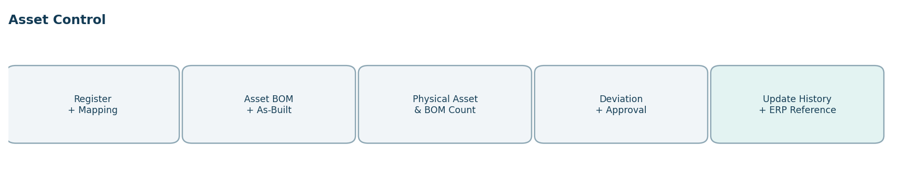
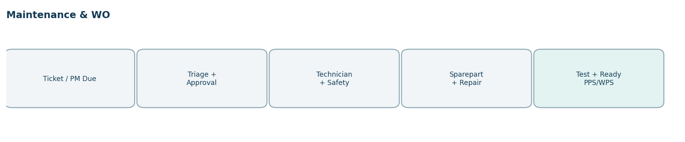
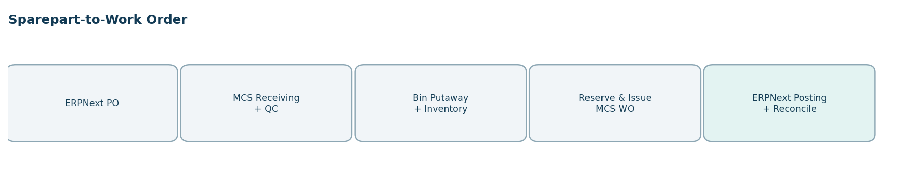
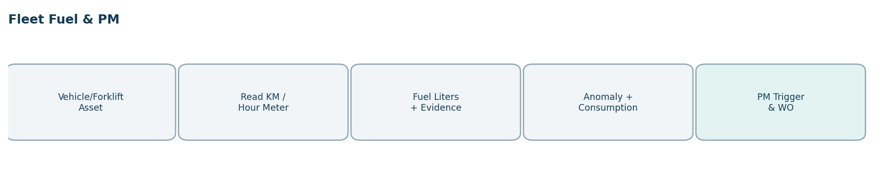
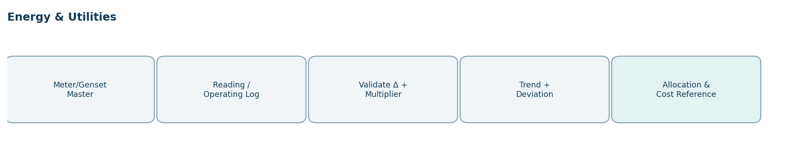

# PRODUCT REQUIREMENTS DOCUMENT

# MCS — MAINTENANCE CONTROL SYSTEM

**PRD v7.0 · Integrated Asset, Maintenance, Sparepart, Fleet & Energy**

> Konversi Markdown dari dokumen PRD MCS v7.0 asli. Urutan materi, identitas, teks, tabel, field, workflow, KPI, NCR, manual, ISO, dan UAT dipertahankan. Diagram asli disertakan sebagai aset gambar.

---

UTAMA CORP • GSU • RU

PRODUCT REQUIREMENTS
DOCUMENT

MCS — MAINTENANCE CONTROL SYSTEM

PRD v7.0 · Integrated Asset, Maintenance, Sparepart, Fleet & Energy

| KETERANGAN | DETAIL |
| --- | --- |
| Document ID | UC-MCS-PRD-007 |
| Versi dan tanggal | 7.0 · 12 Oktober 2026 |
| Entitas | UC (Induk), GSU (Plastik), RU (Kayu) |
| Dokumen utama | BRD MCS v6.0 dan UC Integrated Digital Manufacturing Master Blueprint v8.0 |
| Jenis dokumen | Spesifikasi target-state untuk UI/UX, Frontend, Backend, Database, Integration dan UAT |
| Cakupan | 59 submodul; fitur, dashboard/sub-dashboard, ratio, KPI, report, NCR, manual dan ISO per modul |

Dokumen ini membedakan kebutuhan yang didukung BRD v6.0 dari rincian desain PRD dan pengembangan baru. Angka target KPI dan inventaris fisik yang tidak tersedia di sumber tidak direkayasa.

# Kontrol Dokumen dan Daftar Isi

Document owner: UC MCS Application Owner bersama Maintenance/MESO; business owner terkait: Asset Owner, Gudang Sparepart, Fleet, Utility/Elektrikal dan user GSU/RU. Approval bisnis mengikuti matriks kewenangan organisasi resmi melalui workflow dokumen.

| BAGIAN | KONTEN |
| --- | --- |
| 01 | Landasan PRD, tujuan, ruang lingkup dan sumber |
| 02 | Arsitektur aplikasi, SoR dan integrasi |
| 03 | Struktur organisasi, role, RACI dan approval |
| 04 | User Experience, navigasi, dashboard dan cross-software flow |
| 05 | Business rules, status dan validation engine |
| 06 | Katalog 59 modul + spesifikasi terperinci |
| 07 | Form prioritas, data model dan KPI dictionary |
| 08 | Report/NCR/Manual/ISO master catalog |
| 09 | Workflow, API/event, security/NFR, UAT, roadmap |

Seluruh katalog implementasi turut disediakan dalam Excel dengan ID yang sama untuk pembangunan perangkat lunak, penugasan tim, pelacakan UAT dan release planning.

# 1. Landasan PRD, Tujuan dan Ruang Lingkup

MCS adalah aplikasi web yang mengendalikan lifecycle aset teknis, master lokasi aset, asset BOM dan as-built, perawatan preventive/corrective, sparepart secara operasional, kendaraan dan penggunaan bahan bakar, genset serta pemantauan listrik dan utilitas. Sistem digunakan di seluruh entitas UC/GSU/RU dengan company-site scoping dan role-specific UX.

| Tujuan | Outcome dan bukti penerimaan |
| --- | --- |
| Kesiapan operasional | Status aset dan jadwal preventive tersedia dan terhubung ke PPS/WPS planning. |
| Kendali sparepart | Penerimaan, stok, reserve/issue, return, opname dan rekonsiliasi ERPNext tercatat. |
| Asset governance | Semua aset dalam scope memiliki lokasi, custodian, QR dan hasil pemeriksaan aktual. |
| Reliability & safety | MTTR, MTBF, PM compliance, downtime, LOTO dan WO closure dapat ditelusuri. |
| Fleet & fuel | Liters per kendaraan/forklift/genset terkait odometer/hour-meter serta alarm anomali. |
| Energy accountability | kWh dan utilitas terukur per meter/site, dibedakan actual vs estimasi. |
| One source of truth | Nominal, HPP, PO, GL dan valuasi stok tidak digandakan di MCS. |

## 1.1 Prinsip data dan sistem pemilik

| Domain | Pemilik operasi | Pemilik data/batas |
| --- | --- | --- |
| Technical asset, machine, location, BOM as-built | MCS | Master status/komponen operasional MCS; fixed asset financial di ERPNext. |
| Maintenance ticket, PM/CM WO, downtime | MCS | Tidak dibuat ulang sebagai WO maintenance PPS/WPS. |
| Sparepart: receiving, issue, return, count | MCS untuk UI & bukti fisik | ERPNext Item Master, Purchasing dan stock valuation / ledger akuntansi. |
| Vehicle/forklift/genset fuel and meter | MCS | Pembelian BBM, harga, invoice dan biaya di ERPNext. |
| Listrik, air, kompresor, boiler, utilities | MCS | Nominal dan cost center posting di ERPNext. |
| Operator/teknisi dan struktur | ERPNext HRIS | MCS menyimpan penugasan/role dan activity, bukan employee master kedua. |
| SOP, IK, CAPA sistemik | AIMS | MCS menyimpan NCR operasional dan link CAPA AIMS. |
| Production scheduling availability | PPS/WPS | MCS menerbitkan machine availability/downtime, PPS/WPS menjadwal ulang. |

Keputusan penting: MCS merupakan working interface sparepart untuk penerimaan fisik, bin, request/issue/return dan stock opname. ERPNext menangani Item Master, Purchase Order, stok bernilai, pembukuan, biaya, dan tidak boleh menerima posting ganda. Komponen yang sudah terpasang pada aset dicatat sebagai as-built, bukan stok gudang tersedia.

# 2. Struktur Modul, Navigasi dan Prioritas

| Kelompok modul | Jumlah | Fokus |
| --- | --- | --- |
| Asset Management | 10 | Register, lokasi, BOM, physical count |
| Maintenance & Work Order | 13 | PM/CM, specialist WO, LOTO |
| Sparepart Management | 12 | Receiving, stock, reservation, opname |
| Fleet & Vehicle | 8 | Fuel, meter, automotive PM |
| Energy & Utilities | 10 | Listrik, genset, BBM, air, utilitas |
| Governance & Enterprise | 6 | KPI, report, NCR, SOP/ISO, integrations |

Sidebar sesuai hak akses: My Work / Dashboard → Asset Management → Maintenance & Work Order → Sparepart Management → Fleet & Vehicle → Energy & Utilities → Governance & Enterprise. Submenu setiap modul menyediakan layar Daftar/Queue, Input/Detail, Dashboard dan Sub-Dashboard, Report & KPI, NCR, Manual/ISO. Tidak seluruh submenu ditampilkan kepada operator.

# 3. Organisasi, Role, RACI dan Approval

| Unit resmi | Jabatan / referensi | Role aplikasi |
| --- | --- | --- |
| UC – Gudang Sparepart | Ka. Div. Gudang Sparepart | Sparepart Approver / Warehouse Owner |
| GSU – Gudang Sparepart | Admin Sparepart GSU | Sparepart Receiver, Stock Counter, Bin Operator |
| RU – Gudang Sparepart | Admin Sparepart RU | Sparepart Receiver, Stock Counter, Bin Operator |
| UC – Maintenance | Admin Maintenance; Ass. Operasional Ka.Dept MESO & MTC | Dispatcher, maintenance planner, reviewer |
| UC – MTC Prod Inject | Mould Repair, Mould Setter, Setter Produksi, Trouble Shooter | WO Inject & Mould Executor |
| UC – MTC Sawmill; MTC Washing & Broker; MTC Prod FJLB | Ka. Regu/Operator sesuai struktur | Work-center maintenance crew |
| UC – MESO: Mekanikal/Elektrikal/Otomotif/Sipil | Ka. Dept MESO, Ka. Div dan Operator sesuai bidang | Maintenance owner/technician per bidang |
| GSU / RU – HRGA | Supir Forklift | Vehicle/Forklift operator; input meter dan fuel |
| UC – IS | IS Support, IS Programmer | Technical administrator; integration operator |
| UC – Internal Audit | Staff Internal Audit | Read-only auditor dan bukti |
| ERPNext HRIS | Employee, supervisor assignment | Identity dan delegation source |

Role fungsional seperti Asset Custodian, Fleet Supervisor, Fuel Officer, Energy Controller, Sparepart Counter dan KPI Owner diberikan melalui assignment resmi HRIS; tidak otomatis menjadi jabatan baru.

| Aktivitas | Pelaksana R | Penanggung jawab A | Konsultasi C / informasi I |
| --- | --- | --- | --- |
| Asset create/update mapping | Asset Administrator | MCS Asset Owner | Custodian/ERP fixed asset |
| Transfer lokasi aset | Custodian / Asset Administrator | Asset Owner | Penerima aset / ERP finance bila relevan |
| Physical asset/BOM count | Petugas hitung independen | Maintenance/Asset Owner | AIMS bila critical finding |
| Penerimaan sparepart | Admin Sparepart sesuai company | Gudang Sparepart Approver | ERPNext PO owner; QC verifier |
| Issue sparepart untuk WO | Sparepart Picker/Issuer | Maintenance WO Owner | Warehouse admin; ERP ledger |
| Stock opname sparepart | Counter non-approver | Ka. Div Gudang Sparepart | ERP inventory reconciliation |
| PM / CM Work Order | Teknisi per bidang | Supervisor/MESO yang ditugaskan | PPS/WPS machine owner |
| Fuel kendaraan/forklift | Fuel Officer / driver | Fleet Supervisor | Tank Custodian/ERP purchasing |
| Electricity / genset readings | Operator Utility | Energy Owner / MESO | ERP finance dan plant owner |
| NCR/CAPA | Module Owner | Assigned verifier | AIMS CAPA owner bila eskalasi |

## 3.1 Hak akses minimum per kelompok

| Kelompok | Akses edit | Approval dan pembatasan |
| --- | --- | --- |
| Asset | Asset Admin/Custodian sesuai penugasan | Transfer/disposal dibatasi Asset Owner; histori tidak boleh dihapus |
| Maintenance | Dispatcher, Supervisor, teknisi | LOTO oleh petugas berwenang; test & release tidak oleh diri sendiri pada aset kritikal |
| Sparepart | Receiver, Verifier, Stock Controller | Adjustment dan opname wajib maker-checker; ERPNext ledger posting tidak digandakan |
| Fleet | Driver, Fuel Officer, MESO Otomotif | Koreksi odometer/hours dan fuel anomaly harus disetujui supervisor |
| Energy | Utility Operator, Energy Controller | Multiplier/rollover meter harus disetujui; estimated ≠ measured |
| Governance | MCS Owner, QA/AIMS, IT Integration | Report mengikuti row-level security; data keuangan ERPNext read-only |

# 4. Workflow, Status dan Aturan Bisnis

Setiap transaksi mempunyai status, actor, owner, due, SLA, transition permission, evidence, correction trail, version dan next required action. Workflow-Driven Application, Role-Based UX, Task-Oriented UI, Process-Aware Information System, BPM Suite dan Adaptive Case Management adalah prinsip wajib.

| Status objek | State machine target |
| --- | --- |
| Asset transfer | DRAFT → REQUESTED → APPROVED → IN_TRANSIT → RECEIVED → CLOSED |
| Asset/BOM physical count | DRAFT → SNAPSHOT → COUNTING → RECOUNT → APPROVED → CLOSED |
| Maintenance WO | REQUESTED → TRIAGED → APPROVED → ASSIGNED → IN_PROGRESS → TESTING → CLOSED |
| Sparepart movement | DRAFT → CHECKED → APPROVED → POSTED → RECONCILED |
| Fuel | DRAFT → METER_VALIDATED → CONFIRMED → POSTED / ANOMALY |
| Energy reading | DRAFT → METER_CHECK → VALIDATED → LOCKED / CORRECTION |
| NCR | OPEN → CONTAINMENT → RCA → ACTION → VERIFY → CLOSED |

## 4.1 Business Rules induk (berasal dari BRD v6.0)

BR-001 • Registrasi • Aset harus memiliki kode unik, kategori, company, site, asset custodian dan status.

BR-002 • Registrasi • ID aset teknis MCS tidak sama dengan nomor asset finansial ERP, tetapi saling terhubung.

BR-003 • Mapping • Lokasi aset dibentuk Company → Site → Building → Area → Line → Work Center → Asset → Component.

BR-004 • Mapping • Lokasi active harus tunggal dan histori transfer immutable.

BR-005 • Asset BOM • BOM design dan as-built memiliki versi efektif dan posisi komponen.

BR-006 • Asset BOM • Komponen installed dikeluarkan dari gudang sparepart; tidak boleh double count.

BR-007 • Asset Count • Asset count wajib memvalidasi fisik, kondisi, lokasi, QR/serial, evidence dan PIC.

BR-008 • Asset Count • Asset missing/duplicate/unregistered membuat exception dan approval sebelum koreksi.

BR-009 • Asset BOM Count • Count per komponen dan posisi; mismatch menimbulkan NCR/WO atau revisi as-built yang sah.

BR-010 • Preventive • Jadwal trigger berbasis kalender/odometer/hour-meter/condition dipilih prioritas batas pertama.

BR-011 • Preventive • Seluruh interval berasal dari OEM/risk-based engineering dan disetujui MCS owner.

BR-012 • Work Order • Maintenance WO memiliki sumber ticket/PM, asset, priority, PIC, sparepart dan bukti close.

BR-013 • Work Order • WO berbahaya membutuhkan permit/LOTO sebelum pekerjaan dimulai.

BR-014 • Work Order • Closed WO tidak dapat dihapus; koreksi melalui reversal/append audit.

BR-015 • Machine Status • Breakdown critical mengunci availability mesin bagi PPS/WPS jika interlock aktif.

BR-016 • Machine Status • Machine ready kembali hanya setelah test/verifikasi sesuai criticality.

BR-017 • Sparepart • Kode item/UOM/supplier berasal dari ERPNext Item Master.

BR-018 • Sparepart • Penerimaan fisik MCS harus memiliki ERPNext PO/reference atau authorized non-PO receipt.

BR-019 • Sparepart • QC Hold sparepart tidak masuk available stock.

BR-020 • Sparepart • Reservation tidak mengubah stok fisik; Posted Issue/Receipt mengubah kuantitas operasional sekali.

BR-021 • Sparepart • Issue untuk WO wajib approved Work Order atau emergency release yang tercatat.

BR-022 • Sparepart • Return perlu condition check sebelum restock.

BR-023 • Sparepart • Stock opname: scope lock, blind count, recount, approve variance dan reconcile ERP.

BR-024 • Sparepart • MCS tidak mengubah nilai biaya/GL/HPP; saldo kuantitas dikonfirmasi ke ERPNext.

BR-025 • BBM • Sumber BBM: tangki pabrik atau SPBU; setiap liter issue memiliki referensi transaksi.

BR-026 • BBM • Field odometer sebelum dan sesudah pengisian dicatat; jarak periode memakai histori pengisian sebelumnya.

BR-027 • BBM • Odometer sesudah ≥ sebelum; jam kerja forklift/genset tidak boleh mundur kecuali correction meter replacement.

BR-028 • BBM • Pengisian parsial tidak boleh langsung diperlakukan rasio konsumsi full-to-full.

BR-029 • BBM • Liters >0, timestamp, PIC, lokasi, kendaraan/tangki dan evidence wajib.

BR-030 • Fuel Tank • Fuel received − dispensed ± authorized adjustment = closing measured dengan variance.

BR-031 • Genset • Liters filled tidak otomatis = liters consumed; gunakan tank balance/pengukuran.

BR-032 • Listrik • kWh=(stand akhir−stand awal)×faktor; meter rollover ditangani sebagai correction event.

BR-033 • Listrik • Data per mesin berstatus measured hanya bila tersedia sub-meter; lainnya estimated allocation.

BR-034 • Utilities • Kapasitas dan faktor konversi meter direvisi dengan approval dan effective date.

BR-035 • KPI • Zero denominator menghasilkan N/M dan tidak dianggap performa buruk otomatis.

BR-036 • KPI • Setiap KPI memiliki owner, formula, satuan, target, minimum, bobot, arah, periode dan versi.

BR-037 • NCR • Setiap modul dapat membuat NCR dengan source record, severity, evidence, due dan verifikasi.

BR-038 • NCR • AIMS menerima CAPA sistemik; NCR sumber tetap di MCS.

BR-039 • Security • Approver tidak boleh sama dengan maker untuk transaksi penyesuaian kritis.

BR-040 • Integration • Semua event kritis idempotent; retry tidak menggandakan persediaan/WO.

BR-041 • Tenant • Company/site scope berlaku terhadap register, gambar denah, laporan, dan dashboard.

BR-042 • Manual • SOP/IK ditampilkan sesuai versi berlaku dari AIMS.

BR-043 • Access • Role admin aplikasi tidak otomatis berhak melepas QC Hold atau approve WO.

BR-044 • Lifecycle • Penghapusan fisik aset/fixed asset harus diselaraskan dengan ERPNext dan approval resmi.

BR-045 • Exception • SLA dan escalation harus ditetapkan per klasifikasi risiko, dicatat histori dan owner.

# 5. Spesifikasi Lengkap Per Modul

Setiap bagian modul berikut memuat identitas dan owner; daftar subfitur yang akan dibangun; layar dan aksi; field dan validasi; status/workflow; Dashboard dan Sub-Dashboard; Ratio dan KPI; Report; Report NCR; Manual dan ISO Reference; kriteria UAT. Seluruh layar bersifat web-responsive.

# 5.1 Kelompok: Asset Management

## 01. AS01 — Asset Register

Process owner: UC Maintenance/MESO | Status target: DRAFT → REVIEW → VERIFIED / ACTIVE → TRANSFERRED / RETIRED

Ruang lingkup dan kendali: Kode aset unik; status retired tidak tersedia untuk produksi

| ID | Fitur/Subfitur yang diimplementasikan | Tindakan/hasil |
| --- | --- | --- |
| AS01-F01 | Daftarkan aset teknis | Workflow + validasi + audit trail |
| AS01-F02 | Scan nameplate/serial | Workflow + validasi + audit trail |
| AS01-F03 | Tetapkan custodian | Workflow + validasi + audit trail |
| AS01-F04 | Hubungkan nomor fixed asset ERP | Workflow + validasi + audit trail |
| AS01-F05 | Validasi klasifikasi aset | Workflow + validasi + audit trail |
| AS01-F06 | Kelola histori commissioning | Workflow + validasi + audit trail |

| Layar | Fungsi dan UX |
| --- | --- |
| SCR-AS01-01 | List & Queue: Daftar berdasarkan status, PIC, due dan severity; cari, filter, bulk export sesuai izin |
| SCR-AS01-02 | Detail & Timeline: Detail entitas dan bukti, histori status, next action, actor approval |
| SCR-AS01-03 | Create / Input / Verify: Form transaksi, inline validation, save draft, submit dan hasil approval |
| SCR-AS01-04 | Module Dashboard: Target versus aktual, exception, ratio/KPI, tren, perbandingan site |
| SCR-AS01-05 | NCR, Manual & ISO: Temuan, RCA, tindakan, SOP/IK versi efektif, ISO evidence |

| Field inti | Jenis | Validasi dan kontrol |
| --- | --- | --- |
| record_id | reference/text | Wajib memakai referensi unik dan valid; scope company/site sama. |
| asset_id | reference/text | Wajib memakai referensi unik dan valid; scope company/site sama. |
| company | reference/text | Wajib pada tahap submit apabila relevan; lookup master/enum dan audit perubahan. |
| site | reference/text | Wajib pada tahap submit apabila relevan; lookup master/enum dan audit perubahan. |
| asset_type | text/enum | Wajib memakai referensi unik dan valid; scope company/site sama. |
| serial | reference/text | Unik dalam konteks jenis komponen/aset; cocok dengan label fisik. |
| make_model | text/enum | Wajib pada tahap submit apabila relevan; lookup master/enum dan audit perubahan. |
| commission_date | datetime | Tanggal valid; mengikuti timezone site dan business calendar. |
| custodian | text/enum | Wajib pada tahap submit apabila relevan; lookup master/enum dan audit perubahan. |
| company_id | reference/text | Wajib memakai referensi unik dan valid; scope company/site sama. |
| site_id | reference/text | Wajib memakai referensi unik dan valid; scope company/site sama. |

| Dashboard / Sub | Informasi yang tampil dan visual |
| --- | --- |
| Overview | Asset Register: Volume, status transaksi, capaian KPI, deviasi dan tindakan utama; visual: bar KPI + status counts |
| Process Queue | Asset Register: Pending, due today, overdue, approval queue, filtered by PIC; visual: table + timeline |
| Exception & NCR | Asset Register: Hold, risk, variance, repeat issue, aging & severity; visual: risk distribution + NCR aging |
| Performance & Trend | Asset Register: Ratio per site/asset/period, baseline and target, comparisons; visual: line trend + Pareto |

| Ratio / KPI | Definisi dan formula | Owner/Target |
| --- | --- | --- |
| Ratio proses utama | Aset terverifikasi / aset tercatat ×100%. Sumber: transaksi AS01 terverifikasi; perbandingan berdasar scope, unit, periode yang konsisten. | UC Maintenance/MESO; target/minimum/bobot disetujui dalam KPI Engine |
| Ketepatan penyelesaian | Jumlah transaksi selesai tepat batas waktu / jumlah transaksi jatuh tempo ×100% | UC Maintenance/MESO; target/minimum/bobot disetujui dalam KPI Engine |
| Kepatuhan bukti | Transaksi lengkap evidence dan approval / jumlah transaksi yang dipersyaratkan ×100% | UC Maintenance/MESO; target/minimum/bobot disetujui dalam KPI Engine |

| Kategori | ID | Keluaran/rujukan |
| --- | --- | --- |
| Operasional | RPT-AS01-01 | Register aset dan umur aset |
| Analitis | RPT-AS01-02 | Tren & perbandingan Asset Register per company/site/period; exception dan penyebab |
| Audit & Rekonsiliasi | RPT-AS01-03 | Riwayat approval, perubahan, bukti dan sinkronisasi Asset Register |
| NCR — Ketidaksesuaian utama | NCR-AS01-01 | Aset tidak terdaftar / duplikat |
| NCR — Kepatuhan proses | NCR-AS01-02 | Approval, bukti, data atau SLA tidak sesuai standar untuk Asset Register |

| Komponen wajib | Dokumen/persyaratan |
| --- | --- |
| Manual User & Form | MAN-AS01-01 — Pembuatan, pencarian, input dan validasi Asset Register |
| Manual Workflow & Exception | MAN-AS01-02 — Approval, escalation, koreksi dan penanganan NCR Asset Register |
| Manual SOP/IK & Troubleshooting | MAN-AS01-03 — SOP/IK terkendali AIMS, foto QR, panduan error dan integrasi Asset Register |
| ISO Reference | Pemetaan requirement→control→evidence; ISO 55001 |

| UAT | Verifikasi penerimaan |
| --- | --- |
| UAT-AS01-01 | Daftarkan aset teknis — Input/aksi Daftarkan aset teknis menghasilkan transisi sah menurut status dan owner; false/unauthorized ditolak |
| UAT-AS01-02 | Scan nameplate/serial — Input/aksi Scan nameplate/serial menghasilkan transisi sah menurut status dan owner; false/unauthorized ditolak |
| UAT-AS01-03 | Tetapkan custodian — Input/aksi Tetapkan custodian menghasilkan transisi sah menurut status dan owner; false/unauthorized ditolak |
| UAT-AS01-04 | KPI/ratio terhitung dari transaksi sumber dan zero-denominator ditangani — Bukti dapat ditelusuri ke sumber, hasil konsisten, tidak ada duplikasi posting |
| UAT-AS01-05 | Laporan, NCR, manual dan ISO dapat dibuka sesuai izin — Bukti dapat ditelusuri ke sumber, hasil konsisten, tidak ada duplikasi posting |

## 02. AS02 — Asset Category & Criticality

Process owner: UC Maintenance/MESO | Status target: DRAFT → REVIEW → VERIFIED / ACTIVE → TRANSFERRED / RETIRED

Ruang lingkup dan kendali: Kelas kritikal disetujui owner aset; versi histori

| ID | Fitur/Subfitur yang diimplementasikan | Tindakan/hasil |
| --- | --- | --- |
| AS02-F01 | Tetapkan kategori aset | Workflow + validasi + audit trail |
| AS02-F02 | Skor dampak safety | Workflow + validasi + audit trail |
| AS02-F03 | Skor dampak produksi | Workflow + validasi + audit trail |
| AS02-F04 | Review tingkat criticality | Workflow + validasi + audit trail |
| AS02-F05 | Setujui criticality | Workflow + validasi + audit trail |
| AS02-F06 | Riwayat risk classification | Workflow + validasi + audit trail |

| Layar | Fungsi dan UX |
| --- | --- |
| SCR-AS02-01 | List & Queue: Daftar berdasarkan status, PIC, due dan severity; cari, filter, bulk export sesuai izin |
| SCR-AS02-02 | Detail & Timeline: Detail entitas dan bukti, histori status, next action, actor approval |
| SCR-AS02-03 | Create / Input / Verify: Form transaksi, inline validation, save draft, submit dan hasil approval |
| SCR-AS02-04 | Module Dashboard: Target versus aktual, exception, ratio/KPI, tren, perbandingan site |
| SCR-AS02-05 | NCR, Manual & ISO: Temuan, RCA, tindakan, SOP/IK versi efektif, ISO evidence |

| Field inti | Jenis | Validasi dan kontrol |
| --- | --- | --- |
| record_id | reference/text | Wajib memakai referensi unik dan valid; scope company/site sama. |
| category | reference/text | Wajib pada tahap submit apabila relevan; lookup master/enum dan audit perubahan. |
| asset_class | text/enum | Wajib memakai referensi unik dan valid; scope company/site sama. |
| risk_score | decimal | Wajib pada tahap submit apabila relevan; lookup master/enum dan audit perubahan. |
| safety_impact | text/enum | Wajib pada tahap submit apabila relevan; lookup master/enum dan audit perubahan. |
| production_impact | text/enum | Wajib pada tahap submit apabila relevan; lookup master/enum dan audit perubahan. |
| company_id | reference/text | Wajib memakai referensi unik dan valid; scope company/site sama. |
| site_id | reference/text | Wajib memakai referensi unik dan valid; scope company/site sama. |

| Dashboard / Sub | Informasi yang tampil dan visual |
| --- | --- |
| Overview | Asset Category & Criticality: Volume, status transaksi, capaian KPI, deviasi dan tindakan utama; visual: bar KPI + status counts |
| Process Queue | Asset Category & Criticality: Pending, due today, overdue, approval queue, filtered by PIC; visual: table + timeline |
| Exception & NCR | Asset Category & Criticality: Hold, risk, variance, repeat issue, aging & severity; visual: risk distribution + NCR aging |
| Performance & Trend | Asset Category & Criticality: Ratio per site/asset/period, baseline and target, comparisons; visual: line trend + Pareto |

| Ratio / KPI | Definisi dan formula | Owner/Target |
| --- | --- | --- |
| Ratio proses utama | Aset kritikal berklasifikasi / total aset kritikal ×100%. Sumber: transaksi AS02 terverifikasi; perbandingan berdasar scope, unit, periode yang konsisten. | UC Maintenance/MESO; target/minimum/bobot disetujui dalam KPI Engine |
| Ketepatan penyelesaian | Jumlah transaksi selesai tepat batas waktu / jumlah transaksi jatuh tempo ×100% | UC Maintenance/MESO; target/minimum/bobot disetujui dalam KPI Engine |
| Kepatuhan bukti | Transaksi lengkap evidence dan approval / jumlah transaksi yang dipersyaratkan ×100% | UC Maintenance/MESO; target/minimum/bobot disetujui dalam KPI Engine |

| Kategori | ID | Keluaran/rujukan |
| --- | --- | --- |
| Operasional | RPT-AS02-01 | Criticality matrix dan risk exposure |
| Analitis | RPT-AS02-02 | Tren & perbandingan Asset Category & Criticality per company/site/period; exception dan penyebab |
| Audit & Rekonsiliasi | RPT-AS02-03 | Riwayat approval, perubahan, bukti dan sinkronisasi Asset Category & Criticality |
| NCR — Ketidaksesuaian utama | NCR-AS02-01 | Kelas aset atau tingkat risiko keliru |
| NCR — Kepatuhan proses | NCR-AS02-02 | Approval, bukti, data atau SLA tidak sesuai standar untuk Asset Category & Criticality |

| Komponen wajib | Dokumen/persyaratan |
| --- | --- |
| Manual User & Form | MAN-AS02-01 — Pembuatan, pencarian, input dan validasi Asset Category & Criticality |
| Manual Workflow & Exception | MAN-AS02-02 — Approval, escalation, koreksi dan penanganan NCR Asset Category & Criticality |
| Manual SOP/IK & Troubleshooting | MAN-AS02-03 — SOP/IK terkendali AIMS, foto QR, panduan error dan integrasi Asset Category & Criticality |
| ISO Reference | Pemetaan requirement→control→evidence; ISO 55001 |

| UAT | Verifikasi penerimaan |
| --- | --- |
| UAT-AS02-01 | Tetapkan kategori aset — Input/aksi Tetapkan kategori aset menghasilkan transisi sah menurut status dan owner; false/unauthorized ditolak |
| UAT-AS02-02 | Skor dampak safety — Input/aksi Skor dampak safety menghasilkan transisi sah menurut status dan owner; false/unauthorized ditolak |
| UAT-AS02-03 | Skor dampak produksi — Input/aksi Skor dampak produksi menghasilkan transisi sah menurut status dan owner; false/unauthorized ditolak |
| UAT-AS02-04 | KPI/ratio terhitung dari transaksi sumber dan zero-denominator ditangani — Bukti dapat ditelusuri ke sumber, hasil konsisten, tidak ada duplikasi posting |
| UAT-AS02-05 | Laporan, NCR, manual dan ISO dapat dibuka sesuai izin — Bukti dapat ditelusuri ke sumber, hasil konsisten, tidak ada duplikasi posting |

## 03. AS03 — Asset Location Mapping

Process owner: UC Maintenance/MESO | Status target: DRAFT → REVIEW → VERIFIED / ACTIVE → TRANSFERRED / RETIRED

Ruang lingkup dan kendali: Satu lokasi aktif per aset; peta revisi berversi

| ID | Fitur/Subfitur yang diimplementasikan | Tindakan/hasil |
| --- | --- | --- |
| AS03-F01 | Tampilkan denah plant | Workflow + validasi + audit trail |
| AS03-F02 | Pilih node lokasi | Workflow + validasi + audit trail |
| AS03-F03 | Tarik pin aset pada denah | Workflow + validasi + audit trail |
| AS03-F04 | Scan QR verifikasi posisi | Workflow + validasi + audit trail |
| AS03-F05 | Validasi koordinat X/Y | Workflow + validasi + audit trail |
| AS03-F06 | Telusuri histori mapping | Workflow + validasi + audit trail |

| Layar | Fungsi dan UX |
| --- | --- |
| SCR-AS03-01 | List & Queue: Daftar berdasarkan status, PIC, due dan severity; cari, filter, bulk export sesuai izin |
| SCR-AS03-02 | Detail & Timeline: Detail entitas dan bukti, histori status, next action, actor approval |
| SCR-AS03-03 | Create / Input / Verify: Form transaksi, inline validation, save draft, submit dan hasil approval |
| SCR-AS03-04 | Module Dashboard: Target versus aktual, exception, ratio/KPI, tren, perbandingan site |
| SCR-AS03-05 | NCR, Manual & ISO: Temuan, RCA, tindakan, SOP/IK versi efektif, ISO evidence |

| Field inti | Jenis | Validasi dan kontrol |
| --- | --- | --- |
| record_id | reference/text | Wajib memakai referensi unik dan valid; scope company/site sama. |
| location_id | reference/text | Wajib memakai referensi unik dan valid; scope company/site sama. |
| building | text/enum | Wajib pada tahap submit apabila relevan; lookup master/enum dan audit perubahan. |
| area | text/enum | Harus mengacu master lokasi aktif; history perubahan tetap disimpan. |
| line | text/enum | Harus mengacu master lokasi aktif; history perubahan tetap disimpan. |
| work_center | text/enum | Wajib memakai referensi unik dan valid; scope company/site sama. |
| map_x | decimal | Wajib pada tahap submit apabila relevan; lookup master/enum dan audit perubahan. |
| map_y | decimal | Wajib pada tahap submit apabila relevan; lookup master/enum dan audit perubahan. |
| asset_id | reference/text | Wajib memakai referensi unik dan valid; scope company/site sama. |
| company_id | reference/text | Wajib memakai referensi unik dan valid; scope company/site sama. |
| site_id | reference/text | Wajib memakai referensi unik dan valid; scope company/site sama. |

| Dashboard / Sub | Informasi yang tampil dan visual |
| --- | --- |
| Overview | Asset Location Mapping: Volume, status transaksi, capaian KPI, deviasi dan tindakan utama; visual: bar KPI + status counts |
| Process Queue | Asset Location Mapping: Pending, due today, overdue, approval queue, filtered by PIC; visual: table + timeline |
| Exception & NCR | Asset Location Mapping: Hold, risk, variance, repeat issue, aging & severity; visual: risk distribution + NCR aging |
| Performance & Trend | Asset Location Mapping: Ratio per site/asset/period, baseline and target, comparisons; visual: line trend + Pareto |

| Ratio / KPI | Definisi dan formula | Owner/Target |
| --- | --- | --- |
| Ratio proses utama | Aset dengan lokasi terverifikasi / aset aktif ×100%. Sumber: transaksi AS03 terverifikasi; perbandingan berdasar scope, unit, periode yang konsisten. | UC Maintenance/MESO; target/minimum/bobot disetujui dalam KPI Engine |
| Ketepatan penyelesaian | Jumlah transaksi selesai tepat batas waktu / jumlah transaksi jatuh tempo ×100% | UC Maintenance/MESO; target/minimum/bobot disetujui dalam KPI Engine |
| Kepatuhan bukti | Transaksi lengkap evidence dan approval / jumlah transaksi yang dipersyaratkan ×100% | UC Maintenance/MESO; target/minimum/bobot disetujui dalam KPI Engine |

| Kategori | ID | Keluaran/rujukan |
| --- | --- | --- |
| Operasional | RPT-AS03-01 | Asset location map; location exceptions |
| Analitis | RPT-AS03-02 | Tren & perbandingan Asset Location Mapping per company/site/period; exception dan penyebab |
| Audit & Rekonsiliasi | RPT-AS03-03 | Riwayat approval, perubahan, bukti dan sinkronisasi Asset Location Mapping |
| NCR — Ketidaksesuaian utama | NCR-AS03-01 | Aset tidak ditemukan / salah lokasi |
| NCR — Kepatuhan proses | NCR-AS03-02 | Approval, bukti, data atau SLA tidak sesuai standar untuk Asset Location Mapping |

| Komponen wajib | Dokumen/persyaratan |
| --- | --- |
| Manual User & Form | MAN-AS03-01 — Pembuatan, pencarian, input dan validasi Asset Location Mapping |
| Manual Workflow & Exception | MAN-AS03-02 — Approval, escalation, koreksi dan penanganan NCR Asset Location Mapping |
| Manual SOP/IK & Troubleshooting | MAN-AS03-03 — SOP/IK terkendali AIMS, foto QR, panduan error dan integrasi Asset Location Mapping |
| ISO Reference | Pemetaan requirement→control→evidence; ISO 55001 |

| UAT | Verifikasi penerimaan |
| --- | --- |
| UAT-AS03-01 | Tampilkan denah plant — Input/aksi Tampilkan denah plant menghasilkan transisi sah menurut status dan owner; false/unauthorized ditolak |
| UAT-AS03-02 | Pilih node lokasi — Input/aksi Pilih node lokasi menghasilkan transisi sah menurut status dan owner; false/unauthorized ditolak |
| UAT-AS03-03 | Tarik pin aset pada denah — Input/aksi Tarik pin aset pada denah menghasilkan transisi sah menurut status dan owner; false/unauthorized ditolak |
| UAT-AS03-04 | KPI/ratio terhitung dari transaksi sumber dan zero-denominator ditangani — Bukti dapat ditelusuri ke sumber, hasil konsisten, tidak ada duplikasi posting |
| UAT-AS03-05 | Laporan, NCR, manual dan ISO dapat dibuka sesuai izin — Bukti dapat ditelusuri ke sumber, hasil konsisten, tidak ada duplikasi posting |

## 04. AS04 — Asset Transfer & Relocation

Process owner: Asset Custodian | Status target: DRAFT → REVIEW → VERIFIED / ACTIVE → TRANSFERRED / RETIRED

Ruang lingkup dan kendali: Aset tidak dapat berpindah status final tanpa konfirmasi penerimaan

| ID | Fitur/Subfitur yang diimplementasikan | Tindakan/hasil |
| --- | --- | --- |
| AS04-F01 | Ajukan transfer aset | Workflow + validasi + audit trail |
| AS04-F02 | Pilih lokasi asal/tujuan | Workflow + validasi + audit trail |
| AS04-F03 | Kirim approval | Workflow + validasi + audit trail |
| AS04-F04 | Konfirmasi custodian penerima | Workflow + validasi + audit trail |
| AS04-F05 | Cetak berita acara transfer | Workflow + validasi + audit trail |
| AS04-F06 | Pantau transfer pending | Workflow + validasi + audit trail |

| Layar | Fungsi dan UX |
| --- | --- |
| SCR-AS04-01 | List & Queue: Daftar berdasarkan status, PIC, due dan severity; cari, filter, bulk export sesuai izin |
| SCR-AS04-02 | Detail & Timeline: Detail entitas dan bukti, histori status, next action, actor approval |
| SCR-AS04-03 | Create / Input / Verify: Form transaksi, inline validation, save draft, submit dan hasil approval |
| SCR-AS04-04 | Module Dashboard: Target versus aktual, exception, ratio/KPI, tren, perbandingan site |
| SCR-AS04-05 | NCR, Manual & ISO: Temuan, RCA, tindakan, SOP/IK versi efektif, ISO evidence |

| Field inti | Jenis | Validasi dan kontrol |
| --- | --- | --- |
| record_id | reference/text | Wajib memakai referensi unik dan valid; scope company/site sama. |
| transfer_id | reference/text | Wajib memakai referensi unik dan valid; scope company/site sama. |
| asset_id | reference/text | Wajib memakai referensi unik dan valid; scope company/site sama. |
| from_location | text/enum | Harus mengacu master lokasi aktif; history perubahan tetap disimpan. |
| to_location | text/enum | Harus mengacu master lokasi aktif; history perubahan tetap disimpan. |
| reason | text/enum | Wajib pada tahap submit apabila relevan; lookup master/enum dan audit perubahan. |
| approver | text/enum | Wajib pada tahap submit apabila relevan; lookup master/enum dan audit perubahan. |
| received_by | text/enum | Wajib pada tahap submit apabila relevan; lookup master/enum dan audit perubahan. |
| company_id | reference/text | Wajib memakai referensi unik dan valid; scope company/site sama. |
| site_id | reference/text | Wajib memakai referensi unik dan valid; scope company/site sama. |

| Dashboard / Sub | Informasi yang tampil dan visual |
| --- | --- |
| Overview | Asset Transfer & Relocation: Volume, status transaksi, capaian KPI, deviasi dan tindakan utama; visual: bar KPI + status counts |
| Process Queue | Asset Transfer & Relocation: Pending, due today, overdue, approval queue, filtered by PIC; visual: table + timeline |
| Exception & NCR | Asset Transfer & Relocation: Hold, risk, variance, repeat issue, aging & severity; visual: risk distribution + NCR aging |
| Performance & Trend | Asset Transfer & Relocation: Ratio per site/asset/period, baseline and target, comparisons; visual: line trend + Pareto |

| Ratio / KPI | Definisi dan formula | Owner/Target |
| --- | --- | --- |
| Ratio proses utama | Transfer tepat bukti / transfer selesai ×100%. Sumber: transaksi AS04 terverifikasi; perbandingan berdasar scope, unit, periode yang konsisten. | Asset Custodian; target/minimum/bobot disetujui dalam KPI Engine |
| Ketepatan penyelesaian | Jumlah transaksi selesai tepat batas waktu / jumlah transaksi jatuh tempo ×100% | Asset Custodian; target/minimum/bobot disetujui dalam KPI Engine |
| Kepatuhan bukti | Transaksi lengkap evidence dan approval / jumlah transaksi yang dipersyaratkan ×100% | Asset Custodian; target/minimum/bobot disetujui dalam KPI Engine |

| Kategori | ID | Keluaran/rujukan |
| --- | --- | --- |
| Operasional | RPT-AS04-01 | Asset transfer history |
| Analitis | RPT-AS04-02 | Tren & perbandingan Asset Transfer & Relocation per company/site/period; exception dan penyebab |
| Audit & Rekonsiliasi | RPT-AS04-03 | Riwayat approval, perubahan, bukti dan sinkronisasi Asset Transfer & Relocation |
| NCR — Ketidaksesuaian utama | NCR-AS04-01 | Transfer tanpa izin / tanpa bukti |
| NCR — Kepatuhan proses | NCR-AS04-02 | Approval, bukti, data atau SLA tidak sesuai standar untuk Asset Transfer & Relocation |

| Komponen wajib | Dokumen/persyaratan |
| --- | --- |
| Manual User & Form | MAN-AS04-01 — Pembuatan, pencarian, input dan validasi Asset Transfer & Relocation |
| Manual Workflow & Exception | MAN-AS04-02 — Approval, escalation, koreksi dan penanganan NCR Asset Transfer & Relocation |
| Manual SOP/IK & Troubleshooting | MAN-AS04-03 — SOP/IK terkendali AIMS, foto QR, panduan error dan integrasi Asset Transfer & Relocation |
| ISO Reference | Pemetaan requirement→control→evidence; ISO 55001 |

| UAT | Verifikasi penerimaan |
| --- | --- |
| UAT-AS04-01 | Ajukan transfer aset — Input/aksi Ajukan transfer aset menghasilkan transisi sah menurut status dan owner; false/unauthorized ditolak |
| UAT-AS04-02 | Pilih lokasi asal/tujuan — Input/aksi Pilih lokasi asal/tujuan menghasilkan transisi sah menurut status dan owner; false/unauthorized ditolak |
| UAT-AS04-03 | Kirim approval — Input/aksi Kirim approval menghasilkan transisi sah menurut status dan owner; false/unauthorized ditolak |
| UAT-AS04-04 | KPI/ratio terhitung dari transaksi sumber dan zero-denominator ditangani — Bukti dapat ditelusuri ke sumber, hasil konsisten, tidak ada duplikasi posting |
| UAT-AS04-05 | Laporan, NCR, manual dan ISO dapat dibuka sesuai izin — Bukti dapat ditelusuri ke sumber, hasil konsisten, tidak ada duplikasi posting |

## 05. AS05 — Asset BOM & As-Built

Process owner: Maintenance Engineering | Status target: DRAFT → REVIEW → VERIFIED / ACTIVE → TRANSFERRED / RETIRED

Ruang lingkup dan kendali: Installed part tidak boleh menjadi available sparepart stock bersamaan

| ID | Fitur/Subfitur yang diimplementasikan | Tindakan/hasil |
| --- | --- | --- |
| AS05-F01 | Daftarkan BOM standar | Workflow + validasi + audit trail |
| AS05-F02 | Versioning BOM | Workflow + validasi + audit trail |
| AS05-F03 | Catat posisi komponen | Workflow + validasi + audit trail |
| AS05-F04 | Validasi serial terpasang | Workflow + validasi + audit trail |
| AS05-F05 | Reconcile BOM vs as-built | Workflow + validasi + audit trail |
| AS05-F06 | Riwayat part replacement | Workflow + validasi + audit trail |

| Layar | Fungsi dan UX |
| --- | --- |
| SCR-AS05-01 | List & Queue: Daftar berdasarkan status, PIC, due dan severity; cari, filter, bulk export sesuai izin |
| SCR-AS05-02 | Detail & Timeline: Detail entitas dan bukti, histori status, next action, actor approval |
| SCR-AS05-03 | Create / Input / Verify: Form transaksi, inline validation, save draft, submit dan hasil approval |
| SCR-AS05-04 | Module Dashboard: Target versus aktual, exception, ratio/KPI, tren, perbandingan site |
| SCR-AS05-05 | NCR, Manual & ISO: Temuan, RCA, tindakan, SOP/IK versi efektif, ISO evidence |

| Field inti | Jenis | Validasi dan kontrol |
| --- | --- | --- |
| record_id | reference/text | Wajib memakai referensi unik dan valid; scope company/site sama. |
| bom_id | reference/text | Wajib memakai referensi unik dan valid; scope company/site sama. |
| asset_id | reference/text | Wajib memakai referensi unik dan valid; scope company/site sama. |
| bom_version | reference/text | Wajib memakai referensi unik dan valid; scope company/site sama. |
| component_id | reference/text | Wajib memakai referensi unik dan valid; scope company/site sama. |
| position | text/enum | Wajib pada tahap submit apabila relevan; lookup master/enum dan audit perubahan. |
| installed_qty | decimal | Nonnegatif; satuan dan histori diperiksa; koreksi melalui approval. |
| serial | reference/text | Unik dalam konteks jenis komponen/aset; cocok dengan label fisik. |
| company_id | reference/text | Wajib memakai referensi unik dan valid; scope company/site sama. |
| site_id | reference/text | Wajib memakai referensi unik dan valid; scope company/site sama. |

| Dashboard / Sub | Informasi yang tampil dan visual |
| --- | --- |
| Overview | Asset BOM & As-Built: Volume, status transaksi, capaian KPI, deviasi dan tindakan utama; visual: bar KPI + status counts |
| Process Queue | Asset BOM & As-Built: Pending, due today, overdue, approval queue, filtered by PIC; visual: table + timeline |
| Exception & NCR | Asset BOM & As-Built: Hold, risk, variance, repeat issue, aging & severity; visual: risk distribution + NCR aging |
| Performance & Trend | Asset BOM & As-Built: Ratio per site/asset/period, baseline and target, comparisons; visual: line trend + Pareto |

| Ratio / KPI | Definisi dan formula | Owner/Target |
| --- | --- | --- |
| Ratio proses utama | Komponen as-built tervalidasi / komponen wajib ×100%. Sumber: transaksi AS05 terverifikasi; perbandingan berdasar scope, unit, periode yang konsisten. | Maintenance Engineering; target/minimum/bobot disetujui dalam KPI Engine |
| Ketepatan penyelesaian | Jumlah transaksi selesai tepat batas waktu / jumlah transaksi jatuh tempo ×100% | Maintenance Engineering; target/minimum/bobot disetujui dalam KPI Engine |
| Kepatuhan bukti | Transaksi lengkap evidence dan approval / jumlah transaksi yang dipersyaratkan ×100% | Maintenance Engineering; target/minimum/bobot disetujui dalam KPI Engine |

| Kategori | ID | Keluaran/rujukan |
| --- | --- | --- |
| Operasional | RPT-AS05-01 | Asset BOM vs as-built comparison |
| Analitis | RPT-AS05-02 | Tren & perbandingan Asset BOM & As-Built per company/site/period; exception dan penyebab |
| Audit & Rekonsiliasi | RPT-AS05-03 | Riwayat approval, perubahan, bukti dan sinkronisasi Asset BOM & As-Built |
| NCR — Ketidaksesuaian utama | NCR-AS05-01 | Komponen salah/missing pada asset |
| NCR — Kepatuhan proses | NCR-AS05-02 | Approval, bukti, data atau SLA tidak sesuai standar untuk Asset BOM & As-Built |

| Komponen wajib | Dokumen/persyaratan |
| --- | --- |
| Manual User & Form | MAN-AS05-01 — Pembuatan, pencarian, input dan validasi Asset BOM & As-Built |
| Manual Workflow & Exception | MAN-AS05-02 — Approval, escalation, koreksi dan penanganan NCR Asset BOM & As-Built |
| Manual SOP/IK & Troubleshooting | MAN-AS05-03 — SOP/IK terkendali AIMS, foto QR, panduan error dan integrasi Asset BOM & As-Built |
| ISO Reference | Pemetaan requirement→control→evidence; ISO 55001 |

| UAT | Verifikasi penerimaan |
| --- | --- |
| UAT-AS05-01 | Daftarkan BOM standar — Input/aksi Daftarkan BOM standar menghasilkan transisi sah menurut status dan owner; false/unauthorized ditolak |
| UAT-AS05-02 | Versioning BOM — Input/aksi Versioning BOM menghasilkan transisi sah menurut status dan owner; false/unauthorized ditolak |
| UAT-AS05-03 | Catat posisi komponen — Input/aksi Catat posisi komponen menghasilkan transisi sah menurut status dan owner; false/unauthorized ditolak |
| UAT-AS05-04 | KPI/ratio terhitung dari transaksi sumber dan zero-denominator ditangani — Bukti dapat ditelusuri ke sumber, hasil konsisten, tidak ada duplikasi posting |
| UAT-AS05-05 | Laporan, NCR, manual dan ISO dapat dibuka sesuai izin — Bukti dapat ditelusuri ke sumber, hasil konsisten, tidak ada duplikasi posting |

## 06. AS06 — Stock Opname Asset BOM

Process owner: Maintenance Engineering | Status target: DRAFT → COUNTING → REVIEW_VARIANCE → APPROVED → CLOSED

Ruang lingkup dan kendali: Count dilakukan per posisi; perubahan BOM setelah verifikasi+approval

| ID | Fitur/Subfitur yang diimplementasikan | Tindakan/hasil |
| --- | --- | --- |
| AS06-F01 | Buat campaign BOM check | Workflow + validasi + audit trail |
| AS06-F02 | Bekukan snapshot BOM | Workflow + validasi + audit trail |
| AS06-F03 | Scan posisi/serial komponen | Workflow + validasi + audit trail |
| AS06-F04 | Catat installed qty | Workflow + validasi + audit trail |
| AS06-F05 | Recount BOM variance | Workflow + validasi + audit trail |
| AS06-F06 | Update as-built via approval | Workflow + validasi + audit trail |

| Layar | Fungsi dan UX |
| --- | --- |
| SCR-AS06-01 | List & Queue: Daftar berdasarkan status, PIC, due dan severity; cari, filter, bulk export sesuai izin |
| SCR-AS06-02 | Detail & Timeline: Detail entitas dan bukti, histori status, next action, actor approval |
| SCR-AS06-03 | Create / Input / Verify: Form transaksi, inline validation, save draft, submit dan hasil approval |
| SCR-AS06-04 | Module Dashboard: Target versus aktual, exception, ratio/KPI, tren, perbandingan site |
| SCR-AS06-05 | NCR, Manual & ISO: Temuan, RCA, tindakan, SOP/IK versi efektif, ISO evidence |

| Field inti | Jenis | Validasi dan kontrol |
| --- | --- | --- |
| record_id | reference/text | Wajib memakai referensi unik dan valid; scope company/site sama. |
| count_id | reference/text | Wajib memakai referensi unik dan valid; scope company/site sama. |
| asset_id | reference/text | Wajib memakai referensi unik dan valid; scope company/site sama. |
| component_id | reference/text | Wajib memakai referensi unik dan valid; scope company/site sama. |
| expected | text/enum | Wajib pada tahap submit apabila relevan; lookup master/enum dan audit perubahan. |
| physical | text/enum | Wajib pada tahap submit apabila relevan; lookup master/enum dan audit perubahan. |
| condition | text/enum | Wajib pada tahap submit apabila relevan; lookup master/enum dan audit perubahan. |
| serial | reference/text | Unik dalam konteks jenis komponen/aset; cocok dengan label fisik. |
| evidence | file/URL | Wajib memakai referensi unik dan valid; scope company/site sama. |
| company_id | reference/text | Wajib memakai referensi unik dan valid; scope company/site sama. |
| site_id | reference/text | Wajib memakai referensi unik dan valid; scope company/site sama. |

| Dashboard / Sub | Informasi yang tampil dan visual |
| --- | --- |
| Overview | Stock Opname Asset BOM: Volume, status transaksi, capaian KPI, deviasi dan tindakan utama; visual: bar KPI + status counts |
| Process Queue | Stock Opname Asset BOM: Pending, due today, overdue, approval queue, filtered by PIC; visual: table + timeline |
| Exception & NCR | Stock Opname Asset BOM: Hold, risk, variance, repeat issue, aging & severity; visual: risk distribution + NCR aging |
| Performance & Trend | Stock Opname Asset BOM: Ratio per site/asset/period, baseline and target, comparisons; visual: line trend + Pareto |

| Ratio / KPI | Definisi dan formula | Owner/Target |
| --- | --- | --- |
| Ratio proses utama | Jumlah komponen sesuai / jumlah komponen seharusnya ×100%. Sumber: transaksi AS06 terverifikasi; perbandingan berdasar scope, unit, periode yang konsisten. | Maintenance Engineering; target/minimum/bobot disetujui dalam KPI Engine |
| Ketepatan penyelesaian | Jumlah transaksi selesai tepat batas waktu / jumlah transaksi jatuh tempo ×100% | Maintenance Engineering; target/minimum/bobot disetujui dalam KPI Engine |
| Kepatuhan bukti | Transaksi lengkap evidence dan approval / jumlah transaksi yang dipersyaratkan ×100% | Maintenance Engineering; target/minimum/bobot disetujui dalam KPI Engine |

| Kategori | ID | Keluaran/rujukan |
| --- | --- | --- |
| Operasional | RPT-AS06-01 | BOM count discrepancy; missing part |
| Analitis | RPT-AS06-02 | Tren & perbandingan Stock Opname Asset BOM per company/site/period; exception dan penyebab |
| Audit & Rekonsiliasi | RPT-AS06-03 | Riwayat approval, perubahan, bukti dan sinkronisasi Stock Opname Asset BOM |
| NCR — Ketidaksesuaian utama | NCR-AS06-01 | Installed component mismatch |
| NCR — Kepatuhan proses | NCR-AS06-02 | Approval, bukti, data atau SLA tidak sesuai standar untuk Stock Opname Asset BOM |

| Komponen wajib | Dokumen/persyaratan |
| --- | --- |
| Manual User & Form | MAN-AS06-01 — Pembuatan, pencarian, input dan validasi Stock Opname Asset BOM |
| Manual Workflow & Exception | MAN-AS06-02 — Approval, escalation, koreksi dan penanganan NCR Stock Opname Asset BOM |
| Manual SOP/IK & Troubleshooting | MAN-AS06-03 — SOP/IK terkendali AIMS, foto QR, panduan error dan integrasi Stock Opname Asset BOM |
| ISO Reference | Pemetaan requirement→control→evidence; ISO 55001 |

| UAT | Verifikasi penerimaan |
| --- | --- |
| UAT-AS06-01 | Buat campaign BOM check — Input/aksi Buat campaign BOM check menghasilkan transisi sah menurut status dan owner; false/unauthorized ditolak |
| UAT-AS06-02 | Bekukan snapshot BOM — Input/aksi Bekukan snapshot BOM menghasilkan transisi sah menurut status dan owner; false/unauthorized ditolak |
| UAT-AS06-03 | Scan posisi/serial komponen — Input/aksi Scan posisi/serial komponen menghasilkan transisi sah menurut status dan owner; false/unauthorized ditolak |
| UAT-AS06-04 | KPI/ratio terhitung dari transaksi sumber dan zero-denominator ditangani — Bukti dapat ditelusuri ke sumber, hasil konsisten, tidak ada duplikasi posting |
| UAT-AS06-05 | Laporan, NCR, manual dan ISO dapat dibuka sesuai izin — Bukti dapat ditelusuri ke sumber, hasil konsisten, tidak ada duplikasi posting |

## 07. AS07 — Stock Opname Seluruh Asset

Process owner: Asset Custodian | Status target: DRAFT → SNAPSHOT → COUNTING → RECOUNT → APPROVED → CLOSED

Ruang lingkup dan kendali: Opname aset tidak mengubah nilai buku otomatis; beda lokasi diproses transfer

| ID | Fitur/Subfitur yang diimplementasikan | Tindakan/hasil |
| --- | --- | --- |
| AS07-F01 | Buat campaign opname aset | Workflow + validasi + audit trail |
| AS07-F02 | Bekukan snapshot lokasi | Workflow + validasi + audit trail |
| AS07-F03 | Scan QR aset ditemukan | Workflow + validasi + audit trail |
| AS07-F04 | Catat kondisi/lokasi aktual | Workflow + validasi + audit trail |
| AS07-F05 | Review missing/duplicate | Workflow + validasi + audit trail |
| AS07-F06 | Approve disposition selisih | Workflow + validasi + audit trail |

| Layar | Fungsi dan UX |
| --- | --- |
| SCR-AS07-01 | List & Queue: Daftar berdasarkan status, PIC, due dan severity; cari, filter, bulk export sesuai izin |
| SCR-AS07-02 | Detail & Timeline: Detail entitas dan bukti, histori status, next action, actor approval |
| SCR-AS07-03 | Create / Input / Verify: Form transaksi, inline validation, save draft, submit dan hasil approval |
| SCR-AS07-04 | Module Dashboard: Target versus aktual, exception, ratio/KPI, tren, perbandingan site |
| SCR-AS07-05 | NCR, Manual & ISO: Temuan, RCA, tindakan, SOP/IK versi efektif, ISO evidence |

| Field inti | Jenis | Validasi dan kontrol |
| --- | --- | --- |
| record_id | reference/text | Wajib memakai referensi unik dan valid; scope company/site sama. |
| campaign_id | reference/text | Wajib memakai referensi unik dan valid; scope company/site sama. |
| asset_id | reference/text | Wajib memakai referensi unik dan valid; scope company/site sama. |
| registered_location | text/enum | Harus mengacu master lokasi aktif; history perubahan tetap disimpan. |
| actual_location | text/enum | Harus mengacu master lokasi aktif; history perubahan tetap disimpan. |
| condition | text/enum | Wajib pada tahap submit apabila relevan; lookup master/enum dan audit perubahan. |
| pic | text/enum | Wajib pada tahap submit apabila relevan; lookup master/enum dan audit perubahan. |
| photo | file/URL | File aman dengan metadata uploader dan checksum. |
| company_id | reference/text | Wajib memakai referensi unik dan valid; scope company/site sama. |
| site_id | reference/text | Wajib memakai referensi unik dan valid; scope company/site sama. |

| Dashboard / Sub | Informasi yang tampil dan visual |
| --- | --- |
| Overview | Stock Opname Seluruh Asset: Volume, status transaksi, capaian KPI, deviasi dan tindakan utama; visual: bar KPI + status counts |
| Process Queue | Stock Opname Seluruh Asset: Pending, due today, overdue, approval queue, filtered by PIC; visual: table + timeline |
| Exception & NCR | Stock Opname Seluruh Asset: Hold, risk, variance, repeat issue, aging & severity; visual: risk distribution + NCR aging |
| Performance & Trend | Stock Opname Seluruh Asset: Ratio per site/asset/period, baseline and target, comparisons; visual: line trend + Pareto |

| Ratio / KPI | Definisi dan formula | Owner/Target |
| --- | --- | --- |
| Ratio proses utama | Aset terverifikasi fisik / aset dalam scope ×100%. Sumber: transaksi AS07 terverifikasi; perbandingan berdasar scope, unit, periode yang konsisten. | Asset Custodian; target/minimum/bobot disetujui dalam KPI Engine |
| Ketepatan penyelesaian | Jumlah transaksi selesai tepat batas waktu / jumlah transaksi jatuh tempo ×100% | Asset Custodian; target/minimum/bobot disetujui dalam KPI Engine |
| Kepatuhan bukti | Transaksi lengkap evidence dan approval / jumlah transaksi yang dipersyaratkan ×100% | Asset Custodian; target/minimum/bobot disetujui dalam KPI Engine |

| Kategori | ID | Keluaran/rujukan |
| --- | --- | --- |
| Operasional | RPT-AS07-01 | Asset count register & discrepancy |
| Analitis | RPT-AS07-02 | Tren & perbandingan Stock Opname Seluruh Asset per company/site/period; exception dan penyebab |
| Audit & Rekonsiliasi | RPT-AS07-03 | Riwayat approval, perubahan, bukti dan sinkronisasi Stock Opname Seluruh Asset |
| NCR — Ketidaksesuaian utama | NCR-AS07-01 | Missing/damaged/unregistered asset |
| NCR — Kepatuhan proses | NCR-AS07-02 | Approval, bukti, data atau SLA tidak sesuai standar untuk Stock Opname Seluruh Asset |

| Komponen wajib | Dokumen/persyaratan |
| --- | --- |
| Manual User & Form | MAN-AS07-01 — Pembuatan, pencarian, input dan validasi Stock Opname Seluruh Asset |
| Manual Workflow & Exception | MAN-AS07-02 — Approval, escalation, koreksi dan penanganan NCR Stock Opname Seluruh Asset |
| Manual SOP/IK & Troubleshooting | MAN-AS07-03 — SOP/IK terkendali AIMS, foto QR, panduan error dan integrasi Stock Opname Seluruh Asset |
| ISO Reference | Pemetaan requirement→control→evidence; ISO 55001 |

| UAT | Verifikasi penerimaan |
| --- | --- |
| UAT-AS07-01 | Buat campaign opname aset — Input/aksi Buat campaign opname aset menghasilkan transisi sah menurut status dan owner; false/unauthorized ditolak |
| UAT-AS07-02 | Bekukan snapshot lokasi — Input/aksi Bekukan snapshot lokasi menghasilkan transisi sah menurut status dan owner; false/unauthorized ditolak |
| UAT-AS07-03 | Scan QR aset ditemukan — Input/aksi Scan QR aset ditemukan menghasilkan transisi sah menurut status dan owner; false/unauthorized ditolak |
| UAT-AS07-04 | KPI/ratio terhitung dari transaksi sumber dan zero-denominator ditangani — Bukti dapat ditelusuri ke sumber, hasil konsisten, tidak ada duplikasi posting |
| UAT-AS07-05 | Laporan, NCR, manual dan ISO dapat dibuka sesuai izin — Bukti dapat ditelusuri ke sumber, hasil konsisten, tidak ada duplikasi posting |

## 08. AS08 — Asset Condition Inspection

Process owner: Maintenance Supervisor | Status target: DRAFT → REVIEW → VERIFIED / ACTIVE → TRANSFERRED / RETIRED

Ruang lingkup dan kendali: Finding kritis otomatis blokir operasi menurut approval safety

| ID | Fitur/Subfitur yang diimplementasikan | Tindakan/hasil |
| --- | --- | --- |
| AS08-F01 | Jadwalkan inspeksi kondisi | Workflow + validasi + audit trail |
| AS08-F02 | Input checklist kondisi | Workflow + validasi + audit trail |
| AS08-F03 | Catat defect evidence | Workflow + validasi + audit trail |
| AS08-F04 | Skor condition | Workflow + validasi + audit trail |
| AS08-F05 | Flag unsafe equipment | Workflow + validasi + audit trail |
| AS08-F06 | Terbitkan corrective WO | Workflow + validasi + audit trail |

| Layar | Fungsi dan UX |
| --- | --- |
| SCR-AS08-01 | List & Queue: Daftar berdasarkan status, PIC, due dan severity; cari, filter, bulk export sesuai izin |
| SCR-AS08-02 | Detail & Timeline: Detail entitas dan bukti, histori status, next action, actor approval |
| SCR-AS08-03 | Create / Input / Verify: Form transaksi, inline validation, save draft, submit dan hasil approval |
| SCR-AS08-04 | Module Dashboard: Target versus aktual, exception, ratio/KPI, tren, perbandingan site |
| SCR-AS08-05 | NCR, Manual & ISO: Temuan, RCA, tindakan, SOP/IK versi efektif, ISO evidence |

| Field inti | Jenis | Validasi dan kontrol |
| --- | --- | --- |
| record_id | reference/text | Wajib memakai referensi unik dan valid; scope company/site sama. |
| inspection_id | reference/text | Wajib memakai referensi unik dan valid; scope company/site sama. |
| asset_id | reference/text | Wajib memakai referensi unik dan valid; scope company/site sama. |
| parameter | decimal | Nonnegatif; satuan dan histori diperiksa; koreksi melalui approval. |
| result | text/enum | Wajib pada tahap submit apabila relevan; lookup master/enum dan audit perubahan. |
| condition | text/enum | Wajib pada tahap submit apabila relevan; lookup master/enum dan audit perubahan. |
| inspection_date | datetime | Tanggal valid; mengikuti timezone site dan business calendar. |
| company_id | reference/text | Wajib memakai referensi unik dan valid; scope company/site sama. |
| site_id | reference/text | Wajib memakai referensi unik dan valid; scope company/site sama. |

| Dashboard / Sub | Informasi yang tampil dan visual |
| --- | --- |
| Overview | Asset Condition Inspection: Volume, status transaksi, capaian KPI, deviasi dan tindakan utama; visual: bar KPI + status counts |
| Process Queue | Asset Condition Inspection: Pending, due today, overdue, approval queue, filtered by PIC; visual: table + timeline |
| Exception & NCR | Asset Condition Inspection: Hold, risk, variance, repeat issue, aging & severity; visual: risk distribution + NCR aging |
| Performance & Trend | Asset Condition Inspection: Ratio per site/asset/period, baseline and target, comparisons; visual: line trend + Pareto |

| Ratio / KPI | Definisi dan formula | Owner/Target |
| --- | --- | --- |
| Ratio proses utama | Inspection selesai tepat waktu / jadwal inspeksi ×100%. Sumber: transaksi AS08 terverifikasi; perbandingan berdasar scope, unit, periode yang konsisten. | Maintenance Supervisor; target/minimum/bobot disetujui dalam KPI Engine |
| Ketepatan penyelesaian | Jumlah transaksi selesai tepat batas waktu / jumlah transaksi jatuh tempo ×100% | Maintenance Supervisor; target/minimum/bobot disetujui dalam KPI Engine |
| Kepatuhan bukti | Transaksi lengkap evidence dan approval / jumlah transaksi yang dipersyaratkan ×100% | Maintenance Supervisor; target/minimum/bobot disetujui dalam KPI Engine |

| Kategori | ID | Keluaran/rujukan |
| --- | --- | --- |
| Operasional | RPT-AS08-01 | Asset condition trend |
| Analitis | RPT-AS08-02 | Tren & perbandingan Asset Condition Inspection per company/site/period; exception dan penyebab |
| Audit & Rekonsiliasi | RPT-AS08-03 | Riwayat approval, perubahan, bukti dan sinkronisasi Asset Condition Inspection |
| NCR — Ketidaksesuaian utama | NCR-AS08-01 | Condition fail tanpa tindakan |
| NCR — Kepatuhan proses | NCR-AS08-02 | Approval, bukti, data atau SLA tidak sesuai standar untuk Asset Condition Inspection |

| Komponen wajib | Dokumen/persyaratan |
| --- | --- |
| Manual User & Form | MAN-AS08-01 — Pembuatan, pencarian, input dan validasi Asset Condition Inspection |
| Manual Workflow & Exception | MAN-AS08-02 — Approval, escalation, koreksi dan penanganan NCR Asset Condition Inspection |
| Manual SOP/IK & Troubleshooting | MAN-AS08-03 — SOP/IK terkendali AIMS, foto QR, panduan error dan integrasi Asset Condition Inspection |
| ISO Reference | Pemetaan requirement→control→evidence; ISO 55001 |

| UAT | Verifikasi penerimaan |
| --- | --- |
| UAT-AS08-01 | Jadwalkan inspeksi kondisi — Input/aksi Jadwalkan inspeksi kondisi menghasilkan transisi sah menurut status dan owner; false/unauthorized ditolak |
| UAT-AS08-02 | Input checklist kondisi — Input/aksi Input checklist kondisi menghasilkan transisi sah menurut status dan owner; false/unauthorized ditolak |
| UAT-AS08-03 | Catat defect evidence — Input/aksi Catat defect evidence menghasilkan transisi sah menurut status dan owner; false/unauthorized ditolak |
| UAT-AS08-04 | KPI/ratio terhitung dari transaksi sumber dan zero-denominator ditangani — Bukti dapat ditelusuri ke sumber, hasil konsisten, tidak ada duplikasi posting |
| UAT-AS08-05 | Laporan, NCR, manual dan ISO dapat dibuka sesuai izin — Bukti dapat ditelusuri ke sumber, hasil konsisten, tidak ada duplikasi posting |

## 09. AS09 — QR Asset & Equipment History

Process owner: Maintenance Supervisor | Status target: DRAFT → REVIEW → VERIFIED / ACTIVE → TRANSFERRED / RETIRED

Ruang lingkup dan kendali: QR tidak membocorkan data sensitif; history append-only

| ID | Fitur/Subfitur yang diimplementasikan | Tindakan/hasil |
| --- | --- | --- |
| AS09-F01 | Generate QR aset | Workflow + validasi + audit trail |
| AS09-F02 | Scan equipment QR | Workflow + validasi + audit trail |
| AS09-F03 | Buka asset passport | Workflow + validasi + audit trail |
| AS09-F04 | Lihat histori downtime | Workflow + validasi + audit trail |
| AS09-F05 | Buka BOM dan lokasi | Workflow + validasi + audit trail |
| AS09-F06 | Reprint label dengan otorisasi | Workflow + validasi + audit trail |

| Layar | Fungsi dan UX |
| --- | --- |
| SCR-AS09-01 | List & Queue: Daftar berdasarkan status, PIC, due dan severity; cari, filter, bulk export sesuai izin |
| SCR-AS09-02 | Detail & Timeline: Detail entitas dan bukti, histori status, next action, actor approval |
| SCR-AS09-03 | Create / Input / Verify: Form transaksi, inline validation, save draft, submit dan hasil approval |
| SCR-AS09-04 | Module Dashboard: Target versus aktual, exception, ratio/KPI, tren, perbandingan site |
| SCR-AS09-05 | NCR, Manual & ISO: Temuan, RCA, tindakan, SOP/IK versi efektif, ISO evidence |

| Field inti | Jenis | Validasi dan kontrol |
| --- | --- | --- |
| record_id | reference/text | Wajib memakai referensi unik dan valid; scope company/site sama. |
| asset_id | reference/text | Wajib memakai referensi unik dan valid; scope company/site sama. |
| qr_token | text/enum | Wajib pada tahap submit apabila relevan; lookup master/enum dan audit perubahan. |
| event_id | reference/text | Wajib memakai referensi unik dan valid; scope company/site sama. |
| event_type | text/enum | Wajib pada tahap submit apabila relevan; lookup master/enum dan audit perubahan. |
| event_time | datetime | Tanggal valid; mengikuti timezone site dan business calendar. |
| company_id | reference/text | Wajib memakai referensi unik dan valid; scope company/site sama. |
| site_id | reference/text | Wajib memakai referensi unik dan valid; scope company/site sama. |

| Dashboard / Sub | Informasi yang tampil dan visual |
| --- | --- |
| Overview | QR Asset & Equipment History: Volume, status transaksi, capaian KPI, deviasi dan tindakan utama; visual: bar KPI + status counts |
| Process Queue | QR Asset & Equipment History: Pending, due today, overdue, approval queue, filtered by PIC; visual: table + timeline |
| Exception & NCR | QR Asset & Equipment History: Hold, risk, variance, repeat issue, aging & severity; visual: risk distribution + NCR aging |
| Performance & Trend | QR Asset & Equipment History: Ratio per site/asset/period, baseline and target, comparisons; visual: line trend + Pareto |

| Ratio / KPI | Definisi dan formula | Owner/Target |
| --- | --- | --- |
| Ratio proses utama | Record riwayat tertaut / total event aset ×100%. Sumber: transaksi AS09 terverifikasi; perbandingan berdasar scope, unit, periode yang konsisten. | Maintenance Supervisor; target/minimum/bobot disetujui dalam KPI Engine |
| Ketepatan penyelesaian | Jumlah transaksi selesai tepat batas waktu / jumlah transaksi jatuh tempo ×100% | Maintenance Supervisor; target/minimum/bobot disetujui dalam KPI Engine |
| Kepatuhan bukti | Transaksi lengkap evidence dan approval / jumlah transaksi yang dipersyaratkan ×100% | Maintenance Supervisor; target/minimum/bobot disetujui dalam KPI Engine |

| Kategori | ID | Keluaran/rujukan |
| --- | --- | --- |
| Operasional | RPT-AS09-01 | Asset history & QR scan report |
| Analitis | RPT-AS09-02 | Tren & perbandingan QR Asset & Equipment History per company/site/period; exception dan penyebab |
| Audit & Rekonsiliasi | RPT-AS09-03 | Riwayat approval, perubahan, bukti dan sinkronisasi QR Asset & Equipment History |
| NCR — Ketidaksesuaian utama | NCR-AS09-01 | QR salah taut/jejak putus |
| NCR — Kepatuhan proses | NCR-AS09-02 | Approval, bukti, data atau SLA tidak sesuai standar untuk QR Asset & Equipment History |

| Komponen wajib | Dokumen/persyaratan |
| --- | --- |
| Manual User & Form | MAN-AS09-01 — Pembuatan, pencarian, input dan validasi QR Asset & Equipment History |
| Manual Workflow & Exception | MAN-AS09-02 — Approval, escalation, koreksi dan penanganan NCR QR Asset & Equipment History |
| Manual SOP/IK & Troubleshooting | MAN-AS09-03 — SOP/IK terkendali AIMS, foto QR, panduan error dan integrasi QR Asset & Equipment History |
| ISO Reference | Pemetaan requirement→control→evidence; ISO 55001 |

| UAT | Verifikasi penerimaan |
| --- | --- |
| UAT-AS09-01 | Generate QR aset — Input/aksi Generate QR aset menghasilkan transisi sah menurut status dan owner; false/unauthorized ditolak |
| UAT-AS09-02 | Scan equipment QR — Input/aksi Scan equipment QR menghasilkan transisi sah menurut status dan owner; false/unauthorized ditolak |
| UAT-AS09-03 | Buka asset passport — Input/aksi Buka asset passport menghasilkan transisi sah menurut status dan owner; false/unauthorized ditolak |
| UAT-AS09-04 | KPI/ratio terhitung dari transaksi sumber dan zero-denominator ditangani — Bukti dapat ditelusuri ke sumber, hasil konsisten, tidak ada duplikasi posting |
| UAT-AS09-05 | Laporan, NCR, manual dan ISO dapat dibuka sesuai izin — Bukti dapat ditelusuri ke sumber, hasil konsisten, tidak ada duplikasi posting |

## 10. AS10 — Asset Lifecycle & Disposal

Process owner: UC Management/MESO | Status target: DRAFT → REVIEW → VERIFIED / ACTIVE → TRANSFERRED / RETIRED

Ruang lingkup dan kendali: Retirement fisik memerlukan persetujuan dan rekonsiliasi aset tetap ERPNext

| ID | Fitur/Subfitur yang diimplementasikan | Tindakan/hasil |
| --- | --- | --- |
| AS10-F01 | Usulkan asset retirement | Workflow + validasi + audit trail |
| AS10-F02 | Buat penilaian kondisi | Workflow + validasi + audit trail |
| AS10-F03 | Review lifecycle milestones | Workflow + validasi + audit trail |
| AS10-F04 | Approval disposal | Workflow + validasi + audit trail |
| AS10-F05 | Sinkron referensi ERP fixed asset | Workflow + validasi + audit trail |
| AS10-F06 | Arsipkan evidensi penghapusan | Workflow + validasi + audit trail |

| Layar | Fungsi dan UX |
| --- | --- |
| SCR-AS10-01 | List & Queue: Daftar berdasarkan status, PIC, due dan severity; cari, filter, bulk export sesuai izin |
| SCR-AS10-02 | Detail & Timeline: Detail entitas dan bukti, histori status, next action, actor approval |
| SCR-AS10-03 | Create / Input / Verify: Form transaksi, inline validation, save draft, submit dan hasil approval |
| SCR-AS10-04 | Module Dashboard: Target versus aktual, exception, ratio/KPI, tren, perbandingan site |
| SCR-AS10-05 | NCR, Manual & ISO: Temuan, RCA, tindakan, SOP/IK versi efektif, ISO evidence |

| Field inti | Jenis | Validasi dan kontrol |
| --- | --- | --- |
| record_id | reference/text | Wajib memakai referensi unik dan valid; scope company/site sama. |
| asset_id | reference/text | Wajib memakai referensi unik dan valid; scope company/site sama. |
| lifecycle_state | text/enum | Wajib pada tahap submit apabila relevan; lookup master/enum dan audit perubahan. |
| retire_reason | text/enum | Wajib pada tahap submit apabila relevan; lookup master/enum dan audit perubahan. |
| approval | text/enum | Wajib pada tahap submit apabila relevan; lookup master/enum dan audit perubahan. |
| erp_fixed_asset_ref | text/enum | Wajib memakai referensi unik dan valid; scope company/site sama. |
| company_id | reference/text | Wajib memakai referensi unik dan valid; scope company/site sama. |
| site_id | reference/text | Wajib memakai referensi unik dan valid; scope company/site sama. |

| Dashboard / Sub | Informasi yang tampil dan visual |
| --- | --- |
| Overview | Asset Lifecycle & Disposal: Volume, status transaksi, capaian KPI, deviasi dan tindakan utama; visual: bar KPI + status counts |
| Process Queue | Asset Lifecycle & Disposal: Pending, due today, overdue, approval queue, filtered by PIC; visual: table + timeline |
| Exception & NCR | Asset Lifecycle & Disposal: Hold, risk, variance, repeat issue, aging & severity; visual: risk distribution + NCR aging |
| Performance & Trend | Asset Lifecycle & Disposal: Ratio per site/asset/period, baseline and target, comparisons; visual: line trend + Pareto |

| Ratio / KPI | Definisi dan formula | Owner/Target |
| --- | --- | --- |
| Ratio proses utama | Aset lifecycle lengkap / aset pada register ×100%. Sumber: transaksi AS10 terverifikasi; perbandingan berdasar scope, unit, periode yang konsisten. | UC Management/MESO; target/minimum/bobot disetujui dalam KPI Engine |
| Ketepatan penyelesaian | Jumlah transaksi selesai tepat batas waktu / jumlah transaksi jatuh tempo ×100% | UC Management/MESO; target/minimum/bobot disetujui dalam KPI Engine |
| Kepatuhan bukti | Transaksi lengkap evidence dan approval / jumlah transaksi yang dipersyaratkan ×100% | UC Management/MESO; target/minimum/bobot disetujui dalam KPI Engine |

| Kategori | ID | Keluaran/rujukan |
| --- | --- | --- |
| Operasional | RPT-AS10-01 | Asset lifecycle transition |
| Analitis | RPT-AS10-02 | Tren & perbandingan Asset Lifecycle & Disposal per company/site/period; exception dan penyebab |
| Audit & Rekonsiliasi | RPT-AS10-03 | Riwayat approval, perubahan, bukti dan sinkronisasi Asset Lifecycle & Disposal |
| NCR — Ketidaksesuaian utama | NCR-AS10-01 | Disposed asset masih aktif |
| NCR — Kepatuhan proses | NCR-AS10-02 | Approval, bukti, data atau SLA tidak sesuai standar untuk Asset Lifecycle & Disposal |

| Komponen wajib | Dokumen/persyaratan |
| --- | --- |
| Manual User & Form | MAN-AS10-01 — Pembuatan, pencarian, input dan validasi Asset Lifecycle & Disposal |
| Manual Workflow & Exception | MAN-AS10-02 — Approval, escalation, koreksi dan penanganan NCR Asset Lifecycle & Disposal |
| Manual SOP/IK & Troubleshooting | MAN-AS10-03 — SOP/IK terkendali AIMS, foto QR, panduan error dan integrasi Asset Lifecycle & Disposal |
| ISO Reference | Pemetaan requirement→control→evidence; ISO 55001 |

| UAT | Verifikasi penerimaan |
| --- | --- |
| UAT-AS10-01 | Usulkan asset retirement — Input/aksi Usulkan asset retirement menghasilkan transisi sah menurut status dan owner; false/unauthorized ditolak |
| UAT-AS10-02 | Buat penilaian kondisi — Input/aksi Buat penilaian kondisi menghasilkan transisi sah menurut status dan owner; false/unauthorized ditolak |
| UAT-AS10-03 | Review lifecycle milestones — Input/aksi Review lifecycle milestones menghasilkan transisi sah menurut status dan owner; false/unauthorized ditolak |
| UAT-AS10-04 | KPI/ratio terhitung dari transaksi sumber dan zero-denominator ditangani — Bukti dapat ditelusuri ke sumber, hasil konsisten, tidak ada duplikasi posting |
| UAT-AS10-05 | Laporan, NCR, manual dan ISO dapat dibuka sesuai izin — Bukti dapat ditelusuri ke sumber, hasil konsisten, tidak ada duplikasi posting |

# 5.2 Kelompok: Maintenance & Work Order

## 11. MT01 — Preventive Maintenance Master

Process owner: Maintenance Supervisor | Status target: REQUESTED → TRIAGED → APPROVED → ASSIGNED → IN_PROGRESS → TESTING → CLOSED

Ruang lingkup dan kendali: Versi jadwal dan basis interval pabrikan tercatat

| ID | Fitur/Subfitur yang diimplementasikan | Tindakan/hasil |
| --- | --- | --- |
| MT01-F01 | Buat PM template | Workflow + validasi + audit trail |
| MT01-F02 | Atur interval kalender | Workflow + validasi + audit trail |
| MT01-F03 | Atur trigger km/jam | Workflow + validasi + audit trail |
| MT01-F04 | Tentukan checklist | Workflow + validasi + audit trail |
| MT01-F05 | Versi instruksi keselamatan | Workflow + validasi + audit trail |
| MT01-F06 | Generate PM due | Workflow + validasi + audit trail |

| Layar | Fungsi dan UX |
| --- | --- |
| SCR-MT01-01 | List & Queue: Daftar berdasarkan status, PIC, due dan severity; cari, filter, bulk export sesuai izin |
| SCR-MT01-02 | Detail & Timeline: Detail entitas dan bukti, histori status, next action, actor approval |
| SCR-MT01-03 | Create / Input / Verify: Form transaksi, inline validation, save draft, submit dan hasil approval |
| SCR-MT01-04 | Module Dashboard: Target versus aktual, exception, ratio/KPI, tren, perbandingan site |
| SCR-MT01-05 | NCR, Manual & ISO: Temuan, RCA, tindakan, SOP/IK versi efektif, ISO evidence |

| Field inti | Jenis | Validasi dan kontrol |
| --- | --- | --- |
| record_id | reference/text | Wajib memakai referensi unik dan valid; scope company/site sama. |
| pm_plan_id | reference/text | Wajib memakai referensi unik dan valid; scope company/site sama. |
| asset_id | reference/text | Wajib memakai referensi unik dan valid; scope company/site sama. |
| trigger_type | text/enum | Wajib pada tahap submit apabila relevan; lookup master/enum dan audit perubahan. |
| interval | text/enum | Wajib pada tahap submit apabila relevan; lookup master/enum dan audit perubahan. |
| checklist | text/enum | Wajib pada tahap submit apabila relevan; lookup master/enum dan audit perubahan. |
| risk_class | text/enum | Wajib pada tahap submit apabila relevan; lookup master/enum dan audit perubahan. |
| company_id | reference/text | Wajib memakai referensi unik dan valid; scope company/site sama. |
| site_id | reference/text | Wajib memakai referensi unik dan valid; scope company/site sama. |

| Dashboard / Sub | Informasi yang tampil dan visual |
| --- | --- |
| Overview | Preventive Maintenance Master: Volume, status transaksi, capaian KPI, deviasi dan tindakan utama; visual: bar KPI + status counts |
| Process Queue | Preventive Maintenance Master: Pending, due today, overdue, approval queue, filtered by PIC; visual: table + timeline |
| Exception & NCR | Preventive Maintenance Master: Hold, risk, variance, repeat issue, aging & severity; visual: risk distribution + NCR aging |
| Performance & Trend | Preventive Maintenance Master: Ratio per site/asset/period, baseline and target, comparisons; visual: line trend + Pareto |

| Ratio / KPI | Definisi dan formula | Owner/Target |
| --- | --- | --- |
| Ratio proses utama | PM plan valid / aset wajib PM ×100%. Sumber: transaksi MT01 terverifikasi; perbandingan berdasar scope, unit, periode yang konsisten. | Maintenance Supervisor; target/minimum/bobot disetujui dalam KPI Engine |
| Ketepatan penyelesaian | Jumlah transaksi selesai tepat batas waktu / jumlah transaksi jatuh tempo ×100% | Maintenance Supervisor; target/minimum/bobot disetujui dalam KPI Engine |
| Kepatuhan bukti | Transaksi lengkap evidence dan approval / jumlah transaksi yang dipersyaratkan ×100% | Maintenance Supervisor; target/minimum/bobot disetujui dalam KPI Engine |

| Kategori | ID | Keluaran/rujukan |
| --- | --- | --- |
| Operasional | RPT-MT01-01 | Preventive plan register |
| Analitis | RPT-MT01-02 | Tren & perbandingan Preventive Maintenance Master per company/site/period; exception dan penyebab |
| Audit & Rekonsiliasi | RPT-MT01-03 | Riwayat approval, perubahan, bukti dan sinkronisasi Preventive Maintenance Master |
| NCR — Ketidaksesuaian utama | NCR-MT01-01 | PM plan tidak valid/terlewat |
| NCR — Kepatuhan proses | NCR-MT01-02 | Approval, bukti, data atau SLA tidak sesuai standar untuk Preventive Maintenance Master |

| Komponen wajib | Dokumen/persyaratan |
| --- | --- |
| Manual User & Form | MAN-MT01-01 — Pembuatan, pencarian, input dan validasi Preventive Maintenance Master |
| Manual Workflow & Exception | MAN-MT01-02 — Approval, escalation, koreksi dan penanganan NCR Preventive Maintenance Master |
| Manual SOP/IK & Troubleshooting | MAN-MT01-03 — SOP/IK terkendali AIMS, foto QR, panduan error dan integrasi Preventive Maintenance Master |
| ISO Reference | Pemetaan requirement→control→evidence; ISO 55001 |

| UAT | Verifikasi penerimaan |
| --- | --- |
| UAT-MT01-01 | Buat PM template — Input/aksi Buat PM template menghasilkan transisi sah menurut status dan owner; false/unauthorized ditolak |
| UAT-MT01-02 | Atur interval kalender — Input/aksi Atur interval kalender menghasilkan transisi sah menurut status dan owner; false/unauthorized ditolak |
| UAT-MT01-03 | Atur trigger km/jam — Input/aksi Atur trigger km/jam menghasilkan transisi sah menurut status dan owner; false/unauthorized ditolak |
| UAT-MT01-04 | KPI/ratio terhitung dari transaksi sumber dan zero-denominator ditangani — Bukti dapat ditelusuri ke sumber, hasil konsisten, tidak ada duplikasi posting |
| UAT-MT01-05 | Laporan, NCR, manual dan ISO dapat dibuka sesuai izin — Bukti dapat ditelusuri ke sumber, hasil konsisten, tidak ada duplikasi posting |

## 12. MT02 — Preventive Maintenance Work Order

Process owner: Maintenance Supervisor | Status target: REQUESTED → TRIAGED → APPROVED → ASSIGNED → IN_PROGRESS → TESTING → CLOSED

Ruang lingkup dan kendali: Close memerlukan checklist, testing dan signoff

| ID | Fitur/Subfitur yang diimplementasikan | Tindakan/hasil |
| --- | --- | --- |
| MT02-F01 | Rilis PM WO | Workflow + validasi + audit trail |
| MT02-F02 | Assign teknisi | Workflow + validasi + audit trail |
| MT02-F03 | Lihat alat/part tersedia | Workflow + validasi + audit trail |
| MT02-F04 | Checklist tindakan PM | Workflow + validasi + audit trail |
| MT02-F05 | Uji setelah perawatan | Workflow + validasi + audit trail |
| MT02-F06 | Tutup PM dan next due | Workflow + validasi + audit trail |

| Layar | Fungsi dan UX |
| --- | --- |
| SCR-MT02-01 | List & Queue: Daftar berdasarkan status, PIC, due dan severity; cari, filter, bulk export sesuai izin |
| SCR-MT02-02 | Detail & Timeline: Detail entitas dan bukti, histori status, next action, actor approval |
| SCR-MT02-03 | Create / Input / Verify: Form transaksi, inline validation, save draft, submit dan hasil approval |
| SCR-MT02-04 | Module Dashboard: Target versus aktual, exception, ratio/KPI, tren, perbandingan site |
| SCR-MT02-05 | NCR, Manual & ISO: Temuan, RCA, tindakan, SOP/IK versi efektif, ISO evidence |

| Field inti | Jenis | Validasi dan kontrol |
| --- | --- | --- |
| record_id | reference/text | Wajib memakai referensi unik dan valid; scope company/site sama. |
| wo_id | reference/text | Wajib memakai referensi unik dan valid; scope company/site sama. |
| asset_id | reference/text | Wajib memakai referensi unik dan valid; scope company/site sama. |
| plan_id | reference/text | Wajib memakai referensi unik dan valid; scope company/site sama. |
| technician | text/enum | Wajib pada tahap submit apabila relevan; lookup master/enum dan audit perubahan. |
| parts | text/enum | Wajib pada tahap submit apabila relevan; lookup master/enum dan audit perubahan. |
| actual_start | text/enum | Wajib pada tahap submit apabila relevan; lookup master/enum dan audit perubahan. |
| end_time | datetime | Tanggal valid; mengikuti timezone site dan business calendar. |
| company_id | reference/text | Wajib memakai referensi unik dan valid; scope company/site sama. |
| site_id | reference/text | Wajib memakai referensi unik dan valid; scope company/site sama. |

| Dashboard / Sub | Informasi yang tampil dan visual |
| --- | --- |
| Overview | Preventive Maintenance Work Order: Volume, status transaksi, capaian KPI, deviasi dan tindakan utama; visual: bar KPI + status counts |
| Process Queue | Preventive Maintenance Work Order: Pending, due today, overdue, approval queue, filtered by PIC; visual: table + timeline |
| Exception & NCR | Preventive Maintenance Work Order: Hold, risk, variance, repeat issue, aging & severity; visual: risk distribution + NCR aging |
| Performance & Trend | Preventive Maintenance Work Order: Ratio per site/asset/period, baseline and target, comparisons; visual: line trend + Pareto |

| Ratio / KPI | Definisi dan formula | Owner/Target |
| --- | --- | --- |
| Ratio proses utama | PM selesai tepat waktu / PM jatuh tempo ×100%. Sumber: transaksi MT02 terverifikasi; perbandingan berdasar scope, unit, periode yang konsisten. | Maintenance Supervisor; target/minimum/bobot disetujui dalam KPI Engine |
| Ketepatan penyelesaian | Jumlah transaksi selesai tepat batas waktu / jumlah transaksi jatuh tempo ×100% | Maintenance Supervisor; target/minimum/bobot disetujui dalam KPI Engine |
| Kepatuhan bukti | Transaksi lengkap evidence dan approval / jumlah transaksi yang dipersyaratkan ×100% | Maintenance Supervisor; target/minimum/bobot disetujui dalam KPI Engine |

| Kategori | ID | Keluaran/rujukan |
| --- | --- | --- |
| Operasional | RPT-MT02-01 | PM WO; preventive compliance |
| Analitis | RPT-MT02-02 | Tren & perbandingan Preventive Maintenance Work Order per company/site/period; exception dan penyebab |
| Audit & Rekonsiliasi | RPT-MT02-03 | Riwayat approval, perubahan, bukti dan sinkronisasi Preventive Maintenance Work Order |
| NCR — Ketidaksesuaian utama | NCR-MT02-01 | PM overdue atau incomplete |
| NCR — Kepatuhan proses | NCR-MT02-02 | Approval, bukti, data atau SLA tidak sesuai standar untuk Preventive Maintenance Work Order |

| Komponen wajib | Dokumen/persyaratan |
| --- | --- |
| Manual User & Form | MAN-MT02-01 — Pembuatan, pencarian, input dan validasi Preventive Maintenance Work Order |
| Manual Workflow & Exception | MAN-MT02-02 — Approval, escalation, koreksi dan penanganan NCR Preventive Maintenance Work Order |
| Manual SOP/IK & Troubleshooting | MAN-MT02-03 — SOP/IK terkendali AIMS, foto QR, panduan error dan integrasi Preventive Maintenance Work Order |
| ISO Reference | Pemetaan requirement→control→evidence; ISO 55001 |

| UAT | Verifikasi penerimaan |
| --- | --- |
| UAT-MT02-01 | Rilis PM WO — Input/aksi Rilis PM WO menghasilkan transisi sah menurut status dan owner; false/unauthorized ditolak |
| UAT-MT02-02 | Assign teknisi — Input/aksi Assign teknisi menghasilkan transisi sah menurut status dan owner; false/unauthorized ditolak |
| UAT-MT02-03 | Lihat alat/part tersedia — Input/aksi Lihat alat/part tersedia menghasilkan transisi sah menurut status dan owner; false/unauthorized ditolak |
| UAT-MT02-04 | KPI/ratio terhitung dari transaksi sumber dan zero-denominator ditangani — Bukti dapat ditelusuri ke sumber, hasil konsisten, tidak ada duplikasi posting |
| UAT-MT02-05 | Laporan, NCR, manual dan ISO dapat dibuka sesuai izin — Bukti dapat ditelusuri ke sumber, hasil konsisten, tidak ada duplikasi posting |

## 13. MT03 — Breakdown & Corrective Ticket

Process owner: Maintenance Dispatcher | Status target: OPEN → TRIAGED → DISPATCHED → REPAIRING → TESTING → READY

Ruang lingkup dan kendali: Asset stop yang dipublikasi mengunci kapasitas PPS/WPS

| ID | Fitur/Subfitur yang diimplementasikan | Tindakan/hasil |
| --- | --- | --- |
| MT03-F01 | Operator lapor breakdown | Workflow + validasi + audit trail |
| MT03-F02 | Pilih asset/criticality | Workflow + validasi + audit trail |
| MT03-F03 | Set jam awal downtime | Workflow + validasi + audit trail |
| MT03-F04 | Notifikasi PIC | Workflow + validasi + audit trail |
| MT03-F05 | Triase dan dispatch | Workflow + validasi + audit trail |
| MT03-F06 | Publikasi machine unavailable | Workflow + validasi + audit trail |

| Layar | Fungsi dan UX |
| --- | --- |
| SCR-MT03-01 | List & Queue: Daftar berdasarkan status, PIC, due dan severity; cari, filter, bulk export sesuai izin |
| SCR-MT03-02 | Detail & Timeline: Detail entitas dan bukti, histori status, next action, actor approval |
| SCR-MT03-03 | Create / Input / Verify: Form transaksi, inline validation, save draft, submit dan hasil approval |
| SCR-MT03-04 | Module Dashboard: Target versus aktual, exception, ratio/KPI, tren, perbandingan site |
| SCR-MT03-05 | NCR, Manual & ISO: Temuan, RCA, tindakan, SOP/IK versi efektif, ISO evidence |

| Field inti | Jenis | Validasi dan kontrol |
| --- | --- | --- |
| record_id | reference/text | Wajib memakai referensi unik dan valid; scope company/site sama. |
| ticket_id | reference/text | Wajib memakai referensi unik dan valid; scope company/site sama. |
| asset_id | reference/text | Wajib memakai referensi unik dan valid; scope company/site sama. |
| symptom | text/enum | Wajib pada tahap submit apabila relevan; lookup master/enum dan audit perubahan. |
| severity | text/enum | Wajib pada tahap submit apabila relevan; lookup master/enum dan audit perubahan. |
| reported_at | datetime | Tanggal valid; mengikuti timezone site dan business calendar. |
| downtime_start | datetime | Tanggal valid; mengikuti timezone site dan business calendar. |
| company_id | reference/text | Wajib memakai referensi unik dan valid; scope company/site sama. |
| site_id | reference/text | Wajib memakai referensi unik dan valid; scope company/site sama. |

| Dashboard / Sub | Informasi yang tampil dan visual |
| --- | --- |
| Overview | Breakdown & Corrective Ticket: Volume, status transaksi, capaian KPI, deviasi dan tindakan utama; visual: bar KPI + status counts |
| Process Queue | Breakdown & Corrective Ticket: Pending, due today, overdue, approval queue, filtered by PIC; visual: table + timeline |
| Exception & NCR | Breakdown & Corrective Ticket: Hold, risk, variance, repeat issue, aging & severity; visual: risk distribution + NCR aging |
| Performance & Trend | Breakdown & Corrective Ticket: Ratio per site/asset/period, baseline and target, comparisons; visual: line trend + Pareto |

| Ratio / KPI | Definisi dan formula | Owner/Target |
| --- | --- | --- |
| Ratio proses utama | Breakdown response dalam SLA / seluruh breakdown ×100%. Sumber: transaksi MT03 terverifikasi; perbandingan berdasar scope, unit, periode yang konsisten. | Maintenance Dispatcher; target/minimum/bobot disetujui dalam KPI Engine |
| Ketepatan penyelesaian | Jumlah transaksi selesai tepat batas waktu / jumlah transaksi jatuh tempo ×100% | Maintenance Dispatcher; target/minimum/bobot disetujui dalam KPI Engine |
| Kepatuhan bukti | Transaksi lengkap evidence dan approval / jumlah transaksi yang dipersyaratkan ×100% | Maintenance Dispatcher; target/minimum/bobot disetujui dalam KPI Engine |

| Kategori | ID | Keluaran/rujukan |
| --- | --- | --- |
| Operasional | RPT-MT03-01 | Breakdown and response trend |
| Analitis | RPT-MT03-02 | Tren & perbandingan Breakdown & Corrective Ticket per company/site/period; exception dan penyebab |
| Audit & Rekonsiliasi | RPT-MT03-03 | Riwayat approval, perubahan, bukti dan sinkronisasi Breakdown & Corrective Ticket |
| NCR — Ketidaksesuaian utama | NCR-MT03-01 | Breakdown berulang/tidak ditangani |
| NCR — Kepatuhan proses | NCR-MT03-02 | Approval, bukti, data atau SLA tidak sesuai standar untuk Breakdown & Corrective Ticket |

| Komponen wajib | Dokumen/persyaratan |
| --- | --- |
| Manual User & Form | MAN-MT03-01 — Pembuatan, pencarian, input dan validasi Breakdown & Corrective Ticket |
| Manual Workflow & Exception | MAN-MT03-02 — Approval, escalation, koreksi dan penanganan NCR Breakdown & Corrective Ticket |
| Manual SOP/IK & Troubleshooting | MAN-MT03-03 — SOP/IK terkendali AIMS, foto QR, panduan error dan integrasi Breakdown & Corrective Ticket |
| ISO Reference | Pemetaan requirement→control→evidence; ISO 55001 |

| UAT | Verifikasi penerimaan |
| --- | --- |
| UAT-MT03-01 | Operator lapor breakdown — Input/aksi Operator lapor breakdown menghasilkan transisi sah menurut status dan owner; false/unauthorized ditolak |
| UAT-MT03-02 | Pilih asset/criticality — Input/aksi Pilih asset/criticality menghasilkan transisi sah menurut status dan owner; false/unauthorized ditolak |
| UAT-MT03-03 | Set jam awal downtime — Input/aksi Set jam awal downtime menghasilkan transisi sah menurut status dan owner; false/unauthorized ditolak |
| UAT-MT03-04 | KPI/ratio terhitung dari transaksi sumber dan zero-denominator ditangani — Bukti dapat ditelusuri ke sumber, hasil konsisten, tidak ada duplikasi posting |
| UAT-MT03-05 | Laporan, NCR, manual dan ISO dapat dibuka sesuai izin — Bukti dapat ditelusuri ke sumber, hasil konsisten, tidak ada duplikasi posting |

## 14. MT04 — Corrective Maintenance Work Order

Process owner: Maintenance Supervisor | Status target: DRAFT → APPROVED → IN_PROGRESS → TESTING → READY → CLOSED

Ruang lingkup dan kendali: Kembali ready setelah independent verification sesuai criticality

| ID | Fitur/Subfitur yang diimplementasikan | Tindakan/hasil |
| --- | --- | --- |
| MT04-F01 | Terbitkan corrective WO | Workflow + validasi + audit trail |
| MT04-F02 | Lakukan diagnosis | Workflow + validasi + audit trail |
| MT04-F03 | Issue sparepart | Workflow + validasi + audit trail |
| MT04-F04 | Catat kerja technician | Workflow + validasi + audit trail |
| MT04-F05 | Uji/restore asset | Workflow + validasi + audit trail |
| MT04-F06 | Konfirmasi produksi siap | Workflow + validasi + audit trail |

| Layar | Fungsi dan UX |
| --- | --- |
| SCR-MT04-01 | List & Queue: Daftar berdasarkan status, PIC, due dan severity; cari, filter, bulk export sesuai izin |
| SCR-MT04-02 | Detail & Timeline: Detail entitas dan bukti, histori status, next action, actor approval |
| SCR-MT04-03 | Create / Input / Verify: Form transaksi, inline validation, save draft, submit dan hasil approval |
| SCR-MT04-04 | Module Dashboard: Target versus aktual, exception, ratio/KPI, tren, perbandingan site |
| SCR-MT04-05 | NCR, Manual & ISO: Temuan, RCA, tindakan, SOP/IK versi efektif, ISO evidence |

| Field inti | Jenis | Validasi dan kontrol |
| --- | --- | --- |
| record_id | reference/text | Wajib memakai referensi unik dan valid; scope company/site sama. |
| wo_id | reference/text | Wajib memakai referensi unik dan valid; scope company/site sama. |
| source_ticket | text/enum | Wajib pada tahap submit apabila relevan; lookup master/enum dan audit perubahan. |
| asset_id | reference/text | Wajib memakai referensi unik dan valid; scope company/site sama. |
| repair_type | text/enum | Wajib pada tahap submit apabila relevan; lookup master/enum dan audit perubahan. |
| parts_used | text/enum | Wajib pada tahap submit apabila relevan; lookup master/enum dan audit perubahan. |
| repair_hours | decimal | Nonnegatif; satuan dan histori diperiksa; koreksi melalui approval. |
| company_id | reference/text | Wajib memakai referensi unik dan valid; scope company/site sama. |
| site_id | reference/text | Wajib memakai referensi unik dan valid; scope company/site sama. |

| Dashboard / Sub | Informasi yang tampil dan visual |
| --- | --- |
| Overview | Corrective Maintenance Work Order: Volume, status transaksi, capaian KPI, deviasi dan tindakan utama; visual: bar KPI + status counts |
| Process Queue | Corrective Maintenance Work Order: Pending, due today, overdue, approval queue, filtered by PIC; visual: table + timeline |
| Exception & NCR | Corrective Maintenance Work Order: Hold, risk, variance, repeat issue, aging & severity; visual: risk distribution + NCR aging |
| Performance & Trend | Corrective Maintenance Work Order: Ratio per site/asset/period, baseline and target, comparisons; visual: line trend + Pareto |

| Ratio / KPI | Definisi dan formula | Owner/Target |
| --- | --- | --- |
| Ratio proses utama | WO corrective sesuai SLA / WO corrective selesai ×100%. Sumber: transaksi MT04 terverifikasi; perbandingan berdasar scope, unit, periode yang konsisten. | Maintenance Supervisor; target/minimum/bobot disetujui dalam KPI Engine |
| Ketepatan penyelesaian | Jumlah transaksi selesai tepat batas waktu / jumlah transaksi jatuh tempo ×100% | Maintenance Supervisor; target/minimum/bobot disetujui dalam KPI Engine |
| Kepatuhan bukti | Transaksi lengkap evidence dan approval / jumlah transaksi yang dipersyaratkan ×100% | Maintenance Supervisor; target/minimum/bobot disetujui dalam KPI Engine |

| Kategori | ID | Keluaran/rujukan |
| --- | --- | --- |
| Operasional | RPT-MT04-01 | Corrective WO aging |
| Analitis | RPT-MT04-02 | Tren & perbandingan Corrective Maintenance Work Order per company/site/period; exception dan penyebab |
| Audit & Rekonsiliasi | RPT-MT04-03 | Riwayat approval, perubahan, bukti dan sinkronisasi Corrective Maintenance Work Order |
| NCR — Ketidaksesuaian utama | NCR-MT04-01 | Repair gagal/ulang |
| NCR — Kepatuhan proses | NCR-MT04-02 | Approval, bukti, data atau SLA tidak sesuai standar untuk Corrective Maintenance Work Order |

| Komponen wajib | Dokumen/persyaratan |
| --- | --- |
| Manual User & Form | MAN-MT04-01 — Pembuatan, pencarian, input dan validasi Corrective Maintenance Work Order |
| Manual Workflow & Exception | MAN-MT04-02 — Approval, escalation, koreksi dan penanganan NCR Corrective Maintenance Work Order |
| Manual SOP/IK & Troubleshooting | MAN-MT04-03 — SOP/IK terkendali AIMS, foto QR, panduan error dan integrasi Corrective Maintenance Work Order |
| ISO Reference | Pemetaan requirement→control→evidence; ISO 55001 |

| UAT | Verifikasi penerimaan |
| --- | --- |
| UAT-MT04-01 | Terbitkan corrective WO — Input/aksi Terbitkan corrective WO menghasilkan transisi sah menurut status dan owner; false/unauthorized ditolak |
| UAT-MT04-02 | Lakukan diagnosis — Input/aksi Lakukan diagnosis menghasilkan transisi sah menurut status dan owner; false/unauthorized ditolak |
| UAT-MT04-03 | Issue sparepart — Input/aksi Issue sparepart menghasilkan transisi sah menurut status dan owner; false/unauthorized ditolak |
| UAT-MT04-04 | KPI/ratio terhitung dari transaksi sumber dan zero-denominator ditangani — Bukti dapat ditelusuri ke sumber, hasil konsisten, tidak ada duplikasi posting |
| UAT-MT04-05 | Laporan, NCR, manual dan ISO dapat dibuka sesuai izin — Bukti dapat ditelusuri ke sumber, hasil konsisten, tidak ada duplikasi posting |

## 15. MT05 — WO Maintenance Broker

Process owner: MTC Washing & Broker | Status target: REQUESTED → TRIAGED → APPROVED → ASSIGNED → IN_PROGRESS → TESTING → CLOSED

Ruang lingkup dan kendali: Status mesin terintegrasi PPS Broker

| ID | Fitur/Subfitur yang diimplementasikan | Tindakan/hasil |
| --- | --- | --- |
| MT05-F01 | Checklist Broker | Workflow + validasi + audit trail |
| MT05-F02 | Diagnosa motor/bearing | Workflow + validasi + audit trail |
| MT05-F03 | Inspeksi transmisi/knife | Workflow + validasi + audit trail |
| MT05-F04 | Catat downtime Broker | Workflow + validasi + audit trail |
| MT05-F05 | Issue part WO | Workflow + validasi + audit trail |
| MT05-F06 | Release machine Broker | Workflow + validasi + audit trail |

| Layar | Fungsi dan UX |
| --- | --- |
| SCR-MT05-01 | List & Queue: Daftar berdasarkan status, PIC, due dan severity; cari, filter, bulk export sesuai izin |
| SCR-MT05-02 | Detail & Timeline: Detail entitas dan bukti, histori status, next action, actor approval |
| SCR-MT05-03 | Create / Input / Verify: Form transaksi, inline validation, save draft, submit dan hasil approval |
| SCR-MT05-04 | Module Dashboard: Target versus aktual, exception, ratio/KPI, tren, perbandingan site |
| SCR-MT05-05 | NCR, Manual & ISO: Temuan, RCA, tindakan, SOP/IK versi efektif, ISO evidence |

| Field inti | Jenis | Validasi dan kontrol |
| --- | --- | --- |
| record_id | reference/text | Wajib memakai referensi unik dan valid; scope company/site sama. |
| wo_id | reference/text | Wajib memakai referensi unik dan valid; scope company/site sama. |
| broker_asset_id | reference/text | Wajib memakai referensi unik dan valid; scope company/site sama. |
| fault_category | text/enum | Wajib pada tahap submit apabila relevan; lookup master/enum dan audit perubahan. |
| sparepart | text/enum | Wajib pada tahap submit apabila relevan; lookup master/enum dan audit perubahan. |
| production_impact | text/enum | Wajib pada tahap submit apabila relevan; lookup master/enum dan audit perubahan. |
| company_id | reference/text | Wajib memakai referensi unik dan valid; scope company/site sama. |
| site_id | reference/text | Wajib memakai referensi unik dan valid; scope company/site sama. |

| Dashboard / Sub | Informasi yang tampil dan visual |
| --- | --- |
| Overview | WO Maintenance Broker: Volume, status transaksi, capaian KPI, deviasi dan tindakan utama; visual: bar KPI + status counts |
| Process Queue | WO Maintenance Broker: Pending, due today, overdue, approval queue, filtered by PIC; visual: table + timeline |
| Exception & NCR | WO Maintenance Broker: Hold, risk, variance, repeat issue, aging & severity; visual: risk distribution + NCR aging |
| Performance & Trend | WO Maintenance Broker: Ratio per site/asset/period, baseline and target, comparisons; visual: line trend + Pareto |

| Ratio / KPI | Definisi dan formula | Owner/Target |
| --- | --- | --- |
| Ratio proses utama | MTTR Broker = durasi pemulihan / jumlah failure. Sumber: transaksi MT05 terverifikasi; perbandingan berdasar scope, unit, periode yang konsisten. | MTC Washing & Broker; target/minimum/bobot disetujui dalam KPI Engine |
| Ketepatan penyelesaian | Jumlah transaksi selesai tepat batas waktu / jumlah transaksi jatuh tempo ×100% | MTC Washing & Broker; target/minimum/bobot disetujui dalam KPI Engine |
| Kepatuhan bukti | Transaksi lengkap evidence dan approval / jumlah transaksi yang dipersyaratkan ×100% | MTC Washing & Broker; target/minimum/bobot disetujui dalam KPI Engine |

| Kategori | ID | Keluaran/rujukan |
| --- | --- | --- |
| Operasional | RPT-MT05-01 | WO Broker & breakdown frequency |
| Analitis | RPT-MT05-02 | Tren & perbandingan WO Maintenance Broker per company/site/period; exception dan penyebab |
| Audit & Rekonsiliasi | RPT-MT05-03 | Riwayat approval, perubahan, bukti dan sinkronisasi WO Maintenance Broker |
| NCR — Ketidaksesuaian utama | NCR-MT05-01 | Repeat failure Broker |
| NCR — Kepatuhan proses | NCR-MT05-02 | Approval, bukti, data atau SLA tidak sesuai standar untuk WO Maintenance Broker |

| Komponen wajib | Dokumen/persyaratan |
| --- | --- |
| Manual User & Form | MAN-MT05-01 — Pembuatan, pencarian, input dan validasi WO Maintenance Broker |
| Manual Workflow & Exception | MAN-MT05-02 — Approval, escalation, koreksi dan penanganan NCR WO Maintenance Broker |
| Manual SOP/IK & Troubleshooting | MAN-MT05-03 — SOP/IK terkendali AIMS, foto QR, panduan error dan integrasi WO Maintenance Broker |
| ISO Reference | Pemetaan requirement→control→evidence; ISO 55001 |

| UAT | Verifikasi penerimaan |
| --- | --- |
| UAT-MT05-01 | Checklist Broker — Input/aksi Checklist Broker menghasilkan transisi sah menurut status dan owner; false/unauthorized ditolak |
| UAT-MT05-02 | Diagnosa motor/bearing — Input/aksi Diagnosa motor/bearing menghasilkan transisi sah menurut status dan owner; false/unauthorized ditolak |
| UAT-MT05-03 | Inspeksi transmisi/knife — Input/aksi Inspeksi transmisi/knife menghasilkan transisi sah menurut status dan owner; false/unauthorized ditolak |
| UAT-MT05-04 | KPI/ratio terhitung dari transaksi sumber dan zero-denominator ditangani — Bukti dapat ditelusuri ke sumber, hasil konsisten, tidak ada duplikasi posting |
| UAT-MT05-05 | Laporan, NCR, manual dan ISO dapat dibuka sesuai izin — Bukti dapat ditelusuri ke sumber, hasil konsisten, tidak ada duplikasi posting |

## 16. MT06 — WO Maintenance Inject & Mould

Process owner: MTC Prod Inject | Status target: REQUESTED → TRIAGED → APPROVED → ASSIGNED → IN_PROGRESS → TESTING → CLOSED

Ruang lingkup dan kendali: Machine ready wajib diverifikasi sebelum release produksi

| ID | Fitur/Subfitur yang diimplementasikan | Tindakan/hasil |
| --- | --- | --- |
| MT06-F01 | Checklist Inject | Workflow + validasi + audit trail |
| MT06-F02 | Pilih mould terkait | Workflow + validasi + audit trail |
| MT06-F03 | Periksa hydraulic dan heater | Workflow + validasi + audit trail |
| MT06-F04 | Catat fault Injection | Workflow + validasi + audit trail |
| MT06-F05 | Kalibrasi parameter relevan | Workflow + validasi + audit trail |
| MT06-F06 | Return to service | Workflow + validasi + audit trail |

| Layar | Fungsi dan UX |
| --- | --- |
| SCR-MT06-01 | List & Queue: Daftar berdasarkan status, PIC, due dan severity; cari, filter, bulk export sesuai izin |
| SCR-MT06-02 | Detail & Timeline: Detail entitas dan bukti, histori status, next action, actor approval |
| SCR-MT06-03 | Create / Input / Verify: Form transaksi, inline validation, save draft, submit dan hasil approval |
| SCR-MT06-04 | Module Dashboard: Target versus aktual, exception, ratio/KPI, tren, perbandingan site |
| SCR-MT06-05 | NCR, Manual & ISO: Temuan, RCA, tindakan, SOP/IK versi efektif, ISO evidence |

| Field inti | Jenis | Validasi dan kontrol |
| --- | --- | --- |
| record_id | reference/text | Wajib memakai referensi unik dan valid; scope company/site sama. |
| wo_id | reference/text | Wajib memakai referensi unik dan valid; scope company/site sama. |
| inject_asset_id | reference/text | Wajib memakai referensi unik dan valid; scope company/site sama. |
| mould_ref | text/enum | Wajib pada tahap submit apabila relevan; lookup master/enum dan audit perubahan. |
| fault | text/enum | Wajib pada tahap submit apabila relevan; lookup master/enum dan audit perubahan. |
| setup_validation | text/enum | Wajib memakai referensi unik dan valid; scope company/site sama. |
| company_id | reference/text | Wajib memakai referensi unik dan valid; scope company/site sama. |
| site_id | reference/text | Wajib memakai referensi unik dan valid; scope company/site sama. |

| Dashboard / Sub | Informasi yang tampil dan visual |
| --- | --- |
| Overview | WO Maintenance Inject & Mould: Volume, status transaksi, capaian KPI, deviasi dan tindakan utama; visual: bar KPI + status counts |
| Process Queue | WO Maintenance Inject & Mould: Pending, due today, overdue, approval queue, filtered by PIC; visual: table + timeline |
| Exception & NCR | WO Maintenance Inject & Mould: Hold, risk, variance, repeat issue, aging & severity; visual: risk distribution + NCR aging |
| Performance & Trend | WO Maintenance Inject & Mould: Ratio per site/asset/period, baseline and target, comparisons; visual: line trend + Pareto |

| Ratio / KPI | Definisi dan formula | Owner/Target |
| --- | --- | --- |
| Ratio proses utama | MTBF Inject = operating hours / jumlah failure. Sumber: transaksi MT06 terverifikasi; perbandingan berdasar scope, unit, periode yang konsisten. | MTC Prod Inject; target/minimum/bobot disetujui dalam KPI Engine |
| Ketepatan penyelesaian | Jumlah transaksi selesai tepat batas waktu / jumlah transaksi jatuh tempo ×100% | MTC Prod Inject; target/minimum/bobot disetujui dalam KPI Engine |
| Kepatuhan bukti | Transaksi lengkap evidence dan approval / jumlah transaksi yang dipersyaratkan ×100% | MTC Prod Inject; target/minimum/bobot disetujui dalam KPI Engine |

| Kategori | ID | Keluaran/rujukan |
| --- | --- | --- |
| Operasional | RPT-MT06-01 | Inject/mould WO, downtime |
| Analitis | RPT-MT06-02 | Tren & perbandingan WO Maintenance Inject & Mould per company/site/period; exception dan penyebab |
| Audit & Rekonsiliasi | RPT-MT06-03 | Riwayat approval, perubahan, bukti dan sinkronisasi WO Maintenance Inject & Mould |
| NCR — Ketidaksesuaian utama | NCR-MT06-01 | Hydraulic/mould failure berulang |
| NCR — Kepatuhan proses | NCR-MT06-02 | Approval, bukti, data atau SLA tidak sesuai standar untuk WO Maintenance Inject & Mould |

| Komponen wajib | Dokumen/persyaratan |
| --- | --- |
| Manual User & Form | MAN-MT06-01 — Pembuatan, pencarian, input dan validasi WO Maintenance Inject & Mould |
| Manual Workflow & Exception | MAN-MT06-02 — Approval, escalation, koreksi dan penanganan NCR WO Maintenance Inject & Mould |
| Manual SOP/IK & Troubleshooting | MAN-MT06-03 — SOP/IK terkendali AIMS, foto QR, panduan error dan integrasi WO Maintenance Inject & Mould |
| ISO Reference | Pemetaan requirement→control→evidence; ISO 55001 |

| UAT | Verifikasi penerimaan |
| --- | --- |
| UAT-MT06-01 | Checklist Inject — Input/aksi Checklist Inject menghasilkan transisi sah menurut status dan owner; false/unauthorized ditolak |
| UAT-MT06-02 | Pilih mould terkait — Input/aksi Pilih mould terkait menghasilkan transisi sah menurut status dan owner; false/unauthorized ditolak |
| UAT-MT06-03 | Periksa hydraulic dan heater — Input/aksi Periksa hydraulic dan heater menghasilkan transisi sah menurut status dan owner; false/unauthorized ditolak |
| UAT-MT06-04 | KPI/ratio terhitung dari transaksi sumber dan zero-denominator ditangani — Bukti dapat ditelusuri ke sumber, hasil konsisten, tidak ada duplikasi posting |
| UAT-MT06-05 | Laporan, NCR, manual dan ISO dapat dibuka sesuai izin — Bukti dapat ditelusuri ke sumber, hasil konsisten, tidak ada duplikasi posting |

## 17. MT07 — WO Maintenance Sawmill

Process owner: MTC Sawmill | Status target: REQUESTED → TRIAGED → APPROVED → ASSIGNED → IN_PROGRESS → TESTING → CLOSED

Ruang lingkup dan kendali: Machine ready event ke WPS sesuai work center

| ID | Fitur/Subfitur yang diimplementasikan | Tindakan/hasil |
| --- | --- | --- |
| MT07-F01 | Checklist Sawmill | Workflow + validasi + audit trail |
| MT07-F02 | Pemeriksaan blade | Workflow + validasi + audit trail |
| MT07-F03 | Periksa feed/hydraulic | Workflow + validasi + audit trail |
| MT07-F04 | Catat downtime sawmill | Workflow + validasi + audit trail |
| MT07-F05 | Inspeksi safety guard | Workflow + validasi + audit trail |
| MT07-F06 | Release machine Sawmill | Workflow + validasi + audit trail |

| Layar | Fungsi dan UX |
| --- | --- |
| SCR-MT07-01 | List & Queue: Daftar berdasarkan status, PIC, due dan severity; cari, filter, bulk export sesuai izin |
| SCR-MT07-02 | Detail & Timeline: Detail entitas dan bukti, histori status, next action, actor approval |
| SCR-MT07-03 | Create / Input / Verify: Form transaksi, inline validation, save draft, submit dan hasil approval |
| SCR-MT07-04 | Module Dashboard: Target versus aktual, exception, ratio/KPI, tren, perbandingan site |
| SCR-MT07-05 | NCR, Manual & ISO: Temuan, RCA, tindakan, SOP/IK versi efektif, ISO evidence |

| Field inti | Jenis | Validasi dan kontrol |
| --- | --- | --- |
| record_id | reference/text | Wajib memakai referensi unik dan valid; scope company/site sama. |
| wo_id | reference/text | Wajib memakai referensi unik dan valid; scope company/site sama. |
| sawmill_asset_id | reference/text | Wajib memakai referensi unik dan valid; scope company/site sama. |
| repair_type | text/enum | Wajib pada tahap submit apabila relevan; lookup master/enum dan audit perubahan. |
| safety_check | text/enum | Wajib pada tahap submit apabila relevan; lookup master/enum dan audit perubahan. |
| company_id | reference/text | Wajib memakai referensi unik dan valid; scope company/site sama. |
| site_id | reference/text | Wajib memakai referensi unik dan valid; scope company/site sama. |

| Dashboard / Sub | Informasi yang tampil dan visual |
| --- | --- |
| Overview | WO Maintenance Sawmill: Volume, status transaksi, capaian KPI, deviasi dan tindakan utama; visual: bar KPI + status counts |
| Process Queue | WO Maintenance Sawmill: Pending, due today, overdue, approval queue, filtered by PIC; visual: table + timeline |
| Exception & NCR | WO Maintenance Sawmill: Hold, risk, variance, repeat issue, aging & severity; visual: risk distribution + NCR aging |
| Performance & Trend | WO Maintenance Sawmill: Ratio per site/asset/period, baseline and target, comparisons; visual: line trend + Pareto |

| Ratio / KPI | Definisi dan formula | Owner/Target |
| --- | --- | --- |
| Ratio proses utama | Availability Sawmill = waktu siap / waktu dibutuhkan ×100%. Sumber: transaksi MT07 terverifikasi; perbandingan berdasar scope, unit, periode yang konsisten. | MTC Sawmill; target/minimum/bobot disetujui dalam KPI Engine |
| Ketepatan penyelesaian | Jumlah transaksi selesai tepat batas waktu / jumlah transaksi jatuh tempo ×100% | MTC Sawmill; target/minimum/bobot disetujui dalam KPI Engine |
| Kepatuhan bukti | Transaksi lengkap evidence dan approval / jumlah transaksi yang dipersyaratkan ×100% | MTC Sawmill; target/minimum/bobot disetujui dalam KPI Engine |

| Kategori | ID | Keluaran/rujukan |
| --- | --- | --- |
| Operasional | RPT-MT07-01 | Sawmill service log |
| Analitis | RPT-MT07-02 | Tren & perbandingan WO Maintenance Sawmill per company/site/period; exception dan penyebab |
| Audit & Rekonsiliasi | RPT-MT07-03 | Riwayat approval, perubahan, bukti dan sinkronisasi WO Maintenance Sawmill |
| NCR — Ketidaksesuaian utama | NCR-MT07-01 | Safety defect Sawmill |
| NCR — Kepatuhan proses | NCR-MT07-02 | Approval, bukti, data atau SLA tidak sesuai standar untuk WO Maintenance Sawmill |

| Komponen wajib | Dokumen/persyaratan |
| --- | --- |
| Manual User & Form | MAN-MT07-01 — Pembuatan, pencarian, input dan validasi WO Maintenance Sawmill |
| Manual Workflow & Exception | MAN-MT07-02 — Approval, escalation, koreksi dan penanganan NCR WO Maintenance Sawmill |
| Manual SOP/IK & Troubleshooting | MAN-MT07-03 — SOP/IK terkendali AIMS, foto QR, panduan error dan integrasi WO Maintenance Sawmill |
| ISO Reference | Pemetaan requirement→control→evidence; ISO 55001 |

| UAT | Verifikasi penerimaan |
| --- | --- |
| UAT-MT07-01 | Checklist Sawmill — Input/aksi Checklist Sawmill menghasilkan transisi sah menurut status dan owner; false/unauthorized ditolak |
| UAT-MT07-02 | Pemeriksaan blade — Input/aksi Pemeriksaan blade menghasilkan transisi sah menurut status dan owner; false/unauthorized ditolak |
| UAT-MT07-03 | Periksa feed/hydraulic — Input/aksi Periksa feed/hydraulic menghasilkan transisi sah menurut status dan owner; false/unauthorized ditolak |
| UAT-MT07-04 | KPI/ratio terhitung dari transaksi sumber dan zero-denominator ditangani — Bukti dapat ditelusuri ke sumber, hasil konsisten, tidak ada duplikasi posting |
| UAT-MT07-05 | Laporan, NCR, manual dan ISO dapat dibuka sesuai izin — Bukti dapat ditelusuri ke sumber, hasil konsisten, tidak ada duplikasi posting |

## 18. MT08 — WO Maintenance FJLB

Process owner: MTC Prod FJLB | Status target: REQUESTED → TRIAGED → APPROVED → ASSIGNED → IN_PROGRESS → TESTING → CLOSED

Ruang lingkup dan kendali: Quality handover dan downtime WPS sesuai order

| ID | Fitur/Subfitur yang diimplementasikan | Tindakan/hasil |
| --- | --- | --- |
| MT08-F01 | Checklist FJLB | Workflow + validasi + audit trail |
| MT08-F02 | Periksa Finger Joint Line | Workflow + validasi + audit trail |
| MT08-F03 | Inspeksi conveyor/press | Workflow + validasi + audit trail |
| MT08-F04 | Catat kegagalan FJLB | Workflow + validasi + audit trail |
| MT08-F05 | QC hasil perbaikan | Workflow + validasi + audit trail |
| MT08-F06 | Release machine FJLB | Workflow + validasi + audit trail |

| Layar | Fungsi dan UX |
| --- | --- |
| SCR-MT08-01 | List & Queue: Daftar berdasarkan status, PIC, due dan severity; cari, filter, bulk export sesuai izin |
| SCR-MT08-02 | Detail & Timeline: Detail entitas dan bukti, histori status, next action, actor approval |
| SCR-MT08-03 | Create / Input / Verify: Form transaksi, inline validation, save draft, submit dan hasil approval |
| SCR-MT08-04 | Module Dashboard: Target versus aktual, exception, ratio/KPI, tren, perbandingan site |
| SCR-MT08-05 | NCR, Manual & ISO: Temuan, RCA, tindakan, SOP/IK versi efektif, ISO evidence |

| Field inti | Jenis | Validasi dan kontrol |
| --- | --- | --- |
| record_id | reference/text | Wajib memakai referensi unik dan valid; scope company/site sama. |
| wo_id | reference/text | Wajib memakai referensi unik dan valid; scope company/site sama. |
| fjlb_asset_id | reference/text | Wajib memakai referensi unik dan valid; scope company/site sama. |
| component | text/enum | Wajib pada tahap submit apabila relevan; lookup master/enum dan audit perubahan. |
| repair_type | text/enum | Wajib pada tahap submit apabila relevan; lookup master/enum dan audit perubahan. |
| test_result | text/enum | Wajib pada tahap submit apabila relevan; lookup master/enum dan audit perubahan. |
| company_id | reference/text | Wajib memakai referensi unik dan valid; scope company/site sama. |
| site_id | reference/text | Wajib memakai referensi unik dan valid; scope company/site sama. |

| Dashboard / Sub | Informasi yang tampil dan visual |
| --- | --- |
| Overview | WO Maintenance FJLB: Volume, status transaksi, capaian KPI, deviasi dan tindakan utama; visual: bar KPI + status counts |
| Process Queue | WO Maintenance FJLB: Pending, due today, overdue, approval queue, filtered by PIC; visual: table + timeline |
| Exception & NCR | WO Maintenance FJLB: Hold, risk, variance, repeat issue, aging & severity; visual: risk distribution + NCR aging |
| Performance & Trend | WO Maintenance FJLB: Ratio per site/asset/period, baseline and target, comparisons; visual: line trend + Pareto |

| Ratio / KPI | Definisi dan formula | Owner/Target |
| --- | --- | --- |
| Ratio proses utama | WO FJLB selesai SLA / WO FJLB due ×100%. Sumber: transaksi MT08 terverifikasi; perbandingan berdasar scope, unit, periode yang konsisten. | MTC Prod FJLB; target/minimum/bobot disetujui dalam KPI Engine |
| Ketepatan penyelesaian | Jumlah transaksi selesai tepat batas waktu / jumlah transaksi jatuh tempo ×100% | MTC Prod FJLB; target/minimum/bobot disetujui dalam KPI Engine |
| Kepatuhan bukti | Transaksi lengkap evidence dan approval / jumlah transaksi yang dipersyaratkan ×100% | MTC Prod FJLB; target/minimum/bobot disetujui dalam KPI Engine |

| Kategori | ID | Keluaran/rujukan |
| --- | --- | --- |
| Operasional | RPT-MT08-01 | FJLB maintenance history |
| Analitis | RPT-MT08-02 | Tren & perbandingan WO Maintenance FJLB per company/site/period; exception dan penyebab |
| Audit & Rekonsiliasi | RPT-MT08-03 | Riwayat approval, perubahan, bukti dan sinkronisasi WO Maintenance FJLB |
| NCR — Ketidaksesuaian utama | NCR-MT08-01 | Repeat defect FJLB |
| NCR — Kepatuhan proses | NCR-MT08-02 | Approval, bukti, data atau SLA tidak sesuai standar untuk WO Maintenance FJLB |

| Komponen wajib | Dokumen/persyaratan |
| --- | --- |
| Manual User & Form | MAN-MT08-01 — Pembuatan, pencarian, input dan validasi WO Maintenance FJLB |
| Manual Workflow & Exception | MAN-MT08-02 — Approval, escalation, koreksi dan penanganan NCR WO Maintenance FJLB |
| Manual SOP/IK & Troubleshooting | MAN-MT08-03 — SOP/IK terkendali AIMS, foto QR, panduan error dan integrasi WO Maintenance FJLB |
| ISO Reference | Pemetaan requirement→control→evidence; ISO 55001 |

| UAT | Verifikasi penerimaan |
| --- | --- |
| UAT-MT08-01 | Checklist FJLB — Input/aksi Checklist FJLB menghasilkan transisi sah menurut status dan owner; false/unauthorized ditolak |
| UAT-MT08-02 | Periksa Finger Joint Line — Input/aksi Periksa Finger Joint Line menghasilkan transisi sah menurut status dan owner; false/unauthorized ditolak |
| UAT-MT08-03 | Inspeksi conveyor/press — Input/aksi Inspeksi conveyor/press menghasilkan transisi sah menurut status dan owner; false/unauthorized ditolak |
| UAT-MT08-04 | KPI/ratio terhitung dari transaksi sumber dan zero-denominator ditangani — Bukti dapat ditelusuri ke sumber, hasil konsisten, tidak ada duplikasi posting |
| UAT-MT08-05 | Laporan, NCR, manual dan ISO dapat dibuka sesuai izin — Bukti dapat ditelusuri ke sumber, hasil konsisten, tidak ada duplikasi posting |

## 19. MT09 — WO Mekanikal

Process owner: MESO Mekanikal | Status target: REQUESTED → TRIAGED → APPROVED → ASSIGNED → IN_PROGRESS → TESTING → CLOSED

Ruang lingkup dan kendali: Asset BOM diperbarui jika komponen diganti

| ID | Fitur/Subfitur yang diimplementasikan | Tindakan/hasil |
| --- | --- | --- |
| MT09-F01 | WO perbaikan mekanikal | Workflow + validasi + audit trail |
| MT09-F02 | Inspeksi bearing/pompa | Workflow + validasi + audit trail |
| MT09-F03 | Update checklist teknis | Workflow + validasi + audit trail |
| MT09-F04 | Catat part terpasang | Workflow + validasi + audit trail |
| MT09-F05 | Functional test | Workflow + validasi + audit trail |
| MT09-F06 | Close mekanikal WO | Workflow + validasi + audit trail |

| Layar | Fungsi dan UX |
| --- | --- |
| SCR-MT09-01 | List & Queue: Daftar berdasarkan status, PIC, due dan severity; cari, filter, bulk export sesuai izin |
| SCR-MT09-02 | Detail & Timeline: Detail entitas dan bukti, histori status, next action, actor approval |
| SCR-MT09-03 | Create / Input / Verify: Form transaksi, inline validation, save draft, submit dan hasil approval |
| SCR-MT09-04 | Module Dashboard: Target versus aktual, exception, ratio/KPI, tren, perbandingan site |
| SCR-MT09-05 | NCR, Manual & ISO: Temuan, RCA, tindakan, SOP/IK versi efektif, ISO evidence |

| Field inti | Jenis | Validasi dan kontrol |
| --- | --- | --- |
| record_id | reference/text | Wajib memakai referensi unik dan valid; scope company/site sama. |
| wo_id | reference/text | Wajib memakai referensi unik dan valid; scope company/site sama. |
| mechanical_component | text/enum | Wajib pada tahap submit apabila relevan; lookup master/enum dan audit perubahan. |
| measurement | text/enum | Wajib pada tahap submit apabila relevan; lookup master/enum dan audit perubahan. |
| result | text/enum | Wajib pada tahap submit apabila relevan; lookup master/enum dan audit perubahan. |
| technician | text/enum | Wajib pada tahap submit apabila relevan; lookup master/enum dan audit perubahan. |
| company_id | reference/text | Wajib memakai referensi unik dan valid; scope company/site sama. |
| site_id | reference/text | Wajib memakai referensi unik dan valid; scope company/site sama. |

| Dashboard / Sub | Informasi yang tampil dan visual |
| --- | --- |
| Overview | WO Mekanikal: Volume, status transaksi, capaian KPI, deviasi dan tindakan utama; visual: bar KPI + status counts |
| Process Queue | WO Mekanikal: Pending, due today, overdue, approval queue, filtered by PIC; visual: table + timeline |
| Exception & NCR | WO Mekanikal: Hold, risk, variance, repeat issue, aging & severity; visual: risk distribution + NCR aging |
| Performance & Trend | WO Mekanikal: Ratio per site/asset/period, baseline and target, comparisons; visual: line trend + Pareto |

| Ratio / KPI | Definisi dan formula | Owner/Target |
| --- | --- | --- |
| Ratio proses utama | WO mechanical first-time fix / WO selesai ×100%. Sumber: transaksi MT09 terverifikasi; perbandingan berdasar scope, unit, periode yang konsisten. | MESO Mekanikal; target/minimum/bobot disetujui dalam KPI Engine |
| Ketepatan penyelesaian | Jumlah transaksi selesai tepat batas waktu / jumlah transaksi jatuh tempo ×100% | MESO Mekanikal; target/minimum/bobot disetujui dalam KPI Engine |
| Kepatuhan bukti | Transaksi lengkap evidence dan approval / jumlah transaksi yang dipersyaratkan ×100% | MESO Mekanikal; target/minimum/bobot disetujui dalam KPI Engine |

| Kategori | ID | Keluaran/rujukan |
| --- | --- | --- |
| Operasional | RPT-MT09-01 | Mechanical WO history |
| Analitis | RPT-MT09-02 | Tren & perbandingan WO Mekanikal per company/site/period; exception dan penyebab |
| Audit & Rekonsiliasi | RPT-MT09-03 | Riwayat approval, perubahan, bukti dan sinkronisasi WO Mekanikal |
| NCR — Ketidaksesuaian utama | NCR-MT09-01 | Mechanical test failure |
| NCR — Kepatuhan proses | NCR-MT09-02 | Approval, bukti, data atau SLA tidak sesuai standar untuk WO Mekanikal |

| Komponen wajib | Dokumen/persyaratan |
| --- | --- |
| Manual User & Form | MAN-MT09-01 — Pembuatan, pencarian, input dan validasi WO Mekanikal |
| Manual Workflow & Exception | MAN-MT09-02 — Approval, escalation, koreksi dan penanganan NCR WO Mekanikal |
| Manual SOP/IK & Troubleshooting | MAN-MT09-03 — SOP/IK terkendali AIMS, foto QR, panduan error dan integrasi WO Mekanikal |
| ISO Reference | Pemetaan requirement→control→evidence; ISO 55001 |

| UAT | Verifikasi penerimaan |
| --- | --- |
| UAT-MT09-01 | WO perbaikan mekanikal — Input/aksi WO perbaikan mekanikal menghasilkan transisi sah menurut status dan owner; false/unauthorized ditolak |
| UAT-MT09-02 | Inspeksi bearing/pompa — Input/aksi Inspeksi bearing/pompa menghasilkan transisi sah menurut status dan owner; false/unauthorized ditolak |
| UAT-MT09-03 | Update checklist teknis — Input/aksi Update checklist teknis menghasilkan transisi sah menurut status dan owner; false/unauthorized ditolak |
| UAT-MT09-04 | KPI/ratio terhitung dari transaksi sumber dan zero-denominator ditangani — Bukti dapat ditelusuri ke sumber, hasil konsisten, tidak ada duplikasi posting |
| UAT-MT09-05 | Laporan, NCR, manual dan ISO dapat dibuka sesuai izin — Bukti dapat ditelusuri ke sumber, hasil konsisten, tidak ada duplikasi posting |

## 20. MT10 — WO Elektrikal

Process owner: MESO Elektrikal | Status target: REQUESTED → TRIAGED → APPROVED → ASSIGNED → IN_PROGRESS → TESTING → CLOSED

Ruang lingkup dan kendali: Pekerjaan berbahaya butuh izin dan status isolasi aman

| ID | Fitur/Subfitur yang diimplementasikan | Tindakan/hasil |
| --- | --- | --- |
| MT10-F01 | WO elektrikal | Workflow + validasi + audit trail |
| MT10-F02 | Isolation/LOTO | Workflow + validasi + audit trail |
| MT10-F03 | Ukur parameter listrik | Workflow + validasi + audit trail |
| MT10-F04 | Pasang panel/part | Workflow + validasi + audit trail |
| MT10-F05 | Electrical safety test | Workflow + validasi + audit trail |
| MT10-F06 | Close WO elektrikal | Workflow + validasi + audit trail |

| Layar | Fungsi dan UX |
| --- | --- |
| SCR-MT10-01 | List & Queue: Daftar berdasarkan status, PIC, due dan severity; cari, filter, bulk export sesuai izin |
| SCR-MT10-02 | Detail & Timeline: Detail entitas dan bukti, histori status, next action, actor approval |
| SCR-MT10-03 | Create / Input / Verify: Form transaksi, inline validation, save draft, submit dan hasil approval |
| SCR-MT10-04 | Module Dashboard: Target versus aktual, exception, ratio/KPI, tren, perbandingan site |
| SCR-MT10-05 | NCR, Manual & ISO: Temuan, RCA, tindakan, SOP/IK versi efektif, ISO evidence |

| Field inti | Jenis | Validasi dan kontrol |
| --- | --- | --- |
| record_id | reference/text | Wajib memakai referensi unik dan valid; scope company/site sama. |
| wo_id | reference/text | Wajib memakai referensi unik dan valid; scope company/site sama. |
| electrical_asset_id | reference/text | Wajib memakai referensi unik dan valid; scope company/site sama. |
| permit_id | reference/text | Wajib memakai referensi unik dan valid; scope company/site sama. |
| isolation_status | text/enum | Wajib pada tahap submit apabila relevan; lookup master/enum dan audit perubahan. |
| reading | decimal | Nonnegatif; satuan dan histori diperiksa; koreksi melalui approval. |
| company_id | reference/text | Wajib memakai referensi unik dan valid; scope company/site sama. |
| site_id | reference/text | Wajib memakai referensi unik dan valid; scope company/site sama. |

| Dashboard / Sub | Informasi yang tampil dan visual |
| --- | --- |
| Overview | WO Elektrikal: Volume, status transaksi, capaian KPI, deviasi dan tindakan utama; visual: bar KPI + status counts |
| Process Queue | WO Elektrikal: Pending, due today, overdue, approval queue, filtered by PIC; visual: table + timeline |
| Exception & NCR | WO Elektrikal: Hold, risk, variance, repeat issue, aging & severity; visual: risk distribution + NCR aging |
| Performance & Trend | WO Elektrikal: Ratio per site/asset/period, baseline and target, comparisons; visual: line trend + Pareto |

| Ratio / KPI | Definisi dan formula | Owner/Target |
| --- | --- | --- |
| Ratio proses utama | WO electrical compliance / WO electrical selesai ×100%. Sumber: transaksi MT10 terverifikasi; perbandingan berdasar scope, unit, periode yang konsisten. | MESO Elektrikal; target/minimum/bobot disetujui dalam KPI Engine |
| Ketepatan penyelesaian | Jumlah transaksi selesai tepat batas waktu / jumlah transaksi jatuh tempo ×100% | MESO Elektrikal; target/minimum/bobot disetujui dalam KPI Engine |
| Kepatuhan bukti | Transaksi lengkap evidence dan approval / jumlah transaksi yang dipersyaratkan ×100% | MESO Elektrikal; target/minimum/bobot disetujui dalam KPI Engine |

| Kategori | ID | Keluaran/rujukan |
| --- | --- | --- |
| Operasional | RPT-MT10-01 | Electrical inspection/WO |
| Analitis | RPT-MT10-02 | Tren & perbandingan WO Elektrikal per company/site/period; exception dan penyebab |
| Audit & Rekonsiliasi | RPT-MT10-03 | Riwayat approval, perubahan, bukti dan sinkronisasi WO Elektrikal |
| NCR — Ketidaksesuaian utama | NCR-MT10-01 | Unsafe electrical condition |
| NCR — Kepatuhan proses | NCR-MT10-02 | Approval, bukti, data atau SLA tidak sesuai standar untuk WO Elektrikal |

| Komponen wajib | Dokumen/persyaratan |
| --- | --- |
| Manual User & Form | MAN-MT10-01 — Pembuatan, pencarian, input dan validasi WO Elektrikal |
| Manual Workflow & Exception | MAN-MT10-02 — Approval, escalation, koreksi dan penanganan NCR WO Elektrikal |
| Manual SOP/IK & Troubleshooting | MAN-MT10-03 — SOP/IK terkendali AIMS, foto QR, panduan error dan integrasi WO Elektrikal |
| ISO Reference | Pemetaan requirement→control→evidence; ISO 45001 |

| UAT | Verifikasi penerimaan |
| --- | --- |
| UAT-MT10-01 | WO elektrikal — Input/aksi WO elektrikal menghasilkan transisi sah menurut status dan owner; false/unauthorized ditolak |
| UAT-MT10-02 | Isolation/LOTO — Input/aksi Isolation/LOTO menghasilkan transisi sah menurut status dan owner; false/unauthorized ditolak |
| UAT-MT10-03 | Ukur parameter listrik — Input/aksi Ukur parameter listrik menghasilkan transisi sah menurut status dan owner; false/unauthorized ditolak |
| UAT-MT10-04 | KPI/ratio terhitung dari transaksi sumber dan zero-denominator ditangani — Bukti dapat ditelusuri ke sumber, hasil konsisten, tidak ada duplikasi posting |
| UAT-MT10-05 | Laporan, NCR, manual dan ISO dapat dibuka sesuai izin — Bukti dapat ditelusuri ke sumber, hasil konsisten, tidak ada duplikasi posting |

## 21. MT11 — WO Sipil

Process owner: MESO Sipil | Status target: REQUESTED → TRIAGED → APPROVED → ASSIGNED → IN_PROGRESS → TESTING → CLOSED

Ruang lingkup dan kendali: Pekerjaan ditutup setelah inspeksi hasil

| ID | Fitur/Subfitur yang diimplementasikan | Tindakan/hasil |
| --- | --- | --- |
| MT11-F01 | WO sipil | Workflow + validasi + audit trail |
| MT11-F02 | Catat lokasi bangunan | Workflow + validasi + audit trail |
| MT11-F03 | Inspeksi struktur/fasilitas | Workflow + validasi + audit trail |
| MT11-F04 | Rencana perbaikan | Workflow + validasi + audit trail |
| MT11-F05 | Bukti sebelum/sesudah | Workflow + validasi + audit trail |
| MT11-F06 | Serah terima pekerjaan | Workflow + validasi + audit trail |

| Layar | Fungsi dan UX |
| --- | --- |
| SCR-MT11-01 | List & Queue: Daftar berdasarkan status, PIC, due dan severity; cari, filter, bulk export sesuai izin |
| SCR-MT11-02 | Detail & Timeline: Detail entitas dan bukti, histori status, next action, actor approval |
| SCR-MT11-03 | Create / Input / Verify: Form transaksi, inline validation, save draft, submit dan hasil approval |
| SCR-MT11-04 | Module Dashboard: Target versus aktual, exception, ratio/KPI, tren, perbandingan site |
| SCR-MT11-05 | NCR, Manual & ISO: Temuan, RCA, tindakan, SOP/IK versi efektif, ISO evidence |

| Field inti | Jenis | Validasi dan kontrol |
| --- | --- | --- |
| record_id | reference/text | Wajib memakai referensi unik dan valid; scope company/site sama. |
| wo_id | reference/text | Wajib memakai referensi unik dan valid; scope company/site sama. |
| building_id | reference/text | Wajib memakai referensi unik dan valid; scope company/site sama. |
| work_location | text/enum | Wajib memakai referensi unik dan valid; scope company/site sama. |
| work_description | text/enum | Wajib memakai referensi unik dan valid; scope company/site sama. |
| completion_photo | file/URL | File aman dengan metadata uploader dan checksum. |
| company_id | reference/text | Wajib memakai referensi unik dan valid; scope company/site sama. |
| site_id | reference/text | Wajib memakai referensi unik dan valid; scope company/site sama. |

| Dashboard / Sub | Informasi yang tampil dan visual |
| --- | --- |
| Overview | WO Sipil: Volume, status transaksi, capaian KPI, deviasi dan tindakan utama; visual: bar KPI + status counts |
| Process Queue | WO Sipil: Pending, due today, overdue, approval queue, filtered by PIC; visual: table + timeline |
| Exception & NCR | WO Sipil: Hold, risk, variance, repeat issue, aging & severity; visual: risk distribution + NCR aging |
| Performance & Trend | WO Sipil: Ratio per site/asset/period, baseline and target, comparisons; visual: line trend + Pareto |

| Ratio / KPI | Definisi dan formula | Owner/Target |
| --- | --- | --- |
| Ratio proses utama | Pekerjaan sipil selesai tepat waktu / pekerjaan jatuh tempo ×100%. Sumber: transaksi MT11 terverifikasi; perbandingan berdasar scope, unit, periode yang konsisten. | MESO Sipil; target/minimum/bobot disetujui dalam KPI Engine |
| Ketepatan penyelesaian | Jumlah transaksi selesai tepat batas waktu / jumlah transaksi jatuh tempo ×100% | MESO Sipil; target/minimum/bobot disetujui dalam KPI Engine |
| Kepatuhan bukti | Transaksi lengkap evidence dan approval / jumlah transaksi yang dipersyaratkan ×100% | MESO Sipil; target/minimum/bobot disetujui dalam KPI Engine |

| Kategori | ID | Keluaran/rujukan |
| --- | --- | --- |
| Operasional | RPT-MT11-01 | Civil WO report |
| Analitis | RPT-MT11-02 | Tren & perbandingan WO Sipil per company/site/period; exception dan penyebab |
| Audit & Rekonsiliasi | RPT-MT11-03 | Riwayat approval, perubahan, bukti dan sinkronisasi WO Sipil |
| NCR — Ketidaksesuaian utama | NCR-MT11-01 | Kerusakan fasilitas tidak selesai |
| NCR — Kepatuhan proses | NCR-MT11-02 | Approval, bukti, data atau SLA tidak sesuai standar untuk WO Sipil |

| Komponen wajib | Dokumen/persyaratan |
| --- | --- |
| Manual User & Form | MAN-MT11-01 — Pembuatan, pencarian, input dan validasi WO Sipil |
| Manual Workflow & Exception | MAN-MT11-02 — Approval, escalation, koreksi dan penanganan NCR WO Sipil |
| Manual SOP/IK & Troubleshooting | MAN-MT11-03 — SOP/IK terkendali AIMS, foto QR, panduan error dan integrasi WO Sipil |
| ISO Reference | Pemetaan requirement→control→evidence; ISO 55001 |

| UAT | Verifikasi penerimaan |
| --- | --- |
| UAT-MT11-01 | WO sipil — Input/aksi WO sipil menghasilkan transisi sah menurut status dan owner; false/unauthorized ditolak |
| UAT-MT11-02 | Catat lokasi bangunan — Input/aksi Catat lokasi bangunan menghasilkan transisi sah menurut status dan owner; false/unauthorized ditolak |
| UAT-MT11-03 | Inspeksi struktur/fasilitas — Input/aksi Inspeksi struktur/fasilitas menghasilkan transisi sah menurut status dan owner; false/unauthorized ditolak |
| UAT-MT11-04 | KPI/ratio terhitung dari transaksi sumber dan zero-denominator ditangani — Bukti dapat ditelusuri ke sumber, hasil konsisten, tidak ada duplikasi posting |
| UAT-MT11-05 | Laporan, NCR, manual dan ISO dapat dibuka sesuai izin — Bukti dapat ditelusuri ke sumber, hasil konsisten, tidak ada duplikasi posting |

## 22. MT12 — WO Otomotif

Process owner: MESO Otomotif | Status target: REQUESTED → TRIAGED → APPROVED → ASSIGNED → IN_PROGRESS → TESTING → CLOSED

Ruang lingkup dan kendali: Unit tidak boleh status available saat unsafe

| ID | Fitur/Subfitur yang diimplementasikan | Tindakan/hasil |
| --- | --- | --- |
| MT12-F01 | WO otomotif | Workflow + validasi + audit trail |
| MT12-F02 | Inspeksi rem/ban/oli | Workflow + validasi + audit trail |
| MT12-F03 | Hubungkan odometer | Workflow + validasi + audit trail |
| MT12-F04 | Reservasi komponen | Workflow + validasi + audit trail |
| MT12-F05 | Pencatatan servis | Workflow + validasi + audit trail |
| MT12-F06 | Road test / signoff | Workflow + validasi + audit trail |

| Layar | Fungsi dan UX |
| --- | --- |
| SCR-MT12-01 | List & Queue: Daftar berdasarkan status, PIC, due dan severity; cari, filter, bulk export sesuai izin |
| SCR-MT12-02 | Detail & Timeline: Detail entitas dan bukti, histori status, next action, actor approval |
| SCR-MT12-03 | Create / Input / Verify: Form transaksi, inline validation, save draft, submit dan hasil approval |
| SCR-MT12-04 | Module Dashboard: Target versus aktual, exception, ratio/KPI, tren, perbandingan site |
| SCR-MT12-05 | NCR, Manual & ISO: Temuan, RCA, tindakan, SOP/IK versi efektif, ISO evidence |

| Field inti | Jenis | Validasi dan kontrol |
| --- | --- | --- |
| record_id | reference/text | Wajib memakai referensi unik dan valid; scope company/site sama. |
| wo_id | reference/text | Wajib memakai referensi unik dan valid; scope company/site sama. |
| vehicle_id | reference/text | Wajib memakai referensi unik dan valid; scope company/site sama. |
| odometer | decimal | Nonnegatif; satuan dan histori diperiksa; koreksi melalui approval. |
| hour_meter | decimal | Nonnegatif; satuan dan histori diperiksa; koreksi melalui approval. |
| repair_items | text/enum | Wajib pada tahap submit apabila relevan; lookup master/enum dan audit perubahan. |
| company_id | reference/text | Wajib memakai referensi unik dan valid; scope company/site sama. |
| site_id | reference/text | Wajib memakai referensi unik dan valid; scope company/site sama. |

| Dashboard / Sub | Informasi yang tampil dan visual |
| --- | --- |
| Overview | WO Otomotif: Volume, status transaksi, capaian KPI, deviasi dan tindakan utama; visual: bar KPI + status counts |
| Process Queue | WO Otomotif: Pending, due today, overdue, approval queue, filtered by PIC; visual: table + timeline |
| Exception & NCR | WO Otomotif: Hold, risk, variance, repeat issue, aging & severity; visual: risk distribution + NCR aging |
| Performance & Trend | WO Otomotif: Ratio per site/asset/period, baseline and target, comparisons; visual: line trend + Pareto |

| Ratio / KPI | Definisi dan formula | Owner/Target |
| --- | --- | --- |
| Ratio proses utama | Vehicle repair first-time fix / WO selesai ×100%. Sumber: transaksi MT12 terverifikasi; perbandingan berdasar scope, unit, periode yang konsisten. | MESO Otomotif; target/minimum/bobot disetujui dalam KPI Engine |
| Ketepatan penyelesaian | Jumlah transaksi selesai tepat batas waktu / jumlah transaksi jatuh tempo ×100% | MESO Otomotif; target/minimum/bobot disetujui dalam KPI Engine |
| Kepatuhan bukti | Transaksi lengkap evidence dan approval / jumlah transaksi yang dipersyaratkan ×100% | MESO Otomotif; target/minimum/bobot disetujui dalam KPI Engine |

| Kategori | ID | Keluaran/rujukan |
| --- | --- | --- |
| Operasional | RPT-MT12-01 | Automotive service report |
| Analitis | RPT-MT12-02 | Tren & perbandingan WO Otomotif per company/site/period; exception dan penyebab |
| Audit & Rekonsiliasi | RPT-MT12-03 | Riwayat approval, perubahan, bukti dan sinkronisasi WO Otomotif |
| NCR — Ketidaksesuaian utama | NCR-MT12-01 | Unsafe vehicle return-to-service |
| NCR — Kepatuhan proses | NCR-MT12-02 | Approval, bukti, data atau SLA tidak sesuai standar untuk WO Otomotif |

| Komponen wajib | Dokumen/persyaratan |
| --- | --- |
| Manual User & Form | MAN-MT12-01 — Pembuatan, pencarian, input dan validasi WO Otomotif |
| Manual Workflow & Exception | MAN-MT12-02 — Approval, escalation, koreksi dan penanganan NCR WO Otomotif |
| Manual SOP/IK & Troubleshooting | MAN-MT12-03 — SOP/IK terkendali AIMS, foto QR, panduan error dan integrasi WO Otomotif |
| ISO Reference | Pemetaan requirement→control→evidence; ISO 55001 |

| UAT | Verifikasi penerimaan |
| --- | --- |
| UAT-MT12-01 | WO otomotif — Input/aksi WO otomotif menghasilkan transisi sah menurut status dan owner; false/unauthorized ditolak |
| UAT-MT12-02 | Inspeksi rem/ban/oli — Input/aksi Inspeksi rem/ban/oli menghasilkan transisi sah menurut status dan owner; false/unauthorized ditolak |
| UAT-MT12-03 | Hubungkan odometer — Input/aksi Hubungkan odometer menghasilkan transisi sah menurut status dan owner; false/unauthorized ditolak |
| UAT-MT12-04 | KPI/ratio terhitung dari transaksi sumber dan zero-denominator ditangani — Bukti dapat ditelusuri ke sumber, hasil konsisten, tidak ada duplikasi posting |
| UAT-MT12-05 | Laporan, NCR, manual dan ISO dapat dibuka sesuai izin — Bukti dapat ditelusuri ke sumber, hasil konsisten, tidak ada duplikasi posting |

## 23. MT13 — Maintenance Safety & LOTO

Process owner: Safety Authority/MESO | Status target: REQUESTED → TRIAGED → APPROVED → ASSIGNED → IN_PROGRESS → TESTING → CLOSED

Ruang lingkup dan kendali: WO high-risk ditahan tanpa clearance/verification

| ID | Fitur/Subfitur yang diimplementasikan | Tindakan/hasil |
| --- | --- | --- |
| MT13-F01 | Buka work permit | Workflow + validasi + audit trail |
| MT13-F02 | Hazard assessment | Workflow + validasi + audit trail |
| MT13-F03 | Approve LOTO | Workflow + validasi + audit trail |
| MT13-F04 | Verifikasi isolasi energi | Workflow + validasi + audit trail |
| MT13-F05 | Release work permit | Workflow + validasi + audit trail |
| MT13-F06 | Close lockout setelah uji | Workflow + validasi + audit trail |

| Layar | Fungsi dan UX |
| --- | --- |
| SCR-MT13-01 | List & Queue: Daftar berdasarkan status, PIC, due dan severity; cari, filter, bulk export sesuai izin |
| SCR-MT13-02 | Detail & Timeline: Detail entitas dan bukti, histori status, next action, actor approval |
| SCR-MT13-03 | Create / Input / Verify: Form transaksi, inline validation, save draft, submit dan hasil approval |
| SCR-MT13-04 | Module Dashboard: Target versus aktual, exception, ratio/KPI, tren, perbandingan site |
| SCR-MT13-05 | NCR, Manual & ISO: Temuan, RCA, tindakan, SOP/IK versi efektif, ISO evidence |

| Field inti | Jenis | Validasi dan kontrol |
| --- | --- | --- |
| record_id | reference/text | Wajib memakai referensi unik dan valid; scope company/site sama. |
| permit_id | reference/text | Wajib memakai referensi unik dan valid; scope company/site sama. |
| wo_id | reference/text | Wajib memakai referensi unik dan valid; scope company/site sama. |
| energy_source | text/enum | Wajib pada tahap submit apabila relevan; lookup master/enum dan audit perubahan. |
| isolated_by | text/enum | Wajib pada tahap submit apabila relevan; lookup master/enum dan audit perubahan. |
| verified_by | text/enum | Wajib pada tahap submit apabila relevan; lookup master/enum dan audit perubahan. |
| release_at | datetime | Tanggal valid; mengikuti timezone site dan business calendar. |
| company_id | reference/text | Wajib memakai referensi unik dan valid; scope company/site sama. |
| site_id | reference/text | Wajib memakai referensi unik dan valid; scope company/site sama. |

| Dashboard / Sub | Informasi yang tampil dan visual |
| --- | --- |
| Overview | Maintenance Safety & LOTO: Volume, status transaksi, capaian KPI, deviasi dan tindakan utama; visual: bar KPI + status counts |
| Process Queue | Maintenance Safety & LOTO: Pending, due today, overdue, approval queue, filtered by PIC; visual: table + timeline |
| Exception & NCR | Maintenance Safety & LOTO: Hold, risk, variance, repeat issue, aging & severity; visual: risk distribution + NCR aging |
| Performance & Trend | Maintenance Safety & LOTO: Ratio per site/asset/period, baseline and target, comparisons; visual: line trend + Pareto |

| Ratio / KPI | Definisi dan formula | Owner/Target |
| --- | --- | --- |
| Ratio proses utama | Work permit compliant / high-risk WO ×100%. Sumber: transaksi MT13 terverifikasi; perbandingan berdasar scope, unit, periode yang konsisten. | Safety Authority/MESO; target/minimum/bobot disetujui dalam KPI Engine |
| Ketepatan penyelesaian | Jumlah transaksi selesai tepat batas waktu / jumlah transaksi jatuh tempo ×100% | Safety Authority/MESO; target/minimum/bobot disetujui dalam KPI Engine |
| Kepatuhan bukti | Transaksi lengkap evidence dan approval / jumlah transaksi yang dipersyaratkan ×100% | Safety Authority/MESO; target/minimum/bobot disetujui dalam KPI Engine |

| Kategori | ID | Keluaran/rujukan |
| --- | --- | --- |
| Operasional | RPT-MT13-01 | PTW/LOTO compliance |
| Analitis | RPT-MT13-02 | Tren & perbandingan Maintenance Safety & LOTO per company/site/period; exception dan penyebab |
| Audit & Rekonsiliasi | RPT-MT13-03 | Riwayat approval, perubahan, bukti dan sinkronisasi Maintenance Safety & LOTO |
| NCR — Ketidaksesuaian utama | NCR-MT13-01 | Safety/LOTO violation |
| NCR — Kepatuhan proses | NCR-MT13-02 | Approval, bukti, data atau SLA tidak sesuai standar untuk Maintenance Safety & LOTO |

| Komponen wajib | Dokumen/persyaratan |
| --- | --- |
| Manual User & Form | MAN-MT13-01 — Pembuatan, pencarian, input dan validasi Maintenance Safety & LOTO |
| Manual Workflow & Exception | MAN-MT13-02 — Approval, escalation, koreksi dan penanganan NCR Maintenance Safety & LOTO |
| Manual SOP/IK & Troubleshooting | MAN-MT13-03 — SOP/IK terkendali AIMS, foto QR, panduan error dan integrasi Maintenance Safety & LOTO |
| ISO Reference | Pemetaan requirement→control→evidence; ISO 45001 |

| UAT | Verifikasi penerimaan |
| --- | --- |
| UAT-MT13-01 | Buka work permit — Input/aksi Buka work permit menghasilkan transisi sah menurut status dan owner; false/unauthorized ditolak |
| UAT-MT13-02 | Hazard assessment — Input/aksi Hazard assessment menghasilkan transisi sah menurut status dan owner; false/unauthorized ditolak |
| UAT-MT13-03 | Approve LOTO — Input/aksi Approve LOTO menghasilkan transisi sah menurut status dan owner; false/unauthorized ditolak |
| UAT-MT13-04 | KPI/ratio terhitung dari transaksi sumber dan zero-denominator ditangani — Bukti dapat ditelusuri ke sumber, hasil konsisten, tidak ada duplikasi posting |
| UAT-MT13-05 | Laporan, NCR, manual dan ISO dapat dibuka sesuai izin — Bukti dapat ditelusuri ke sumber, hasil konsisten, tidak ada duplikasi posting |

# 5.3 Kelompok: Sparepart Management

## 24. SP01 — Sparepart Master & Compatibility

Process owner: Ka. Div. Gudang Sparepart | Status target: DRAFT → CHECKED → APPROVED → POSTED → RECONCILED

Ruang lingkup dan kendali: MCS tidak membuat Item Master independen; hanya referensi & atribut teknis

| ID | Fitur/Subfitur yang diimplementasikan | Tindakan/hasil |
| --- | --- | --- |
| SP01-F01 | Cari item ERPNext | Workflow + validasi + audit trail |
| SP01-F02 | Tambah atribut teknis | Workflow + validasi + audit trail |
| SP01-F03 | Tandai kompatibilitas aset | Workflow + validasi + audit trail |
| SP01-F04 | Kelola min/max level | Workflow + validasi + audit trail |
| SP01-F05 | Kontrol barang critical | Workflow + validasi + audit trail |
| SP01-F06 | Catat alternatif approved | Workflow + validasi + audit trail |

| Layar | Fungsi dan UX |
| --- | --- |
| SCR-SP01-01 | List & Queue: Daftar berdasarkan status, PIC, due dan severity; cari, filter, bulk export sesuai izin |
| SCR-SP01-02 | Detail & Timeline: Detail entitas dan bukti, histori status, next action, actor approval |
| SCR-SP01-03 | Create / Input / Verify: Form transaksi, inline validation, save draft, submit dan hasil approval |
| SCR-SP01-04 | Module Dashboard: Target versus aktual, exception, ratio/KPI, tren, perbandingan site |
| SCR-SP01-05 | NCR, Manual & ISO: Temuan, RCA, tindakan, SOP/IK versi efektif, ISO evidence |

| Field inti | Jenis | Validasi dan kontrol |
| --- | --- | --- |
| record_id | reference/text | Wajib memakai referensi unik dan valid; scope company/site sama. |
| item_code | reference/text | Wajib memakai referensi unik dan valid; scope company/site sama. |
| uom | text/enum | Wajib pada tahap submit apabila relevan; lookup master/enum dan audit perubahan. |
| specification | text/enum | Wajib pada tahap submit apabila relevan; lookup master/enum dan audit perubahan. |
| category | reference/text | Wajib pada tahap submit apabila relevan; lookup master/enum dan audit perubahan. |
| compatible_asset | text/enum | Wajib memakai referensi unik dan valid; scope company/site sama. |
| criticality | text/enum | Wajib pada tahap submit apabila relevan; lookup master/enum dan audit perubahan. |
| company_id | reference/text | Wajib memakai referensi unik dan valid; scope company/site sama. |
| site_id | reference/text | Wajib memakai referensi unik dan valid; scope company/site sama. |

| Dashboard / Sub | Informasi yang tampil dan visual |
| --- | --- |
| Overview | Sparepart Master & Compatibility: Volume, status transaksi, capaian KPI, deviasi dan tindakan utama; visual: bar KPI + status counts |
| Process Queue | Sparepart Master & Compatibility: Pending, due today, overdue, approval queue, filtered by PIC; visual: table + timeline |
| Exception & NCR | Sparepart Master & Compatibility: Hold, risk, variance, repeat issue, aging & severity; visual: risk distribution + NCR aging |
| Performance & Trend | Sparepart Master & Compatibility: Ratio per site/asset/period, baseline and target, comparisons; visual: line trend + Pareto |

| Ratio / KPI | Definisi dan formula | Owner/Target |
| --- | --- | --- |
| Ratio proses utama | Item sparepart terpetakan / total item sparepart aktif ×100%. Sumber: transaksi SP01 terverifikasi; perbandingan berdasar scope, unit, periode yang konsisten. | Ka. Div. Gudang Sparepart; target/minimum/bobot disetujui dalam KPI Engine |
| Ketepatan penyelesaian | Jumlah transaksi selesai tepat batas waktu / jumlah transaksi jatuh tempo ×100% | Ka. Div. Gudang Sparepart; target/minimum/bobot disetujui dalam KPI Engine |
| Kepatuhan bukti | Transaksi lengkap evidence dan approval / jumlah transaksi yang dipersyaratkan ×100% | Ka. Div. Gudang Sparepart; target/minimum/bobot disetujui dalam KPI Engine |

| Kategori | ID | Keluaran/rujukan |
| --- | --- | --- |
| Operasional | RPT-SP01-01 | Part master & obsolete mapping |
| Analitis | RPT-SP01-02 | Tren & perbandingan Sparepart Master & Compatibility per company/site/period; exception dan penyebab |
| Audit & Rekonsiliasi | RPT-SP01-03 | Riwayat approval, perubahan, bukti dan sinkronisasi Sparepart Master & Compatibility |
| NCR — Ketidaksesuaian utama | NCR-SP01-01 | Wrong part mapping |
| NCR — Kepatuhan proses | NCR-SP01-02 | Approval, bukti, data atau SLA tidak sesuai standar untuk Sparepart Master & Compatibility |

| Komponen wajib | Dokumen/persyaratan |
| --- | --- |
| Manual User & Form | MAN-SP01-01 — Pembuatan, pencarian, input dan validasi Sparepart Master & Compatibility |
| Manual Workflow & Exception | MAN-SP01-02 — Approval, escalation, koreksi dan penanganan NCR Sparepart Master & Compatibility |
| Manual SOP/IK & Troubleshooting | MAN-SP01-03 — SOP/IK terkendali AIMS, foto QR, panduan error dan integrasi Sparepart Master & Compatibility |
| ISO Reference | Pemetaan requirement→control→evidence; ISO 9001 |

| UAT | Verifikasi penerimaan |
| --- | --- |
| UAT-SP01-01 | Cari item ERPNext — Input/aksi Cari item ERPNext menghasilkan transisi sah menurut status dan owner; false/unauthorized ditolak |
| UAT-SP01-02 | Tambah atribut teknis — Input/aksi Tambah atribut teknis menghasilkan transisi sah menurut status dan owner; false/unauthorized ditolak |
| UAT-SP01-03 | Tandai kompatibilitas aset — Input/aksi Tandai kompatibilitas aset menghasilkan transisi sah menurut status dan owner; false/unauthorized ditolak |
| UAT-SP01-04 | KPI/ratio terhitung dari transaksi sumber dan zero-denominator ditangani — Bukti dapat ditelusuri ke sumber, hasil konsisten, tidak ada duplikasi posting |
| UAT-SP01-05 | Laporan, NCR, manual dan ISO dapat dibuka sesuai izin — Bukti dapat ditelusuri ke sumber, hasil konsisten, tidak ada duplikasi posting |

## 25. SP02 — Penerimaan Barang Sparepart

Process owner: Admin Sparepart UC/GSU/RU | Status target: DRAFT → RECEIVED → QC_PENDING → ACCEPTED / HOLD → POSTED → RECONCILED

Ruang lingkup dan kendali: Fisik diterima di MCS, posting ledger ERPNext idempotent; no double receipt

| ID | Fitur/Subfitur yang diimplementasikan | Tindakan/hasil |
| --- | --- | --- |
| SP02-F01 | Tarik PO ERPNext | Workflow + validasi + audit trail |
| SP02-F02 | Buat GRN fisik | Workflow + validasi + audit trail |
| SP02-F03 | Scan delivery note | Workflow + validasi + audit trail |
| SP02-F04 | Hitung accepted/rejected | Workflow + validasi + audit trail |
| SP02-F05 | Rekam bukti penerimaan | Workflow + validasi + audit trail |
| SP02-F06 | Kirim posting idempotent | Workflow + validasi + audit trail |

| Layar | Fungsi dan UX |
| --- | --- |
| SCR-SP02-01 | List & Queue: Daftar berdasarkan status, PIC, due dan severity; cari, filter, bulk export sesuai izin |
| SCR-SP02-02 | Detail & Timeline: Detail entitas dan bukti, histori status, next action, actor approval |
| SCR-SP02-03 | Create / Input / Verify: Form transaksi, inline validation, save draft, submit dan hasil approval |
| SCR-SP02-04 | Module Dashboard: Target versus aktual, exception, ratio/KPI, tren, perbandingan site |
| SCR-SP02-05 | NCR, Manual & ISO: Temuan, RCA, tindakan, SOP/IK versi efektif, ISO evidence |

| Field inti | Jenis | Validasi dan kontrol |
| --- | --- | --- |
| record_id | reference/text | Wajib memakai referensi unik dan valid; scope company/site sama. |
| receipt_id | reference/text | Wajib memakai referensi unik dan valid; scope company/site sama. |
| erp_po | reference/text | Wajib memakai referensi unik dan valid; scope company/site sama. |
| delivery_note | text/enum | Wajib pada tahap submit apabila relevan; lookup master/enum dan audit perubahan. |
| item_code | reference/text | Wajib memakai referensi unik dan valid; scope company/site sama. |
| accepted_qty | decimal | Nonnegatif; satuan dan histori diperiksa; koreksi melalui approval. |
| rejected_qty | decimal | Nonnegatif; satuan dan histori diperiksa; koreksi melalui approval. |
| bin | reference/text | Harus mengacu master lokasi aktif; history perubahan tetap disimpan. |
| company_id | reference/text | Wajib memakai referensi unik dan valid; scope company/site sama. |
| site_id | reference/text | Wajib memakai referensi unik dan valid; scope company/site sama. |

| Dashboard / Sub | Informasi yang tampil dan visual |
| --- | --- |
| Overview | Penerimaan Barang Sparepart: Volume, status transaksi, capaian KPI, deviasi dan tindakan utama; visual: bar KPI + status counts |
| Process Queue | Penerimaan Barang Sparepart: Pending, due today, overdue, approval queue, filtered by PIC; visual: table + timeline |
| Exception & NCR | Penerimaan Barang Sparepart: Hold, risk, variance, repeat issue, aging & severity; visual: risk distribution + NCR aging |
| Performance & Trend | Penerimaan Barang Sparepart: Ratio per site/asset/period, baseline and target, comparisons; visual: line trend + Pareto |

| Ratio / KPI | Definisi dan formula | Owner/Target |
| --- | --- | --- |
| Ratio proses utama | Received accepted / received total ×100%. Sumber: transaksi SP02 terverifikasi; perbandingan berdasar scope, unit, periode yang konsisten. | Admin Sparepart UC/GSU/RU; target/minimum/bobot disetujui dalam KPI Engine |
| Ketepatan penyelesaian | Jumlah transaksi selesai tepat batas waktu / jumlah transaksi jatuh tempo ×100% | Admin Sparepart UC/GSU/RU; target/minimum/bobot disetujui dalam KPI Engine |
| Kepatuhan bukti | Transaksi lengkap evidence dan approval / jumlah transaksi yang dipersyaratkan ×100% | Admin Sparepart UC/GSU/RU; target/minimum/bobot disetujui dalam KPI Engine |

| Kategori | ID | Keluaran/rujukan |
| --- | --- | --- |
| Operasional | RPT-SP02-01 | Sparepart receiving & discrepancy |
| Analitis | RPT-SP02-02 | Tren & perbandingan Penerimaan Barang Sparepart per company/site/period; exception dan penyebab |
| Audit & Rekonsiliasi | RPT-SP02-03 | Riwayat approval, perubahan, bukti dan sinkronisasi Penerimaan Barang Sparepart |
| NCR — Ketidaksesuaian utama | NCR-SP02-01 | Supplier short/over/damaged part |
| NCR — Kepatuhan proses | NCR-SP02-02 | Approval, bukti, data atau SLA tidak sesuai standar untuk Penerimaan Barang Sparepart |

| Komponen wajib | Dokumen/persyaratan |
| --- | --- |
| Manual User & Form | MAN-SP02-01 — Pembuatan, pencarian, input dan validasi Penerimaan Barang Sparepart |
| Manual Workflow & Exception | MAN-SP02-02 — Approval, escalation, koreksi dan penanganan NCR Penerimaan Barang Sparepart |
| Manual SOP/IK & Troubleshooting | MAN-SP02-03 — SOP/IK terkendali AIMS, foto QR, panduan error dan integrasi Penerimaan Barang Sparepart |
| ISO Reference | Pemetaan requirement→control→evidence; ISO 9001 klausul 8.4 |

| UAT | Verifikasi penerimaan |
| --- | --- |
| UAT-SP02-01 | Tarik PO ERPNext — Input/aksi Tarik PO ERPNext menghasilkan transisi sah menurut status dan owner; false/unauthorized ditolak |
| UAT-SP02-02 | Buat GRN fisik — Input/aksi Buat GRN fisik menghasilkan transisi sah menurut status dan owner; false/unauthorized ditolak |
| UAT-SP02-03 | Scan delivery note — Input/aksi Scan delivery note menghasilkan transisi sah menurut status dan owner; false/unauthorized ditolak |
| UAT-SP02-04 | KPI/ratio terhitung dari transaksi sumber dan zero-denominator ditangani — Bukti dapat ditelusuri ke sumber, hasil konsisten, tidak ada duplikasi posting |
| UAT-SP02-05 | Laporan, NCR, manual dan ISO dapat dibuka sesuai izin — Bukti dapat ditelusuri ke sumber, hasil konsisten, tidak ada duplikasi posting |

## 26. SP03 — Pemeriksaan Sparepart Masuk

Process owner: Sparepart Verifier | Status target: DRAFT → CHECKED → APPROVED → POSTED → RECONCILED

Ruang lingkup dan kendali: Hold sparepart dikecualikan dari available stock

| ID | Fitur/Subfitur yang diimplementasikan | Tindakan/hasil |
| --- | --- | --- |
| SP03-F01 | Buka incoming QC | Workflow + validasi + audit trail |
| SP03-F02 | Periksa spesifikasi part | Workflow + validasi + audit trail |
| SP03-F03 | Catat hasil inspection | Workflow + validasi + audit trail |
| SP03-F04 | Hold/reject barang | Workflow + validasi + audit trail |
| SP03-F05 | Terbitkan NCR incoming | Workflow + validasi + audit trail |
| SP03-F06 | Release qty accepted | Workflow + validasi + audit trail |

| Layar | Fungsi dan UX |
| --- | --- |
| SCR-SP03-01 | List & Queue: Daftar berdasarkan status, PIC, due dan severity; cari, filter, bulk export sesuai izin |
| SCR-SP03-02 | Detail & Timeline: Detail entitas dan bukti, histori status, next action, actor approval |
| SCR-SP03-03 | Create / Input / Verify: Form transaksi, inline validation, save draft, submit dan hasil approval |
| SCR-SP03-04 | Module Dashboard: Target versus aktual, exception, ratio/KPI, tren, perbandingan site |
| SCR-SP03-05 | NCR, Manual & ISO: Temuan, RCA, tindakan, SOP/IK versi efektif, ISO evidence |

| Field inti | Jenis | Validasi dan kontrol |
| --- | --- | --- |
| record_id | reference/text | Wajib memakai referensi unik dan valid; scope company/site sama. |
| inspection_id | reference/text | Wajib memakai referensi unik dan valid; scope company/site sama. |
| receipt_id | reference/text | Wajib memakai referensi unik dan valid; scope company/site sama. |
| item_code | reference/text | Wajib memakai referensi unik dan valid; scope company/site sama. |
| result | text/enum | Wajib pada tahap submit apabila relevan; lookup master/enum dan audit perubahan. |
| defect | text/enum | Wajib pada tahap submit apabila relevan; lookup master/enum dan audit perubahan. |
| photo | file/URL | File aman dengan metadata uploader dan checksum. |
| company_id | reference/text | Wajib memakai referensi unik dan valid; scope company/site sama. |
| site_id | reference/text | Wajib memakai referensi unik dan valid; scope company/site sama. |

| Dashboard / Sub | Informasi yang tampil dan visual |
| --- | --- |
| Overview | Pemeriksaan Sparepart Masuk: Volume, status transaksi, capaian KPI, deviasi dan tindakan utama; visual: bar KPI + status counts |
| Process Queue | Pemeriksaan Sparepart Masuk: Pending, due today, overdue, approval queue, filtered by PIC; visual: table + timeline |
| Exception & NCR | Pemeriksaan Sparepart Masuk: Hold, risk, variance, repeat issue, aging & severity; visual: risk distribution + NCR aging |
| Performance & Trend | Pemeriksaan Sparepart Masuk: Ratio per site/asset/period, baseline and target, comparisons; visual: line trend + Pareto |

| Ratio / KPI | Definisi dan formula | Owner/Target |
| --- | --- | --- |
| Ratio proses utama | QC accepted sparepart / inspected ×100%. Sumber: transaksi SP03 terverifikasi; perbandingan berdasar scope, unit, periode yang konsisten. | Sparepart Verifier; target/minimum/bobot disetujui dalam KPI Engine |
| Ketepatan penyelesaian | Jumlah transaksi selesai tepat batas waktu / jumlah transaksi jatuh tempo ×100% | Sparepart Verifier; target/minimum/bobot disetujui dalam KPI Engine |
| Kepatuhan bukti | Transaksi lengkap evidence dan approval / jumlah transaksi yang dipersyaratkan ×100% | Sparepart Verifier; target/minimum/bobot disetujui dalam KPI Engine |

| Kategori | ID | Keluaran/rujukan |
| --- | --- | --- |
| Operasional | RPT-SP03-01 | Incoming sparepart QC |
| Analitis | RPT-SP03-02 | Tren & perbandingan Pemeriksaan Sparepart Masuk per company/site/period; exception dan penyebab |
| Audit & Rekonsiliasi | RPT-SP03-03 | Riwayat approval, perubahan, bukti dan sinkronisasi Pemeriksaan Sparepart Masuk |
| NCR — Ketidaksesuaian utama | NCR-SP03-01 | Nonconforming sparepart incoming |
| NCR — Kepatuhan proses | NCR-SP03-02 | Approval, bukti, data atau SLA tidak sesuai standar untuk Pemeriksaan Sparepart Masuk |

| Komponen wajib | Dokumen/persyaratan |
| --- | --- |
| Manual User & Form | MAN-SP03-01 — Pembuatan, pencarian, input dan validasi Pemeriksaan Sparepart Masuk |
| Manual Workflow & Exception | MAN-SP03-02 — Approval, escalation, koreksi dan penanganan NCR Pemeriksaan Sparepart Masuk |
| Manual SOP/IK & Troubleshooting | MAN-SP03-03 — SOP/IK terkendali AIMS, foto QR, panduan error dan integrasi Pemeriksaan Sparepart Masuk |
| ISO Reference | Pemetaan requirement→control→evidence; ISO 9001 klausul 8.6, 8.7 |

| UAT | Verifikasi penerimaan |
| --- | --- |
| UAT-SP03-01 | Buka incoming QC — Input/aksi Buka incoming QC menghasilkan transisi sah menurut status dan owner; false/unauthorized ditolak |
| UAT-SP03-02 | Periksa spesifikasi part — Input/aksi Periksa spesifikasi part menghasilkan transisi sah menurut status dan owner; false/unauthorized ditolak |
| UAT-SP03-03 | Catat hasil inspection — Input/aksi Catat hasil inspection menghasilkan transisi sah menurut status dan owner; false/unauthorized ditolak |
| UAT-SP03-04 | KPI/ratio terhitung dari transaksi sumber dan zero-denominator ditangani — Bukti dapat ditelusuri ke sumber, hasil konsisten, tidak ada duplikasi posting |
| UAT-SP03-05 | Laporan, NCR, manual dan ISO dapat dibuka sesuai izin — Bukti dapat ditelusuri ke sumber, hasil konsisten, tidak ada duplikasi posting |

## 27. SP04 — Monitoring Stok Sparepart

Process owner: Ka. Div. Gudang Sparepart | Status target: DRAFT → CHECKED → APPROVED → POSTED → RECONCILED

Ruang lingkup dan kendali: Stok tampil dari posted movements tersinkron dengan ERPNext; nilai di ERPNext

| ID | Fitur/Subfitur yang diimplementasikan | Tindakan/hasil |
| --- | --- | --- |
| SP04-F01 | Lihat on-hand per bin | Workflow + validasi + audit trail |
| SP04-F02 | Lihat reserved | Workflow + validasi + audit trail |
| SP04-F03 | Hitung available | Workflow + validasi + audit trail |
| SP04-F04 | Filter lot/serial | Workflow + validasi + audit trail |
| SP04-F05 | Pantau stok hold | Workflow + validasi + audit trail |
| SP04-F06 | Tampilkan penilaian dari ERP read-only | Workflow + validasi + audit trail |

| Layar | Fungsi dan UX |
| --- | --- |
| SCR-SP04-01 | List & Queue: Daftar berdasarkan status, PIC, due dan severity; cari, filter, bulk export sesuai izin |
| SCR-SP04-02 | Detail & Timeline: Detail entitas dan bukti, histori status, next action, actor approval |
| SCR-SP04-03 | Create / Input / Verify: Form transaksi, inline validation, save draft, submit dan hasil approval |
| SCR-SP04-04 | Module Dashboard: Target versus aktual, exception, ratio/KPI, tren, perbandingan site |
| SCR-SP04-05 | NCR, Manual & ISO: Temuan, RCA, tindakan, SOP/IK versi efektif, ISO evidence |

| Field inti | Jenis | Validasi dan kontrol |
| --- | --- | --- |
| record_id | reference/text | Wajib memakai referensi unik dan valid; scope company/site sama. |
| item_code | reference/text | Wajib memakai referensi unik dan valid; scope company/site sama. |
| company | reference/text | Wajib pada tahap submit apabila relevan; lookup master/enum dan audit perubahan. |
| warehouse | text/enum | Harus mengacu master lokasi aktif; history perubahan tetap disimpan. |
| bin | reference/text | Harus mengacu master lokasi aktif; history perubahan tetap disimpan. |
| lot | reference/text | Wajib pada tahap submit apabila relevan; lookup master/enum dan audit perubahan. |
| on_hand | text/enum | Wajib pada tahap submit apabila relevan; lookup master/enum dan audit perubahan. |
| reserved | text/enum | Wajib pada tahap submit apabila relevan; lookup master/enum dan audit perubahan. |
| available | text/enum | Wajib pada tahap submit apabila relevan; lookup master/enum dan audit perubahan. |
| company_id | reference/text | Wajib memakai referensi unik dan valid; scope company/site sama. |
| site_id | reference/text | Wajib memakai referensi unik dan valid; scope company/site sama. |

| Dashboard / Sub | Informasi yang tampil dan visual |
| --- | --- |
| Overview | Monitoring Stok Sparepart: Volume, status transaksi, capaian KPI, deviasi dan tindakan utama; visual: bar KPI + status counts |
| Process Queue | Monitoring Stok Sparepart: Pending, due today, overdue, approval queue, filtered by PIC; visual: table + timeline |
| Exception & NCR | Monitoring Stok Sparepart: Hold, risk, variance, repeat issue, aging & severity; visual: risk distribution + NCR aging |
| Performance & Trend | Monitoring Stok Sparepart: Ratio per site/asset/period, baseline and target, comparisons; visual: line trend + Pareto |

| Ratio / KPI | Definisi dan formula | Owner/Target |
| --- | --- | --- |
| Ratio proses utama | Available stock / required demand ×100%. Sumber: transaksi SP04 terverifikasi; perbandingan berdasar scope, unit, periode yang konsisten. | Ka. Div. Gudang Sparepart; target/minimum/bobot disetujui dalam KPI Engine |
| Ketepatan penyelesaian | Jumlah transaksi selesai tepat batas waktu / jumlah transaksi jatuh tempo ×100% | Ka. Div. Gudang Sparepart; target/minimum/bobot disetujui dalam KPI Engine |
| Kepatuhan bukti | Transaksi lengkap evidence dan approval / jumlah transaksi yang dipersyaratkan ×100% | Ka. Div. Gudang Sparepart; target/minimum/bobot disetujui dalam KPI Engine |

| Kategori | ID | Keluaran/rujukan |
| --- | --- | --- |
| Operasional | RPT-SP04-01 | Stock balance & aging |
| Analitis | RPT-SP04-02 | Tren & perbandingan Monitoring Stok Sparepart per company/site/period; exception dan penyebab |
| Audit & Rekonsiliasi | RPT-SP04-03 | Riwayat approval, perubahan, bukti dan sinkronisasi Monitoring Stok Sparepart |
| NCR — Ketidaksesuaian utama | NCR-SP04-01 | Negative/incorrect stock |
| NCR — Kepatuhan proses | NCR-SP04-02 | Approval, bukti, data atau SLA tidak sesuai standar untuk Monitoring Stok Sparepart |

| Komponen wajib | Dokumen/persyaratan |
| --- | --- |
| Manual User & Form | MAN-SP04-01 — Pembuatan, pencarian, input dan validasi Monitoring Stok Sparepart |
| Manual Workflow & Exception | MAN-SP04-02 — Approval, escalation, koreksi dan penanganan NCR Monitoring Stok Sparepart |
| Manual SOP/IK & Troubleshooting | MAN-SP04-03 — SOP/IK terkendali AIMS, foto QR, panduan error dan integrasi Monitoring Stok Sparepart |
| ISO Reference | Pemetaan requirement→control→evidence; ISO 9001 |

| UAT | Verifikasi penerimaan |
| --- | --- |
| UAT-SP04-01 | Lihat on-hand per bin — Input/aksi Lihat on-hand per bin menghasilkan transisi sah menurut status dan owner; false/unauthorized ditolak |
| UAT-SP04-02 | Lihat reserved — Input/aksi Lihat reserved menghasilkan transisi sah menurut status dan owner; false/unauthorized ditolak |
| UAT-SP04-03 | Hitung available — Input/aksi Hitung available menghasilkan transisi sah menurut status dan owner; false/unauthorized ditolak |
| UAT-SP04-04 | KPI/ratio terhitung dari transaksi sumber dan zero-denominator ditangani — Bukti dapat ditelusuri ke sumber, hasil konsisten, tidak ada duplikasi posting |
| UAT-SP04-05 | Laporan, NCR, manual dan ISO dapat dibuka sesuai izin — Bukti dapat ditelusuri ke sumber, hasil konsisten, tidak ada duplikasi posting |

## 28. SP05 — Mapping Gudang Sparepart

Process owner: Admin Sparepart UC/GSU/RU | Status target: DRAFT → CHECKED → APPROVED → POSTED → RECONCILED

Ruang lingkup dan kendali: Satu stock bin aktif per lot/custody sesuai ledger; transfer tercatat

| ID | Fitur/Subfitur yang diimplementasikan | Tindakan/hasil |
| --- | --- | --- |
| SP05-F01 | Definisikan warehouse/bin | Workflow + validasi + audit trail |
| SP05-F02 | Tandai kapasitas rak | Workflow + validasi + audit trail |
| SP05-F03 | Generate QR bin | Workflow + validasi + audit trail |
| SP05-F04 | Verifikasi putaway | Workflow + validasi + audit trail |
| SP05-F05 | Tampilkan heatmap lokasi | Workflow + validasi + audit trail |
| SP05-F06 | Lihat perpindahan per lot | Workflow + validasi + audit trail |

| Layar | Fungsi dan UX |
| --- | --- |
| SCR-SP05-01 | List & Queue: Daftar berdasarkan status, PIC, due dan severity; cari, filter, bulk export sesuai izin |
| SCR-SP05-02 | Detail & Timeline: Detail entitas dan bukti, histori status, next action, actor approval |
| SCR-SP05-03 | Create / Input / Verify: Form transaksi, inline validation, save draft, submit dan hasil approval |
| SCR-SP05-04 | Module Dashboard: Target versus aktual, exception, ratio/KPI, tren, perbandingan site |
| SCR-SP05-05 | NCR, Manual & ISO: Temuan, RCA, tindakan, SOP/IK versi efektif, ISO evidence |

| Field inti | Jenis | Validasi dan kontrol |
| --- | --- | --- |
| record_id | reference/text | Wajib memakai referensi unik dan valid; scope company/site sama. |
| company | reference/text | Wajib pada tahap submit apabila relevan; lookup master/enum dan audit perubahan. |
| site | reference/text | Wajib pada tahap submit apabila relevan; lookup master/enum dan audit perubahan. |
| warehouse | text/enum | Harus mengacu master lokasi aktif; history perubahan tetap disimpan. |
| zone | reference/text | Harus mengacu master lokasi aktif; history perubahan tetap disimpan. |
| aisle | text/enum | Wajib pada tahap submit apabila relevan; lookup master/enum dan audit perubahan. |
| rack | reference/text | Wajib pada tahap submit apabila relevan; lookup master/enum dan audit perubahan. |
| level | decimal | Nonnegatif; satuan dan histori diperiksa; koreksi melalui approval. |
| bin | reference/text | Harus mengacu master lokasi aktif; history perubahan tetap disimpan. |
| company_id | reference/text | Wajib memakai referensi unik dan valid; scope company/site sama. |
| site_id | reference/text | Wajib memakai referensi unik dan valid; scope company/site sama. |

| Dashboard / Sub | Informasi yang tampil dan visual |
| --- | --- |
| Overview | Mapping Gudang Sparepart: Volume, status transaksi, capaian KPI, deviasi dan tindakan utama; visual: bar KPI + status counts |
| Process Queue | Mapping Gudang Sparepart: Pending, due today, overdue, approval queue, filtered by PIC; visual: table + timeline |
| Exception & NCR | Mapping Gudang Sparepart: Hold, risk, variance, repeat issue, aging & severity; visual: risk distribution + NCR aging |
| Performance & Trend | Mapping Gudang Sparepart: Ratio per site/asset/period, baseline and target, comparisons; visual: line trend + Pareto |

| Ratio / KPI | Definisi dan formula | Owner/Target |
| --- | --- | --- |
| Ratio proses utama | Bin mapped stock / total stock labels ×100%. Sumber: transaksi SP05 terverifikasi; perbandingan berdasar scope, unit, periode yang konsisten. | Admin Sparepart UC/GSU/RU; target/minimum/bobot disetujui dalam KPI Engine |
| Ketepatan penyelesaian | Jumlah transaksi selesai tepat batas waktu / jumlah transaksi jatuh tempo ×100% | Admin Sparepart UC/GSU/RU; target/minimum/bobot disetujui dalam KPI Engine |
| Kepatuhan bukti | Transaksi lengkap evidence dan approval / jumlah transaksi yang dipersyaratkan ×100% | Admin Sparepart UC/GSU/RU; target/minimum/bobot disetujui dalam KPI Engine |

| Kategori | ID | Keluaran/rujukan |
| --- | --- | --- |
| Operasional | RPT-SP05-01 | Bin occupancy & location map |
| Analitis | RPT-SP05-02 | Tren & perbandingan Mapping Gudang Sparepart per company/site/period; exception dan penyebab |
| Audit & Rekonsiliasi | RPT-SP05-03 | Riwayat approval, perubahan, bukti dan sinkronisasi Mapping Gudang Sparepart |
| NCR — Ketidaksesuaian utama | NCR-SP05-01 | Bin label/location mismatch |
| NCR — Kepatuhan proses | NCR-SP05-02 | Approval, bukti, data atau SLA tidak sesuai standar untuk Mapping Gudang Sparepart |

| Komponen wajib | Dokumen/persyaratan |
| --- | --- |
| Manual User & Form | MAN-SP05-01 — Pembuatan, pencarian, input dan validasi Mapping Gudang Sparepart |
| Manual Workflow & Exception | MAN-SP05-02 — Approval, escalation, koreksi dan penanganan NCR Mapping Gudang Sparepart |
| Manual SOP/IK & Troubleshooting | MAN-SP05-03 — SOP/IK terkendali AIMS, foto QR, panduan error dan integrasi Mapping Gudang Sparepart |
| ISO Reference | Pemetaan requirement→control→evidence; ISO 9001 klausul 8.5.4 |

| UAT | Verifikasi penerimaan |
| --- | --- |
| UAT-SP05-01 | Definisikan warehouse/bin — Input/aksi Definisikan warehouse/bin menghasilkan transisi sah menurut status dan owner; false/unauthorized ditolak |
| UAT-SP05-02 | Tandai kapasitas rak — Input/aksi Tandai kapasitas rak menghasilkan transisi sah menurut status dan owner; false/unauthorized ditolak |
| UAT-SP05-03 | Generate QR bin — Input/aksi Generate QR bin menghasilkan transisi sah menurut status dan owner; false/unauthorized ditolak |
| UAT-SP05-04 | KPI/ratio terhitung dari transaksi sumber dan zero-denominator ditangani — Bukti dapat ditelusuri ke sumber, hasil konsisten, tidak ada duplikasi posting |
| UAT-SP05-05 | Laporan, NCR, manual dan ISO dapat dibuka sesuai izin — Bukti dapat ditelusuri ke sumber, hasil konsisten, tidak ada duplikasi posting |

## 29. SP06 — Permintaan & Reservasi Sparepart WO

Process owner: Maintenance Supervisor | Status target: DRAFT → CHECKED → APPROVED → POSTED → RECONCILED

Ruang lingkup dan kendali: Parts issue wajib ada approved WO atau izin pengecualian; reserve ≠ issue

| ID | Fitur/Subfitur yang diimplementasikan | Tindakan/hasil |
| --- | --- | --- |
| SP06-F01 | Minta sparepart dari WO | Workflow + validasi + audit trail |
| SP06-F02 | Cek kompatibilitas aset | Workflow + validasi + audit trail |
| SP06-F03 | Lihat saldo available | Workflow + validasi + audit trail |
| SP06-F04 | Ajukan reservasi | Workflow + validasi + audit trail |
| SP06-F05 | Approve shortage exception | Workflow + validasi + audit trail |
| SP06-F06 | Kirim picking task | Workflow + validasi + audit trail |

| Layar | Fungsi dan UX |
| --- | --- |
| SCR-SP06-01 | List & Queue: Daftar berdasarkan status, PIC, due dan severity; cari, filter, bulk export sesuai izin |
| SCR-SP06-02 | Detail & Timeline: Detail entitas dan bukti, histori status, next action, actor approval |
| SCR-SP06-03 | Create / Input / Verify: Form transaksi, inline validation, save draft, submit dan hasil approval |
| SCR-SP06-04 | Module Dashboard: Target versus aktual, exception, ratio/KPI, tren, perbandingan site |
| SCR-SP06-05 | NCR, Manual & ISO: Temuan, RCA, tindakan, SOP/IK versi efektif, ISO evidence |

| Field inti | Jenis | Validasi dan kontrol |
| --- | --- | --- |
| record_id | reference/text | Wajib memakai referensi unik dan valid; scope company/site sama. |
| request_id | reference/text | Wajib memakai referensi unik dan valid; scope company/site sama. |
| wo_id | reference/text | Wajib memakai referensi unik dan valid; scope company/site sama. |
| item_code | reference/text | Wajib memakai referensi unik dan valid; scope company/site sama. |
| qty | decimal | Nonnegatif; satuan dan histori diperiksa; koreksi melalui approval. |
| stock_status | decimal | Wajib pada tahap submit apabila relevan; lookup master/enum dan audit perubahan. |
| approval | text/enum | Wajib pada tahap submit apabila relevan; lookup master/enum dan audit perubahan. |
| company_id | reference/text | Wajib memakai referensi unik dan valid; scope company/site sama. |
| site_id | reference/text | Wajib memakai referensi unik dan valid; scope company/site sama. |

| Dashboard / Sub | Informasi yang tampil dan visual |
| --- | --- |
| Overview | Permintaan & Reservasi Sparepart WO: Volume, status transaksi, capaian KPI, deviasi dan tindakan utama; visual: bar KPI + status counts |
| Process Queue | Permintaan & Reservasi Sparepart WO: Pending, due today, overdue, approval queue, filtered by PIC; visual: table + timeline |
| Exception & NCR | Permintaan & Reservasi Sparepart WO: Hold, risk, variance, repeat issue, aging & severity; visual: risk distribution + NCR aging |
| Performance & Trend | Permintaan & Reservasi Sparepart WO: Ratio per site/asset/period, baseline and target, comparisons; visual: line trend + Pareto |

| Ratio / KPI | Definisi dan formula | Owner/Target |
| --- | --- | --- |
| Ratio proses utama | Request terpenuhi / total request ×100%. Sumber: transaksi SP06 terverifikasi; perbandingan berdasar scope, unit, periode yang konsisten. | Maintenance Supervisor; target/minimum/bobot disetujui dalam KPI Engine |
| Ketepatan penyelesaian | Jumlah transaksi selesai tepat batas waktu / jumlah transaksi jatuh tempo ×100% | Maintenance Supervisor; target/minimum/bobot disetujui dalam KPI Engine |
| Kepatuhan bukti | Transaksi lengkap evidence dan approval / jumlah transaksi yang dipersyaratkan ×100% | Maintenance Supervisor; target/minimum/bobot disetujui dalam KPI Engine |

| Kategori | ID | Keluaran/rujukan |
| --- | --- | --- |
| Operasional | RPT-SP06-01 | Parts requirement and shortage |
| Analitis | RPT-SP06-02 | Tren & perbandingan Permintaan & Reservasi Sparepart WO per company/site/period; exception dan penyebab |
| Audit & Rekonsiliasi | RPT-SP06-03 | Riwayat approval, perubahan, bukti dan sinkronisasi Permintaan & Reservasi Sparepart WO |
| NCR — Ketidaksesuaian utama | NCR-SP06-01 | Unapproved parts request |
| NCR — Kepatuhan proses | NCR-SP06-02 | Approval, bukti, data atau SLA tidak sesuai standar untuk Permintaan & Reservasi Sparepart WO |

| Komponen wajib | Dokumen/persyaratan |
| --- | --- |
| Manual User & Form | MAN-SP06-01 — Pembuatan, pencarian, input dan validasi Permintaan & Reservasi Sparepart WO |
| Manual Workflow & Exception | MAN-SP06-02 — Approval, escalation, koreksi dan penanganan NCR Permintaan & Reservasi Sparepart WO |
| Manual SOP/IK & Troubleshooting | MAN-SP06-03 — SOP/IK terkendali AIMS, foto QR, panduan error dan integrasi Permintaan & Reservasi Sparepart WO |
| ISO Reference | Pemetaan requirement→control→evidence; ISO 55001 |

| UAT | Verifikasi penerimaan |
| --- | --- |
| UAT-SP06-01 | Minta sparepart dari WO — Input/aksi Minta sparepart dari WO menghasilkan transisi sah menurut status dan owner; false/unauthorized ditolak |
| UAT-SP06-02 | Cek kompatibilitas aset — Input/aksi Cek kompatibilitas aset menghasilkan transisi sah menurut status dan owner; false/unauthorized ditolak |
| UAT-SP06-03 | Lihat saldo available — Input/aksi Lihat saldo available menghasilkan transisi sah menurut status dan owner; false/unauthorized ditolak |
| UAT-SP06-04 | KPI/ratio terhitung dari transaksi sumber dan zero-denominator ditangani — Bukti dapat ditelusuri ke sumber, hasil konsisten, tidak ada duplikasi posting |
| UAT-SP06-05 | Laporan, NCR, manual dan ISO dapat dibuka sesuai izin — Bukti dapat ditelusuri ke sumber, hasil konsisten, tidak ada duplikasi posting |

## 30. SP07 — Picking & Issue Sparepart

Process owner: Admin Sparepart UC/GSU/RU | Status target: DRAFT → CHECKED → APPROVED → POSTED → RECONCILED

Ruang lingkup dan kendali: Deduct stock sekali saat posted; biaya di ERPNext terkait WO

| ID | Fitur/Subfitur yang diimplementasikan | Tindakan/hasil |
| --- | --- | --- |
| SP07-F01 | Buat picking list WO | Workflow + validasi + audit trail |
| SP07-F02 | Scan rak/bin | Workflow + validasi + audit trail |
| SP07-F03 | Scan part/serial | Workflow + validasi + audit trail |
| SP07-F04 | Verifikasi qty issued | Workflow + validasi + audit trail |
| SP07-F05 | Serah terima teknisi | Workflow + validasi + audit trail |
| SP07-F06 | Posting movement ERPNext | Workflow + validasi + audit trail |

| Layar | Fungsi dan UX |
| --- | --- |
| SCR-SP07-01 | List & Queue: Daftar berdasarkan status, PIC, due dan severity; cari, filter, bulk export sesuai izin |
| SCR-SP07-02 | Detail & Timeline: Detail entitas dan bukti, histori status, next action, actor approval |
| SCR-SP07-03 | Create / Input / Verify: Form transaksi, inline validation, save draft, submit dan hasil approval |
| SCR-SP07-04 | Module Dashboard: Target versus aktual, exception, ratio/KPI, tren, perbandingan site |
| SCR-SP07-05 | NCR, Manual & ISO: Temuan, RCA, tindakan, SOP/IK versi efektif, ISO evidence |

| Field inti | Jenis | Validasi dan kontrol |
| --- | --- | --- |
| record_id | reference/text | Wajib memakai referensi unik dan valid; scope company/site sama. |
| issue_id | reference/text | Wajib memakai referensi unik dan valid; scope company/site sama. |
| wo_id | reference/text | Wajib memakai referensi unik dan valid; scope company/site sama. |
| part_id | reference/text | Wajib memakai referensi unik dan valid; scope company/site sama. |
| lot | reference/text | Wajib pada tahap submit apabila relevan; lookup master/enum dan audit perubahan. |
| bin | reference/text | Harus mengacu master lokasi aktif; history perubahan tetap disimpan. |
| qty | decimal | Nonnegatif; satuan dan histori diperiksa; koreksi melalui approval. |
| receiver | text/enum | Wajib pada tahap submit apabila relevan; lookup master/enum dan audit perubahan. |
| company_id | reference/text | Wajib memakai referensi unik dan valid; scope company/site sama. |
| site_id | reference/text | Wajib memakai referensi unik dan valid; scope company/site sama. |

| Dashboard / Sub | Informasi yang tampil dan visual |
| --- | --- |
| Overview | Picking & Issue Sparepart: Volume, status transaksi, capaian KPI, deviasi dan tindakan utama; visual: bar KPI + status counts |
| Process Queue | Picking & Issue Sparepart: Pending, due today, overdue, approval queue, filtered by PIC; visual: table + timeline |
| Exception & NCR | Picking & Issue Sparepart: Hold, risk, variance, repeat issue, aging & severity; visual: risk distribution + NCR aging |
| Performance & Trend | Picking & Issue Sparepart: Ratio per site/asset/period, baseline and target, comparisons; visual: line trend + Pareto |

| Ratio / KPI | Definisi dan formula | Owner/Target |
| --- | --- | --- |
| Ratio proses utama | Issue akurat / issue transaksi ×100%. Sumber: transaksi SP07 terverifikasi; perbandingan berdasar scope, unit, periode yang konsisten. | Admin Sparepart UC/GSU/RU; target/minimum/bobot disetujui dalam KPI Engine |
| Ketepatan penyelesaian | Jumlah transaksi selesai tepat batas waktu / jumlah transaksi jatuh tempo ×100% | Admin Sparepart UC/GSU/RU; target/minimum/bobot disetujui dalam KPI Engine |
| Kepatuhan bukti | Transaksi lengkap evidence dan approval / jumlah transaksi yang dipersyaratkan ×100% | Admin Sparepart UC/GSU/RU; target/minimum/bobot disetujui dalam KPI Engine |

| Kategori | ID | Keluaran/rujukan |
| --- | --- | --- |
| Operasional | RPT-SP07-01 | WO parts issue and usage |
| Analitis | RPT-SP07-02 | Tren & perbandingan Picking & Issue Sparepart per company/site/period; exception dan penyebab |
| Audit & Rekonsiliasi | RPT-SP07-03 | Riwayat approval, perubahan, bukti dan sinkronisasi Picking & Issue Sparepart |
| NCR — Ketidaksesuaian utama | NCR-SP07-01 | Wrong issue/unauthorized issue |
| NCR — Kepatuhan proses | NCR-SP07-02 | Approval, bukti, data atau SLA tidak sesuai standar untuk Picking & Issue Sparepart |

| Komponen wajib | Dokumen/persyaratan |
| --- | --- |
| Manual User & Form | MAN-SP07-01 — Pembuatan, pencarian, input dan validasi Picking & Issue Sparepart |
| Manual Workflow & Exception | MAN-SP07-02 — Approval, escalation, koreksi dan penanganan NCR Picking & Issue Sparepart |
| Manual SOP/IK & Troubleshooting | MAN-SP07-03 — SOP/IK terkendali AIMS, foto QR, panduan error dan integrasi Picking & Issue Sparepart |
| ISO Reference | Pemetaan requirement→control→evidence; ISO 55001 |

| UAT | Verifikasi penerimaan |
| --- | --- |
| UAT-SP07-01 | Buat picking list WO — Input/aksi Buat picking list WO menghasilkan transisi sah menurut status dan owner; false/unauthorized ditolak |
| UAT-SP07-02 | Scan rak/bin — Input/aksi Scan rak/bin menghasilkan transisi sah menurut status dan owner; false/unauthorized ditolak |
| UAT-SP07-03 | Scan part/serial — Input/aksi Scan part/serial menghasilkan transisi sah menurut status dan owner; false/unauthorized ditolak |
| UAT-SP07-04 | KPI/ratio terhitung dari transaksi sumber dan zero-denominator ditangani — Bukti dapat ditelusuri ke sumber, hasil konsisten, tidak ada duplikasi posting |
| UAT-SP07-05 | Laporan, NCR, manual dan ISO dapat dibuka sesuai izin — Bukti dapat ditelusuri ke sumber, hasil konsisten, tidak ada duplikasi posting |

## 31. SP08 — Return Sparepart

Process owner: Admin Sparepart UC/GSU/RU | Status target: DRAFT → CHECKED → APPROVED → POSTED → RECONCILED

Ruang lingkup dan kendali: Tidak semua return otomatis available; QC/disposition diperlukan

| ID | Fitur/Subfitur yang diimplementasikan | Tindakan/hasil |
| --- | --- | --- |
| SP08-F01 | Buat return terhadap issue | Workflow + validasi + audit trail |
| SP08-F02 | Scan kondisi sparepart | Workflow + validasi + audit trail |
| SP08-F03 | Pilih reusable/scrap | Workflow + validasi + audit trail |
| SP08-F04 | QC pemeriksaan retur | Workflow + validasi + audit trail |
| SP08-F05 | Putaway saldo kembali | Workflow + validasi + audit trail |
| SP08-F06 | Posting reversal/return | Workflow + validasi + audit trail |

| Layar | Fungsi dan UX |
| --- | --- |
| SCR-SP08-01 | List & Queue: Daftar berdasarkan status, PIC, due dan severity; cari, filter, bulk export sesuai izin |
| SCR-SP08-02 | Detail & Timeline: Detail entitas dan bukti, histori status, next action, actor approval |
| SCR-SP08-03 | Create / Input / Verify: Form transaksi, inline validation, save draft, submit dan hasil approval |
| SCR-SP08-04 | Module Dashboard: Target versus aktual, exception, ratio/KPI, tren, perbandingan site |
| SCR-SP08-05 | NCR, Manual & ISO: Temuan, RCA, tindakan, SOP/IK versi efektif, ISO evidence |

| Field inti | Jenis | Validasi dan kontrol |
| --- | --- | --- |
| record_id | reference/text | Wajib memakai referensi unik dan valid; scope company/site sama. |
| return_id | reference/text | Wajib memakai referensi unik dan valid; scope company/site sama. |
| source_issue | text/enum | Wajib pada tahap submit apabila relevan; lookup master/enum dan audit perubahan. |
| wo_id | reference/text | Wajib memakai referensi unik dan valid; scope company/site sama. |
| item_code | reference/text | Wajib memakai referensi unik dan valid; scope company/site sama. |
| qty | decimal | Nonnegatif; satuan dan histori diperiksa; koreksi melalui approval. |
| disposition | text/enum | Wajib pada tahap submit apabila relevan; lookup master/enum dan audit perubahan. |
| company_id | reference/text | Wajib memakai referensi unik dan valid; scope company/site sama. |
| site_id | reference/text | Wajib memakai referensi unik dan valid; scope company/site sama. |

| Dashboard / Sub | Informasi yang tampil dan visual |
| --- | --- |
| Overview | Return Sparepart: Volume, status transaksi, capaian KPI, deviasi dan tindakan utama; visual: bar KPI + status counts |
| Process Queue | Return Sparepart: Pending, due today, overdue, approval queue, filtered by PIC; visual: table + timeline |
| Exception & NCR | Return Sparepart: Hold, risk, variance, repeat issue, aging & severity; visual: risk distribution + NCR aging |
| Performance & Trend | Return Sparepart: Ratio per site/asset/period, baseline and target, comparisons; visual: line trend + Pareto |

| Ratio / KPI | Definisi dan formula | Owner/Target |
| --- | --- | --- |
| Ratio proses utama | Return valid / total return ×100%. Sumber: transaksi SP08 terverifikasi; perbandingan berdasar scope, unit, periode yang konsisten. | Admin Sparepart UC/GSU/RU; target/minimum/bobot disetujui dalam KPI Engine |
| Ketepatan penyelesaian | Jumlah transaksi selesai tepat batas waktu / jumlah transaksi jatuh tempo ×100% | Admin Sparepart UC/GSU/RU; target/minimum/bobot disetujui dalam KPI Engine |
| Kepatuhan bukti | Transaksi lengkap evidence dan approval / jumlah transaksi yang dipersyaratkan ×100% | Admin Sparepart UC/GSU/RU; target/minimum/bobot disetujui dalam KPI Engine |

| Kategori | ID | Keluaran/rujukan |
| --- | --- | --- |
| Operasional | RPT-SP08-01 | Parts return & recovery |
| Analitis | RPT-SP08-02 | Tren & perbandingan Return Sparepart per company/site/period; exception dan penyebab |
| Audit & Rekonsiliasi | RPT-SP08-03 | Riwayat approval, perubahan, bukti dan sinkronisasi Return Sparepart |
| NCR — Ketidaksesuaian utama | NCR-SP08-01 | Unauthorized returns |
| NCR — Kepatuhan proses | NCR-SP08-02 | Approval, bukti, data atau SLA tidak sesuai standar untuk Return Sparepart |

| Komponen wajib | Dokumen/persyaratan |
| --- | --- |
| Manual User & Form | MAN-SP08-01 — Pembuatan, pencarian, input dan validasi Return Sparepart |
| Manual Workflow & Exception | MAN-SP08-02 — Approval, escalation, koreksi dan penanganan NCR Return Sparepart |
| Manual SOP/IK & Troubleshooting | MAN-SP08-03 — SOP/IK terkendali AIMS, foto QR, panduan error dan integrasi Return Sparepart |
| ISO Reference | Pemetaan requirement→control→evidence; ISO 9001 klausul 8.7 |

| UAT | Verifikasi penerimaan |
| --- | --- |
| UAT-SP08-01 | Buat return terhadap issue — Input/aksi Buat return terhadap issue menghasilkan transisi sah menurut status dan owner; false/unauthorized ditolak |
| UAT-SP08-02 | Scan kondisi sparepart — Input/aksi Scan kondisi sparepart menghasilkan transisi sah menurut status dan owner; false/unauthorized ditolak |
| UAT-SP08-03 | Pilih reusable/scrap — Input/aksi Pilih reusable/scrap menghasilkan transisi sah menurut status dan owner; false/unauthorized ditolak |
| UAT-SP08-04 | KPI/ratio terhitung dari transaksi sumber dan zero-denominator ditangani — Bukti dapat ditelusuri ke sumber, hasil konsisten, tidak ada duplikasi posting |
| UAT-SP08-05 | Laporan, NCR, manual dan ISO dapat dibuka sesuai izin — Bukti dapat ditelusuri ke sumber, hasil konsisten, tidak ada duplikasi posting |

## 32. SP09 — Transfer & Stock Movement

Process owner: Ka. Div. Gudang Sparepart | Status target: DRAFT → CHECKED → APPROVED → POSTED → RECONCILED

Ruang lingkup dan kendali: Transaction posted/reversed; no delete ledger event

| ID | Fitur/Subfitur yang diimplementasikan | Tindakan/hasil |
| --- | --- | --- |
| SP09-F01 | Buat transfer request | Workflow + validasi + audit trail |
| SP09-F02 | Scan from/to bin | Workflow + validasi + audit trail |
| SP09-F03 | Cek bin active | Workflow + validasi + audit trail |
| SP09-F04 | Posting perpindahan | Workflow + validasi + audit trail |
| SP09-F05 | Lihat movement ledger | Workflow + validasi + audit trail |
| SP09-F06 | Ajukan reversal terkendali | Workflow + validasi + audit trail |

| Layar | Fungsi dan UX |
| --- | --- |
| SCR-SP09-01 | List & Queue: Daftar berdasarkan status, PIC, due dan severity; cari, filter, bulk export sesuai izin |
| SCR-SP09-02 | Detail & Timeline: Detail entitas dan bukti, histori status, next action, actor approval |
| SCR-SP09-03 | Create / Input / Verify: Form transaksi, inline validation, save draft, submit dan hasil approval |
| SCR-SP09-04 | Module Dashboard: Target versus aktual, exception, ratio/KPI, tren, perbandingan site |
| SCR-SP09-05 | NCR, Manual & ISO: Temuan, RCA, tindakan, SOP/IK versi efektif, ISO evidence |

| Field inti | Jenis | Validasi dan kontrol |
| --- | --- | --- |
| record_id | reference/text | Wajib memakai referensi unik dan valid; scope company/site sama. |
| movement_id | reference/text | Wajib memakai referensi unik dan valid; scope company/site sama. |
| from_bin | text/enum | Harus mengacu master lokasi aktif; history perubahan tetap disimpan. |
| to_bin | text/enum | Harus mengacu master lokasi aktif; history perubahan tetap disimpan. |
| item_code | reference/text | Wajib memakai referensi unik dan valid; scope company/site sama. |
| qty | decimal | Nonnegatif; satuan dan histori diperiksa; koreksi melalui approval. |
| lot | reference/text | Wajib pada tahap submit apabila relevan; lookup master/enum dan audit perubahan. |
| company_id | reference/text | Wajib memakai referensi unik dan valid; scope company/site sama. |
| site_id | reference/text | Wajib memakai referensi unik dan valid; scope company/site sama. |

| Dashboard / Sub | Informasi yang tampil dan visual |
| --- | --- |
| Overview | Transfer & Stock Movement: Volume, status transaksi, capaian KPI, deviasi dan tindakan utama; visual: bar KPI + status counts |
| Process Queue | Transfer & Stock Movement: Pending, due today, overdue, approval queue, filtered by PIC; visual: table + timeline |
| Exception & NCR | Transfer & Stock Movement: Hold, risk, variance, repeat issue, aging & severity; visual: risk distribution + NCR aging |
| Performance & Trend | Transfer & Stock Movement: Ratio per site/asset/period, baseline and target, comparisons; visual: line trend + Pareto |

| Ratio / KPI | Definisi dan formula | Owner/Target |
| --- | --- | --- |
| Ratio proses utama | Transfer sesuai bukti / transfer selesai ×100%. Sumber: transaksi SP09 terverifikasi; perbandingan berdasar scope, unit, periode yang konsisten. | Ka. Div. Gudang Sparepart; target/minimum/bobot disetujui dalam KPI Engine |
| Ketepatan penyelesaian | Jumlah transaksi selesai tepat batas waktu / jumlah transaksi jatuh tempo ×100% | Ka. Div. Gudang Sparepart; target/minimum/bobot disetujui dalam KPI Engine |
| Kepatuhan bukti | Transaksi lengkap evidence dan approval / jumlah transaksi yang dipersyaratkan ×100% | Ka. Div. Gudang Sparepart; target/minimum/bobot disetujui dalam KPI Engine |

| Kategori | ID | Keluaran/rujukan |
| --- | --- | --- |
| Operasional | RPT-SP09-01 | Movement register |
| Analitis | RPT-SP09-02 | Tren & perbandingan Transfer & Stock Movement per company/site/period; exception dan penyebab |
| Audit & Rekonsiliasi | RPT-SP09-03 | Riwayat approval, perubahan, bukti dan sinkronisasi Transfer & Stock Movement |
| NCR — Ketidaksesuaian utama | NCR-SP09-01 | Lost/misrouted transfer |
| NCR — Kepatuhan proses | NCR-SP09-02 | Approval, bukti, data atau SLA tidak sesuai standar untuk Transfer & Stock Movement |

| Komponen wajib | Dokumen/persyaratan |
| --- | --- |
| Manual User & Form | MAN-SP09-01 — Pembuatan, pencarian, input dan validasi Transfer & Stock Movement |
| Manual Workflow & Exception | MAN-SP09-02 — Approval, escalation, koreksi dan penanganan NCR Transfer & Stock Movement |
| Manual SOP/IK & Troubleshooting | MAN-SP09-03 — SOP/IK terkendali AIMS, foto QR, panduan error dan integrasi Transfer & Stock Movement |
| ISO Reference | Pemetaan requirement→control→evidence; ISO 9001 klausul 8.5.4 |

| UAT | Verifikasi penerimaan |
| --- | --- |
| UAT-SP09-01 | Buat transfer request — Input/aksi Buat transfer request menghasilkan transisi sah menurut status dan owner; false/unauthorized ditolak |
| UAT-SP09-02 | Scan from/to bin — Input/aksi Scan from/to bin menghasilkan transisi sah menurut status dan owner; false/unauthorized ditolak |
| UAT-SP09-03 | Cek bin active — Input/aksi Cek bin active menghasilkan transisi sah menurut status dan owner; false/unauthorized ditolak |
| UAT-SP09-04 | KPI/ratio terhitung dari transaksi sumber dan zero-denominator ditangani — Bukti dapat ditelusuri ke sumber, hasil konsisten, tidak ada duplikasi posting |
| UAT-SP09-05 | Laporan, NCR, manual dan ISO dapat dibuka sesuai izin — Bukti dapat ditelusuri ke sumber, hasil konsisten, tidak ada duplikasi posting |

## 33. SP10 — Stock Opname Sparepart

Process owner: Ka. Div. Gudang Sparepart | Status target: DRAFT → SNAPSHOT → BLIND_COUNT → RECOUNT → APPROVED → POSTED → CLOSED

Ruang lingkup dan kendali: Pembuat/count/approver dipisahkan; posting adjustment ke ERPNext

| ID | Fitur/Subfitur yang diimplementasikan | Tindakan/hasil |
| --- | --- | --- |
| SP10-F01 | Buka cycle/full count | Workflow + validasi + audit trail |
| SP10-F02 | Freeze snapshot stok | Workflow + validasi + audit trail |
| SP10-F03 | Blind count QR/bin | Workflow + validasi + audit trail |
| SP10-F04 | Recount selisih | Workflow + validasi + audit trail |
| SP10-F05 | Maker-checker approval | Workflow + validasi + audit trail |
| SP10-F06 | Reconcile ke ERPNext | Workflow + validasi + audit trail |

| Layar | Fungsi dan UX |
| --- | --- |
| SCR-SP10-01 | List & Queue: Daftar berdasarkan status, PIC, due dan severity; cari, filter, bulk export sesuai izin |
| SCR-SP10-02 | Detail & Timeline: Detail entitas dan bukti, histori status, next action, actor approval |
| SCR-SP10-03 | Create / Input / Verify: Form transaksi, inline validation, save draft, submit dan hasil approval |
| SCR-SP10-04 | Module Dashboard: Target versus aktual, exception, ratio/KPI, tren, perbandingan site |
| SCR-SP10-05 | NCR, Manual & ISO: Temuan, RCA, tindakan, SOP/IK versi efektif, ISO evidence |

| Field inti | Jenis | Validasi dan kontrol |
| --- | --- | --- |
| record_id | reference/text | Wajib memakai referensi unik dan valid; scope company/site sama. |
| count_id | reference/text | Wajib memakai referensi unik dan valid; scope company/site sama. |
| warehouse | text/enum | Harus mengacu master lokasi aktif; history perubahan tetap disimpan. |
| bin | reference/text | Harus mengacu master lokasi aktif; history perubahan tetap disimpan. |
| item | text/enum | Wajib pada tahap submit apabila relevan; lookup master/enum dan audit perubahan. |
| lot | reference/text | Wajib pada tahap submit apabila relevan; lookup master/enum dan audit perubahan. |
| book_qty | decimal | Nonnegatif; satuan dan histori diperiksa; koreksi melalui approval. |
| physical_qty | decimal | Nonnegatif; satuan dan histori diperiksa; koreksi melalui approval. |
| variance | text/enum | Wajib pada tahap submit apabila relevan; lookup master/enum dan audit perubahan. |
| company_id | reference/text | Wajib memakai referensi unik dan valid; scope company/site sama. |
| site_id | reference/text | Wajib memakai referensi unik dan valid; scope company/site sama. |

| Dashboard / Sub | Informasi yang tampil dan visual |
| --- | --- |
| Overview | Stock Opname Sparepart: Volume, status transaksi, capaian KPI, deviasi dan tindakan utama; visual: bar KPI + status counts |
| Process Queue | Stock Opname Sparepart: Pending, due today, overdue, approval queue, filtered by PIC; visual: table + timeline |
| Exception & NCR | Stock Opname Sparepart: Hold, risk, variance, repeat issue, aging & severity; visual: risk distribution + NCR aging |
| Performance & Trend | Stock Opname Sparepart: Ratio per site/asset/period, baseline and target, comparisons; visual: line trend + Pareto |

| Ratio / KPI | Definisi dan formula | Owner/Target |
| --- | --- | --- |
| Ratio proses utama | 1 − ΣABS(fisik − sistem) / Σstok sistem (denominator >0). Sumber: transaksi SP10 terverifikasi; perbandingan berdasar scope, unit, periode yang konsisten. | Ka. Div. Gudang Sparepart; target/minimum/bobot disetujui dalam KPI Engine |
| Ketepatan penyelesaian | Jumlah transaksi selesai tepat batas waktu / jumlah transaksi jatuh tempo ×100% | Ka. Div. Gudang Sparepart; target/minimum/bobot disetujui dalam KPI Engine |
| Kepatuhan bukti | Transaksi lengkap evidence dan approval / jumlah transaksi yang dipersyaratkan ×100% | Ka. Div. Gudang Sparepart; target/minimum/bobot disetujui dalam KPI Engine |

| Kategori | ID | Keluaran/rujukan |
| --- | --- | --- |
| Operasional | RPT-SP10-01 | Stock opname & variance |
| Analitis | RPT-SP10-02 | Tren & perbandingan Stock Opname Sparepart per company/site/period; exception dan penyebab |
| Audit & Rekonsiliasi | RPT-SP10-03 | Riwayat approval, perubahan, bukti dan sinkronisasi Stock Opname Sparepart |
| NCR — Ketidaksesuaian utama | NCR-SP10-01 | Repeated stock discrepancy |
| NCR — Kepatuhan proses | NCR-SP10-02 | Approval, bukti, data atau SLA tidak sesuai standar untuk Stock Opname Sparepart |

| Komponen wajib | Dokumen/persyaratan |
| --- | --- |
| Manual User & Form | MAN-SP10-01 — Pembuatan, pencarian, input dan validasi Stock Opname Sparepart |
| Manual Workflow & Exception | MAN-SP10-02 — Approval, escalation, koreksi dan penanganan NCR Stock Opname Sparepart |
| Manual SOP/IK & Troubleshooting | MAN-SP10-03 — SOP/IK terkendali AIMS, foto QR, panduan error dan integrasi Stock Opname Sparepart |
| ISO Reference | Pemetaan requirement→control→evidence; ISO 9001 |

| UAT | Verifikasi penerimaan |
| --- | --- |
| UAT-SP10-01 | Buka cycle/full count — Input/aksi Buka cycle/full count menghasilkan transisi sah menurut status dan owner; false/unauthorized ditolak |
| UAT-SP10-02 | Freeze snapshot stok — Input/aksi Freeze snapshot stok menghasilkan transisi sah menurut status dan owner; false/unauthorized ditolak |
| UAT-SP10-03 | Blind count QR/bin — Input/aksi Blind count QR/bin menghasilkan transisi sah menurut status dan owner; false/unauthorized ditolak |
| UAT-SP10-04 | KPI/ratio terhitung dari transaksi sumber dan zero-denominator ditangani — Bukti dapat ditelusuri ke sumber, hasil konsisten, tidak ada duplikasi posting |
| UAT-SP10-05 | Laporan, NCR, manual dan ISO dapat dibuka sesuai izin — Bukti dapat ditelusuri ke sumber, hasil konsisten, tidak ada duplikasi posting |

## 34. SP11 — Stock Adjustment & Reconciliation

Process owner: Ka. Div. Gudang Sparepart | Status target: OPEN_VARIANCE → INVESTIGATING → APPROVED_ADJUSTMENT → POSTED → VERIFIED

Ruang lingkup dan kendali: Tidak ada manual override ledger tanpa authorization

| ID | Fitur/Subfitur yang diimplementasikan | Tindakan/hasil |
| --- | --- | --- |
| SP11-F01 | Buka selisih PPS/MCS–ERP | Workflow + validasi + audit trail |
| SP11-F02 | Kelompokkan variance | Workflow + validasi + audit trail |
| SP11-F03 | Kirim koreksi & evidence | Workflow + validasi + audit trail |
| SP11-F04 | Approver memutuskan | Workflow + validasi + audit trail |
| SP11-F05 | Posting adjustment sekali | Workflow + validasi + audit trail |
| SP11-F06 | Tutup reconciliation case | Workflow + validasi + audit trail |

| Layar | Fungsi dan UX |
| --- | --- |
| SCR-SP11-01 | List & Queue: Daftar berdasarkan status, PIC, due dan severity; cari, filter, bulk export sesuai izin |
| SCR-SP11-02 | Detail & Timeline: Detail entitas dan bukti, histori status, next action, actor approval |
| SCR-SP11-03 | Create / Input / Verify: Form transaksi, inline validation, save draft, submit dan hasil approval |
| SCR-SP11-04 | Module Dashboard: Target versus aktual, exception, ratio/KPI, tren, perbandingan site |
| SCR-SP11-05 | NCR, Manual & ISO: Temuan, RCA, tindakan, SOP/IK versi efektif, ISO evidence |

| Field inti | Jenis | Validasi dan kontrol |
| --- | --- | --- |
| record_id | reference/text | Wajib memakai referensi unik dan valid; scope company/site sama. |
| adjust_id | reference/text | Wajib memakai referensi unik dan valid; scope company/site sama. |
| source_count | decimal | Wajib pada tahap submit apabila relevan; lookup master/enum dan audit perubahan. |
| old_qty | decimal | Nonnegatif; satuan dan histori diperiksa; koreksi melalui approval. |
| new_qty | decimal | Nonnegatif; satuan dan histori diperiksa; koreksi melalui approval. |
| reason | text/enum | Wajib pada tahap submit apabila relevan; lookup master/enum dan audit perubahan. |
| approver | text/enum | Wajib pada tahap submit apabila relevan; lookup master/enum dan audit perubahan. |
| company_id | reference/text | Wajib memakai referensi unik dan valid; scope company/site sama. |
| site_id | reference/text | Wajib memakai referensi unik dan valid; scope company/site sama. |

| Dashboard / Sub | Informasi yang tampil dan visual |
| --- | --- |
| Overview | Stock Adjustment & Reconciliation: Volume, status transaksi, capaian KPI, deviasi dan tindakan utama; visual: bar KPI + status counts |
| Process Queue | Stock Adjustment & Reconciliation: Pending, due today, overdue, approval queue, filtered by PIC; visual: table + timeline |
| Exception & NCR | Stock Adjustment & Reconciliation: Hold, risk, variance, repeat issue, aging & severity; visual: risk distribution + NCR aging |
| Performance & Trend | Stock Adjustment & Reconciliation: Ratio per site/asset/period, baseline and target, comparisons; visual: line trend + Pareto |

| Ratio / KPI | Definisi dan formula | Owner/Target |
| --- | --- | --- |
| Ratio proses utama | Adjustment sah / adjustment terposting ×100%. Sumber: transaksi SP11 terverifikasi; perbandingan berdasar scope, unit, periode yang konsisten. | Ka. Div. Gudang Sparepart; target/minimum/bobot disetujui dalam KPI Engine |
| Ketepatan penyelesaian | Jumlah transaksi selesai tepat batas waktu / jumlah transaksi jatuh tempo ×100% | Ka. Div. Gudang Sparepart; target/minimum/bobot disetujui dalam KPI Engine |
| Kepatuhan bukti | Transaksi lengkap evidence dan approval / jumlah transaksi yang dipersyaratkan ×100% | Ka. Div. Gudang Sparepart; target/minimum/bobot disetujui dalam KPI Engine |

| Kategori | ID | Keluaran/rujukan |
| --- | --- | --- |
| Operasional | RPT-SP11-01 | Adjustment & ERP variance |
| Analitis | RPT-SP11-02 | Tren & perbandingan Stock Adjustment & Reconciliation per company/site/period; exception dan penyebab |
| Audit & Rekonsiliasi | RPT-SP11-03 | Riwayat approval, perubahan, bukti dan sinkronisasi Stock Adjustment & Reconciliation |
| NCR — Ketidaksesuaian utama | NCR-SP11-01 | Unapproved adjustment |
| NCR — Kepatuhan proses | NCR-SP11-02 | Approval, bukti, data atau SLA tidak sesuai standar untuk Stock Adjustment & Reconciliation |

| Komponen wajib | Dokumen/persyaratan |
| --- | --- |
| Manual User & Form | MAN-SP11-01 — Pembuatan, pencarian, input dan validasi Stock Adjustment & Reconciliation |
| Manual Workflow & Exception | MAN-SP11-02 — Approval, escalation, koreksi dan penanganan NCR Stock Adjustment & Reconciliation |
| Manual SOP/IK & Troubleshooting | MAN-SP11-03 — SOP/IK terkendali AIMS, foto QR, panduan error dan integrasi Stock Adjustment & Reconciliation |
| ISO Reference | Pemetaan requirement→control→evidence; ISO 9001 |

| UAT | Verifikasi penerimaan |
| --- | --- |
| UAT-SP11-01 | Buka selisih PPS/MCS–ERP — Input/aksi Buka selisih PPS/MCS–ERP menghasilkan transisi sah menurut status dan owner; false/unauthorized ditolak |
| UAT-SP11-02 | Kelompokkan variance — Input/aksi Kelompokkan variance menghasilkan transisi sah menurut status dan owner; false/unauthorized ditolak |
| UAT-SP11-03 | Kirim koreksi & evidence — Input/aksi Kirim koreksi & evidence menghasilkan transisi sah menurut status dan owner; false/unauthorized ditolak |
| UAT-SP11-04 | KPI/ratio terhitung dari transaksi sumber dan zero-denominator ditangani — Bukti dapat ditelusuri ke sumber, hasil konsisten, tidak ada duplikasi posting |
| UAT-SP11-05 | Laporan, NCR, manual dan ISO dapat dibuka sesuai izin — Bukti dapat ditelusuri ke sumber, hasil konsisten, tidak ada duplikasi posting |

## 35. SP12 — Reorder & Shortage Control

Process owner: Gudang Sparepart/Procurement | Status target: DRAFT → CHECKED → APPROVED → POSTED → RECONCILED

Ruang lingkup dan kendali: Penerbitan PO tetap ERPNext Purchasing

| ID | Fitur/Subfitur yang diimplementasikan | Tindakan/hasil |
| --- | --- | --- |
| SP12-F01 | Cek reorder point | Workflow + validasi + audit trail |
| SP12-F02 | Analisis lead time | Workflow + validasi + audit trail |
| SP12-F03 | Tampilkan WO shortage | Workflow + validasi + audit trail |
| SP12-F04 | Buat purchase request ERPNext | Workflow + validasi + audit trail |
| SP12-F05 | Pantau planned receipt | Workflow + validasi + audit trail |
| SP12-F06 | Escalate critical stockout | Workflow + validasi + audit trail |

| Layar | Fungsi dan UX |
| --- | --- |
| SCR-SP12-01 | List & Queue: Daftar berdasarkan status, PIC, due dan severity; cari, filter, bulk export sesuai izin |
| SCR-SP12-02 | Detail & Timeline: Detail entitas dan bukti, histori status, next action, actor approval |
| SCR-SP12-03 | Create / Input / Verify: Form transaksi, inline validation, save draft, submit dan hasil approval |
| SCR-SP12-04 | Module Dashboard: Target versus aktual, exception, ratio/KPI, tren, perbandingan site |
| SCR-SP12-05 | NCR, Manual & ISO: Temuan, RCA, tindakan, SOP/IK versi efektif, ISO evidence |

| Field inti | Jenis | Validasi dan kontrol |
| --- | --- | --- |
| record_id | reference/text | Wajib memakai referensi unik dan valid; scope company/site sama. |
| min_qty | decimal | Nonnegatif; satuan dan histori diperiksa; koreksi melalui approval. |
| max_qty | decimal | Nonnegatif; satuan dan histori diperiksa; koreksi melalui approval. |
| lead_time | datetime | Tanggal valid; mengikuti timezone site dan business calendar. |
| item_code | reference/text | Wajib memakai referensi unik dan valid; scope company/site sama. |
| shortage | text/enum | Wajib pada tahap submit apabila relevan; lookup master/enum dan audit perubahan. |
| pr_ref | text/enum | Wajib pada tahap submit apabila relevan; lookup master/enum dan audit perubahan. |
| company_id | reference/text | Wajib memakai referensi unik dan valid; scope company/site sama. |
| site_id | reference/text | Wajib memakai referensi unik dan valid; scope company/site sama. |

| Dashboard / Sub | Informasi yang tampil dan visual |
| --- | --- |
| Overview | Reorder & Shortage Control: Volume, status transaksi, capaian KPI, deviasi dan tindakan utama; visual: bar KPI + status counts |
| Process Queue | Reorder & Shortage Control: Pending, due today, overdue, approval queue, filtered by PIC; visual: table + timeline |
| Exception & NCR | Reorder & Shortage Control: Hold, risk, variance, repeat issue, aging & severity; visual: risk distribution + NCR aging |
| Performance & Trend | Reorder & Shortage Control: Ratio per site/asset/period, baseline and target, comparisons; visual: line trend + Pareto |

| Ratio / KPI | Definisi dan formula | Owner/Target |
| --- | --- | --- |
| Ratio proses utama | Stockout item kritikal / item kritikal aktif ×100%. Sumber: transaksi SP12 terverifikasi; perbandingan berdasar scope, unit, periode yang konsisten. | Gudang Sparepart/Procurement; target/minimum/bobot disetujui dalam KPI Engine |
| Ketepatan penyelesaian | Jumlah transaksi selesai tepat batas waktu / jumlah transaksi jatuh tempo ×100% | Gudang Sparepart/Procurement; target/minimum/bobot disetujui dalam KPI Engine |
| Kepatuhan bukti | Transaksi lengkap evidence dan approval / jumlah transaksi yang dipersyaratkan ×100% | Gudang Sparepart/Procurement; target/minimum/bobot disetujui dalam KPI Engine |

| Kategori | ID | Keluaran/rujukan |
| --- | --- | --- |
| Operasional | RPT-SP12-01 | Low-stock and replenishment |
| Analitis | RPT-SP12-02 | Tren & perbandingan Reorder & Shortage Control per company/site/period; exception dan penyebab |
| Audit & Rekonsiliasi | RPT-SP12-03 | Riwayat approval, perubahan, bukti dan sinkronisasi Reorder & Shortage Control |
| NCR — Ketidaksesuaian utama | NCR-SP12-01 | Critical stockout |
| NCR — Kepatuhan proses | NCR-SP12-02 | Approval, bukti, data atau SLA tidak sesuai standar untuk Reorder & Shortage Control |

| Komponen wajib | Dokumen/persyaratan |
| --- | --- |
| Manual User & Form | MAN-SP12-01 — Pembuatan, pencarian, input dan validasi Reorder & Shortage Control |
| Manual Workflow & Exception | MAN-SP12-02 — Approval, escalation, koreksi dan penanganan NCR Reorder & Shortage Control |
| Manual SOP/IK & Troubleshooting | MAN-SP12-03 — SOP/IK terkendali AIMS, foto QR, panduan error dan integrasi Reorder & Shortage Control |
| ISO Reference | Pemetaan requirement→control→evidence; ISO 55001 |

| UAT | Verifikasi penerimaan |
| --- | --- |
| UAT-SP12-01 | Cek reorder point — Input/aksi Cek reorder point menghasilkan transisi sah menurut status dan owner; false/unauthorized ditolak |
| UAT-SP12-02 | Analisis lead time — Input/aksi Analisis lead time menghasilkan transisi sah menurut status dan owner; false/unauthorized ditolak |
| UAT-SP12-03 | Tampilkan WO shortage — Input/aksi Tampilkan WO shortage menghasilkan transisi sah menurut status dan owner; false/unauthorized ditolak |
| UAT-SP12-04 | KPI/ratio terhitung dari transaksi sumber dan zero-denominator ditangani — Bukti dapat ditelusuri ke sumber, hasil konsisten, tidak ada duplikasi posting |
| UAT-SP12-05 | Laporan, NCR, manual dan ISO dapat dibuka sesuai izin — Bukti dapat ditelusuri ke sumber, hasil konsisten, tidak ada duplikasi posting |

# 5.4 Kelompok: Fleet & Vehicle

## 36. FL01 — Fleet Master Kendaraan/Forklift

Process owner: MESO Otomotif | Status target: DRAFT → VALIDATED → APPROVED → POSTED / EXCEPTION

Ruang lingkup dan kendali: Mencatat satu master asset MCS, tidak membuat fixed asset kedua

| ID | Fitur/Subfitur yang diimplementasikan | Tindakan/hasil |
| --- | --- | --- |
| FL01-F01 | Registrasi unit kendaraan | Workflow + validasi + audit trail |
| FL01-F02 | Tautkan asset/plate | Workflow + validasi + audit trail |
| FL01-F03 | Catat tank capacity | Workflow + validasi + audit trail |
| FL01-F04 | Aktifkan basis km/hour | Workflow + validasi + audit trail |
| FL01-F05 | Atur custodian/driver | Workflow + validasi + audit trail |
| FL01-F06 | Tampilkan service history | Workflow + validasi + audit trail |

| Layar | Fungsi dan UX |
| --- | --- |
| SCR-FL01-01 | List & Queue: Daftar berdasarkan status, PIC, due dan severity; cari, filter, bulk export sesuai izin |
| SCR-FL01-02 | Detail & Timeline: Detail entitas dan bukti, histori status, next action, actor approval |
| SCR-FL01-03 | Create / Input / Verify: Form transaksi, inline validation, save draft, submit dan hasil approval |
| SCR-FL01-04 | Module Dashboard: Target versus aktual, exception, ratio/KPI, tren, perbandingan site |
| SCR-FL01-05 | NCR, Manual & ISO: Temuan, RCA, tindakan, SOP/IK versi efektif, ISO evidence |

| Field inti | Jenis | Validasi dan kontrol |
| --- | --- | --- |
| record_id | reference/text | Wajib memakai referensi unik dan valid; scope company/site sama. |
| asset_id | reference/text | Wajib memakai referensi unik dan valid; scope company/site sama. |
| plate_no | text/enum | Wajib pada tahap submit apabila relevan; lookup master/enum dan audit perubahan. |
| vehicle_class | text/enum | Wajib pada tahap submit apabila relevan; lookup master/enum dan audit perubahan. |
| fuel_type | text/enum | Wajib pada tahap submit apabila relevan; lookup master/enum dan audit perubahan. |
| tank_capacity | decimal | Wajib pada tahap submit apabila relevan; lookup master/enum dan audit perubahan. |
| current_meter | decimal | Nonnegatif; satuan dan histori diperiksa; koreksi melalui approval. |
| company_id | reference/text | Wajib memakai referensi unik dan valid; scope company/site sama. |
| site_id | reference/text | Wajib memakai referensi unik dan valid; scope company/site sama. |

| Dashboard / Sub | Informasi yang tampil dan visual |
| --- | --- |
| Overview | Fleet Master Kendaraan/Forklift: Volume, status transaksi, capaian KPI, deviasi dan tindakan utama; visual: bar KPI + status counts |
| Process Queue | Fleet Master Kendaraan/Forklift: Pending, due today, overdue, approval queue, filtered by PIC; visual: table + timeline |
| Exception & NCR | Fleet Master Kendaraan/Forklift: Hold, risk, variance, repeat issue, aging & severity; visual: risk distribution + NCR aging |
| Performance & Trend | Fleet Master Kendaraan/Forklift: Ratio per site/asset/period, baseline and target, comparisons; visual: line trend + Pareto |

| Ratio / KPI | Definisi dan formula | Owner/Target |
| --- | --- | --- |
| Ratio proses utama | Fleet master tervalidasi / fleet aktif ×100%. Sumber: transaksi FL01 terverifikasi; perbandingan berdasar scope, unit, periode yang konsisten. | MESO Otomotif; target/minimum/bobot disetujui dalam KPI Engine |
| Ketepatan penyelesaian | Jumlah transaksi selesai tepat batas waktu / jumlah transaksi jatuh tempo ×100% | MESO Otomotif; target/minimum/bobot disetujui dalam KPI Engine |
| Kepatuhan bukti | Transaksi lengkap evidence dan approval / jumlah transaksi yang dipersyaratkan ×100% | MESO Otomotif; target/minimum/bobot disetujui dalam KPI Engine |

| Kategori | ID | Keluaran/rujukan |
| --- | --- | --- |
| Operasional | RPT-FL01-01 | Fleet asset register |
| Analitis | RPT-FL01-02 | Tren & perbandingan Fleet Master Kendaraan/Forklift per company/site/period; exception dan penyebab |
| Audit & Rekonsiliasi | RPT-FL01-03 | Riwayat approval, perubahan, bukti dan sinkronisasi Fleet Master Kendaraan/Forklift |
| NCR — Ketidaksesuaian utama | NCR-FL01-01 | Vehicle data mismatch |
| NCR — Kepatuhan proses | NCR-FL01-02 | Approval, bukti, data atau SLA tidak sesuai standar untuk Fleet Master Kendaraan/Forklift |

| Komponen wajib | Dokumen/persyaratan |
| --- | --- |
| Manual User & Form | MAN-FL01-01 — Pembuatan, pencarian, input dan validasi Fleet Master Kendaraan/Forklift |
| Manual Workflow & Exception | MAN-FL01-02 — Approval, escalation, koreksi dan penanganan NCR Fleet Master Kendaraan/Forklift |
| Manual SOP/IK & Troubleshooting | MAN-FL01-03 — SOP/IK terkendali AIMS, foto QR, panduan error dan integrasi Fleet Master Kendaraan/Forklift |
| ISO Reference | Pemetaan requirement→control→evidence; ISO 55001 |

| UAT | Verifikasi penerimaan |
| --- | --- |
| UAT-FL01-01 | Registrasi unit kendaraan — Input/aksi Registrasi unit kendaraan menghasilkan transisi sah menurut status dan owner; false/unauthorized ditolak |
| UAT-FL01-02 | Tautkan asset/plate — Input/aksi Tautkan asset/plate menghasilkan transisi sah menurut status dan owner; false/unauthorized ditolak |
| UAT-FL01-03 | Catat tank capacity — Input/aksi Catat tank capacity menghasilkan transisi sah menurut status dan owner; false/unauthorized ditolak |
| UAT-FL01-04 | KPI/ratio terhitung dari transaksi sumber dan zero-denominator ditangani — Bukti dapat ditelusuri ke sumber, hasil konsisten, tidak ada duplikasi posting |
| UAT-FL01-05 | Laporan, NCR, manual dan ISO dapat dibuka sesuai izin — Bukti dapat ditelusuri ke sumber, hasil konsisten, tidak ada duplikasi posting |

## 37. FL02 — Vehicle Daily Inspection

Process owner: MESO Otomotif | Status target: DRAFT → VALIDATED → APPROVED → POSTED / EXCEPTION

Ruang lingkup dan kendali: Vehicle unsafe → maintenance ticket dan blokir penggunaan

| ID | Fitur/Subfitur yang diimplementasikan | Tindakan/hasil |
| --- | --- | --- |
| FL02-F01 | Checklist sebelum berangkat | Workflow + validasi + audit trail |
| FL02-F02 | Foto kondisi kendaraan | Workflow + validasi + audit trail |
| FL02-F03 | Input odometer | Workflow + validasi + audit trail |
| FL02-F04 | Cek rem/ban/lampu | Workflow + validasi + audit trail |
| FL02-F05 | Blokir unit unsafe | Workflow + validasi + audit trail |
| FL02-F06 | Terbitkan WO jika cacat | Workflow + validasi + audit trail |

| Layar | Fungsi dan UX |
| --- | --- |
| SCR-FL02-01 | List & Queue: Daftar berdasarkan status, PIC, due dan severity; cari, filter, bulk export sesuai izin |
| SCR-FL02-02 | Detail & Timeline: Detail entitas dan bukti, histori status, next action, actor approval |
| SCR-FL02-03 | Create / Input / Verify: Form transaksi, inline validation, save draft, submit dan hasil approval |
| SCR-FL02-04 | Module Dashboard: Target versus aktual, exception, ratio/KPI, tren, perbandingan site |
| SCR-FL02-05 | NCR, Manual & ISO: Temuan, RCA, tindakan, SOP/IK versi efektif, ISO evidence |

| Field inti | Jenis | Validasi dan kontrol |
| --- | --- | --- |
| record_id | reference/text | Wajib memakai referensi unik dan valid; scope company/site sama. |
| inspection_id | reference/text | Wajib memakai referensi unik dan valid; scope company/site sama. |
| asset_id | reference/text | Wajib memakai referensi unik dan valid; scope company/site sama. |
| shift | text/enum | Wajib pada tahap submit apabila relevan; lookup master/enum dan audit perubahan. |
| checklist | text/enum | Wajib pada tahap submit apabila relevan; lookup master/enum dan audit perubahan. |
| condition | text/enum | Wajib pada tahap submit apabila relevan; lookup master/enum dan audit perubahan. |
| operator | text/enum | Wajib pada tahap submit apabila relevan; lookup master/enum dan audit perubahan. |
| company_id | reference/text | Wajib memakai referensi unik dan valid; scope company/site sama. |
| site_id | reference/text | Wajib memakai referensi unik dan valid; scope company/site sama. |

| Dashboard / Sub | Informasi yang tampil dan visual |
| --- | --- |
| Overview | Vehicle Daily Inspection: Volume, status transaksi, capaian KPI, deviasi dan tindakan utama; visual: bar KPI + status counts |
| Process Queue | Vehicle Daily Inspection: Pending, due today, overdue, approval queue, filtered by PIC; visual: table + timeline |
| Exception & NCR | Vehicle Daily Inspection: Hold, risk, variance, repeat issue, aging & severity; visual: risk distribution + NCR aging |
| Performance & Trend | Vehicle Daily Inspection: Ratio per site/asset/period, baseline and target, comparisons; visual: line trend + Pareto |

| Ratio / KPI | Definisi dan formula | Owner/Target |
| --- | --- | --- |
| Ratio proses utama | Daily inspection completed / daily inspections due ×100%. Sumber: transaksi FL02 terverifikasi; perbandingan berdasar scope, unit, periode yang konsisten. | MESO Otomotif; target/minimum/bobot disetujui dalam KPI Engine |
| Ketepatan penyelesaian | Jumlah transaksi selesai tepat batas waktu / jumlah transaksi jatuh tempo ×100% | MESO Otomotif; target/minimum/bobot disetujui dalam KPI Engine |
| Kepatuhan bukti | Transaksi lengkap evidence dan approval / jumlah transaksi yang dipersyaratkan ×100% | MESO Otomotif; target/minimum/bobot disetujui dalam KPI Engine |

| Kategori | ID | Keluaran/rujukan |
| --- | --- | --- |
| Operasional | RPT-FL02-01 | Vehicle pre-operation report |
| Analitis | RPT-FL02-02 | Tren & perbandingan Vehicle Daily Inspection per company/site/period; exception dan penyebab |
| Audit & Rekonsiliasi | RPT-FL02-03 | Riwayat approval, perubahan, bukti dan sinkronisasi Vehicle Daily Inspection |
| NCR — Ketidaksesuaian utama | NCR-FL02-01 | Unsafe vehicle dispatched |
| NCR — Kepatuhan proses | NCR-FL02-02 | Approval, bukti, data atau SLA tidak sesuai standar untuk Vehicle Daily Inspection |

| Komponen wajib | Dokumen/persyaratan |
| --- | --- |
| Manual User & Form | MAN-FL02-01 — Pembuatan, pencarian, input dan validasi Vehicle Daily Inspection |
| Manual Workflow & Exception | MAN-FL02-02 — Approval, escalation, koreksi dan penanganan NCR Vehicle Daily Inspection |
| Manual SOP/IK & Troubleshooting | MAN-FL02-03 — SOP/IK terkendali AIMS, foto QR, panduan error dan integrasi Vehicle Daily Inspection |
| ISO Reference | Pemetaan requirement→control→evidence; ISO 45001 |

| UAT | Verifikasi penerimaan |
| --- | --- |
| UAT-FL02-01 | Checklist sebelum berangkat — Input/aksi Checklist sebelum berangkat menghasilkan transisi sah menurut status dan owner; false/unauthorized ditolak |
| UAT-FL02-02 | Foto kondisi kendaraan — Input/aksi Foto kondisi kendaraan menghasilkan transisi sah menurut status dan owner; false/unauthorized ditolak |
| UAT-FL02-03 | Input odometer — Input/aksi Input odometer menghasilkan transisi sah menurut status dan owner; false/unauthorized ditolak |
| UAT-FL02-04 | KPI/ratio terhitung dari transaksi sumber dan zero-denominator ditangani — Bukti dapat ditelusuri ke sumber, hasil konsisten, tidak ada duplikasi posting |
| UAT-FL02-05 | Laporan, NCR, manual dan ISO dapat dibuka sesuai izin — Bukti dapat ditelusuri ke sumber, hasil konsisten, tidak ada duplikasi posting |

## 38. FL03 — Pengisian Solar Kendaraan

Process owner: Driver/Fuel Officer | Status target: DRAFT → METER_VALIDATED → CONFIRMED → POSTED / ANOMALY

Ruang lingkup dan kendali: KM saat isi biasanya tidak berubah; jarak dari pengisian sebelumnya; flag partial-fill

| ID | Fitur/Subfitur yang diimplementasikan | Tindakan/hasil |
| --- | --- | --- |
| FL03-F01 | Pilih kendaraan & driver | Workflow + validasi + audit trail |
| FL03-F02 | Tarik KM isi sebelumnya | Workflow + validasi + audit trail |
| FL03-F03 | Isi KM sebelum/sesudah | Workflow + validasi + audit trail |
| FL03-F04 | Catat liter & sumber tangki | Workflow + validasi + audit trail |
| FL03-F05 | Foto meter/struk | Workflow + validasi + audit trail |
| FL03-F06 | Analisis outlier & posting | Workflow + validasi + audit trail |

| Layar | Fungsi dan UX |
| --- | --- |
| SCR-FL03-01 | List & Queue: Daftar berdasarkan status, PIC, due dan severity; cari, filter, bulk export sesuai izin |
| SCR-FL03-02 | Detail & Timeline: Detail entitas dan bukti, histori status, next action, actor approval |
| SCR-FL03-03 | Create / Input / Verify: Form transaksi, inline validation, save draft, submit dan hasil approval |
| SCR-FL03-04 | Module Dashboard: Target versus aktual, exception, ratio/KPI, tren, perbandingan site |
| SCR-FL03-05 | NCR, Manual & ISO: Temuan, RCA, tindakan, SOP/IK versi efektif, ISO evidence |

| Field inti | Jenis | Validasi dan kontrol |
| --- | --- | --- |
| record_id | reference/text | Wajib memakai referensi unik dan valid; scope company/site sama. |
| fuel_tx_id | reference/text | Wajib memakai referensi unik dan valid; scope company/site sama. |
| vehicle_id | reference/text | Wajib memakai referensi unik dan valid; scope company/site sama. |
| prev_fill_km | text/enum | Wajib pada tahap submit apabila relevan; lookup master/enum dan audit perubahan. |
| km_before | decimal | Wajib pada tahap submit apabila relevan; lookup master/enum dan audit perubahan. |
| km_after | decimal | Wajib pada tahap submit apabila relevan; lookup master/enum dan audit perubahan. |
| liters | decimal | Nonnegatif; satuan dan histori diperiksa; koreksi melalui approval. |
| source | text/enum | Wajib pada tahap submit apabila relevan; lookup master/enum dan audit perubahan. |
| company_id | reference/text | Wajib memakai referensi unik dan valid; scope company/site sama. |
| site_id | reference/text | Wajib memakai referensi unik dan valid; scope company/site sama. |

| Dashboard / Sub | Informasi yang tampil dan visual |
| --- | --- |
| Overview | Pengisian Solar Kendaraan: Volume, status transaksi, capaian KPI, deviasi dan tindakan utama; visual: bar KPI + status counts |
| Process Queue | Pengisian Solar Kendaraan: Pending, due today, overdue, approval queue, filtered by PIC; visual: table + timeline |
| Exception & NCR | Pengisian Solar Kendaraan: Hold, risk, variance, repeat issue, aging & severity; visual: risk distribution + NCR aging |
| Performance & Trend | Pengisian Solar Kendaraan: Ratio per site/asset/period, baseline and target, comparisons; visual: line trend + Pareto |

| Ratio / KPI | Definisi dan formula | Owner/Target |
| --- | --- | --- |
| Ratio proses utama | KM antar pengisian / liter periode (full-to-full). Sumber: transaksi FL03 terverifikasi; perbandingan berdasar scope, unit, periode yang konsisten. | Driver/Fuel Officer; target/minimum/bobot disetujui dalam KPI Engine |
| Ketepatan penyelesaian | Jumlah transaksi selesai tepat batas waktu / jumlah transaksi jatuh tempo ×100% | Driver/Fuel Officer; target/minimum/bobot disetujui dalam KPI Engine |
| Kepatuhan bukti | Transaksi lengkap evidence dan approval / jumlah transaksi yang dipersyaratkan ×100% | Driver/Fuel Officer; target/minimum/bobot disetujui dalam KPI Engine |

| Kategori | ID | Keluaran/rujukan |
| --- | --- | --- |
| Operasional | RPT-FL03-01 | Vehicle fuel log and mileage trend |
| Analitis | RPT-FL03-02 | Tren & perbandingan Pengisian Solar Kendaraan per company/site/period; exception dan penyebab |
| Audit & Rekonsiliasi | RPT-FL03-03 | Riwayat approval, perubahan, bukti dan sinkronisasi Pengisian Solar Kendaraan |
| NCR — Ketidaksesuaian utama | NCR-FL03-01 | Fuel anomaly/odometer regression |
| NCR — Kepatuhan proses | NCR-FL03-02 | Approval, bukti, data atau SLA tidak sesuai standar untuk Pengisian Solar Kendaraan |

| Komponen wajib | Dokumen/persyaratan |
| --- | --- |
| Manual User & Form | MAN-FL03-01 — Pembuatan, pencarian, input dan validasi Pengisian Solar Kendaraan |
| Manual Workflow & Exception | MAN-FL03-02 — Approval, escalation, koreksi dan penanganan NCR Pengisian Solar Kendaraan |
| Manual SOP/IK & Troubleshooting | MAN-FL03-03 — SOP/IK terkendali AIMS, foto QR, panduan error dan integrasi Pengisian Solar Kendaraan |
| ISO Reference | Pemetaan requirement→control→evidence; ISO 55001 |

| UAT | Verifikasi penerimaan |
| --- | --- |
| UAT-FL03-01 | Pilih kendaraan & driver — Input/aksi Pilih kendaraan & driver menghasilkan transisi sah menurut status dan owner; false/unauthorized ditolak |
| UAT-FL03-02 | Tarik KM isi sebelumnya — Input/aksi Tarik KM isi sebelumnya menghasilkan transisi sah menurut status dan owner; false/unauthorized ditolak |
| UAT-FL03-03 | Isi KM sebelum/sesudah — Input/aksi Isi KM sebelum/sesudah menghasilkan transisi sah menurut status dan owner; false/unauthorized ditolak |
| UAT-FL03-04 | KPI/ratio terhitung dari transaksi sumber dan zero-denominator ditangani — Bukti dapat ditelusuri ke sumber, hasil konsisten, tidak ada duplikasi posting |
| UAT-FL03-05 | Laporan, NCR, manual dan ISO dapat dibuka sesuai izin — Bukti dapat ditelusuri ke sumber, hasil konsisten, tidak ada duplikasi posting |

## 39. FL04 — Pengisian Solar Forklift

Process owner: Fuel Officer/Supir Forklift | Status target: DRAFT → HOUR_VALIDATED → CONFIRMED → POSTED / ANOMALY

Ruang lingkup dan kendali: Liter >0; meter tidak turun; perhitungan liter/jam bila delta >0

| ID | Fitur/Subfitur yang diimplementasikan | Tindakan/hasil |
| --- | --- | --- |
| FL04-F01 | Pilih forklift/operator | Workflow + validasi + audit trail |
| FL04-F02 | Baca hour meter sebelumnya | Workflow + validasi + audit trail |
| FL04-F03 | Catat hour meter saat ini | Workflow + validasi + audit trail |
| FL04-F04 | Catat liter/asset sumber | Workflow + validasi + audit trail |
| FL04-F05 | Foto display meter | Workflow + validasi + audit trail |
| FL04-F06 | Monitor liter/operating-hour | Workflow + validasi + audit trail |

| Layar | Fungsi dan UX |
| --- | --- |
| SCR-FL04-01 | List & Queue: Daftar berdasarkan status, PIC, due dan severity; cari, filter, bulk export sesuai izin |
| SCR-FL04-02 | Detail & Timeline: Detail entitas dan bukti, histori status, next action, actor approval |
| SCR-FL04-03 | Create / Input / Verify: Form transaksi, inline validation, save draft, submit dan hasil approval |
| SCR-FL04-04 | Module Dashboard: Target versus aktual, exception, ratio/KPI, tren, perbandingan site |
| SCR-FL04-05 | NCR, Manual & ISO: Temuan, RCA, tindakan, SOP/IK versi efektif, ISO evidence |

| Field inti | Jenis | Validasi dan kontrol |
| --- | --- | --- |
| record_id | reference/text | Wajib memakai referensi unik dan valid; scope company/site sama. |
| fuel_tx_id | reference/text | Wajib memakai referensi unik dan valid; scope company/site sama. |
| forklift_id | reference/text | Wajib memakai referensi unik dan valid; scope company/site sama. |
| prev_hour | decimal | Nonnegatif; satuan dan histori diperiksa; koreksi melalui approval. |
| current_hour | decimal | Nonnegatif; satuan dan histori diperiksa; koreksi melalui approval. |
| liters | decimal | Nonnegatif; satuan dan histori diperiksa; koreksi melalui approval. |
| fuel_source | text/enum | Wajib pada tahap submit apabila relevan; lookup master/enum dan audit perubahan. |
| company_id | reference/text | Wajib memakai referensi unik dan valid; scope company/site sama. |
| site_id | reference/text | Wajib memakai referensi unik dan valid; scope company/site sama. |

| Dashboard / Sub | Informasi yang tampil dan visual |
| --- | --- |
| Overview | Pengisian Solar Forklift: Volume, status transaksi, capaian KPI, deviasi dan tindakan utama; visual: bar KPI + status counts |
| Process Queue | Pengisian Solar Forklift: Pending, due today, overdue, approval queue, filtered by PIC; visual: table + timeline |
| Exception & NCR | Pengisian Solar Forklift: Hold, risk, variance, repeat issue, aging & severity; visual: risk distribution + NCR aging |
| Performance & Trend | Pengisian Solar Forklift: Ratio per site/asset/period, baseline and target, comparisons; visual: line trend + Pareto |

| Ratio / KPI | Definisi dan formula | Owner/Target |
| --- | --- | --- |
| Ratio proses utama | Liter / delta running-hour. Sumber: transaksi FL04 terverifikasi; perbandingan berdasar scope, unit, periode yang konsisten. | Fuel Officer/Supir Forklift; target/minimum/bobot disetujui dalam KPI Engine |
| Ketepatan penyelesaian | Jumlah transaksi selesai tepat batas waktu / jumlah transaksi jatuh tempo ×100% | Fuel Officer/Supir Forklift; target/minimum/bobot disetujui dalam KPI Engine |
| Kepatuhan bukti | Transaksi lengkap evidence dan approval / jumlah transaksi yang dipersyaratkan ×100% | Fuel Officer/Supir Forklift; target/minimum/bobot disetujui dalam KPI Engine |

| Kategori | ID | Keluaran/rujukan |
| --- | --- | --- |
| Operasional | RPT-FL04-01 | Forklift consumption per site |
| Analitis | RPT-FL04-02 | Tren & perbandingan Pengisian Solar Forklift per company/site/period; exception dan penyebab |
| Audit & Rekonsiliasi | RPT-FL04-03 | Riwayat approval, perubahan, bukti dan sinkronisasi Pengisian Solar Forklift |
| NCR — Ketidaksesuaian utama | NCR-FL04-01 | Excess forklift consumption |
| NCR — Kepatuhan proses | NCR-FL04-02 | Approval, bukti, data atau SLA tidak sesuai standar untuk Pengisian Solar Forklift |

| Komponen wajib | Dokumen/persyaratan |
| --- | --- |
| Manual User & Form | MAN-FL04-01 — Pembuatan, pencarian, input dan validasi Pengisian Solar Forklift |
| Manual Workflow & Exception | MAN-FL04-02 — Approval, escalation, koreksi dan penanganan NCR Pengisian Solar Forklift |
| Manual SOP/IK & Troubleshooting | MAN-FL04-03 — SOP/IK terkendali AIMS, foto QR, panduan error dan integrasi Pengisian Solar Forklift |
| ISO Reference | Pemetaan requirement→control→evidence; ISO 55001 |

| UAT | Verifikasi penerimaan |
| --- | --- |
| UAT-FL04-01 | Pilih forklift/operator — Input/aksi Pilih forklift/operator menghasilkan transisi sah menurut status dan owner; false/unauthorized ditolak |
| UAT-FL04-02 | Baca hour meter sebelumnya — Input/aksi Baca hour meter sebelumnya menghasilkan transisi sah menurut status dan owner; false/unauthorized ditolak |
| UAT-FL04-03 | Catat hour meter saat ini — Input/aksi Catat hour meter saat ini menghasilkan transisi sah menurut status dan owner; false/unauthorized ditolak |
| UAT-FL04-04 | KPI/ratio terhitung dari transaksi sumber dan zero-denominator ditangani — Bukti dapat ditelusuri ke sumber, hasil konsisten, tidak ada duplikasi posting |
| UAT-FL04-05 | Laporan, NCR, manual dan ISO dapat dibuka sesuai izin — Bukti dapat ditelusuri ke sumber, hasil konsisten, tidak ada duplikasi posting |

## 40. FL05 — Odometer & Hour Meter Register

Process owner: Fleet Supervisor | Status target: DRAFT → VALIDATED → APPROVED → POSTED / EXCEPTION

Ruang lingkup dan kendali: Meter replacement memerlukan approval dan continuity mapping

| ID | Fitur/Subfitur yang diimplementasikan | Tindakan/hasil |
| --- | --- | --- |
| FL05-F01 | Baca odometer/hour meter | Workflow + validasi + audit trail |
| FL05-F02 | Validasi monotonik | Workflow + validasi + audit trail |
| FL05-F03 | Ajukan koreksi meter | Workflow + validasi + audit trail |
| FL05-F04 | Riwayat pembacaan | Workflow + validasi + audit trail |
| FL05-F05 | Trigger due maintenance | Workflow + validasi + audit trail |
| FL05-F06 | Deduplikasi input pembacaan | Workflow + validasi + audit trail |

| Layar | Fungsi dan UX |
| --- | --- |
| SCR-FL05-01 | List & Queue: Daftar berdasarkan status, PIC, due dan severity; cari, filter, bulk export sesuai izin |
| SCR-FL05-02 | Detail & Timeline: Detail entitas dan bukti, histori status, next action, actor approval |
| SCR-FL05-03 | Create / Input / Verify: Form transaksi, inline validation, save draft, submit dan hasil approval |
| SCR-FL05-04 | Module Dashboard: Target versus aktual, exception, ratio/KPI, tren, perbandingan site |
| SCR-FL05-05 | NCR, Manual & ISO: Temuan, RCA, tindakan, SOP/IK versi efektif, ISO evidence |

| Field inti | Jenis | Validasi dan kontrol |
| --- | --- | --- |
| record_id | reference/text | Wajib memakai referensi unik dan valid; scope company/site sama. |
| reading_id | reference/text | Nonnegatif; satuan dan histori diperiksa; koreksi melalui approval. |
| asset_id | reference/text | Wajib memakai referensi unik dan valid; scope company/site sama. |
| reading_type | decimal | Nonnegatif; satuan dan histori diperiksa; koreksi melalui approval. |
| previous | text/enum | Wajib pada tahap submit apabila relevan; lookup master/enum dan audit perubahan. |
| current | text/enum | Wajib pada tahap submit apabila relevan; lookup master/enum dan audit perubahan. |
| reason | text/enum | Wajib pada tahap submit apabila relevan; lookup master/enum dan audit perubahan. |
| photo | file/URL | File aman dengan metadata uploader dan checksum. |
| company_id | reference/text | Wajib memakai referensi unik dan valid; scope company/site sama. |
| site_id | reference/text | Wajib memakai referensi unik dan valid; scope company/site sama. |

| Dashboard / Sub | Informasi yang tampil dan visual |
| --- | --- |
| Overview | Odometer & Hour Meter Register: Volume, status transaksi, capaian KPI, deviasi dan tindakan utama; visual: bar KPI + status counts |
| Process Queue | Odometer & Hour Meter Register: Pending, due today, overdue, approval queue, filtered by PIC; visual: table + timeline |
| Exception & NCR | Odometer & Hour Meter Register: Hold, risk, variance, repeat issue, aging & severity; visual: risk distribution + NCR aging |
| Performance & Trend | Odometer & Hour Meter Register: Ratio per site/asset/period, baseline and target, comparisons; visual: line trend + Pareto |

| Ratio / KPI | Definisi dan formula | Owner/Target |
| --- | --- | --- |
| Ratio proses utama | Valid meter reading / submitted readings ×100%. Sumber: transaksi FL05 terverifikasi; perbandingan berdasar scope, unit, periode yang konsisten. | Fleet Supervisor; target/minimum/bobot disetujui dalam KPI Engine |
| Ketepatan penyelesaian | Jumlah transaksi selesai tepat batas waktu / jumlah transaksi jatuh tempo ×100% | Fleet Supervisor; target/minimum/bobot disetujui dalam KPI Engine |
| Kepatuhan bukti | Transaksi lengkap evidence dan approval / jumlah transaksi yang dipersyaratkan ×100% | Fleet Supervisor; target/minimum/bobot disetujui dalam KPI Engine |

| Kategori | ID | Keluaran/rujukan |
| --- | --- | --- |
| Operasional | RPT-FL05-01 | Odometer/hour-meter history |
| Analitis | RPT-FL05-02 | Tren & perbandingan Odometer & Hour Meter Register per company/site/period; exception dan penyebab |
| Audit & Rekonsiliasi | RPT-FL05-03 | Riwayat approval, perubahan, bukti dan sinkronisasi Odometer & Hour Meter Register |
| NCR — Ketidaksesuaian utama | NCR-FL05-01 | Meter rollback/missing reading |
| NCR — Kepatuhan proses | NCR-FL05-02 | Approval, bukti, data atau SLA tidak sesuai standar untuk Odometer & Hour Meter Register |

| Komponen wajib | Dokumen/persyaratan |
| --- | --- |
| Manual User & Form | MAN-FL05-01 — Pembuatan, pencarian, input dan validasi Odometer & Hour Meter Register |
| Manual Workflow & Exception | MAN-FL05-02 — Approval, escalation, koreksi dan penanganan NCR Odometer & Hour Meter Register |
| Manual SOP/IK & Troubleshooting | MAN-FL05-03 — SOP/IK terkendali AIMS, foto QR, panduan error dan integrasi Odometer & Hour Meter Register |
| ISO Reference | Pemetaan requirement→control→evidence; ISO 55001 |

| UAT | Verifikasi penerimaan |
| --- | --- |
| UAT-FL05-01 | Baca odometer/hour meter — Input/aksi Baca odometer/hour meter menghasilkan transisi sah menurut status dan owner; false/unauthorized ditolak |
| UAT-FL05-02 | Validasi monotonik — Input/aksi Validasi monotonik menghasilkan transisi sah menurut status dan owner; false/unauthorized ditolak |
| UAT-FL05-03 | Ajukan koreksi meter — Input/aksi Ajukan koreksi meter menghasilkan transisi sah menurut status dan owner; false/unauthorized ditolak |
| UAT-FL05-04 | KPI/ratio terhitung dari transaksi sumber dan zero-denominator ditangani — Bukti dapat ditelusuri ke sumber, hasil konsisten, tidak ada duplikasi posting |
| UAT-FL05-05 | Laporan, NCR, manual dan ISO dapat dibuka sesuai izin — Bukti dapat ditelusuri ke sumber, hasil konsisten, tidak ada duplikasi posting |

## 41. FL06 — Vehicle Preventive Maintenance

Process owner: MESO Otomotif | Status target: DRAFT → VALIDATED → APPROVED → POSTED / EXCEPTION

Ruang lingkup dan kendali: Trigger mana yang lebih dulu; interval approved berdasar OEM

| ID | Fitur/Subfitur yang diimplementasikan | Tindakan/hasil |
| --- | --- | --- |
| FL06-F01 | Buat PM kendaraan | Workflow + validasi + audit trail |
| FL06-F02 | Hitung threshold KM/jam/waktu | Workflow + validasi + audit trail |
| FL06-F03 | Generate due WO | Workflow + validasi + audit trail |
| FL06-F04 | Checklist servis otomotif | Workflow + validasi + audit trail |
| FL06-F05 | Issue sparepart | Workflow + validasi + audit trail |
| FL06-F06 | Tutup & next due | Workflow + validasi + audit trail |

| Layar | Fungsi dan UX |
| --- | --- |
| SCR-FL06-01 | List & Queue: Daftar berdasarkan status, PIC, due dan severity; cari, filter, bulk export sesuai izin |
| SCR-FL06-02 | Detail & Timeline: Detail entitas dan bukti, histori status, next action, actor approval |
| SCR-FL06-03 | Create / Input / Verify: Form transaksi, inline validation, save draft, submit dan hasil approval |
| SCR-FL06-04 | Module Dashboard: Target versus aktual, exception, ratio/KPI, tren, perbandingan site |
| SCR-FL06-05 | NCR, Manual & ISO: Temuan, RCA, tindakan, SOP/IK versi efektif, ISO evidence |

| Field inti | Jenis | Validasi dan kontrol |
| --- | --- | --- |
| record_id | reference/text | Wajib memakai referensi unik dan valid; scope company/site sama. |
| pm_schedule_id | reference/text | Wajib memakai referensi unik dan valid; scope company/site sama. |
| asset_id | reference/text | Wajib memakai referensi unik dan valid; scope company/site sama. |
| km_interval | decimal | Wajib pada tahap submit apabila relevan; lookup master/enum dan audit perubahan. |
| hour_interval | decimal | Nonnegatif; satuan dan histori diperiksa; koreksi melalui approval. |
| time_interval | datetime | Tanggal valid; mengikuti timezone site dan business calendar. |
| last_service | text/enum | Wajib pada tahap submit apabila relevan; lookup master/enum dan audit perubahan. |
| company_id | reference/text | Wajib memakai referensi unik dan valid; scope company/site sama. |
| site_id | reference/text | Wajib memakai referensi unik dan valid; scope company/site sama. |

| Dashboard / Sub | Informasi yang tampil dan visual |
| --- | --- |
| Overview | Vehicle Preventive Maintenance: Volume, status transaksi, capaian KPI, deviasi dan tindakan utama; visual: bar KPI + status counts |
| Process Queue | Vehicle Preventive Maintenance: Pending, due today, overdue, approval queue, filtered by PIC; visual: table + timeline |
| Exception & NCR | Vehicle Preventive Maintenance: Hold, risk, variance, repeat issue, aging & severity; visual: risk distribution + NCR aging |
| Performance & Trend | Vehicle Preventive Maintenance: Ratio per site/asset/period, baseline and target, comparisons; visual: line trend + Pareto |

| Ratio / KPI | Definisi dan formula | Owner/Target |
| --- | --- | --- |
| Ratio proses utama | PM kendaraan tepat waktu / PM kendaraan due ×100%. Sumber: transaksi FL06 terverifikasi; perbandingan berdasar scope, unit, periode yang konsisten. | MESO Otomotif; target/minimum/bobot disetujui dalam KPI Engine |
| Ketepatan penyelesaian | Jumlah transaksi selesai tepat batas waktu / jumlah transaksi jatuh tempo ×100% | MESO Otomotif; target/minimum/bobot disetujui dalam KPI Engine |
| Kepatuhan bukti | Transaksi lengkap evidence dan approval / jumlah transaksi yang dipersyaratkan ×100% | MESO Otomotif; target/minimum/bobot disetujui dalam KPI Engine |

| Kategori | ID | Keluaran/rujukan |
| --- | --- | --- |
| Operasional | RPT-FL06-01 | Vehicle PM service schedule |
| Analitis | RPT-FL06-02 | Tren & perbandingan Vehicle Preventive Maintenance per company/site/period; exception dan penyebab |
| Audit & Rekonsiliasi | RPT-FL06-03 | Riwayat approval, perubahan, bukti dan sinkronisasi Vehicle Preventive Maintenance |
| NCR — Ketidaksesuaian utama | NCR-FL06-01 | Overdue vehicle service |
| NCR — Kepatuhan proses | NCR-FL06-02 | Approval, bukti, data atau SLA tidak sesuai standar untuk Vehicle Preventive Maintenance |

| Komponen wajib | Dokumen/persyaratan |
| --- | --- |
| Manual User & Form | MAN-FL06-01 — Pembuatan, pencarian, input dan validasi Vehicle Preventive Maintenance |
| Manual Workflow & Exception | MAN-FL06-02 — Approval, escalation, koreksi dan penanganan NCR Vehicle Preventive Maintenance |
| Manual SOP/IK & Troubleshooting | MAN-FL06-03 — SOP/IK terkendali AIMS, foto QR, panduan error dan integrasi Vehicle Preventive Maintenance |
| ISO Reference | Pemetaan requirement→control→evidence; ISO 55001 |

| UAT | Verifikasi penerimaan |
| --- | --- |
| UAT-FL06-01 | Buat PM kendaraan — Input/aksi Buat PM kendaraan menghasilkan transisi sah menurut status dan owner; false/unauthorized ditolak |
| UAT-FL06-02 | Hitung threshold KM/jam/waktu — Input/aksi Hitung threshold KM/jam/waktu menghasilkan transisi sah menurut status dan owner; false/unauthorized ditolak |
| UAT-FL06-03 | Generate due WO — Input/aksi Generate due WO menghasilkan transisi sah menurut status dan owner; false/unauthorized ditolak |
| UAT-FL06-04 | KPI/ratio terhitung dari transaksi sumber dan zero-denominator ditangani — Bukti dapat ditelusuri ke sumber, hasil konsisten, tidak ada duplikasi posting |
| UAT-FL06-05 | Laporan, NCR, manual dan ISO dapat dibuka sesuai izin — Bukti dapat ditelusuri ke sumber, hasil konsisten, tidak ada duplikasi posting |

## 42. FL07 — Vehicle Service & Corrective History

Process owner: MESO Otomotif | Status target: DRAFT → VALIDATED → APPROVED → POSTED / EXCEPTION

Ruang lingkup dan kendali: Dokumen teknis disimpan MCS; biaya ERPNext

| ID | Fitur/Subfitur yang diimplementasikan | Tindakan/hasil |
| --- | --- | --- |
| FL07-F01 | Lihat riwayat servis unit | Workflow + validasi + audit trail |
| FL07-F02 | Catat komponen diganti | Workflow + validasi + audit trail |
| FL07-F03 | Hubungkan fuel anomaly | Workflow + validasi + audit trail |
| FL07-F04 | Lihat breakdown recurrence | Workflow + validasi + audit trail |
| FL07-F05 | Cetak service book | Workflow + validasi + audit trail |
| FL07-F06 | Audit cost ERP reference | Workflow + validasi + audit trail |

| Layar | Fungsi dan UX |
| --- | --- |
| SCR-FL07-01 | List & Queue: Daftar berdasarkan status, PIC, due dan severity; cari, filter, bulk export sesuai izin |
| SCR-FL07-02 | Detail & Timeline: Detail entitas dan bukti, histori status, next action, actor approval |
| SCR-FL07-03 | Create / Input / Verify: Form transaksi, inline validation, save draft, submit dan hasil approval |
| SCR-FL07-04 | Module Dashboard: Target versus aktual, exception, ratio/KPI, tren, perbandingan site |
| SCR-FL07-05 | NCR, Manual & ISO: Temuan, RCA, tindakan, SOP/IK versi efektif, ISO evidence |

| Field inti | Jenis | Validasi dan kontrol |
| --- | --- | --- |
| record_id | reference/text | Wajib memakai referensi unik dan valid; scope company/site sama. |
| service_id | reference/text | Wajib memakai referensi unik dan valid; scope company/site sama. |
| asset_id | reference/text | Wajib memakai referensi unik dan valid; scope company/site sama. |
| wo_id | reference/text | Wajib memakai referensi unik dan valid; scope company/site sama. |
| odometer | decimal | Nonnegatif; satuan dan histori diperiksa; koreksi melalui approval. |
| service_type | text/enum | Wajib pada tahap submit apabila relevan; lookup master/enum dan audit perubahan. |
| parts | text/enum | Wajib pada tahap submit apabila relevan; lookup master/enum dan audit perubahan. |
| evidence | file/URL | Wajib memakai referensi unik dan valid; scope company/site sama. |
| company_id | reference/text | Wajib memakai referensi unik dan valid; scope company/site sama. |
| site_id | reference/text | Wajib memakai referensi unik dan valid; scope company/site sama. |

| Dashboard / Sub | Informasi yang tampil dan visual |
| --- | --- |
| Overview | Vehicle Service & Corrective History: Volume, status transaksi, capaian KPI, deviasi dan tindakan utama; visual: bar KPI + status counts |
| Process Queue | Vehicle Service & Corrective History: Pending, due today, overdue, approval queue, filtered by PIC; visual: table + timeline |
| Exception & NCR | Vehicle Service & Corrective History: Hold, risk, variance, repeat issue, aging & severity; visual: risk distribution + NCR aging |
| Performance & Trend | Vehicle Service & Corrective History: Ratio per site/asset/period, baseline and target, comparisons; visual: line trend + Pareto |

| Ratio / KPI | Definisi dan formula | Owner/Target |
| --- | --- | --- |
| Ratio proses utama | Vehicle downtime hours / available fleet hours ×100%. Sumber: transaksi FL07 terverifikasi; perbandingan berdasar scope, unit, periode yang konsisten. | MESO Otomotif; target/minimum/bobot disetujui dalam KPI Engine |
| Ketepatan penyelesaian | Jumlah transaksi selesai tepat batas waktu / jumlah transaksi jatuh tempo ×100% | MESO Otomotif; target/minimum/bobot disetujui dalam KPI Engine |
| Kepatuhan bukti | Transaksi lengkap evidence dan approval / jumlah transaksi yang dipersyaratkan ×100% | MESO Otomotif; target/minimum/bobot disetujui dalam KPI Engine |

| Kategori | ID | Keluaran/rujukan |
| --- | --- | --- |
| Operasional | RPT-FL07-01 | Vehicle maintenance and parts report |
| Analitis | RPT-FL07-02 | Tren & perbandingan Vehicle Service & Corrective History per company/site/period; exception dan penyebab |
| Audit & Rekonsiliasi | RPT-FL07-03 | Riwayat approval, perubahan, bukti dan sinkronisasi Vehicle Service & Corrective History |
| NCR — Ketidaksesuaian utama | NCR-FL07-01 | Incomplete critical service |
| NCR — Kepatuhan proses | NCR-FL07-02 | Approval, bukti, data atau SLA tidak sesuai standar untuk Vehicle Service & Corrective History |

| Komponen wajib | Dokumen/persyaratan |
| --- | --- |
| Manual User & Form | MAN-FL07-01 — Pembuatan, pencarian, input dan validasi Vehicle Service & Corrective History |
| Manual Workflow & Exception | MAN-FL07-02 — Approval, escalation, koreksi dan penanganan NCR Vehicle Service & Corrective History |
| Manual SOP/IK & Troubleshooting | MAN-FL07-03 — SOP/IK terkendali AIMS, foto QR, panduan error dan integrasi Vehicle Service & Corrective History |
| ISO Reference | Pemetaan requirement→control→evidence; ISO 55001 |

| UAT | Verifikasi penerimaan |
| --- | --- |
| UAT-FL07-01 | Lihat riwayat servis unit — Input/aksi Lihat riwayat servis unit menghasilkan transisi sah menurut status dan owner; false/unauthorized ditolak |
| UAT-FL07-02 | Catat komponen diganti — Input/aksi Catat komponen diganti menghasilkan transisi sah menurut status dan owner; false/unauthorized ditolak |
| UAT-FL07-03 | Hubungkan fuel anomaly — Input/aksi Hubungkan fuel anomaly menghasilkan transisi sah menurut status dan owner; false/unauthorized ditolak |
| UAT-FL07-04 | KPI/ratio terhitung dari transaksi sumber dan zero-denominator ditangani — Bukti dapat ditelusuri ke sumber, hasil konsisten, tidak ada duplikasi posting |
| UAT-FL07-05 | Laporan, NCR, manual dan ISO dapat dibuka sesuai izin — Bukti dapat ditelusuri ke sumber, hasil konsisten, tidak ada duplikasi posting |

## 43. FL08 — Fuel Anomaly & Efficiency Control

Process owner: Fleet Supervisor | Status target: DRAFT → VALIDATED → APPROVED → POSTED / EXCEPTION

Ruang lingkup dan kendali: Fuel anomaly menciptakan exception dengan owner, SLA, evidence

| ID | Fitur/Subfitur yang diimplementasikan | Tindakan/hasil |
| --- | --- | --- |
| FL08-F01 | Deteksi konsumsi abnormal | Workflow + validasi + audit trail |
| FL08-F02 | Banding per unit dan periode | Workflow + validasi + audit trail |
| FL08-F03 | Flag pengisian ganda | Workflow + validasi + audit trail |
| FL08-F04 | Validasi kapasitas tangki | Workflow + validasi + audit trail |
| FL08-F05 | Buat exception / NCR | Workflow + validasi + audit trail |
| FL08-F06 | Atur baseline terverifikasi | Workflow + validasi + audit trail |

| Layar | Fungsi dan UX |
| --- | --- |
| SCR-FL08-01 | List & Queue: Daftar berdasarkan status, PIC, due dan severity; cari, filter, bulk export sesuai izin |
| SCR-FL08-02 | Detail & Timeline: Detail entitas dan bukti, histori status, next action, actor approval |
| SCR-FL08-03 | Create / Input / Verify: Form transaksi, inline validation, save draft, submit dan hasil approval |
| SCR-FL08-04 | Module Dashboard: Target versus aktual, exception, ratio/KPI, tren, perbandingan site |
| SCR-FL08-05 | NCR, Manual & ISO: Temuan, RCA, tindakan, SOP/IK versi efektif, ISO evidence |

| Field inti | Jenis | Validasi dan kontrol |
| --- | --- | --- |
| record_id | reference/text | Wajib memakai referensi unik dan valid; scope company/site sama. |
| asset_id | reference/text | Wajib memakai referensi unik dan valid; scope company/site sama. |
| period | text/enum | Wajib pada tahap submit apabila relevan; lookup master/enum dan audit perubahan. |
| liters | decimal | Nonnegatif; satuan dan histori diperiksa; koreksi melalui approval. |
| distance | text/enum | Wajib pada tahap submit apabila relevan; lookup master/enum dan audit perubahan. |
| hours | decimal | Nonnegatif; satuan dan histori diperiksa; koreksi melalui approval. |
| anomaly_type | text/enum | Wajib pada tahap submit apabila relevan; lookup master/enum dan audit perubahan. |
| case_id | reference/text | Wajib memakai referensi unik dan valid; scope company/site sama. |
| company_id | reference/text | Wajib memakai referensi unik dan valid; scope company/site sama. |
| site_id | reference/text | Wajib memakai referensi unik dan valid; scope company/site sama. |

| Dashboard / Sub | Informasi yang tampil dan visual |
| --- | --- |
| Overview | Fuel Anomaly & Efficiency Control: Volume, status transaksi, capaian KPI, deviasi dan tindakan utama; visual: bar KPI + status counts |
| Process Queue | Fuel Anomaly & Efficiency Control: Pending, due today, overdue, approval queue, filtered by PIC; visual: table + timeline |
| Exception & NCR | Fuel Anomaly & Efficiency Control: Hold, risk, variance, repeat issue, aging & severity; visual: risk distribution + NCR aging |
| Performance & Trend | Fuel Anomaly & Efficiency Control: Ratio per site/asset/period, baseline and target, comparisons; visual: line trend + Pareto |

| Ratio / KPI | Definisi dan formula | Owner/Target |
| --- | --- | --- |
| Ratio proses utama | Anomalous fills / all fill transactions ×100%. Sumber: transaksi FL08 terverifikasi; perbandingan berdasar scope, unit, periode yang konsisten. | Fleet Supervisor; target/minimum/bobot disetujui dalam KPI Engine |
| Ketepatan penyelesaian | Jumlah transaksi selesai tepat batas waktu / jumlah transaksi jatuh tempo ×100% | Fleet Supervisor; target/minimum/bobot disetujui dalam KPI Engine |
| Kepatuhan bukti | Transaksi lengkap evidence dan approval / jumlah transaksi yang dipersyaratkan ×100% | Fleet Supervisor; target/minimum/bobot disetujui dalam KPI Engine |

| Kategori | ID | Keluaran/rujukan |
| --- | --- | --- |
| Operasional | RPT-FL08-01 | Fuel anomaly investigation |
| Analitis | RPT-FL08-02 | Tren & perbandingan Fuel Anomaly & Efficiency Control per company/site/period; exception dan penyebab |
| Audit & Rekonsiliasi | RPT-FL08-03 | Riwayat approval, perubahan, bukti dan sinkronisasi Fuel Anomaly & Efficiency Control |
| NCR — Ketidaksesuaian utama | NCR-FL08-01 | Suspected unauthorized filling |
| NCR — Kepatuhan proses | NCR-FL08-02 | Approval, bukti, data atau SLA tidak sesuai standar untuk Fuel Anomaly & Efficiency Control |

| Komponen wajib | Dokumen/persyaratan |
| --- | --- |
| Manual User & Form | MAN-FL08-01 — Pembuatan, pencarian, input dan validasi Fuel Anomaly & Efficiency Control |
| Manual Workflow & Exception | MAN-FL08-02 — Approval, escalation, koreksi dan penanganan NCR Fuel Anomaly & Efficiency Control |
| Manual SOP/IK & Troubleshooting | MAN-FL08-03 — SOP/IK terkendali AIMS, foto QR, panduan error dan integrasi Fuel Anomaly & Efficiency Control |
| ISO Reference | Pemetaan requirement→control→evidence; ISO 50001 |

| UAT | Verifikasi penerimaan |
| --- | --- |
| UAT-FL08-01 | Deteksi konsumsi abnormal — Input/aksi Deteksi konsumsi abnormal menghasilkan transisi sah menurut status dan owner; false/unauthorized ditolak |
| UAT-FL08-02 | Banding per unit dan periode — Input/aksi Banding per unit dan periode menghasilkan transisi sah menurut status dan owner; false/unauthorized ditolak |
| UAT-FL08-03 | Flag pengisian ganda — Input/aksi Flag pengisian ganda menghasilkan transisi sah menurut status dan owner; false/unauthorized ditolak |
| UAT-FL08-04 | KPI/ratio terhitung dari transaksi sumber dan zero-denominator ditangani — Bukti dapat ditelusuri ke sumber, hasil konsisten, tidak ada duplikasi posting |
| UAT-FL08-05 | Laporan, NCR, manual dan ISO dapat dibuka sesuai izin — Bukti dapat ditelusuri ke sumber, hasil konsisten, tidak ada duplikasi posting |

# 5.5 Kelompok: Energy & Utilities

## 44. EN01 — Electricity Meter Master

Process owner: MESO Elektrikal | Status target: DRAFT → RECORDED → VERIFIED → LOCKED / CORRECTED

Ruang lingkup dan kendali: Meter harus memiliki rantai pengukuran, bukan dobel hitung meter parent-child

| ID | Fitur/Subfitur yang diimplementasikan | Tindakan/hasil |
| --- | --- | --- |
| EN01-F01 | Registrasi meter kWh | Workflow + validasi + audit trail |
| EN01-F02 | Tetapkan multiplier | Workflow + validasi + audit trail |
| EN01-F03 | Tentukan parent/sub-meter | Workflow + validasi + audit trail |
| EN01-F04 | Map ke site/building | Workflow + validasi + audit trail |
| EN01-F05 | Catat histori kalibrasi | Workflow + validasi + audit trail |
| EN01-F06 | Validasi sumber pembacaan | Workflow + validasi + audit trail |

| Layar | Fungsi dan UX |
| --- | --- |
| SCR-EN01-01 | List & Queue: Daftar berdasarkan status, PIC, due dan severity; cari, filter, bulk export sesuai izin |
| SCR-EN01-02 | Detail & Timeline: Detail entitas dan bukti, histori status, next action, actor approval |
| SCR-EN01-03 | Create / Input / Verify: Form transaksi, inline validation, save draft, submit dan hasil approval |
| SCR-EN01-04 | Module Dashboard: Target versus aktual, exception, ratio/KPI, tren, perbandingan site |
| SCR-EN01-05 | NCR, Manual & ISO: Temuan, RCA, tindakan, SOP/IK versi efektif, ISO evidence |

| Field inti | Jenis | Validasi dan kontrol |
| --- | --- | --- |
| record_id | reference/text | Wajib memakai referensi unik dan valid; scope company/site sama. |
| meter_id | reference/text | Nonnegatif; satuan dan histori diperiksa; koreksi melalui approval. |
| company | reference/text | Wajib pada tahap submit apabila relevan; lookup master/enum dan audit perubahan. |
| site | reference/text | Wajib pada tahap submit apabila relevan; lookup master/enum dan audit perubahan. |
| asset_id | reference/text | Wajib memakai referensi unik dan valid; scope company/site sama. |
| location | text/enum | Harus mengacu master lokasi aktif; history perubahan tetap disimpan. |
| multiplier | decimal | Nonnegatif; satuan dan histori diperiksa; koreksi melalui approval. |
| meter_kind | decimal | Nonnegatif; satuan dan histori diperiksa; koreksi melalui approval. |
| company_id | reference/text | Wajib memakai referensi unik dan valid; scope company/site sama. |
| site_id | reference/text | Wajib memakai referensi unik dan valid; scope company/site sama. |

| Dashboard / Sub | Informasi yang tampil dan visual |
| --- | --- |
| Overview | Electricity Meter Master: Volume, status transaksi, capaian KPI, deviasi dan tindakan utama; visual: bar KPI + status counts |
| Process Queue | Electricity Meter Master: Pending, due today, overdue, approval queue, filtered by PIC; visual: table + timeline |
| Exception & NCR | Electricity Meter Master: Hold, risk, variance, repeat issue, aging & severity; visual: risk distribution + NCR aging |
| Performance & Trend | Electricity Meter Master: Ratio per site/asset/period, baseline and target, comparisons; visual: line trend + Pareto |

| Ratio / KPI | Definisi dan formula | Owner/Target |
| --- | --- | --- |
| Ratio proses utama | Meter terkatalog / meter yang digunakan ×100%. Sumber: transaksi EN01 terverifikasi; perbandingan berdasar scope, unit, periode yang konsisten. | MESO Elektrikal; target/minimum/bobot disetujui dalam KPI Engine |
| Ketepatan penyelesaian | Jumlah transaksi selesai tepat batas waktu / jumlah transaksi jatuh tempo ×100% | MESO Elektrikal; target/minimum/bobot disetujui dalam KPI Engine |
| Kepatuhan bukti | Transaksi lengkap evidence dan approval / jumlah transaksi yang dipersyaratkan ×100% | MESO Elektrikal; target/minimum/bobot disetujui dalam KPI Engine |

| Kategori | ID | Keluaran/rujukan |
| --- | --- | --- |
| Operasional | RPT-EN01-01 | Meter inventory & calibration |
| Analitis | RPT-EN01-02 | Tren & perbandingan Electricity Meter Master per company/site/period; exception dan penyebab |
| Audit & Rekonsiliasi | RPT-EN01-03 | Riwayat approval, perubahan, bukti dan sinkronisasi Electricity Meter Master |
| NCR — Ketidaksesuaian utama | NCR-EN01-01 | Unknown meter/multiplier |
| NCR — Kepatuhan proses | NCR-EN01-02 | Approval, bukti, data atau SLA tidak sesuai standar untuk Electricity Meter Master |

| Komponen wajib | Dokumen/persyaratan |
| --- | --- |
| Manual User & Form | MAN-EN01-01 — Pembuatan, pencarian, input dan validasi Electricity Meter Master |
| Manual Workflow & Exception | MAN-EN01-02 — Approval, escalation, koreksi dan penanganan NCR Electricity Meter Master |
| Manual SOP/IK & Troubleshooting | MAN-EN01-03 — SOP/IK terkendali AIMS, foto QR, panduan error dan integrasi Electricity Meter Master |
| ISO Reference | Pemetaan requirement→control→evidence; ISO 50001 |

| UAT | Verifikasi penerimaan |
| --- | --- |
| UAT-EN01-01 | Registrasi meter kWh — Input/aksi Registrasi meter kWh menghasilkan transisi sah menurut status dan owner; false/unauthorized ditolak |
| UAT-EN01-02 | Tetapkan multiplier — Input/aksi Tetapkan multiplier menghasilkan transisi sah menurut status dan owner; false/unauthorized ditolak |
| UAT-EN01-03 | Tentukan parent/sub-meter — Input/aksi Tentukan parent/sub-meter menghasilkan transisi sah menurut status dan owner; false/unauthorized ditolak |
| UAT-EN01-04 | KPI/ratio terhitung dari transaksi sumber dan zero-denominator ditangani — Bukti dapat ditelusuri ke sumber, hasil konsisten, tidak ada duplikasi posting |
| UAT-EN01-05 | Laporan, NCR, manual dan ISO dapat dibuka sesuai izin — Bukti dapat ditelusuri ke sumber, hasil konsisten, tidak ada duplikasi posting |

## 45. EN02 — Pemakaian Listrik / Meter Reading

Process owner: MESO Elektrikal | Status target: DRAFT → METER_CHECK → VALIDATED → LOCKED / CORRECTION

Ruang lingkup dan kendali: kWh=(akhir−awal)×faktor; rollover/correction dicatat

| ID | Fitur/Subfitur yang diimplementasikan | Tindakan/hasil |
| --- | --- | --- |
| EN02-F01 | Input register awal/akhir | Workflow + validasi + audit trail |
| EN02-F02 | Rekam evidence foto | Workflow + validasi + audit trail |
| EN02-F03 | Hitung kWh × multiplier | Workflow + validasi + audit trail |
| EN02-F04 | Tangani rollover meter | Workflow + validasi + audit trail |
| EN02-F05 | Tandai manual/IoT/estimasi | Workflow + validasi + audit trail |
| EN02-F06 | Approve correction reading | Workflow + validasi + audit trail |

| Layar | Fungsi dan UX |
| --- | --- |
| SCR-EN02-01 | List & Queue: Daftar berdasarkan status, PIC, due dan severity; cari, filter, bulk export sesuai izin |
| SCR-EN02-02 | Detail & Timeline: Detail entitas dan bukti, histori status, next action, actor approval |
| SCR-EN02-03 | Create / Input / Verify: Form transaksi, inline validation, save draft, submit dan hasil approval |
| SCR-EN02-04 | Module Dashboard: Target versus aktual, exception, ratio/KPI, tren, perbandingan site |
| SCR-EN02-05 | NCR, Manual & ISO: Temuan, RCA, tindakan, SOP/IK versi efektif, ISO evidence |

| Field inti | Jenis | Validasi dan kontrol |
| --- | --- | --- |
| record_id | reference/text | Wajib memakai referensi unik dan valid; scope company/site sama. |
| reading_id | reference/text | Nonnegatif; satuan dan histori diperiksa; koreksi melalui approval. |
| meter_id | reference/text | Nonnegatif; satuan dan histori diperiksa; koreksi melalui approval. |
| start_read | text/enum | Wajib pada tahap submit apabila relevan; lookup master/enum dan audit perubahan. |
| end_read | text/enum | Wajib pada tahap submit apabila relevan; lookup master/enum dan audit perubahan. |
| factor | text/enum | Wajib pada tahap submit apabila relevan; lookup master/enum dan audit perubahan. |
| kwh | decimal | Nonnegatif; satuan dan histori diperiksa; koreksi melalui approval. |
| photo | file/URL | File aman dengan metadata uploader dan checksum. |
| company_id | reference/text | Wajib memakai referensi unik dan valid; scope company/site sama. |
| site_id | reference/text | Wajib memakai referensi unik dan valid; scope company/site sama. |

| Dashboard / Sub | Informasi yang tampil dan visual |
| --- | --- |
| Overview | Pemakaian Listrik / Meter Reading: Volume, status transaksi, capaian KPI, deviasi dan tindakan utama; visual: bar KPI + status counts |
| Process Queue | Pemakaian Listrik / Meter Reading: Pending, due today, overdue, approval queue, filtered by PIC; visual: table + timeline |
| Exception & NCR | Pemakaian Listrik / Meter Reading: Hold, risk, variance, repeat issue, aging & severity; visual: risk distribution + NCR aging |
| Performance & Trend | Pemakaian Listrik / Meter Reading: Ratio per site/asset/period, baseline and target, comparisons; visual: line trend + Pareto |

| Ratio / KPI | Definisi dan formula | Owner/Target |
| --- | --- | --- |
| Ratio proses utama | Pembacaan tepat waktu / jadwal pembacaan ×100%. Sumber: transaksi EN02 terverifikasi; perbandingan berdasar scope, unit, periode yang konsisten. | MESO Elektrikal; target/minimum/bobot disetujui dalam KPI Engine |
| Ketepatan penyelesaian | Jumlah transaksi selesai tepat batas waktu / jumlah transaksi jatuh tempo ×100% | MESO Elektrikal; target/minimum/bobot disetujui dalam KPI Engine |
| Kepatuhan bukti | Transaksi lengkap evidence dan approval / jumlah transaksi yang dipersyaratkan ×100% | MESO Elektrikal; target/minimum/bobot disetujui dalam KPI Engine |

| Kategori | ID | Keluaran/rujukan |
| --- | --- | --- |
| Operasional | RPT-EN02-01 | kWh consumption report |
| Analitis | RPT-EN02-02 | Tren & perbandingan Pemakaian Listrik / Meter Reading per company/site/period; exception dan penyebab |
| Audit & Rekonsiliasi | RPT-EN02-03 | Riwayat approval, perubahan, bukti dan sinkronisasi Pemakaian Listrik / Meter Reading |
| NCR — Ketidaksesuaian utama | NCR-EN02-01 | Unreasonable reading |
| NCR — Kepatuhan proses | NCR-EN02-02 | Approval, bukti, data atau SLA tidak sesuai standar untuk Pemakaian Listrik / Meter Reading |

| Komponen wajib | Dokumen/persyaratan |
| --- | --- |
| Manual User & Form | MAN-EN02-01 — Pembuatan, pencarian, input dan validasi Pemakaian Listrik / Meter Reading |
| Manual Workflow & Exception | MAN-EN02-02 — Approval, escalation, koreksi dan penanganan NCR Pemakaian Listrik / Meter Reading |
| Manual SOP/IK & Troubleshooting | MAN-EN02-03 — SOP/IK terkendali AIMS, foto QR, panduan error dan integrasi Pemakaian Listrik / Meter Reading |
| ISO Reference | Pemetaan requirement→control→evidence; ISO 50001 |

| UAT | Verifikasi penerimaan |
| --- | --- |
| UAT-EN02-01 | Input register awal/akhir — Input/aksi Input register awal/akhir menghasilkan transisi sah menurut status dan owner; false/unauthorized ditolak |
| UAT-EN02-02 | Rekam evidence foto — Input/aksi Rekam evidence foto menghasilkan transisi sah menurut status dan owner; false/unauthorized ditolak |
| UAT-EN02-03 | Hitung kWh × multiplier — Input/aksi Hitung kWh × multiplier menghasilkan transisi sah menurut status dan owner; false/unauthorized ditolak |
| UAT-EN02-04 | KPI/ratio terhitung dari transaksi sumber dan zero-denominator ditangani — Bukti dapat ditelusuri ke sumber, hasil konsisten, tidak ada duplikasi posting |
| UAT-EN02-05 | Laporan, NCR, manual dan ISO dapat dibuka sesuai izin — Bukti dapat ditelusuri ke sumber, hasil konsisten, tidak ada duplikasi posting |

## 46. EN03 — Electricity Consumption Analytics

Process owner: Energy Controller | Status target: DRAFT → RECORDED → VERIFIED → LOCKED / CORRECTED

Ruang lingkup dan kendali: Per mesin hanya measured bila submeter; jika estimasi beri label

| ID | Fitur/Subfitur yang diimplementasikan | Tindakan/hasil |
| --- | --- | --- |
| EN03-F01 | Banding kWh per plant | Workflow + validasi + audit trail |
| EN03-F02 | Buat baseline energi | Workflow + validasi + audit trail |
| EN03-F03 | Analisis kWh/unit produksi | Workflow + validasi + audit trail |
| EN03-F04 | Pantau loss/anomaly | Workflow + validasi + audit trail |
| EN03-F05 | Filter shift/periode | Workflow + validasi + audit trail |
| EN03-F06 | Drill-down meter reading | Workflow + validasi + audit trail |

| Layar | Fungsi dan UX |
| --- | --- |
| SCR-EN03-01 | List & Queue: Daftar berdasarkan status, PIC, due dan severity; cari, filter, bulk export sesuai izin |
| SCR-EN03-02 | Detail & Timeline: Detail entitas dan bukti, histori status, next action, actor approval |
| SCR-EN03-03 | Create / Input / Verify: Form transaksi, inline validation, save draft, submit dan hasil approval |
| SCR-EN03-04 | Module Dashboard: Target versus aktual, exception, ratio/KPI, tren, perbandingan site |
| SCR-EN03-05 | NCR, Manual & ISO: Temuan, RCA, tindakan, SOP/IK versi efektif, ISO evidence |

| Field inti | Jenis | Validasi dan kontrol |
| --- | --- | --- |
| record_id | reference/text | Wajib memakai referensi unik dan valid; scope company/site sama. |
| kwh | decimal | Nonnegatif; satuan dan histori diperiksa; koreksi melalui approval. |
| period | text/enum | Wajib pada tahap submit apabila relevan; lookup master/enum dan audit perubahan. |
| site | reference/text | Wajib pada tahap submit apabila relevan; lookup master/enum dan audit perubahan. |
| department | text/enum | Wajib pada tahap submit apabila relevan; lookup master/enum dan audit perubahan. |
| line | text/enum | Harus mengacu master lokasi aktif; history perubahan tetap disimpan. |
| asset | reference/text | Wajib memakai referensi unik dan valid; scope company/site sama. |
| production_output | text/enum | Wajib pada tahap submit apabila relevan; lookup master/enum dan audit perubahan. |
| company_id | reference/text | Wajib memakai referensi unik dan valid; scope company/site sama. |
| site_id | reference/text | Wajib memakai referensi unik dan valid; scope company/site sama. |

| Dashboard / Sub | Informasi yang tampil dan visual |
| --- | --- |
| Overview | Electricity Consumption Analytics: Volume, status transaksi, capaian KPI, deviasi dan tindakan utama; visual: bar KPI + status counts |
| Process Queue | Electricity Consumption Analytics: Pending, due today, overdue, approval queue, filtered by PIC; visual: table + timeline |
| Exception & NCR | Electricity Consumption Analytics: Hold, risk, variance, repeat issue, aging & severity; visual: risk distribution + NCR aging |
| Performance & Trend | Electricity Consumption Analytics: Ratio per site/asset/period, baseline and target, comparisons; visual: line trend + Pareto |

| Ratio / KPI | Definisi dan formula | Owner/Target |
| --- | --- | --- |
| Ratio proses utama | kWh / output dalam unit yang konsisten. Sumber: transaksi EN03 terverifikasi; perbandingan berdasar scope, unit, periode yang konsisten. | Energy Controller; target/minimum/bobot disetujui dalam KPI Engine |
| Ketepatan penyelesaian | Jumlah transaksi selesai tepat batas waktu / jumlah transaksi jatuh tempo ×100% | Energy Controller; target/minimum/bobot disetujui dalam KPI Engine |
| Kepatuhan bukti | Transaksi lengkap evidence dan approval / jumlah transaksi yang dipersyaratkan ×100% | Energy Controller; target/minimum/bobot disetujui dalam KPI Engine |

| Kategori | ID | Keluaran/rujukan |
| --- | --- | --- |
| Operasional | RPT-EN03-01 | Energy intensity & electricity variance |
| Analitis | RPT-EN03-02 | Tren & perbandingan Electricity Consumption Analytics per company/site/period; exception dan penyebab |
| Audit & Rekonsiliasi | RPT-EN03-03 | Riwayat approval, perubahan, bukti dan sinkronisasi Electricity Consumption Analytics |
| NCR — Ketidaksesuaian utama | NCR-EN03-01 | Energy spike unexplained |
| NCR — Kepatuhan proses | NCR-EN03-02 | Approval, bukti, data atau SLA tidak sesuai standar untuk Electricity Consumption Analytics |

| Komponen wajib | Dokumen/persyaratan |
| --- | --- |
| Manual User & Form | MAN-EN03-01 — Pembuatan, pencarian, input dan validasi Electricity Consumption Analytics |
| Manual Workflow & Exception | MAN-EN03-02 — Approval, escalation, koreksi dan penanganan NCR Electricity Consumption Analytics |
| Manual SOP/IK & Troubleshooting | MAN-EN03-03 — SOP/IK terkendali AIMS, foto QR, panduan error dan integrasi Electricity Consumption Analytics |
| ISO Reference | Pemetaan requirement→control→evidence; ISO 50001 |

| UAT | Verifikasi penerimaan |
| --- | --- |
| UAT-EN03-01 | Banding kWh per plant — Input/aksi Banding kWh per plant menghasilkan transisi sah menurut status dan owner; false/unauthorized ditolak |
| UAT-EN03-02 | Buat baseline energi — Input/aksi Buat baseline energi menghasilkan transisi sah menurut status dan owner; false/unauthorized ditolak |
| UAT-EN03-03 | Analisis kWh/unit produksi — Input/aksi Analisis kWh/unit produksi menghasilkan transisi sah menurut status dan owner; false/unauthorized ditolak |
| UAT-EN03-04 | KPI/ratio terhitung dari transaksi sumber dan zero-denominator ditangani — Bukti dapat ditelusuri ke sumber, hasil konsisten, tidak ada duplikasi posting |
| UAT-EN03-05 | Laporan, NCR, manual dan ISO dapat dibuka sesuai izin — Bukti dapat ditelusuri ke sumber, hasil konsisten, tidak ada duplikasi posting |

## 47. EN04 — Genset Master & Maintenance

Process owner: MESO Elektrikal | Status target: DRAFT → RECORDED → VERIFIED → LOCKED / CORRECTED

Ruang lingkup dan kendali: Genset terdaftar aset MCS dan maintenance WO

| ID | Fitur/Subfitur yang diimplementasikan | Tindakan/hasil |
| --- | --- | --- |
| EN04-F01 | Registrasi genset | Workflow + validasi + audit trail |
| EN04-F02 | Asset BOM genset | Workflow + validasi + audit trail |
| EN04-F03 | Atur servis hour meter | Workflow + validasi + audit trail |
| EN04-F04 | Tautkan fuel source | Workflow + validasi + audit trail |
| EN04-F05 | Cek availability | Workflow + validasi + audit trail |
| EN04-F06 | Integrasi WO genset | Workflow + validasi + audit trail |

| Layar | Fungsi dan UX |
| --- | --- |
| SCR-EN04-01 | List & Queue: Daftar berdasarkan status, PIC, due dan severity; cari, filter, bulk export sesuai izin |
| SCR-EN04-02 | Detail & Timeline: Detail entitas dan bukti, histori status, next action, actor approval |
| SCR-EN04-03 | Create / Input / Verify: Form transaksi, inline validation, save draft, submit dan hasil approval |
| SCR-EN04-04 | Module Dashboard: Target versus aktual, exception, ratio/KPI, tren, perbandingan site |
| SCR-EN04-05 | NCR, Manual & ISO: Temuan, RCA, tindakan, SOP/IK versi efektif, ISO evidence |

| Field inti | Jenis | Validasi dan kontrol |
| --- | --- | --- |
| record_id | reference/text | Wajib memakai referensi unik dan valid; scope company/site sama. |
| genset_id | reference/text | Wajib memakai referensi unik dan valid; scope company/site sama. |
| asset_id | reference/text | Wajib memakai referensi unik dan valid; scope company/site sama. |
| capacity_kw | decimal | Wajib pada tahap submit apabila relevan; lookup master/enum dan audit perubahan. |
| location | text/enum | Harus mengacu master lokasi aktif; history perubahan tetap disimpan. |
| hour_meter | decimal | Nonnegatif; satuan dan histori diperiksa; koreksi melalui approval. |
| pm_interval | text/enum | Wajib pada tahap submit apabila relevan; lookup master/enum dan audit perubahan. |
| company_id | reference/text | Wajib memakai referensi unik dan valid; scope company/site sama. |
| site_id | reference/text | Wajib memakai referensi unik dan valid; scope company/site sama. |

| Dashboard / Sub | Informasi yang tampil dan visual |
| --- | --- |
| Overview | Genset Master & Maintenance: Volume, status transaksi, capaian KPI, deviasi dan tindakan utama; visual: bar KPI + status counts |
| Process Queue | Genset Master & Maintenance: Pending, due today, overdue, approval queue, filtered by PIC; visual: table + timeline |
| Exception & NCR | Genset Master & Maintenance: Hold, risk, variance, repeat issue, aging & severity; visual: risk distribution + NCR aging |
| Performance & Trend | Genset Master & Maintenance: Ratio per site/asset/period, baseline and target, comparisons; visual: line trend + Pareto |

| Ratio / KPI | Definisi dan formula | Owner/Target |
| --- | --- | --- |
| Ratio proses utama | Genset availability = ready hours / required hours ×100%. Sumber: transaksi EN04 terverifikasi; perbandingan berdasar scope, unit, periode yang konsisten. | MESO Elektrikal; target/minimum/bobot disetujui dalam KPI Engine |
| Ketepatan penyelesaian | Jumlah transaksi selesai tepat batas waktu / jumlah transaksi jatuh tempo ×100% | MESO Elektrikal; target/minimum/bobot disetujui dalam KPI Engine |
| Kepatuhan bukti | Transaksi lengkap evidence dan approval / jumlah transaksi yang dipersyaratkan ×100% | MESO Elektrikal; target/minimum/bobot disetujui dalam KPI Engine |

| Kategori | ID | Keluaran/rujukan |
| --- | --- | --- |
| Operasional | RPT-EN04-01 | Genset register and PM |
| Analitis | RPT-EN04-02 | Tren & perbandingan Genset Master & Maintenance per company/site/period; exception dan penyebab |
| Audit & Rekonsiliasi | RPT-EN04-03 | Riwayat approval, perubahan, bukti dan sinkronisasi Genset Master & Maintenance |
| NCR — Ketidaksesuaian utama | NCR-EN04-01 | Genset safety/PM violation |
| NCR — Kepatuhan proses | NCR-EN04-02 | Approval, bukti, data atau SLA tidak sesuai standar untuk Genset Master & Maintenance |

| Komponen wajib | Dokumen/persyaratan |
| --- | --- |
| Manual User & Form | MAN-EN04-01 — Pembuatan, pencarian, input dan validasi Genset Master & Maintenance |
| Manual Workflow & Exception | MAN-EN04-02 — Approval, escalation, koreksi dan penanganan NCR Genset Master & Maintenance |
| Manual SOP/IK & Troubleshooting | MAN-EN04-03 — SOP/IK terkendali AIMS, foto QR, panduan error dan integrasi Genset Master & Maintenance |
| ISO Reference | Pemetaan requirement→control→evidence; ISO 55001 |

| UAT | Verifikasi penerimaan |
| --- | --- |
| UAT-EN04-01 | Registrasi genset — Input/aksi Registrasi genset menghasilkan transisi sah menurut status dan owner; false/unauthorized ditolak |
| UAT-EN04-02 | Asset BOM genset — Input/aksi Asset BOM genset menghasilkan transisi sah menurut status dan owner; false/unauthorized ditolak |
| UAT-EN04-03 | Atur servis hour meter — Input/aksi Atur servis hour meter menghasilkan transisi sah menurut status dan owner; false/unauthorized ditolak |
| UAT-EN04-04 | KPI/ratio terhitung dari transaksi sumber dan zero-denominator ditangani — Bukti dapat ditelusuri ke sumber, hasil konsisten, tidak ada duplikasi posting |
| UAT-EN04-05 | Laporan, NCR, manual dan ISO dapat dibuka sesuai izin — Bukti dapat ditelusuri ke sumber, hasil konsisten, tidak ada duplikasi posting |

## 48. EN05 — Genset Operation Log

Process owner: Genset Operator | Status target: DRAFT → RECORDED → VERIFIED → LOCKED / CORRECTED

Ruang lingkup dan kendali: Running hours non-negatif; output kWh bila meter tersedia

| ID | Fitur/Subfitur yang diimplementasikan | Tindakan/hasil |
| --- | --- | --- |
| EN05-F01 | Catat start/stop genset | Workflow + validasi + audit trail |
| EN05-F02 | Input hour meter | Workflow + validasi + audit trail |
| EN05-F03 | Input load kW/kVA | Workflow + validasi + audit trail |
| EN05-F04 | Tautkan meter kWh | Workflow + validasi + audit trail |
| EN05-F05 | Inspeksi abnormal run | Workflow + validasi + audit trail |
| EN05-F06 | Log operator shift | Workflow + validasi + audit trail |

| Layar | Fungsi dan UX |
| --- | --- |
| SCR-EN05-01 | List & Queue: Daftar berdasarkan status, PIC, due dan severity; cari, filter, bulk export sesuai izin |
| SCR-EN05-02 | Detail & Timeline: Detail entitas dan bukti, histori status, next action, actor approval |
| SCR-EN05-03 | Create / Input / Verify: Form transaksi, inline validation, save draft, submit dan hasil approval |
| SCR-EN05-04 | Module Dashboard: Target versus aktual, exception, ratio/KPI, tren, perbandingan site |
| SCR-EN05-05 | NCR, Manual & ISO: Temuan, RCA, tindakan, SOP/IK versi efektif, ISO evidence |

| Field inti | Jenis | Validasi dan kontrol |
| --- | --- | --- |
| record_id | reference/text | Wajib memakai referensi unik dan valid; scope company/site sama. |
| run_id | reference/text | Wajib memakai referensi unik dan valid; scope company/site sama. |
| genset_id | reference/text | Wajib memakai referensi unik dan valid; scope company/site sama. |
| start | text/enum | Wajib pada tahap submit apabila relevan; lookup master/enum dan audit perubahan. |
| end | text/enum | Wajib pada tahap submit apabila relevan; lookup master/enum dan audit perubahan. |
| running_hours | decimal | Nonnegatif; satuan dan histori diperiksa; koreksi melalui approval. |
| load_pct | decimal | Wajib pada tahap submit apabila relevan; lookup master/enum dan audit perubahan. |
| kwh | decimal | Nonnegatif; satuan dan histori diperiksa; koreksi melalui approval. |
| company_id | reference/text | Wajib memakai referensi unik dan valid; scope company/site sama. |
| site_id | reference/text | Wajib memakai referensi unik dan valid; scope company/site sama. |

| Dashboard / Sub | Informasi yang tampil dan visual |
| --- | --- |
| Overview | Genset Operation Log: Volume, status transaksi, capaian KPI, deviasi dan tindakan utama; visual: bar KPI + status counts |
| Process Queue | Genset Operation Log: Pending, due today, overdue, approval queue, filtered by PIC; visual: table + timeline |
| Exception & NCR | Genset Operation Log: Hold, risk, variance, repeat issue, aging & severity; visual: risk distribution + NCR aging |
| Performance & Trend | Genset Operation Log: Ratio per site/asset/period, baseline and target, comparisons; visual: line trend + Pareto |

| Ratio / KPI | Definisi dan formula | Owner/Target |
| --- | --- | --- |
| Ratio proses utama | Produced kWh / running hours. Sumber: transaksi EN05 terverifikasi; perbandingan berdasar scope, unit, periode yang konsisten. | Genset Operator; target/minimum/bobot disetujui dalam KPI Engine |
| Ketepatan penyelesaian | Jumlah transaksi selesai tepat batas waktu / jumlah transaksi jatuh tempo ×100% | Genset Operator; target/minimum/bobot disetujui dalam KPI Engine |
| Kepatuhan bukti | Transaksi lengkap evidence dan approval / jumlah transaksi yang dipersyaratkan ×100% | Genset Operator; target/minimum/bobot disetujui dalam KPI Engine |

| Kategori | ID | Keluaran/rujukan |
| --- | --- | --- |
| Operasional | RPT-EN05-01 | Genset runtime & production |
| Analitis | RPT-EN05-02 | Tren & perbandingan Genset Operation Log per company/site/period; exception dan penyebab |
| Audit & Rekonsiliasi | RPT-EN05-03 | Riwayat approval, perubahan, bukti dan sinkronisasi Genset Operation Log |
| NCR — Ketidaksesuaian utama | NCR-EN05-01 | Incomplete genset operations |
| NCR — Kepatuhan proses | NCR-EN05-02 | Approval, bukti, data atau SLA tidak sesuai standar untuk Genset Operation Log |

| Komponen wajib | Dokumen/persyaratan |
| --- | --- |
| Manual User & Form | MAN-EN05-01 — Pembuatan, pencarian, input dan validasi Genset Operation Log |
| Manual Workflow & Exception | MAN-EN05-02 — Approval, escalation, koreksi dan penanganan NCR Genset Operation Log |
| Manual SOP/IK & Troubleshooting | MAN-EN05-03 — SOP/IK terkendali AIMS, foto QR, panduan error dan integrasi Genset Operation Log |
| ISO Reference | Pemetaan requirement→control→evidence; ISO 50001 |

| UAT | Verifikasi penerimaan |
| --- | --- |
| UAT-EN05-01 | Catat start/stop genset — Input/aksi Catat start/stop genset menghasilkan transisi sah menurut status dan owner; false/unauthorized ditolak |
| UAT-EN05-02 | Input hour meter — Input/aksi Input hour meter menghasilkan transisi sah menurut status dan owner; false/unauthorized ditolak |
| UAT-EN05-03 | Input load kW/kVA — Input/aksi Input load kW/kVA menghasilkan transisi sah menurut status dan owner; false/unauthorized ditolak |
| UAT-EN05-04 | KPI/ratio terhitung dari transaksi sumber dan zero-denominator ditangani — Bukti dapat ditelusuri ke sumber, hasil konsisten, tidak ada duplikasi posting |
| UAT-EN05-05 | Laporan, NCR, manual dan ISO dapat dibuka sesuai izin — Bukti dapat ditelusuri ke sumber, hasil konsisten, tidak ada duplikasi posting |

## 49. EN06 — Genset Fuel Consumption

Process owner: Genset Operator | Status target: DRAFT → RECORDED → VERIFIED → LOCKED / CORRECTED

Ruang lingkup dan kendali: Fuel filled ≠ fuel consumed; consumption via balance/measurement

| ID | Fitur/Subfitur yang diimplementasikan | Tindakan/hasil |
| --- | --- | --- |
| EN06-F01 | Tautkan solar masuk/keluar | Workflow + validasi + audit trail |
| EN06-F02 | Ukur tank delta | Workflow + validasi + audit trail |
| EN06-F03 | Hitung liter/jam | Workflow + validasi + audit trail |
| EN06-F04 | Hitung kWh/liter bila tersedia | Workflow + validasi + audit trail |
| EN06-F05 | Flag fuel loss | Workflow + validasi + audit trail |
| EN06-F06 | Tampilkan energy cost ref | Workflow + validasi + audit trail |

| Layar | Fungsi dan UX |
| --- | --- |
| SCR-EN06-01 | List & Queue: Daftar berdasarkan status, PIC, due dan severity; cari, filter, bulk export sesuai izin |
| SCR-EN06-02 | Detail & Timeline: Detail entitas dan bukti, histori status, next action, actor approval |
| SCR-EN06-03 | Create / Input / Verify: Form transaksi, inline validation, save draft, submit dan hasil approval |
| SCR-EN06-04 | Module Dashboard: Target versus aktual, exception, ratio/KPI, tren, perbandingan site |
| SCR-EN06-05 | NCR, Manual & ISO: Temuan, RCA, tindakan, SOP/IK versi efektif, ISO evidence |

| Field inti | Jenis | Validasi dan kontrol |
| --- | --- | --- |
| record_id | reference/text | Wajib memakai referensi unik dan valid; scope company/site sama. |
| fuel_log_id | reference/text | Wajib memakai referensi unik dan valid; scope company/site sama. |
| genset_id | reference/text | Wajib memakai referensi unik dan valid; scope company/site sama. |
| issued_liter | text/enum | Wajib pada tahap submit apabila relevan; lookup master/enum dan audit perubahan. |
| tank_level | decimal | Nonnegatif; satuan dan histori diperiksa; koreksi melalui approval. |
| run_hours | decimal | Nonnegatif; satuan dan histori diperiksa; koreksi melalui approval. |
| kwh | decimal | Nonnegatif; satuan dan histori diperiksa; koreksi melalui approval. |
| company_id | reference/text | Wajib memakai referensi unik dan valid; scope company/site sama. |
| site_id | reference/text | Wajib memakai referensi unik dan valid; scope company/site sama. |

| Dashboard / Sub | Informasi yang tampil dan visual |
| --- | --- |
| Overview | Genset Fuel Consumption: Volume, status transaksi, capaian KPI, deviasi dan tindakan utama; visual: bar KPI + status counts |
| Process Queue | Genset Fuel Consumption: Pending, due today, overdue, approval queue, filtered by PIC; visual: table + timeline |
| Exception & NCR | Genset Fuel Consumption: Hold, risk, variance, repeat issue, aging & severity; visual: risk distribution + NCR aging |
| Performance & Trend | Genset Fuel Consumption: Ratio per site/asset/period, baseline and target, comparisons; visual: line trend + Pareto |

| Ratio / KPI | Definisi dan formula | Owner/Target |
| --- | --- | --- |
| Ratio proses utama | Liter BBM terpakai / running hours. Sumber: transaksi EN06 terverifikasi; perbandingan berdasar scope, unit, periode yang konsisten. | Genset Operator; target/minimum/bobot disetujui dalam KPI Engine |
| Ketepatan penyelesaian | Jumlah transaksi selesai tepat batas waktu / jumlah transaksi jatuh tempo ×100% | Genset Operator; target/minimum/bobot disetujui dalam KPI Engine |
| Kepatuhan bukti | Transaksi lengkap evidence dan approval / jumlah transaksi yang dipersyaratkan ×100% | Genset Operator; target/minimum/bobot disetujui dalam KPI Engine |

| Kategori | ID | Keluaran/rujukan |
| --- | --- | --- |
| Operasional | RPT-EN06-01 | Genset fuel consumption |
| Analitis | RPT-EN06-02 | Tren & perbandingan Genset Fuel Consumption per company/site/period; exception dan penyebab |
| Audit & Rekonsiliasi | RPT-EN06-03 | Riwayat approval, perubahan, bukti dan sinkronisasi Genset Fuel Consumption |
| NCR — Ketidaksesuaian utama | NCR-EN06-01 | Unexplained genset fuel loss |
| NCR — Kepatuhan proses | NCR-EN06-02 | Approval, bukti, data atau SLA tidak sesuai standar untuk Genset Fuel Consumption |

| Komponen wajib | Dokumen/persyaratan |
| --- | --- |
| Manual User & Form | MAN-EN06-01 — Pembuatan, pencarian, input dan validasi Genset Fuel Consumption |
| Manual Workflow & Exception | MAN-EN06-02 — Approval, escalation, koreksi dan penanganan NCR Genset Fuel Consumption |
| Manual SOP/IK & Troubleshooting | MAN-EN06-03 — SOP/IK terkendali AIMS, foto QR, panduan error dan integrasi Genset Fuel Consumption |
| ISO Reference | Pemetaan requirement→control→evidence; ISO 50001 |

| UAT | Verifikasi penerimaan |
| --- | --- |
| UAT-EN06-01 | Tautkan solar masuk/keluar — Input/aksi Tautkan solar masuk/keluar menghasilkan transisi sah menurut status dan owner; false/unauthorized ditolak |
| UAT-EN06-02 | Ukur tank delta — Input/aksi Ukur tank delta menghasilkan transisi sah menurut status dan owner; false/unauthorized ditolak |
| UAT-EN06-03 | Hitung liter/jam — Input/aksi Hitung liter/jam menghasilkan transisi sah menurut status dan owner; false/unauthorized ditolak |
| UAT-EN06-04 | KPI/ratio terhitung dari transaksi sumber dan zero-denominator ditangani — Bukti dapat ditelusuri ke sumber, hasil konsisten, tidak ada duplikasi posting |
| UAT-EN06-05 | Laporan, NCR, manual dan ISO dapat dibuka sesuai izin — Bukti dapat ditelusuri ke sumber, hasil konsisten, tidak ada duplikasi posting |

## 50. EN07 — Fuel Tank Inventory & Opname

Process owner: Fuel Tank Custodian | Status target: DRAFT → PHYSICAL_COUNT → VARIANCE_REVIEW → APPROVED → RECONCILED

Ruang lingkup dan kendali: Dispenser issue harus terkait vehicle/forklift/genset; no double issue

| ID | Fitur/Subfitur yang diimplementasikan | Tindakan/hasil |
| --- | --- | --- |
| EN07-F01 | Catat receipt ke tangki | Workflow + validasi + audit trail |
| EN07-F02 | Catat dispensing BBM | Workflow + validasi + audit trail |
| EN07-F03 | Stok tangki per site | Workflow + validasi + audit trail |
| EN07-F04 | Ukur dipstick/sensor | Workflow + validasi + audit trail |
| EN07-F05 | Stock opname BBM | Workflow + validasi + audit trail |
| EN07-F06 | Reconcile ERPNext stock value | Workflow + validasi + audit trail |

| Layar | Fungsi dan UX |
| --- | --- |
| SCR-EN07-01 | List & Queue: Daftar berdasarkan status, PIC, due dan severity; cari, filter, bulk export sesuai izin |
| SCR-EN07-02 | Detail & Timeline: Detail entitas dan bukti, histori status, next action, actor approval |
| SCR-EN07-03 | Create / Input / Verify: Form transaksi, inline validation, save draft, submit dan hasil approval |
| SCR-EN07-04 | Module Dashboard: Target versus aktual, exception, ratio/KPI, tren, perbandingan site |
| SCR-EN07-05 | NCR, Manual & ISO: Temuan, RCA, tindakan, SOP/IK versi efektif, ISO evidence |

| Field inti | Jenis | Validasi dan kontrol |
| --- | --- | --- |
| record_id | reference/text | Wajib memakai referensi unik dan valid; scope company/site sama. |
| tank_id | reference/text | Wajib memakai referensi unik dan valid; scope company/site sama. |
| opening_liters | decimal | Nonnegatif; satuan dan histori diperiksa; koreksi melalui approval. |
| received | text/enum | Wajib pada tahap submit apabila relevan; lookup master/enum dan audit perubahan. |
| dispensed | text/enum | Wajib pada tahap submit apabila relevan; lookup master/enum dan audit perubahan. |
| closing | text/enum | Wajib pada tahap submit apabila relevan; lookup master/enum dan audit perubahan. |
| measurement | text/enum | Wajib pada tahap submit apabila relevan; lookup master/enum dan audit perubahan. |
| company_id | reference/text | Wajib memakai referensi unik dan valid; scope company/site sama. |
| site_id | reference/text | Wajib memakai referensi unik dan valid; scope company/site sama. |

| Dashboard / Sub | Informasi yang tampil dan visual |
| --- | --- |
| Overview | Fuel Tank Inventory & Opname: Volume, status transaksi, capaian KPI, deviasi dan tindakan utama; visual: bar KPI + status counts |
| Process Queue | Fuel Tank Inventory & Opname: Pending, due today, overdue, approval queue, filtered by PIC; visual: table + timeline |
| Exception & NCR | Fuel Tank Inventory & Opname: Hold, risk, variance, repeat issue, aging & severity; visual: risk distribution + NCR aging |
| Performance & Trend | Fuel Tank Inventory & Opname: Ratio per site/asset/period, baseline and target, comparisons; visual: line trend + Pareto |

| Ratio / KPI | Definisi dan formula | Owner/Target |
| --- | --- | --- |
| Ratio proses utama | Fuel variance / accounted liters ×100%. Sumber: transaksi EN07 terverifikasi; perbandingan berdasar scope, unit, periode yang konsisten. | Fuel Tank Custodian; target/minimum/bobot disetujui dalam KPI Engine |
| Ketepatan penyelesaian | Jumlah transaksi selesai tepat batas waktu / jumlah transaksi jatuh tempo ×100% | Fuel Tank Custodian; target/minimum/bobot disetujui dalam KPI Engine |
| Kepatuhan bukti | Transaksi lengkap evidence dan approval / jumlah transaksi yang dipersyaratkan ×100% | Fuel Tank Custodian; target/minimum/bobot disetujui dalam KPI Engine |

| Kategori | ID | Keluaran/rujukan |
| --- | --- | --- |
| Operasional | RPT-EN07-01 | Tank fuel stock card & reconciliation |
| Analitis | RPT-EN07-02 | Tren & perbandingan Fuel Tank Inventory & Opname per company/site/period; exception dan penyebab |
| Audit & Rekonsiliasi | RPT-EN07-03 | Riwayat approval, perubahan, bukti dan sinkronisasi Fuel Tank Inventory & Opname |
| NCR — Ketidaksesuaian utama | NCR-EN07-01 | Unexplained tank shrinkage |
| NCR — Kepatuhan proses | NCR-EN07-02 | Approval, bukti, data atau SLA tidak sesuai standar untuk Fuel Tank Inventory & Opname |

| Komponen wajib | Dokumen/persyaratan |
| --- | --- |
| Manual User & Form | MAN-EN07-01 — Pembuatan, pencarian, input dan validasi Fuel Tank Inventory & Opname |
| Manual Workflow & Exception | MAN-EN07-02 — Approval, escalation, koreksi dan penanganan NCR Fuel Tank Inventory & Opname |
| Manual SOP/IK & Troubleshooting | MAN-EN07-03 — SOP/IK terkendali AIMS, foto QR, panduan error dan integrasi Fuel Tank Inventory & Opname |
| ISO Reference | Pemetaan requirement→control→evidence; ISO 50001 |

| UAT | Verifikasi penerimaan |
| --- | --- |
| UAT-EN07-01 | Catat receipt ke tangki — Input/aksi Catat receipt ke tangki menghasilkan transisi sah menurut status dan owner; false/unauthorized ditolak |
| UAT-EN07-02 | Catat dispensing BBM — Input/aksi Catat dispensing BBM menghasilkan transisi sah menurut status dan owner; false/unauthorized ditolak |
| UAT-EN07-03 | Stok tangki per site — Input/aksi Stok tangki per site menghasilkan transisi sah menurut status dan owner; false/unauthorized ditolak |
| UAT-EN07-04 | KPI/ratio terhitung dari transaksi sumber dan zero-denominator ditangani — Bukti dapat ditelusuri ke sumber, hasil konsisten, tidak ada duplikasi posting |
| UAT-EN07-05 | Laporan, NCR, manual dan ISO dapat dibuka sesuai izin — Bukti dapat ditelusuri ke sumber, hasil konsisten, tidak ada duplikasi posting |

## 51. EN08 — Water Consumption

Process owner: Utility Operator | Status target: DRAFT → RECORDED → VERIFIED → LOCKED / CORRECTED

Ruang lingkup dan kendali: Penggunaan actual vs estimasi dibedakan

| ID | Fitur/Subfitur yang diimplementasikan | Tindakan/hasil |
| --- | --- | --- |
| EN08-F01 | Registrasi water meter | Workflow + validasi + audit trail |
| EN08-F02 | Input pembacaan m3 | Workflow + validasi + audit trail |
| EN08-F03 | Pantau konsumsi | Workflow + validasi + audit trail |
| EN08-F04 | Deteksi kebocoran | Workflow + validasi + audit trail |
| EN08-F05 | Banding baseline | Workflow + validasi + audit trail |
| EN08-F06 | Buat utility NCR | Workflow + validasi + audit trail |

| Layar | Fungsi dan UX |
| --- | --- |
| SCR-EN08-01 | List & Queue: Daftar berdasarkan status, PIC, due dan severity; cari, filter, bulk export sesuai izin |
| SCR-EN08-02 | Detail & Timeline: Detail entitas dan bukti, histori status, next action, actor approval |
| SCR-EN08-03 | Create / Input / Verify: Form transaksi, inline validation, save draft, submit dan hasil approval |
| SCR-EN08-04 | Module Dashboard: Target versus aktual, exception, ratio/KPI, tren, perbandingan site |
| SCR-EN08-05 | NCR, Manual & ISO: Temuan, RCA, tindakan, SOP/IK versi efektif, ISO evidence |

| Field inti | Jenis | Validasi dan kontrol |
| --- | --- | --- |
| record_id | reference/text | Wajib memakai referensi unik dan valid; scope company/site sama. |
| water_meter_id | reference/text | Nonnegatif; satuan dan histori diperiksa; koreksi melalui approval. |
| period | text/enum | Wajib pada tahap submit apabila relevan; lookup master/enum dan audit perubahan. |
| reading_start | decimal | Nonnegatif; satuan dan histori diperiksa; koreksi melalui approval. |
| reading_end | decimal | Nonnegatif; satuan dan histori diperiksa; koreksi melalui approval. |
| m3 | decimal | Wajib pada tahap submit apabila relevan; lookup master/enum dan audit perubahan. |
| location | text/enum | Harus mengacu master lokasi aktif; history perubahan tetap disimpan. |
| company_id | reference/text | Wajib memakai referensi unik dan valid; scope company/site sama. |
| site_id | reference/text | Wajib memakai referensi unik dan valid; scope company/site sama. |

| Dashboard / Sub | Informasi yang tampil dan visual |
| --- | --- |
| Overview | Water Consumption: Volume, status transaksi, capaian KPI, deviasi dan tindakan utama; visual: bar KPI + status counts |
| Process Queue | Water Consumption: Pending, due today, overdue, approval queue, filtered by PIC; visual: table + timeline |
| Exception & NCR | Water Consumption: Hold, risk, variance, repeat issue, aging & severity; visual: risk distribution + NCR aging |
| Performance & Trend | Water Consumption: Ratio per site/asset/period, baseline and target, comparisons; visual: line trend + Pareto |

| Ratio / KPI | Definisi dan formula | Owner/Target |
| --- | --- | --- |
| Ratio proses utama | m³ air / unit output atau periode. Sumber: transaksi EN08 terverifikasi; perbandingan berdasar scope, unit, periode yang konsisten. | Utility Operator; target/minimum/bobot disetujui dalam KPI Engine |
| Ketepatan penyelesaian | Jumlah transaksi selesai tepat batas waktu / jumlah transaksi jatuh tempo ×100% | Utility Operator; target/minimum/bobot disetujui dalam KPI Engine |
| Kepatuhan bukti | Transaksi lengkap evidence dan approval / jumlah transaksi yang dipersyaratkan ×100% | Utility Operator; target/minimum/bobot disetujui dalam KPI Engine |

| Kategori | ID | Keluaran/rujukan |
| --- | --- | --- |
| Operasional | RPT-EN08-01 | Water usage & leak trend |
| Analitis | RPT-EN08-02 | Tren & perbandingan Water Consumption per company/site/period; exception dan penyebab |
| Audit & Rekonsiliasi | RPT-EN08-03 | Riwayat approval, perubahan, bukti dan sinkronisasi Water Consumption |
| NCR — Ketidaksesuaian utama | NCR-EN08-01 | Abnormal water loss |
| NCR — Kepatuhan proses | NCR-EN08-02 | Approval, bukti, data atau SLA tidak sesuai standar untuk Water Consumption |

| Komponen wajib | Dokumen/persyaratan |
| --- | --- |
| Manual User & Form | MAN-EN08-01 — Pembuatan, pencarian, input dan validasi Water Consumption |
| Manual Workflow & Exception | MAN-EN08-02 — Approval, escalation, koreksi dan penanganan NCR Water Consumption |
| Manual SOP/IK & Troubleshooting | MAN-EN08-03 — SOP/IK terkendali AIMS, foto QR, panduan error dan integrasi Water Consumption |
| ISO Reference | Pemetaan requirement→control→evidence; ISO 14001 |

| UAT | Verifikasi penerimaan |
| --- | --- |
| UAT-EN08-01 | Registrasi water meter — Input/aksi Registrasi water meter menghasilkan transisi sah menurut status dan owner; false/unauthorized ditolak |
| UAT-EN08-02 | Input pembacaan m3 — Input/aksi Input pembacaan m3 menghasilkan transisi sah menurut status dan owner; false/unauthorized ditolak |
| UAT-EN08-03 | Pantau konsumsi — Input/aksi Pantau konsumsi menghasilkan transisi sah menurut status dan owner; false/unauthorized ditolak |
| UAT-EN08-04 | KPI/ratio terhitung dari transaksi sumber dan zero-denominator ditangani — Bukti dapat ditelusuri ke sumber, hasil konsisten, tidak ada duplikasi posting |
| UAT-EN08-05 | Laporan, NCR, manual dan ISO dapat dibuka sesuai izin — Bukti dapat ditelusuri ke sumber, hasil konsisten, tidak ada duplikasi posting |

## 52. EN09 — Compressed Air / Boiler Utilities

Process owner: MESO Mekanikal | Status target: DRAFT → RECORDED → VERIFIED → LOCKED / CORRECTED

Ruang lingkup dan kendali: Proses yang tidak ada di plant bersifat not-applicable tercatat

| ID | Fitur/Subfitur yang diimplementasikan | Tindakan/hasil |
| --- | --- | --- |
| EN09-F01 | Monitor kompresor/boiler | Workflow + validasi + audit trail |
| EN09-F02 | Catat jam operasi | Workflow + validasi + audit trail |
| EN09-F03 | Catat tekanan/temperatur | Workflow + validasi + audit trail |
| EN09-F04 | Cek preventive utility | Workflow + validasi + audit trail |
| EN09-F05 | Flag abnormal condition | Workflow + validasi + audit trail |
| EN09-F06 | Hubungkan service WO | Workflow + validasi + audit trail |

| Layar | Fungsi dan UX |
| --- | --- |
| SCR-EN09-01 | List & Queue: Daftar berdasarkan status, PIC, due dan severity; cari, filter, bulk export sesuai izin |
| SCR-EN09-02 | Detail & Timeline: Detail entitas dan bukti, histori status, next action, actor approval |
| SCR-EN09-03 | Create / Input / Verify: Form transaksi, inline validation, save draft, submit dan hasil approval |
| SCR-EN09-04 | Module Dashboard: Target versus aktual, exception, ratio/KPI, tren, perbandingan site |
| SCR-EN09-05 | NCR, Manual & ISO: Temuan, RCA, tindakan, SOP/IK versi efektif, ISO evidence |

| Field inti | Jenis | Validasi dan kontrol |
| --- | --- | --- |
| record_id | reference/text | Wajib memakai referensi unik dan valid; scope company/site sama. |
| utility_id | reference/text | Wajib memakai referensi unik dan valid; scope company/site sama. |
| asset_id | reference/text | Wajib memakai referensi unik dan valid; scope company/site sama. |
| pressure | text/enum | Wajib pada tahap submit apabila relevan; lookup master/enum dan audit perubahan. |
| flow | text/enum | Wajib pada tahap submit apabila relevan; lookup master/enum dan audit perubahan. |
| run_hours | decimal | Nonnegatif; satuan dan histori diperiksa; koreksi melalui approval. |
| reading | decimal | Nonnegatif; satuan dan histori diperiksa; koreksi melalui approval. |
| company_id | reference/text | Wajib memakai referensi unik dan valid; scope company/site sama. |
| site_id | reference/text | Wajib memakai referensi unik dan valid; scope company/site sama. |

| Dashboard / Sub | Informasi yang tampil dan visual |
| --- | --- |
| Overview | Compressed Air / Boiler Utilities: Volume, status transaksi, capaian KPI, deviasi dan tindakan utama; visual: bar KPI + status counts |
| Process Queue | Compressed Air / Boiler Utilities: Pending, due today, overdue, approval queue, filtered by PIC; visual: table + timeline |
| Exception & NCR | Compressed Air / Boiler Utilities: Hold, risk, variance, repeat issue, aging & severity; visual: risk distribution + NCR aging |
| Performance & Trend | Compressed Air / Boiler Utilities: Ratio per site/asset/period, baseline and target, comparisons; visual: line trend + Pareto |

| Ratio / KPI | Definisi dan formula | Owner/Target |
| --- | --- | --- |
| Ratio proses utama | Energi input / output utilitas terukur. Sumber: transaksi EN09 terverifikasi; perbandingan berdasar scope, unit, periode yang konsisten. | MESO Mekanikal; target/minimum/bobot disetujui dalam KPI Engine |
| Ketepatan penyelesaian | Jumlah transaksi selesai tepat batas waktu / jumlah transaksi jatuh tempo ×100% | MESO Mekanikal; target/minimum/bobot disetujui dalam KPI Engine |
| Kepatuhan bukti | Transaksi lengkap evidence dan approval / jumlah transaksi yang dipersyaratkan ×100% | MESO Mekanikal; target/minimum/bobot disetujui dalam KPI Engine |

| Kategori | ID | Keluaran/rujukan |
| --- | --- | --- |
| Operasional | RPT-EN09-01 | Air/boiler utility efficiency |
| Analitis | RPT-EN09-02 | Tren & perbandingan Compressed Air / Boiler Utilities per company/site/period; exception dan penyebab |
| Audit & Rekonsiliasi | RPT-EN09-03 | Riwayat approval, perubahan, bukti dan sinkronisasi Compressed Air / Boiler Utilities |
| NCR — Ketidaksesuaian utama | NCR-EN09-01 | Pressure/safety exceedance |
| NCR — Kepatuhan proses | NCR-EN09-02 | Approval, bukti, data atau SLA tidak sesuai standar untuk Compressed Air / Boiler Utilities |

| Komponen wajib | Dokumen/persyaratan |
| --- | --- |
| Manual User & Form | MAN-EN09-01 — Pembuatan, pencarian, input dan validasi Compressed Air / Boiler Utilities |
| Manual Workflow & Exception | MAN-EN09-02 — Approval, escalation, koreksi dan penanganan NCR Compressed Air / Boiler Utilities |
| Manual SOP/IK & Troubleshooting | MAN-EN09-03 — SOP/IK terkendali AIMS, foto QR, panduan error dan integrasi Compressed Air / Boiler Utilities |
| ISO Reference | Pemetaan requirement→control→evidence; ISO 50001 |

| UAT | Verifikasi penerimaan |
| --- | --- |
| UAT-EN09-01 | Monitor kompresor/boiler — Input/aksi Monitor kompresor/boiler menghasilkan transisi sah menurut status dan owner; false/unauthorized ditolak |
| UAT-EN09-02 | Catat jam operasi — Input/aksi Catat jam operasi menghasilkan transisi sah menurut status dan owner; false/unauthorized ditolak |
| UAT-EN09-03 | Catat tekanan/temperatur — Input/aksi Catat tekanan/temperatur menghasilkan transisi sah menurut status dan owner; false/unauthorized ditolak |
| UAT-EN09-04 | KPI/ratio terhitung dari transaksi sumber dan zero-denominator ditangani — Bukti dapat ditelusuri ke sumber, hasil konsisten, tidak ada duplikasi posting |
| UAT-EN09-05 | Laporan, NCR, manual dan ISO dapat dibuka sesuai izin — Bukti dapat ditelusuri ke sumber, hasil konsisten, tidak ada duplikasi posting |

## 53. EN10 — Utility Allocation & Cost Reference

Process owner: Energy Controller | Status target: DRAFT → RECORDED → VERIFIED → LOCKED / CORRECTED

Ruang lingkup dan kendali: MCS memberikan kuantitas; ERPNext menyimpan nominal/GL

| ID | Fitur/Subfitur yang diimplementasikan | Tindakan/hasil |
| --- | --- | --- |
| EN10-F01 | Alokasikan utilitas per cost center | Workflow + validasi + audit trail |
| EN10-F02 | Bedakan measured vs estimated | Workflow + validasi + audit trail |
| EN10-F03 | Definisikan allocation driver | Workflow + validasi + audit trail |
| EN10-F04 | Review tarif dari ERPNext | Workflow + validasi + audit trail |
| EN10-F05 | Trend biaya referensi | Workflow + validasi + audit trail |
| EN10-F06 | Review allocation approval | Workflow + validasi + audit trail |

| Layar | Fungsi dan UX |
| --- | --- |
| SCR-EN10-01 | List & Queue: Daftar berdasarkan status, PIC, due dan severity; cari, filter, bulk export sesuai izin |
| SCR-EN10-02 | Detail & Timeline: Detail entitas dan bukti, histori status, next action, actor approval |
| SCR-EN10-03 | Create / Input / Verify: Form transaksi, inline validation, save draft, submit dan hasil approval |
| SCR-EN10-04 | Module Dashboard: Target versus aktual, exception, ratio/KPI, tren, perbandingan site |
| SCR-EN10-05 | NCR, Manual & ISO: Temuan, RCA, tindakan, SOP/IK versi efektif, ISO evidence |

| Field inti | Jenis | Validasi dan kontrol |
| --- | --- | --- |
| record_id | reference/text | Wajib memakai referensi unik dan valid; scope company/site sama. |
| utility_tx_id | reference/text | Wajib memakai referensi unik dan valid; scope company/site sama. |
| source_meter | decimal | Nonnegatif; satuan dan histori diperiksa; koreksi melalui approval. |
| period | text/enum | Wajib pada tahap submit apabila relevan; lookup master/enum dan audit perubahan. |
| allocation_basis | text/enum | Harus mengacu master lokasi aktif; history perubahan tetap disimpan. |
| cost_center | decimal | Nonnegatif; satuan dan histori diperiksa; koreksi melalui approval. |
| kwh | decimal | Nonnegatif; satuan dan histori diperiksa; koreksi melalui approval. |
| company_id | reference/text | Wajib memakai referensi unik dan valid; scope company/site sama. |
| site_id | reference/text | Wajib memakai referensi unik dan valid; scope company/site sama. |

| Dashboard / Sub | Informasi yang tampil dan visual |
| --- | --- |
| Overview | Utility Allocation & Cost Reference: Volume, status transaksi, capaian KPI, deviasi dan tindakan utama; visual: bar KPI + status counts |
| Process Queue | Utility Allocation & Cost Reference: Pending, due today, overdue, approval queue, filtered by PIC; visual: table + timeline |
| Exception & NCR | Utility Allocation & Cost Reference: Hold, risk, variance, repeat issue, aging & severity; visual: risk distribution + NCR aging |
| Performance & Trend | Utility Allocation & Cost Reference: Ratio per site/asset/period, baseline and target, comparisons; visual: line trend + Pareto |

| Ratio / KPI | Definisi dan formula | Owner/Target |
| --- | --- | --- |
| Ratio proses utama | Alokasi terlacak / konsumsi total ×100%. Sumber: transaksi EN10 terverifikasi; perbandingan berdasar scope, unit, periode yang konsisten. | Energy Controller; target/minimum/bobot disetujui dalam KPI Engine |
| Ketepatan penyelesaian | Jumlah transaksi selesai tepat batas waktu / jumlah transaksi jatuh tempo ×100% | Energy Controller; target/minimum/bobot disetujui dalam KPI Engine |
| Kepatuhan bukti | Transaksi lengkap evidence dan approval / jumlah transaksi yang dipersyaratkan ×100% | Energy Controller; target/minimum/bobot disetujui dalam KPI Engine |

| Kategori | ID | Keluaran/rujukan |
| --- | --- | --- |
| Operasional | RPT-EN10-01 | Allocated utility by center |
| Analitis | RPT-EN10-02 | Tren & perbandingan Utility Allocation & Cost Reference per company/site/period; exception dan penyebab |
| Audit & Rekonsiliasi | RPT-EN10-03 | Riwayat approval, perubahan, bukti dan sinkronisasi Utility Allocation & Cost Reference |
| NCR — Ketidaksesuaian utama | NCR-EN10-01 | Allocation mismatch/duplicate |
| NCR — Kepatuhan proses | NCR-EN10-02 | Approval, bukti, data atau SLA tidak sesuai standar untuk Utility Allocation & Cost Reference |

| Komponen wajib | Dokumen/persyaratan |
| --- | --- |
| Manual User & Form | MAN-EN10-01 — Pembuatan, pencarian, input dan validasi Utility Allocation & Cost Reference |
| Manual Workflow & Exception | MAN-EN10-02 — Approval, escalation, koreksi dan penanganan NCR Utility Allocation & Cost Reference |
| Manual SOP/IK & Troubleshooting | MAN-EN10-03 — SOP/IK terkendali AIMS, foto QR, panduan error dan integrasi Utility Allocation & Cost Reference |
| ISO Reference | Pemetaan requirement→control→evidence; ISO 50001 |

| UAT | Verifikasi penerimaan |
| --- | --- |
| UAT-EN10-01 | Alokasikan utilitas per cost center — Input/aksi Alokasikan utilitas per cost center menghasilkan transisi sah menurut status dan owner; false/unauthorized ditolak |
| UAT-EN10-02 | Bedakan measured vs estimated — Input/aksi Bedakan measured vs estimated menghasilkan transisi sah menurut status dan owner; false/unauthorized ditolak |
| UAT-EN10-03 | Definisikan allocation driver — Input/aksi Definisikan allocation driver menghasilkan transisi sah menurut status dan owner; false/unauthorized ditolak |
| UAT-EN10-04 | KPI/ratio terhitung dari transaksi sumber dan zero-denominator ditangani — Bukti dapat ditelusuri ke sumber, hasil konsisten, tidak ada duplikasi posting |
| UAT-EN10-05 | Laporan, NCR, manual dan ISO dapat dibuka sesuai izin — Bukti dapat ditelusuri ke sumber, hasil konsisten, tidak ada duplikasi posting |

# 5.6 Kelompok: Governance & Enterprise

## 54. GV01 — My Work & Management Dashboard

Process owner: MCS Application Owner | Status target: OPEN → ASSIGNED → IN_PROGRESS → VERIFIED → CLOSED

Ruang lingkup dan kendali: Data tersaring company/site/role; row-level security

| ID | Fitur/Subfitur yang diimplementasikan | Tindakan/hasil |
| --- | --- | --- |
| GV01-F01 | Corporate cockpit UC | Workflow + validasi + audit trail |
| GV01-F02 | Tampilkan My Work | Workflow + validasi + audit trail |
| GV01-F03 | Pending approvals | Workflow + validasi + audit trail |
| GV01-F04 | Cross company exception | Workflow + validasi + audit trail |
| GV01-F05 | Drill-down dashboard asset | Workflow + validasi + audit trail |
| GV01-F06 | Role-based homepage | Workflow + validasi + audit trail |

| Layar | Fungsi dan UX |
| --- | --- |
| SCR-GV01-01 | List & Queue: Daftar berdasarkan status, PIC, due dan severity; cari, filter, bulk export sesuai izin |
| SCR-GV01-02 | Detail & Timeline: Detail entitas dan bukti, histori status, next action, actor approval |
| SCR-GV01-03 | Create / Input / Verify: Form transaksi, inline validation, save draft, submit dan hasil approval |
| SCR-GV01-04 | Module Dashboard: Target versus aktual, exception, ratio/KPI, tren, perbandingan site |
| SCR-GV01-05 | NCR, Manual & ISO: Temuan, RCA, tindakan, SOP/IK versi efektif, ISO evidence |

| Field inti | Jenis | Validasi dan kontrol |
| --- | --- | --- |
| record_id | reference/text | Wajib memakai referensi unik dan valid; scope company/site sama. |
| user_id | reference/text | Wajib memakai referensi unik dan valid; scope company/site sama. |
| role | text/enum | Wajib pada tahap submit apabila relevan; lookup master/enum dan audit perubahan. |
| work_queue | text/enum | Wajib memakai referensi unik dan valid; scope company/site sama. |
| assigned | text/enum | Wajib pada tahap submit apabila relevan; lookup master/enum dan audit perubahan. |
| overdue | text/enum | Wajib pada tahap submit apabila relevan; lookup master/enum dan audit perubahan. |
| criticality | text/enum | Wajib pada tahap submit apabila relevan; lookup master/enum dan audit perubahan. |
| company_id | reference/text | Wajib memakai referensi unik dan valid; scope company/site sama. |
| site_id | reference/text | Wajib memakai referensi unik dan valid; scope company/site sama. |

| Dashboard / Sub | Informasi yang tampil dan visual |
| --- | --- |
| Overview | My Work & Management Dashboard: Volume, status transaksi, capaian KPI, deviasi dan tindakan utama; visual: bar KPI + status counts |
| Process Queue | My Work & Management Dashboard: Pending, due today, overdue, approval queue, filtered by PIC; visual: table + timeline |
| Exception & NCR | My Work & Management Dashboard: Hold, risk, variance, repeat issue, aging & severity; visual: risk distribution + NCR aging |
| Performance & Trend | My Work & Management Dashboard: Ratio per site/asset/period, baseline and target, comparisons; visual: line trend + Pareto |

| Ratio / KPI | Definisi dan formula | Owner/Target |
| --- | --- | --- |
| Ratio proses utama | Task selesai tepat waktu / seluruh tugas due ×100%. Sumber: transaksi GV01 terverifikasi; perbandingan berdasar scope, unit, periode yang konsisten. | MCS Application Owner; target/minimum/bobot disetujui dalam KPI Engine |
| Ketepatan penyelesaian | Jumlah transaksi selesai tepat batas waktu / jumlah transaksi jatuh tempo ×100% | MCS Application Owner; target/minimum/bobot disetujui dalam KPI Engine |
| Kepatuhan bukti | Transaksi lengkap evidence dan approval / jumlah transaksi yang dipersyaratkan ×100% | MCS Application Owner; target/minimum/bobot disetujui dalam KPI Engine |

| Kategori | ID | Keluaran/rujukan |
| --- | --- | --- |
| Operasional | RPT-GV01-01 | My Work & executive summary |
| Analitis | RPT-GV01-02 | Tren & perbandingan My Work & Management Dashboard per company/site/period; exception dan penyebab |
| Audit & Rekonsiliasi | RPT-GV01-03 | Riwayat approval, perubahan, bukti dan sinkronisasi My Work & Management Dashboard |
| NCR — Ketidaksesuaian utama | NCR-GV01-01 | Overdue unassigned task |
| NCR — Kepatuhan proses | NCR-GV01-02 | Approval, bukti, data atau SLA tidak sesuai standar untuk My Work & Management Dashboard |

| Komponen wajib | Dokumen/persyaratan |
| --- | --- |
| Manual User & Form | MAN-GV01-01 — Pembuatan, pencarian, input dan validasi My Work & Management Dashboard |
| Manual Workflow & Exception | MAN-GV01-02 — Approval, escalation, koreksi dan penanganan NCR My Work & Management Dashboard |
| Manual SOP/IK & Troubleshooting | MAN-GV01-03 — SOP/IK terkendali AIMS, foto QR, panduan error dan integrasi My Work & Management Dashboard |
| ISO Reference | Pemetaan requirement→control→evidence; ISO 9001 |

| UAT | Verifikasi penerimaan |
| --- | --- |
| UAT-GV01-01 | Corporate cockpit UC — Input/aksi Corporate cockpit UC menghasilkan transisi sah menurut status dan owner; false/unauthorized ditolak |
| UAT-GV01-02 | Tampilkan My Work — Input/aksi Tampilkan My Work menghasilkan transisi sah menurut status dan owner; false/unauthorized ditolak |
| UAT-GV01-03 | Pending approvals — Input/aksi Pending approvals menghasilkan transisi sah menurut status dan owner; false/unauthorized ditolak |
| UAT-GV01-04 | KPI/ratio terhitung dari transaksi sumber dan zero-denominator ditangani — Bukti dapat ditelusuri ke sumber, hasil konsisten, tidak ada duplikasi posting |
| UAT-GV01-05 | Laporan, NCR, manual dan ISO dapat dibuka sesuai izin — Bukti dapat ditelusuri ke sumber, hasil konsisten, tidak ada duplikasi posting |

## 55. GV02 — KPI Engine & Ratio Dictionary

Process owner: UC Management/MCS Owner | Status target: OPEN → ASSIGNED → IN_PROGRESS → VERIFIED → CLOSED

Ruang lingkup dan kendali: Satuan dan denominator disetujui; N/M bila pembagi nol

| ID | Fitur/Subfitur yang diimplementasikan | Tindakan/hasil |
| --- | --- | --- |
| GV02-F01 | Master KPI formula | Workflow + validasi + audit trail |
| GV02-F02 | Set numerator/denominator | Workflow + validasi + audit trail |
| GV02-F03 | Atur owner/target minimum/bobot | Workflow + validasi + audit trail |
| GV02-F04 | Version KPI | Workflow + validasi + audit trail |
| GV02-F05 | Validasi direction | Workflow + validasi + audit trail |
| GV02-F06 | Scheduled calculation | Workflow + validasi + audit trail |

| Layar | Fungsi dan UX |
| --- | --- |
| SCR-GV02-01 | List & Queue: Daftar berdasarkan status, PIC, due dan severity; cari, filter, bulk export sesuai izin |
| SCR-GV02-02 | Detail & Timeline: Detail entitas dan bukti, histori status, next action, actor approval |
| SCR-GV02-03 | Create / Input / Verify: Form transaksi, inline validation, save draft, submit dan hasil approval |
| SCR-GV02-04 | Module Dashboard: Target versus aktual, exception, ratio/KPI, tren, perbandingan site |
| SCR-GV02-05 | NCR, Manual & ISO: Temuan, RCA, tindakan, SOP/IK versi efektif, ISO evidence |

| Field inti | Jenis | Validasi dan kontrol |
| --- | --- | --- |
| record_id | reference/text | Wajib memakai referensi unik dan valid; scope company/site sama. |
| metric_id | reference/text | Wajib memakai referensi unik dan valid; scope company/site sama. |
| formula | text/enum | Wajib pada tahap submit apabila relevan; lookup master/enum dan audit perubahan. |
| denominator | text/enum | Wajib pada tahap submit apabila relevan; lookup master/enum dan audit perubahan. |
| target | text/enum | Wajib pada tahap submit apabila relevan; lookup master/enum dan audit perubahan. |
| minimum | text/enum | Wajib pada tahap submit apabila relevan; lookup master/enum dan audit perubahan. |
| weight | text/enum | Wajib pada tahap submit apabila relevan; lookup master/enum dan audit perubahan. |
| owner | text/enum | Wajib pada tahap submit apabila relevan; lookup master/enum dan audit perubahan. |
| company_id | reference/text | Wajib memakai referensi unik dan valid; scope company/site sama. |
| site_id | reference/text | Wajib memakai referensi unik dan valid; scope company/site sama. |

| Dashboard / Sub | Informasi yang tampil dan visual |
| --- | --- |
| Overview | KPI Engine & Ratio Dictionary: Volume, status transaksi, capaian KPI, deviasi dan tindakan utama; visual: bar KPI + status counts |
| Process Queue | KPI Engine & Ratio Dictionary: Pending, due today, overdue, approval queue, filtered by PIC; visual: table + timeline |
| Exception & NCR | KPI Engine & Ratio Dictionary: Hold, risk, variance, repeat issue, aging & severity; visual: risk distribution + NCR aging |
| Performance & Trend | KPI Engine & Ratio Dictionary: Ratio per site/asset/period, baseline and target, comparisons; visual: line trend + Pareto |

| Ratio / KPI | Definisi dan formula | Owner/Target |
| --- | --- | --- |
| Ratio proses utama | KPI dengan formula valid / KPI aktif ×100%. Sumber: transaksi GV02 terverifikasi; perbandingan berdasar scope, unit, periode yang konsisten. | UC Management/MCS Owner; target/minimum/bobot disetujui dalam KPI Engine |
| Ketepatan penyelesaian | Jumlah transaksi selesai tepat batas waktu / jumlah transaksi jatuh tempo ×100% | UC Management/MCS Owner; target/minimum/bobot disetujui dalam KPI Engine |
| Kepatuhan bukti | Transaksi lengkap evidence dan approval / jumlah transaksi yang dipersyaratkan ×100% | UC Management/MCS Owner; target/minimum/bobot disetujui dalam KPI Engine |

| Kategori | ID | Keluaran/rujukan |
| --- | --- | --- |
| Operasional | RPT-GV02-01 | KPI scorecard & exceptions |
| Analitis | RPT-GV02-02 | Tren & perbandingan KPI Engine & Ratio Dictionary per company/site/period; exception dan penyebab |
| Audit & Rekonsiliasi | RPT-GV02-03 | Riwayat approval, perubahan, bukti dan sinkronisasi KPI Engine & Ratio Dictionary |
| NCR — Ketidaksesuaian utama | NCR-GV02-01 | Wrong KPI calculation |
| NCR — Kepatuhan proses | NCR-GV02-02 | Approval, bukti, data atau SLA tidak sesuai standar untuk KPI Engine & Ratio Dictionary |

| Komponen wajib | Dokumen/persyaratan |
| --- | --- |
| Manual User & Form | MAN-GV02-01 — Pembuatan, pencarian, input dan validasi KPI Engine & Ratio Dictionary |
| Manual Workflow & Exception | MAN-GV02-02 — Approval, escalation, koreksi dan penanganan NCR KPI Engine & Ratio Dictionary |
| Manual SOP/IK & Troubleshooting | MAN-GV02-03 — SOP/IK terkendali AIMS, foto QR, panduan error dan integrasi KPI Engine & Ratio Dictionary |
| ISO Reference | Pemetaan requirement→control→evidence; ISO 55001 |

| UAT | Verifikasi penerimaan |
| --- | --- |
| UAT-GV02-01 | Master KPI formula — Input/aksi Master KPI formula menghasilkan transisi sah menurut status dan owner; false/unauthorized ditolak |
| UAT-GV02-02 | Set numerator/denominator — Input/aksi Set numerator/denominator menghasilkan transisi sah menurut status dan owner; false/unauthorized ditolak |
| UAT-GV02-03 | Atur owner/target minimum/bobot — Input/aksi Atur owner/target minimum/bobot menghasilkan transisi sah menurut status dan owner; false/unauthorized ditolak |
| UAT-GV02-04 | KPI/ratio terhitung dari transaksi sumber dan zero-denominator ditangani — Bukti dapat ditelusuri ke sumber, hasil konsisten, tidak ada duplikasi posting |
| UAT-GV02-05 | Laporan, NCR, manual dan ISO dapat dibuka sesuai izin — Bukti dapat ditelusuri ke sumber, hasil konsisten, tidak ada duplikasi posting |

## 56. GV03 — Report Center & Scheduled Reports

Process owner: MCS Application Owner | Status target: OPEN → ASSIGNED → IN_PROGRESS → VERIFIED → CLOSED

Ruang lingkup dan kendali: Laporan sensitif hanya dapat diakses authorized users

| ID | Fitur/Subfitur yang diimplementasikan | Tindakan/hasil |
| --- | --- | --- |
| GV03-F01 | Katalog report | Workflow + validasi + audit trail |
| GV03-F02 | Simpan filter | Workflow + validasi + audit trail |
| GV03-F03 | Jadwalkan report | Workflow + validasi + audit trail |
| GV03-F04 | Ekspor PDF/XLSX | Workflow + validasi + audit trail |
| GV03-F05 | Distribusi sesuai role | Workflow + validasi + audit trail |
| GV03-F06 | Report execution log | Workflow + validasi + audit trail |

| Layar | Fungsi dan UX |
| --- | --- |
| SCR-GV03-01 | List & Queue: Daftar berdasarkan status, PIC, due dan severity; cari, filter, bulk export sesuai izin |
| SCR-GV03-02 | Detail & Timeline: Detail entitas dan bukti, histori status, next action, actor approval |
| SCR-GV03-03 | Create / Input / Verify: Form transaksi, inline validation, save draft, submit dan hasil approval |
| SCR-GV03-04 | Module Dashboard: Target versus aktual, exception, ratio/KPI, tren, perbandingan site |
| SCR-GV03-05 | NCR, Manual & ISO: Temuan, RCA, tindakan, SOP/IK versi efektif, ISO evidence |

| Field inti | Jenis | Validasi dan kontrol |
| --- | --- | --- |
| record_id | reference/text | Wajib memakai referensi unik dan valid; scope company/site sama. |
| report_id | reference/text | Wajib memakai referensi unik dan valid; scope company/site sama. |
| scope | text/enum | Wajib pada tahap submit apabila relevan; lookup master/enum dan audit perubahan. |
| owner | text/enum | Wajib pada tahap submit apabila relevan; lookup master/enum dan audit perubahan. |
| filter | text/enum | Wajib pada tahap submit apabila relevan; lookup master/enum dan audit perubahan. |
| format | text/enum | Wajib pada tahap submit apabila relevan; lookup master/enum dan audit perubahan. |
| schedule | text/enum | Wajib pada tahap submit apabila relevan; lookup master/enum dan audit perubahan. |
| company_id | reference/text | Wajib memakai referensi unik dan valid; scope company/site sama. |
| site_id | reference/text | Wajib memakai referensi unik dan valid; scope company/site sama. |

| Dashboard / Sub | Informasi yang tampil dan visual |
| --- | --- |
| Overview | Report Center & Scheduled Reports: Volume, status transaksi, capaian KPI, deviasi dan tindakan utama; visual: bar KPI + status counts |
| Process Queue | Report Center & Scheduled Reports: Pending, due today, overdue, approval queue, filtered by PIC; visual: table + timeline |
| Exception & NCR | Report Center & Scheduled Reports: Hold, risk, variance, repeat issue, aging & severity; visual: risk distribution + NCR aging |
| Performance & Trend | Report Center & Scheduled Reports: Ratio per site/asset/period, baseline and target, comparisons; visual: line trend + Pareto |

| Ratio / KPI | Definisi dan formula | Owner/Target |
| --- | --- | --- |
| Ratio proses utama | Laporan berhasil dijadwalkan / laporan dijadwalkan ×100%. Sumber: transaksi GV03 terverifikasi; perbandingan berdasar scope, unit, periode yang konsisten. | MCS Application Owner; target/minimum/bobot disetujui dalam KPI Engine |
| Ketepatan penyelesaian | Jumlah transaksi selesai tepat batas waktu / jumlah transaksi jatuh tempo ×100% | MCS Application Owner; target/minimum/bobot disetujui dalam KPI Engine |
| Kepatuhan bukti | Transaksi lengkap evidence dan approval / jumlah transaksi yang dipersyaratkan ×100% | MCS Application Owner; target/minimum/bobot disetujui dalam KPI Engine |

| Kategori | ID | Keluaran/rujukan |
| --- | --- | --- |
| Operasional | RPT-GV03-01 | Report execution history |
| Analitis | RPT-GV03-02 | Tren & perbandingan Report Center & Scheduled Reports per company/site/period; exception dan penyebab |
| Audit & Rekonsiliasi | RPT-GV03-03 | Riwayat approval, perubahan, bukti dan sinkronisasi Report Center & Scheduled Reports |
| NCR — Ketidaksesuaian utama | NCR-GV03-01 | Wrong/missing management report |
| NCR — Kepatuhan proses | NCR-GV03-02 | Approval, bukti, data atau SLA tidak sesuai standar untuk Report Center & Scheduled Reports |

| Komponen wajib | Dokumen/persyaratan |
| --- | --- |
| Manual User & Form | MAN-GV03-01 — Pembuatan, pencarian, input dan validasi Report Center & Scheduled Reports |
| Manual Workflow & Exception | MAN-GV03-02 — Approval, escalation, koreksi dan penanganan NCR Report Center & Scheduled Reports |
| Manual SOP/IK & Troubleshooting | MAN-GV03-03 — SOP/IK terkendali AIMS, foto QR, panduan error dan integrasi Report Center & Scheduled Reports |
| ISO Reference | Pemetaan requirement→control→evidence; ISO 9001 klausul 9.1 |

| UAT | Verifikasi penerimaan |
| --- | --- |
| UAT-GV03-01 | Katalog report — Input/aksi Katalog report menghasilkan transisi sah menurut status dan owner; false/unauthorized ditolak |
| UAT-GV03-02 | Simpan filter — Input/aksi Simpan filter menghasilkan transisi sah menurut status dan owner; false/unauthorized ditolak |
| UAT-GV03-03 | Jadwalkan report — Input/aksi Jadwalkan report menghasilkan transisi sah menurut status dan owner; false/unauthorized ditolak |
| UAT-GV03-04 | KPI/ratio terhitung dari transaksi sumber dan zero-denominator ditangani — Bukti dapat ditelusuri ke sumber, hasil konsisten, tidak ada duplikasi posting |
| UAT-GV03-05 | Laporan, NCR, manual dan ISO dapat dibuka sesuai izin — Bukti dapat ditelusuri ke sumber, hasil konsisten, tidak ada duplikasi posting |

## 57. GV04 — Report NCR & AIMS CAPA

Process owner: MCS Quality Coordinator | Status target: OPEN → ASSIGNED → IN_PROGRESS → VERIFIED → CLOSED

Ruang lingkup dan kendali: Tidak semua NCR menjadi CAPA; AIMS pemilik CAPA enterprise

| ID | Fitur/Subfitur yang diimplementasikan | Tindakan/hasil |
| --- | --- | --- |
| GV04-F01 | Registrasi NCR module | Workflow + validasi + audit trail |
| GV04-F02 | Containment/Disposition | Workflow + validasi + audit trail |
| GV04-F03 | Analisis akar masalah | Workflow + validasi + audit trail |
| GV04-F04 | Escalate CAPA AIMS | Workflow + validasi + audit trail |
| GV04-F05 | Verifikasi effectiveness | Workflow + validasi + audit trail |
| GV04-F06 | NCR aging & recurrence | Workflow + validasi + audit trail |

| Layar | Fungsi dan UX |
| --- | --- |
| SCR-GV04-01 | List & Queue: Daftar berdasarkan status, PIC, due dan severity; cari, filter, bulk export sesuai izin |
| SCR-GV04-02 | Detail & Timeline: Detail entitas dan bukti, histori status, next action, actor approval |
| SCR-GV04-03 | Create / Input / Verify: Form transaksi, inline validation, save draft, submit dan hasil approval |
| SCR-GV04-04 | Module Dashboard: Target versus aktual, exception, ratio/KPI, tren, perbandingan site |
| SCR-GV04-05 | NCR, Manual & ISO: Temuan, RCA, tindakan, SOP/IK versi efektif, ISO evidence |

| Field inti | Jenis | Validasi dan kontrol |
| --- | --- | --- |
| record_id | reference/text | Wajib memakai referensi unik dan valid; scope company/site sama. |
| ncr_id | reference/text | Wajib memakai referensi unik dan valid; scope company/site sama. |
| source_id | reference/text | Wajib memakai referensi unik dan valid; scope company/site sama. |
| severity | text/enum | Wajib pada tahap submit apabila relevan; lookup master/enum dan audit perubahan. |
| containment | text/enum | Wajib pada tahap submit apabila relevan; lookup master/enum dan audit perubahan. |
| root_cause | text/enum | Wajib pada tahap submit apabila relevan; lookup master/enum dan audit perubahan. |
| pic | text/enum | Wajib pada tahap submit apabila relevan; lookup master/enum dan audit perubahan. |
| due | text/enum | Wajib pada tahap submit apabila relevan; lookup master/enum dan audit perubahan. |
| verification | text/enum | Wajib pada tahap submit apabila relevan; lookup master/enum dan audit perubahan. |
| company_id | reference/text | Wajib memakai referensi unik dan valid; scope company/site sama. |
| site_id | reference/text | Wajib memakai referensi unik dan valid; scope company/site sama. |

| Dashboard / Sub | Informasi yang tampil dan visual |
| --- | --- |
| Overview | Report NCR & AIMS CAPA: Volume, status transaksi, capaian KPI, deviasi dan tindakan utama; visual: bar KPI + status counts |
| Process Queue | Report NCR & AIMS CAPA: Pending, due today, overdue, approval queue, filtered by PIC; visual: table + timeline |
| Exception & NCR | Report NCR & AIMS CAPA: Hold, risk, variance, repeat issue, aging & severity; visual: risk distribution + NCR aging |
| Performance & Trend | Report NCR & AIMS CAPA: Ratio per site/asset/period, baseline and target, comparisons; visual: line trend + Pareto |

| Ratio / KPI | Definisi dan formula | Owner/Target |
| --- | --- | --- |
| Ratio proses utama | NCR verified closed on-time / NCR due ×100%. Sumber: transaksi GV04 terverifikasi; perbandingan berdasar scope, unit, periode yang konsisten. | MCS Quality Coordinator; target/minimum/bobot disetujui dalam KPI Engine |
| Ketepatan penyelesaian | Jumlah transaksi selesai tepat batas waktu / jumlah transaksi jatuh tempo ×100% | MCS Quality Coordinator; target/minimum/bobot disetujui dalam KPI Engine |
| Kepatuhan bukti | Transaksi lengkap evidence dan approval / jumlah transaksi yang dipersyaratkan ×100% | MCS Quality Coordinator; target/minimum/bobot disetujui dalam KPI Engine |

| Kategori | ID | Keluaran/rujukan |
| --- | --- | --- |
| Operasional | RPT-GV04-01 | NCR aging, repeat failures, CAPA links |
| Analitis | RPT-GV04-02 | Tren & perbandingan Report NCR & AIMS CAPA per company/site/period; exception dan penyebab |
| Audit & Rekonsiliasi | RPT-GV04-03 | Riwayat approval, perubahan, bukti dan sinkronisasi Report NCR & AIMS CAPA |
| NCR — Ketidaksesuaian utama | NCR-GV04-01 | Overdue critical NCR |
| NCR — Kepatuhan proses | NCR-GV04-02 | Approval, bukti, data atau SLA tidak sesuai standar untuk Report NCR & AIMS CAPA |

| Komponen wajib | Dokumen/persyaratan |
| --- | --- |
| Manual User & Form | MAN-GV04-01 — Pembuatan, pencarian, input dan validasi Report NCR & AIMS CAPA |
| Manual Workflow & Exception | MAN-GV04-02 — Approval, escalation, koreksi dan penanganan NCR Report NCR & AIMS CAPA |
| Manual SOP/IK & Troubleshooting | MAN-GV04-03 — SOP/IK terkendali AIMS, foto QR, panduan error dan integrasi Report NCR & AIMS CAPA |
| ISO Reference | Pemetaan requirement→control→evidence; ISO 9001 klausul 10.2 |

| UAT | Verifikasi penerimaan |
| --- | --- |
| UAT-GV04-01 | Registrasi NCR module — Input/aksi Registrasi NCR module menghasilkan transisi sah menurut status dan owner; false/unauthorized ditolak |
| UAT-GV04-02 | Containment/Disposition — Input/aksi Containment/Disposition menghasilkan transisi sah menurut status dan owner; false/unauthorized ditolak |
| UAT-GV04-03 | Analisis akar masalah — Input/aksi Analisis akar masalah menghasilkan transisi sah menurut status dan owner; false/unauthorized ditolak |
| UAT-GV04-04 | KPI/ratio terhitung dari transaksi sumber dan zero-denominator ditangani — Bukti dapat ditelusuri ke sumber, hasil konsisten, tidak ada duplikasi posting |
| UAT-GV04-05 | Laporan, NCR, manual dan ISO dapat dibuka sesuai izin — Bukti dapat ditelusuri ke sumber, hasil konsisten, tidak ada duplikasi posting |

## 58. GV05 — Manual, SOP & ISO Reference

Process owner: UC Maintenance/AIMS | Status target: OPEN → ASSIGNED → IN_PROGRESS → VERIFIED → CLOSED

Ruang lingkup dan kendali: Versi efektif selalu dari AIMS; bukti acknowledgment bila wajib

| ID | Fitur/Subfitur yang diimplementasikan | Tindakan/hasil |
| --- | --- | --- |
| GV05-F01 | Baca SOP/IK controlled | Workflow + validasi + audit trail |
| GV05-F02 | Kelola manual kontekstual | Workflow + validasi + audit trail |
| GV05-F03 | Peta ISO ke kontrol | Workflow + validasi + audit trail |
| GV05-F04 | Cek revision/effective date | Workflow + validasi + audit trail |
| GV05-F05 | Help by role | Workflow + validasi + audit trail |
| GV05-F06 | History acknowledgment | Workflow + validasi + audit trail |

| Layar | Fungsi dan UX |
| --- | --- |
| SCR-GV05-01 | List & Queue: Daftar berdasarkan status, PIC, due dan severity; cari, filter, bulk export sesuai izin |
| SCR-GV05-02 | Detail & Timeline: Detail entitas dan bukti, histori status, next action, actor approval |
| SCR-GV05-03 | Create / Input / Verify: Form transaksi, inline validation, save draft, submit dan hasil approval |
| SCR-GV05-04 | Module Dashboard: Target versus aktual, exception, ratio/KPI, tren, perbandingan site |
| SCR-GV05-05 | NCR, Manual & ISO: Temuan, RCA, tindakan, SOP/IK versi efektif, ISO evidence |

| Field inti | Jenis | Validasi dan kontrol |
| --- | --- | --- |
| record_id | reference/text | Wajib memakai referensi unik dan valid; scope company/site sama. |
| document_id | reference/text | Wajib memakai referensi unik dan valid; scope company/site sama. |
| module_id | reference/text | Wajib memakai referensi unik dan valid; scope company/site sama. |
| version | text/enum | Wajib pada tahap submit apabila relevan; lookup master/enum dan audit perubahan. |
| effective_date | datetime | Tanggal valid; mengikuti timezone site dan business calendar. |
| iso_ref | text/enum | Wajib pada tahap submit apabila relevan; lookup master/enum dan audit perubahan. |
| owner | text/enum | Wajib pada tahap submit apabila relevan; lookup master/enum dan audit perubahan. |
| company_id | reference/text | Wajib memakai referensi unik dan valid; scope company/site sama. |
| site_id | reference/text | Wajib memakai referensi unik dan valid; scope company/site sama. |

| Dashboard / Sub | Informasi yang tampil dan visual |
| --- | --- |
| Overview | Manual, SOP & ISO Reference: Volume, status transaksi, capaian KPI, deviasi dan tindakan utama; visual: bar KPI + status counts |
| Process Queue | Manual, SOP & ISO Reference: Pending, due today, overdue, approval queue, filtered by PIC; visual: table + timeline |
| Exception & NCR | Manual, SOP & ISO Reference: Hold, risk, variance, repeat issue, aging & severity; visual: risk distribution + NCR aging |
| Performance & Trend | Manual, SOP & ISO Reference: Ratio per site/asset/period, baseline and target, comparisons; visual: line trend + Pareto |

| Ratio / KPI | Definisi dan formula | Owner/Target |
| --- | --- | --- |
| Ratio proses utama | Dokumen efektif tersedia / dokumen wajib ×100%. Sumber: transaksi GV05 terverifikasi; perbandingan berdasar scope, unit, periode yang konsisten. | UC Maintenance/AIMS; target/minimum/bobot disetujui dalam KPI Engine |
| Ketepatan penyelesaian | Jumlah transaksi selesai tepat batas waktu / jumlah transaksi jatuh tempo ×100% | UC Maintenance/AIMS; target/minimum/bobot disetujui dalam KPI Engine |
| Kepatuhan bukti | Transaksi lengkap evidence dan approval / jumlah transaksi yang dipersyaratkan ×100% | UC Maintenance/AIMS; target/minimum/bobot disetujui dalam KPI Engine |

| Kategori | ID | Keluaran/rujukan |
| --- | --- | --- |
| Operasional | RPT-GV05-01 | Manual compliance & ISO mapping |
| Analitis | RPT-GV05-02 | Tren & perbandingan Manual, SOP & ISO Reference per company/site/period; exception dan penyebab |
| Audit & Rekonsiliasi | RPT-GV05-03 | Riwayat approval, perubahan, bukti dan sinkronisasi Manual, SOP & ISO Reference |
| NCR — Ketidaksesuaian utama | NCR-GV05-01 | Obsolete SOP used |
| NCR — Kepatuhan proses | NCR-GV05-02 | Approval, bukti, data atau SLA tidak sesuai standar untuk Manual, SOP & ISO Reference |

| Komponen wajib | Dokumen/persyaratan |
| --- | --- |
| Manual User & Form | MAN-GV05-01 — Pembuatan, pencarian, input dan validasi Manual, SOP & ISO Reference |
| Manual Workflow & Exception | MAN-GV05-02 — Approval, escalation, koreksi dan penanganan NCR Manual, SOP & ISO Reference |
| Manual SOP/IK & Troubleshooting | MAN-GV05-03 — SOP/IK terkendali AIMS, foto QR, panduan error dan integrasi Manual, SOP & ISO Reference |
| ISO Reference | Pemetaan requirement→control→evidence; ISO 9001 klausul 7.5 |

| UAT | Verifikasi penerimaan |
| --- | --- |
| UAT-GV05-01 | Baca SOP/IK controlled — Input/aksi Baca SOP/IK controlled menghasilkan transisi sah menurut status dan owner; false/unauthorized ditolak |
| UAT-GV05-02 | Kelola manual kontekstual — Input/aksi Kelola manual kontekstual menghasilkan transisi sah menurut status dan owner; false/unauthorized ditolak |
| UAT-GV05-03 | Peta ISO ke kontrol — Input/aksi Peta ISO ke kontrol menghasilkan transisi sah menurut status dan owner; false/unauthorized ditolak |
| UAT-GV05-04 | KPI/ratio terhitung dari transaksi sumber dan zero-denominator ditangani — Bukti dapat ditelusuri ke sumber, hasil konsisten, tidak ada duplikasi posting |
| UAT-GV05-05 | Laporan, NCR, manual dan ISO dapat dibuka sesuai izin — Bukti dapat ditelusuri ke sumber, hasil konsisten, tidak ada duplikasi posting |

## 59. GV06 — Integration & Reconciliation Center

Process owner: UC IS Integration Owner | Status target: OPEN → ASSIGNED → IN_PROGRESS → VERIFIED → CLOSED

Ruang lingkup dan kendali: Idempotent posting; mismatch → exception, bukan data overwrite otomatis

| ID | Fitur/Subfitur yang diimplementasikan | Tindakan/hasil |
| --- | --- | --- |
| GV06-F01 | Monitor event queue | Workflow + validasi + audit trail |
| GV06-F02 | Retry failed webhook | Workflow + validasi + audit trail |
| GV06-F03 | Reconcile ledger ERP | Workflow + validasi + audit trail |
| GV06-F04 | Lihat correlation ID | Workflow + validasi + audit trail |
| GV06-F05 | Resolve sync mismatches | Workflow + validasi + audit trail |
| GV06-F06 | Audit integration health | Workflow + validasi + audit trail |

| Layar | Fungsi dan UX |
| --- | --- |
| SCR-GV06-01 | List & Queue: Daftar berdasarkan status, PIC, due dan severity; cari, filter, bulk export sesuai izin |
| SCR-GV06-02 | Detail & Timeline: Detail entitas dan bukti, histori status, next action, actor approval |
| SCR-GV06-03 | Create / Input / Verify: Form transaksi, inline validation, save draft, submit dan hasil approval |
| SCR-GV06-04 | Module Dashboard: Target versus aktual, exception, ratio/KPI, tren, perbandingan site |
| SCR-GV06-05 | NCR, Manual & ISO: Temuan, RCA, tindakan, SOP/IK versi efektif, ISO evidence |

| Field inti | Jenis | Validasi dan kontrol |
| --- | --- | --- |
| record_id | reference/text | Wajib memakai referensi unik dan valid; scope company/site sama. |
| event_id | reference/text | Wajib memakai referensi unik dan valid; scope company/site sama. |
| source | text/enum | Wajib pada tahap submit apabila relevan; lookup master/enum dan audit perubahan. |
| object_id | reference/text | Wajib memakai referensi unik dan valid; scope company/site sama. |
| target | text/enum | Wajib pada tahap submit apabila relevan; lookup master/enum dan audit perubahan. |
| retry_count | decimal | Wajib pada tahap submit apabila relevan; lookup master/enum dan audit perubahan. |
| ack | text/enum | Wajib pada tahap submit apabila relevan; lookup master/enum dan audit perubahan. |
| company_id | reference/text | Wajib memakai referensi unik dan valid; scope company/site sama. |
| site_id | reference/text | Wajib memakai referensi unik dan valid; scope company/site sama. |

| Dashboard / Sub | Informasi yang tampil dan visual |
| --- | --- |
| Overview | Integration & Reconciliation Center: Volume, status transaksi, capaian KPI, deviasi dan tindakan utama; visual: bar KPI + status counts |
| Process Queue | Integration & Reconciliation Center: Pending, due today, overdue, approval queue, filtered by PIC; visual: table + timeline |
| Exception & NCR | Integration & Reconciliation Center: Hold, risk, variance, repeat issue, aging & severity; visual: risk distribution + NCR aging |
| Performance & Trend | Integration & Reconciliation Center: Ratio per site/asset/period, baseline and target, comparisons; visual: line trend + Pareto |

| Ratio / KPI | Definisi dan formula | Owner/Target |
| --- | --- | --- |
| Ratio proses utama | Event accepted / event published ×100%. Sumber: transaksi GV06 terverifikasi; perbandingan berdasar scope, unit, periode yang konsisten. | UC IS Integration Owner; target/minimum/bobot disetujui dalam KPI Engine |
| Ketepatan penyelesaian | Jumlah transaksi selesai tepat batas waktu / jumlah transaksi jatuh tempo ×100% | UC IS Integration Owner; target/minimum/bobot disetujui dalam KPI Engine |
| Kepatuhan bukti | Transaksi lengkap evidence dan approval / jumlah transaksi yang dipersyaratkan ×100% | UC IS Integration Owner; target/minimum/bobot disetujui dalam KPI Engine |

| Kategori | ID | Keluaran/rujukan |
| --- | --- | --- |
| Operasional | RPT-GV06-01 | Integration failures & reconciliation |
| Analitis | RPT-GV06-02 | Tren & perbandingan Integration & Reconciliation Center per company/site/period; exception dan penyebab |
| Audit & Rekonsiliasi | RPT-GV06-03 | Riwayat approval, perubahan, bukti dan sinkronisasi Integration & Reconciliation Center |
| NCR — Ketidaksesuaian utama | NCR-GV06-01 | Unposted critical event |
| NCR — Kepatuhan proses | NCR-GV06-02 | Approval, bukti, data atau SLA tidak sesuai standar untuk Integration & Reconciliation Center |

| Komponen wajib | Dokumen/persyaratan |
| --- | --- |
| Manual User & Form | MAN-GV06-01 — Pembuatan, pencarian, input dan validasi Integration & Reconciliation Center |
| Manual Workflow & Exception | MAN-GV06-02 — Approval, escalation, koreksi dan penanganan NCR Integration & Reconciliation Center |
| Manual SOP/IK & Troubleshooting | MAN-GV06-03 — SOP/IK terkendali AIMS, foto QR, panduan error dan integrasi Integration & Reconciliation Center |
| ISO Reference | Pemetaan requirement→control→evidence; ISO/IEC 27001 |

| UAT | Verifikasi penerimaan |
| --- | --- |
| UAT-GV06-01 | Monitor event queue — Input/aksi Monitor event queue menghasilkan transisi sah menurut status dan owner; false/unauthorized ditolak |
| UAT-GV06-02 | Retry failed webhook — Input/aksi Retry failed webhook menghasilkan transisi sah menurut status dan owner; false/unauthorized ditolak |
| UAT-GV06-03 | Reconcile ledger ERP — Input/aksi Reconcile ledger ERP menghasilkan transisi sah menurut status dan owner; false/unauthorized ditolak |
| UAT-GV06-04 | KPI/ratio terhitung dari transaksi sumber dan zero-denominator ditangani — Bukti dapat ditelusuri ke sumber, hasil konsisten, tidak ada duplikasi posting |
| UAT-GV06-05 | Laporan, NCR, manual dan ISO dapat dibuka sesuai izin — Bukti dapat ditelusuri ke sumber, hasil konsisten, tidak ada duplikasi posting |

# 6. Daftar Form Prioritas dan Field Wajib

## FM-01: Penerimaan Sparepart

| Field / elemen | Aturan wajib |
| --- | --- |
| Receipt ID | Otomatis, unik dan idempotent |
| ERP PO dan Supplier | Referensi master ERPNext |
| Delivery Note/Invoice | Dokumen penerimaan fisik, bukan posting accounting |
| Item / UOM | Referensi ERPNext; multi-line |
| Qty Ordered/Received/Accepted/Rejected | Tidak negatif; ada alasan selisih |
| Lot/Serial/Condition | Wajib untuk part kritikal/serialized |
| Company/Site/Warehouse/Bin | Valid terhadap mapping lokasi |
| Photo QC/Receiver/Approver | Evidence dan approval berjenjang |

Interaksi standar: Save Draft → Validate → Submit/Review → Approve → Posted/Verified → History. Aksi disesuaikan dengan transaksi masing-masing; perubahan setelah final memakai Correction Request.

## FM-02: Stock Opname Sparepart

| Field / elemen | Aturan wajib |
| --- | --- |
| Count ID / scope / freeze | Gudang, bin, item, lot, cutoff |
| System Qty | Snapshot disembunyikan untuk blind count |
| Physical Qty | Input ≥0, mencatat counter dan waktu |
| Recount Qty | Wajib pada variance melewati policy |
| Variance Qty / reason | Dihitung otomatis, kategori selisih |
| Approval & ERP Posting | Maker-checker, event idempotent |

Interaksi standar: Save Draft → Validate → Submit/Review → Approve → Posted/Verified → History. Aksi disesuaikan dengan transaksi masing-masing; perubahan setelah final memakai Correction Request.

## FM-03: Asset Physical Stock Opname

| Field / elemen | Aturan wajib |
| --- | --- |
| Campaign / asset list | Scope, owner, due, PIC |
| Asset Code QR / Serial | Scan dan cocokkan nameplate |
| Registered vs Actual Location | Pin pada denah dan evidence |
| Condition/Operational Status | Good, Need Repair, Damaged, Missing |
| Custodian Signoff | Bukti pemeriksaan |
| Mismatch & Corrective Reference | NCR, asset transfer, WO sesuai klasifikasi |

Interaksi standar: Save Draft → Validate → Submit/Review → Approve → Posted/Verified → History. Aksi disesuaikan dengan transaksi masing-masing; perubahan setelah final memakai Correction Request.

## FM-04: Stock Opname Asset BOM

| Field / elemen | Aturan wajib |
| --- | --- |
| Asset ID / BOM revision | Snapshot BOM saat campaign dimulai |
| Component / Position / Required Qty | Part spesifikasi dan lokasi terpasang |
| Installed Qty / Serial / Condition | Pemeriksaan posisi fisik, foto |
| Deviation / Reason | Qty dan specification mismatch |
| Verifier/Approval | Update as-built atau WO setelah approval |

Interaksi standar: Save Draft → Validate → Submit/Review → Approve → Posted/Verified → History. Aksi disesuaikan dengan transaksi masing-masing; perubahan setelah final memakai Correction Request.

## FM-05: Fuel Kendaraan

| Field / elemen | Aturan wajib |
| --- | --- |
| Fuel Tx / Date / Company | Nomor dan timestamp |
| Vehicle Asset ID/Plate/Driver | Referensi MCS/HRIS |
| Previous Fill Odometer | Ditampilkan dari histori valid |
| KM Before Fill | Wajib; ≥ meter sebelumnya (kecuali meter correction) |
| KM After Fill | Wajib; ≥ KM Before Fill; biasanya sama |
| Liters/Source/Tank/Location | Liters >0 dan kapasitas tangki dicek |
| Receipt/Photos/Fill type | Evidence; full/partial; SPBU atau tank |
| Approval/Correction | Anomaly reason dan approver |

Interaksi standar: Save Draft → Validate → Submit/Review → Approve → Posted/Verified → History. Aksi disesuaikan dengan transaksi masing-masing; perubahan setelah final memakai Correction Request.

## FM-06: Fuel Forklift

| Field / elemen | Aturan wajib |
| --- | --- |
| Forklift Asset ID / Operator | MCS + HRIS |
| Previous / Current Hour Meter | Current ≥ previous |
| Liters / Tank Source | Value positif; source valid |
| Location / Evidence | Foto meter, transaksi |
| Liter per Running Hour | Hanya bila delta jam >0, selain itu N/M |

Interaksi standar: Save Draft → Validate → Submit/Review → Approve → Posted/Verified → History. Aksi disesuaikan dengan transaksi masing-masing; perubahan setelah final memakai Correction Request.

## FM-07: Genset Operation & Solar

| Field / elemen | Aturan wajib |
| --- | --- |
| Genset Asset / Date | Referensi asset register |
| Start/End, Run Hours, Load | Timestamp dan jam valid |
| Previous/Current Hour Meter | Harus monotonic |
| Fuel Filled / Issued / Tank Level | Dibedakan fill vs consumption |
| kWh Generated | Hanya bila output meter tersedia |
| Fault, PM, WO | Generate issue untuk maintenance |

Interaksi standar: Save Draft → Validate → Submit/Review → Approve → Posted/Verified → History. Aksi disesuaikan dengan transaksi masing-masing; perubahan setelah final memakai Correction Request.

## FM-08: Electricity Reading

| Field / elemen | Aturan wajib |
| --- | --- |
| Company/Site/Meter ID | Meter dan multiplier valid |
| Previous/Current Register | Validasi meter roll-over |
| Multiplier / kWh / UOM | kWh selisih × factor, full precision |
| Reading Source | Manual/IoT/estimated secara eksplisit |
| Photo / Technician / Date | Evidence dan sign-off |
| Abnormal Reason/Approval | Alert bila spike/outlier |

Interaksi standar: Save Draft → Validate → Submit/Review → Approve → Posted/Verified → History. Aksi disesuaikan dengan transaksi masing-masing; perubahan setelah final memakai Correction Request.

## FM-09: WO Maintenance

| Field / elemen | Aturan wajib |
| --- | --- |
| WO ID / Type / Asset | Referensi PM, breakdown atau request |
| Priority/SLA/Approval | Berdasar criticality |
| Technician/Regu / Schedule | Assignment dan attendance |
| Work Safety / LOTO | Permit dan checklist sesuai bahaya |
| Required/Consumed Spareparts | Request + issue ERP linked |
| Diagnosis/Actions/Photo | Before-after, RCA jika dibutuhkan |
| Testing / Return to Service | Independent verifier pada aset kritikal |

Interaksi standar: Save Draft → Validate → Submit/Review → Approve → Posted/Verified → History. Aksi disesuaikan dengan transaksi masing-masing; perubahan setelah final memakai Correction Request.

## FM-10: Asset Mapping / Transfer

| Field / elemen | Aturan wajib |
| --- | --- |
| Asset ID / Category | Registrasi unik |
| Source / Destination Map Node | Valid company/site/location |
| Floorplan X/Y | Pin koordinat lokal pada denah |
| Custodian / Receiver | Acceptance by receiving PIC |
| Evidence / Reason / Approval | Dokumentasi change |
| Effective Date / Audit | Update current map tanpa kehilangan histori |

Interaksi standar: Save Draft → Validate → Submit/Review → Approve → Posted/Verified → History. Aksi disesuaikan dengan transaksi masing-masing; perubahan setelah final memakai Correction Request.

# 7. Daftar Dashboard dan Sub-Dashboard Executive

| Level tampilan | Sub-dashboard wajib | Peran | Visualisasi / tindakan |
| --- | --- | --- | --- |
| Corporate Cockpit | Availability, PM, Breakdown, MTTR/MTBF, Critical NCR, Sparepart Shortage, Fuel, Electricity, Asset Compliance | Direksi / UC Management | Cross company benchmark, exception approval |
| MCS My Work | Today jobs, WO assigned, overdue PM, My Approvals, NCR Due | Operator / teknisi / supervisor | Mulai, check, escalate, close |
| Asset Dashboard | Asset category, lifecycle, condition, criticality, map | Asset Owner | Pin peta, asset profile, QR scan |
| Asset Opname | Verified vs scope, missing, location mismatch, damaged | Custodian/Auditor | Open discrepancy; recount; approval |
| Asset BOM Opname | Missing component, as-built mismatch, BOM conform | Maintenance Engineering | Component genealogy, corrective WO |
| Maintenance | PM due, breakdowns, WO stage, downtime, repeat failure | MTC/MESO | Dispatch, sparepart request, repair |
| Sparepart | Stock available/reserved, receipt pending, low stock, pending count | Gudang Sparepart | Receive, issue, move, count |
| Fleet | Vehicle availability, fuel KM/L, forklift liter/hour, PM due | MESO Otomotif | Fuel transaction, service history |
| Energy | kWh by meter/plant, intensity, genset, water, anomalies | MESO Elektrikal/Energy Owner | Read meter, investigate spike |
| NCR & Governance | Open/overdue NCR, CAPA links, ISO evidence, manuals due | Quality/AIMS/MCS Owner | Verification and audit |

Pada setiap modul terdapat empat panel terdefinisi: Overview, Process Queue, Exception & NCR, Performance & Trend. Masing-masing wajib membuka underlying record; cakupan disaring sesuai role dan company/site.

# 8. Ratio, Parameter KPI dan Scoring

| Kode | KPI/Ratio | Rumus | Arah | Dimensi | Sumber |
| --- | --- | --- | --- | --- | --- |
| KPI-MCS-001 | Asset Availability | Waktu asset tersedia / waktu asset wajib tersedia ×100% | Higher | Asset criticality / site | Asset register + downtime |
| KPI-MCS-002 | PM Compliance | PM selesai tepat waktu / PM due pada periode ×100% | Higher | Asset group / maint team | PM schedule, WO close |
| KPI-MCS-003 | MTTR | Total jam pemulihan dari failure / jumlah functional failure | Lower | Jenis mesin / severity | Breakdown and repair time |
| KPI-MCS-004 | MTBF | Total operating hours / jumlah functional failure | Higher | Mesin dengan data running hour | Operating meter + failures |
| KPI-MCS-005 | Planned Maintenance % | Planned maintenance hours / all maintenance labor hours ×100% | Higher | Team / plant | WO timesheet |
| KPI-MCS-006 | Repeat Breakdown % | Repeated failure within defined recurrence window / failure total ×100% | Lower | Asset / failure mode | Breakdown event |
| KPI-MCS-007 | WO SLA % | WO selesai sebelum due / WO selesai ×100% | Higher | Priority / type | Work Order status/time |
| KPI-MCS-008 | Asset Physical Verification % | Asset terverifikasi / aset dalam campaign ×100% | Higher | Company/site/category | Asset count campaign |
| KPI-MCS-009 | Asset Mapping Accuracy % | Aset actual location = registered location / assets counted ×100% | Higher | Plant/building/line | QR asset count |
| KPI-MCS-010 | Asset BOM Conformity % | Komponen installed sesuai qty/spec / komponen wajib ×100% | Higher | Asset/BOM version | Asset BOM count |
| KPI-MCS-011 | Sparepart Stock Accuracy % | (1 − Σ\|physical − system\| / Σsystem) ×100% | Higher | Warehouse/bin/item | Sparepart blind count |
| KPI-MCS-012 | Parts Fill Rate % | Parts request fulfilled qty / requested qty ×100% | Higher | WO class/site | Parts request/issue |
| KPI-MCS-013 | Parts Receiving Acceptance % | Qty sparepart accepted / received qty ×100% | Higher | Supplier/item | Receipt/QC |
| KPI-MCS-014 | Parts Critical Stockout % | Critical active items unavailable / critical active items ×100% | Lower | Warehouse | Stock available & criticality |
| KPI-MCS-015 | Fuel Efficiency Vehicle | Kilometer antarpengisian full-to-full / liter BBM dalam interval | Higher | Vehicle/driver period | Odometer/fuel fill |
| KPI-MCS-016 | Fuel Use Forklift | Liter BBM terpakai / delta operating hours | Lower | Forklift/site | Fuel + hour meter |
| KPI-MCS-017 | Fuel Fill Anomaly Rate % | Pengisian abnormal / total pengisian ×100% | Lower | Vehicle / fuel source | Fuel anomaly engine |
| KPI-MCS-018 | Vehicle PM Compliance % | Vehicle PM on-time / vehicle PM due ×100% | Higher | Fleet type | Vehicle PM schedule |
| KPI-MCS-019 | Genset Specific Fuel | Liter terpakai / output kWh terukur | Lower | Genset/period | Genset fuel balance + kWh |
| KPI-MCS-020 | Genset Fuel / Running Hour | Liter terpakai / running hours | Lower | Genset/period | Tank balance + hour meter |
| KPI-MCS-021 | Electricity Consumption | (Reading end − start) × meter factor | Monitoring | Meter/site/period | Meter register |
| KPI-MCS-022 | Energy Intensity GSU | kWh terukur / kg output plastik terverifikasi | Lower | Site/line/period | Meter + PPS quantity |
| KPI-MCS-023 | Energy Intensity RU | kWh terukur / m³ output kayu terverifikasi | Lower | Site/period | Meter + WPS quantity |
| KPI-MCS-024 | Fuel Tank Stock Variance % | \|Stock teoritis − stok hasil ukur\| / stock teoritis ×100% | Lower | Tank/period | Tank ledger and dipstick |
| KPI-MCS-025 | Electricity Reading Timeliness % | Meter dibaca tepat waktu / meter jatuh tempo ×100% | Higher | Site/meter | Meter reading schedule |
| KPI-MCS-026 | NCR Closure Compliance % | NCR verified closed on-time / NCR due ×100% | Higher | Module / severity | NCR ledger |
| KPI-MCS-027 | Manual Compliance % | Manual efektif ditautkan / manual wajib ×100% | Higher | Module | AIMS document link |
| KPI-MCS-028 | Integration Success % | Acknowledged critical events / all published critical events ×100% | Higher | Integration target | Event log |

Untuk setiap KPI, schema minimum adalah kpi_id, name, formula_version, numerator, denominator, period, unit, direction (higher/lower/range), target, minimum, weight, owner, approver, data_source, calculated_at, audit_version. Pembagi nol → Not Measurable; nilai target dari baseline dan approval owner, bukan angka yang diada-adakan.

# 9. Report Center, Report NCR, Manual dan ISO Reference

| Modul | Report utama | Jenis NCR utama |
| --- | --- | --- |
| AS01 | RPT-AS01: Register aset dan umur aset | NCR-AS01: Aset tidak terdaftar / duplikat |
| AS02 | RPT-AS02: Criticality matrix dan risk exposure | NCR-AS02: Kelas aset atau tingkat risiko keliru |
| AS03 | RPT-AS03: Asset location map; location exceptions | NCR-AS03: Aset tidak ditemukan / salah lokasi |
| AS04 | RPT-AS04: Asset transfer history | NCR-AS04: Transfer tanpa izin / tanpa bukti |
| AS05 | RPT-AS05: Asset BOM vs as-built comparison | NCR-AS05: Komponen salah/missing pada asset |
| AS06 | RPT-AS06: BOM count discrepancy; missing part | NCR-AS06: Installed component mismatch |
| AS07 | RPT-AS07: Asset count register & discrepancy | NCR-AS07: Missing/damaged/unregistered asset |
| AS08 | RPT-AS08: Asset condition trend | NCR-AS08: Condition fail tanpa tindakan |
| AS09 | RPT-AS09: Asset history & QR scan report | NCR-AS09: QR salah taut/jejak putus |
| AS10 | RPT-AS10: Asset lifecycle transition | NCR-AS10: Disposed asset masih aktif |
| MT01 | RPT-MT01: Preventive plan register | NCR-MT01: PM plan tidak valid/terlewat |
| MT02 | RPT-MT02: PM WO; preventive compliance | NCR-MT02: PM overdue atau incomplete |
| MT03 | RPT-MT03: Breakdown and response trend | NCR-MT03: Breakdown berulang/tidak ditangani |
| MT04 | RPT-MT04: Corrective WO aging | NCR-MT04: Repair gagal/ulang |
| MT05 | RPT-MT05: WO Broker & breakdown frequency | NCR-MT05: Repeat failure Broker |
| MT06 | RPT-MT06: Inject/mould WO, downtime | NCR-MT06: Hydraulic/mould failure berulang |
| MT07 | RPT-MT07: Sawmill service log | NCR-MT07: Safety defect Sawmill |
| MT08 | RPT-MT08: FJLB maintenance history | NCR-MT08: Repeat defect FJLB |
| MT09 | RPT-MT09: Mechanical WO history | NCR-MT09: Mechanical test failure |
| MT10 | RPT-MT10: Electrical inspection/WO | NCR-MT10: Unsafe electrical condition |
| MT11 | RPT-MT11: Civil WO report | NCR-MT11: Kerusakan fasilitas tidak selesai |
| MT12 | RPT-MT12: Automotive service report | NCR-MT12: Unsafe vehicle return-to-service |
| MT13 | RPT-MT13: PTW/LOTO compliance | NCR-MT13: Safety/LOTO violation |
| SP01 | RPT-SP01: Part master & obsolete mapping | NCR-SP01: Wrong part mapping |
| SP02 | RPT-SP02: Sparepart receiving & discrepancy | NCR-SP02: Supplier short/over/damaged part |
| SP03 | RPT-SP03: Incoming sparepart QC | NCR-SP03: Nonconforming sparepart incoming |
| SP04 | RPT-SP04: Stock balance & aging | NCR-SP04: Negative/incorrect stock |
| SP05 | RPT-SP05: Bin occupancy & location map | NCR-SP05: Bin label/location mismatch |
| SP06 | RPT-SP06: Parts requirement and shortage | NCR-SP06: Unapproved parts request |
| SP07 | RPT-SP07: WO parts issue and usage | NCR-SP07: Wrong issue/unauthorized issue |
| SP08 | RPT-SP08: Parts return & recovery | NCR-SP08: Unauthorized returns |
| SP09 | RPT-SP09: Movement register | NCR-SP09: Lost/misrouted transfer |
| SP10 | RPT-SP10: Stock opname & variance | NCR-SP10: Repeated stock discrepancy |
| SP11 | RPT-SP11: Adjustment & ERP variance | NCR-SP11: Unapproved adjustment |
| SP12 | RPT-SP12: Low-stock and replenishment | NCR-SP12: Critical stockout |
| FL01 | RPT-FL01: Fleet asset register | NCR-FL01: Vehicle data mismatch |
| FL02 | RPT-FL02: Vehicle pre-operation report | NCR-FL02: Unsafe vehicle dispatched |
| FL03 | RPT-FL03: Vehicle fuel log and mileage trend | NCR-FL03: Fuel anomaly/odometer regression |
| FL04 | RPT-FL04: Forklift consumption per site | NCR-FL04: Excess forklift consumption |
| FL05 | RPT-FL05: Odometer/hour-meter history | NCR-FL05: Meter rollback/missing reading |
| FL06 | RPT-FL06: Vehicle PM service schedule | NCR-FL06: Overdue vehicle service |
| FL07 | RPT-FL07: Vehicle maintenance and parts report | NCR-FL07: Incomplete critical service |
| FL08 | RPT-FL08: Fuel anomaly investigation | NCR-FL08: Suspected unauthorized filling |
| EN01 | RPT-EN01: Meter inventory & calibration | NCR-EN01: Unknown meter/multiplier |
| EN02 | RPT-EN02: kWh consumption report | NCR-EN02: Unreasonable reading |
| EN03 | RPT-EN03: Energy intensity & electricity variance | NCR-EN03: Energy spike unexplained |
| EN04 | RPT-EN04: Genset register and PM | NCR-EN04: Genset safety/PM violation |
| EN05 | RPT-EN05: Genset runtime & production | NCR-EN05: Incomplete genset operations |
| EN06 | RPT-EN06: Genset fuel consumption | NCR-EN06: Unexplained genset fuel loss |
| EN07 | RPT-EN07: Tank fuel stock card & reconciliation | NCR-EN07: Unexplained tank shrinkage |
| EN08 | RPT-EN08: Water usage & leak trend | NCR-EN08: Abnormal water loss |
| EN09 | RPT-EN09: Air/boiler utility efficiency | NCR-EN09: Pressure/safety exceedance |
| EN10 | RPT-EN10: Allocated utility by center | NCR-EN10: Allocation mismatch/duplicate |
| GV01 | RPT-GV01: My Work & executive summary | NCR-GV01: Overdue unassigned task |
| GV02 | RPT-GV02: KPI scorecard & exceptions | NCR-GV02: Wrong KPI calculation |
| GV03 | RPT-GV03: Report execution history | NCR-GV03: Wrong/missing management report |
| GV04 | RPT-GV04: NCR aging, repeat failures, CAPA links | NCR-GV04: Overdue critical NCR |
| GV05 | RPT-GV05: Manual compliance & ISO mapping | NCR-GV05: Obsolete SOP used |
| GV06 | RPT-GV06: Integration failures & reconciliation | NCR-GV06: Unposted critical event |

## 9.1 Universal NCR dan CAPA

| Kelompok | Field dan proses |
| --- | --- |
| Identitas | ncr_id, company, site, module_id, source_reference, event_time, created_by, asset/item/location/WO |
| Klasifikasi | category, severity (low/medium/high/critical), defect mode, potential impact, qty/measurement |
| Evidence | photo, attachment, before/after, SOP reference, observation, measured reading |
| Tindakan awal | containment, isolation, stop-operation flag, immediate disposition |
| Investigasi | 5M/5-Why/other approved RCA, risk reassessment, recurring flag |
| Penyelesaian | action plan, action PIC, target/due, actual close, independent verification, effectiveness |
| Integrasi AIMS | CAPA case ID untuk masalah sistemik; tidak menggandakan owner NCR sumber |

NCR operasional disimpan di MCS. Jika kasus sistemik/berulang atau memerlukan tindakan korektif lintas departemen, AIMS memegang CAPA enterprise. NCR tetap bertaut pada transaksi sumber MCS, bukan dibuat dua kali tanpa relasi.

## 9.2 Manual dan referensi standar

| Modul | Manual | ISO Reference |
| --- | --- | --- |
| MAN-AS01 | Panduan Asset Register | ISO 55001; ISO 9001 |
| MAN-AS02 | Panduan Asset Category & Criticality | ISO 55001; ISO 31000 |
| MAN-AS03 | Panduan Asset Location Mapping | ISO 55001; ISO 9001 |
| MAN-AS04 | Panduan Asset Transfer & Relocation | ISO 55001; ISO 9001 |
| MAN-AS05 | Panduan Asset BOM & As-Built | ISO 55001; ISO 9001 |
| MAN-AS06 | Panduan Stock Opname Asset BOM | ISO 55001; ISO 9001 |
| MAN-AS07 | Panduan Stock Opname Seluruh Asset | ISO 55001; ISO 9001 |
| MAN-AS08 | Panduan Asset Condition Inspection | ISO 55001; ISO 45001 |
| MAN-AS09 | Panduan QR Asset & Equipment History | ISO 55001; ISO/IEC 27001 |
| MAN-AS10 | Panduan Asset Lifecycle & Disposal | ISO 55001; ISO 9001 |
| MAN-MT01 | Panduan Preventive Maintenance Master | ISO 55001; ISO 45001 |
| MAN-MT02 | Panduan Preventive Maintenance Work Order | ISO 55001; ISO 9001 |
| MAN-MT03 | Panduan Breakdown & Corrective Ticket | ISO 55001; ISO 45001 |
| MAN-MT04 | Panduan Corrective Maintenance Work Order | ISO 55001; ISO 9001 |
| MAN-MT05 | Panduan WO Maintenance Broker | ISO 55001; ISO 45001 |
| MAN-MT06 | Panduan WO Maintenance Inject & Mould | ISO 55001; ISO 9001 |
| MAN-MT07 | Panduan WO Maintenance Sawmill | ISO 55001; ISO 45001 |
| MAN-MT08 | Panduan WO Maintenance FJLB | ISO 55001; ISO 9001 |
| MAN-MT09 | Panduan WO Mekanikal | ISO 55001; ISO 45001 |
| MAN-MT10 | Panduan WO Elektrikal | ISO 45001; ISO 55001 |
| MAN-MT11 | Panduan WO Sipil | ISO 55001; ISO 45001 |
| MAN-MT12 | Panduan WO Otomotif | ISO 55001; ISO 45001 |
| MAN-MT13 | Panduan Maintenance Safety & LOTO | ISO 45001 |
| MAN-SP01 | Panduan Sparepart Master & Compatibility | ISO 9001; ISO 55001 |
| MAN-SP02 | Panduan Penerimaan Barang Sparepart | ISO 9001 klausul 8.4; ISO 55001 |
| MAN-SP03 | Panduan Pemeriksaan Sparepart Masuk | ISO 9001 klausul 8.6, 8.7 |
| MAN-SP04 | Panduan Monitoring Stok Sparepart | ISO 9001; ISO 55001 |
| MAN-SP05 | Panduan Mapping Gudang Sparepart | ISO 9001 klausul 8.5.4 |
| MAN-SP06 | Panduan Permintaan & Reservasi Sparepart WO | ISO 55001; ISO 9001 |
| MAN-SP07 | Panduan Picking & Issue Sparepart | ISO 55001; ISO 9001 |
| MAN-SP08 | Panduan Return Sparepart | ISO 9001 klausul 8.7 |
| MAN-SP09 | Panduan Transfer & Stock Movement | ISO 9001 klausul 8.5.4 |
| MAN-SP10 | Panduan Stock Opname Sparepart | ISO 9001; ISO 55001 |
| MAN-SP11 | Panduan Stock Adjustment & Reconciliation | ISO 9001; ISO/IEC 27001 |
| MAN-SP12 | Panduan Reorder & Shortage Control | ISO 55001; ISO 9001 |
| MAN-FL01 | Panduan Fleet Master Kendaraan/Forklift | ISO 55001; ISO 45001 |
| MAN-FL02 | Panduan Vehicle Daily Inspection | ISO 45001; ISO 55001 |
| MAN-FL03 | Panduan Pengisian Solar Kendaraan | ISO 55001; ISO 50001 |
| MAN-FL04 | Panduan Pengisian Solar Forklift | ISO 55001; ISO 50001 |
| MAN-FL05 | Panduan Odometer & Hour Meter Register | ISO 55001; ISO 9001 |
| MAN-FL06 | Panduan Vehicle Preventive Maintenance | ISO 55001; ISO 45001 |
| MAN-FL07 | Panduan Vehicle Service & Corrective History | ISO 55001; ISO 45001 |
| MAN-FL08 | Panduan Fuel Anomaly & Efficiency Control | ISO 50001; ISO 55001 |
| MAN-EN01 | Panduan Electricity Meter Master | ISO 50001; ISO 55001 |
| MAN-EN02 | Panduan Pemakaian Listrik / Meter Reading | ISO 50001; ISO 9001 |
| MAN-EN03 | Panduan Electricity Consumption Analytics | ISO 50001; ISO 14001 |
| MAN-EN04 | Panduan Genset Master & Maintenance | ISO 55001; ISO 50001 |
| MAN-EN05 | Panduan Genset Operation Log | ISO 50001; ISO 55001 |
| MAN-EN06 | Panduan Genset Fuel Consumption | ISO 50001; ISO 55001 |
| MAN-EN07 | Panduan Fuel Tank Inventory & Opname | ISO 50001; ISO 9001 |
| MAN-EN08 | Panduan Water Consumption | ISO 14001; ISO 50001 |
| MAN-EN09 | Panduan Compressed Air / Boiler Utilities | ISO 50001; ISO 45001 |
| MAN-EN10 | Panduan Utility Allocation & Cost Reference | ISO 50001; ISO 9001 |
| MAN-GV01 | Panduan My Work & Management Dashboard | ISO 9001; ISO 55001 |
| MAN-GV02 | Panduan KPI Engine & Ratio Dictionary | ISO 55001; ISO 9001 |
| MAN-GV03 | Panduan Report Center & Scheduled Reports | ISO 9001 klausul 9.1 |
| MAN-GV04 | Panduan Report NCR & AIMS CAPA | ISO 9001 klausul 10.2; ISO 55001 |
| MAN-GV05 | Panduan Manual, SOP & ISO Reference | ISO 9001 klausul 7.5; ISO 55001 |
| MAN-GV06 | Panduan Integration & Reconciliation Center | ISO/IEC 27001; ISO 9001 |

| ISO/standar | Modul relevan | Evidence |
| --- | --- | --- |
| ISO 55001 – Asset Management | Asset, Maintenance, Fleet, Genset, Sparepart | Asset register, risk, PM, lifecycle, BOM, physical verification |
| ISO 50001 – Energy Management | Electricity, Genset, Fleet Fuel, Water/Utilities | Energy review, meters, baseline, intensity and measurement |
| ISO 45001 – OH&S | MTC, MESO, vehicle, electrical, boiler | PTW, LOTO, safety checklist, unsafe equipment NCR |
| ISO 9001 – QMS | Receiving, stock, calibration, WO release, NCR | Documented processes, traceability, supplier QC, nonconformity control |
| ISO 14001 – EMS | Fuel, waste/spill, water and utilities | Spill evidence, utility/water monitoring, environmental incidents |
| ISO/IEC 27001 – Information Security | All MCS modules + integrations | RBAC, MFA, audit trail, API secure access and recovery |
| ISO 31000 – Risk Management Guidance | Criticality and risk rules | Priority/risk scoring methodology, controls and review |
| ISO 19011 – Auditing Guidelines | Asset and process audits | Audit trail, inspection evidence and follow-up |

Referensi ISO adalah mapping relevansi kontrol dan evidence; tidak menyatakan sertifikasi. Versi standar harus mengikuti register dokumen terkendali AIMS yang berlaku pada tanggal efektif.

# 10. Cross-Software Integration dan System of Record

| Hubungan | Data dikirim/diterima | Alasan terhubung | Tidak mengambil alih |
| --- | --- | --- | --- |
| ERPNext → MCS | Item/UOM, PO, supplier, HR, cost center | MCS receiving, reference, staff scope | MCS tidak menulis Item Master / PO / payroll |
| MCS → ERPNext | Part receipt/issue/return/adjustment, WO cost reference, fuel, measured energy | Persediaan dan akuntansi | MCS tidak membuat GL/COGS/nominal |
| MCS ↔ PPS | Machine status, breakdown, return to service | Hindari menjadwalkan mesin rusak | MCS bukan pemilik SPK produksi |
| MCS ↔ WPS | Sawmill/FJLB readiness, downtime, asset profile | Rencana APS dipengaruhi breakdown | MCS bukan pemilik MPS/MRP/WO produksi |
| MCS ↔ AIMS | NCR escalation, controlled manuals, CAPA follow-up | Kepatuhan dan improvement | MCS NCR operasional; AIMS CAPA resmi |
| MCS ↔ ISM | Reference IT technical assets only when relevant | Menghindari duplikasi ownership aset | ISM pemilik inventaris IT/CCTV |
| MCS → UPM | Deep link ke follow-up user | Pengingat pribadi/meeting | UPM tidak mengubah WO status |
| MCS → UMS | Referensi memo formal bila diperlukan | Komunikasi internal | Memo bukan approval maintenance |

## 10.1 Katalog event integrasi

| Event | Publisher | Subscriber | Payload minimum |
| --- | --- | --- | --- |
| mcs.asset.created | MCS | ERPNext reference/BI | asset_id,company,site,location_id |
| mcs.asset.location.changed | MCS | ERP/BI | asset_id,old_loc,new_loc,transfer_id |
| mcs.asset.bom.verified | MCS | BI/AIMS | asset_id,bom_revision,verification_id |
| mcs.wo.breakdown.opened | MCS | PPS/WPS | wo_id,asset_id,severity,machine_status |
| mcs.machine.unavailable | MCS | PPS/WPS | asset_id,reason,since,expected_impact |
| mcs.machine.ready | MCS | PPS/WPS | asset_id,wo_id,verified_at |
| mcs.sparepart.received | MCS | ERPNext | receipt_id,po_id,item,qty,bin |
| mcs.sparepart.issued | MCS | ERPNext | issue_id,wo_id,item,qty |
| mcs.sparepart.adjustment.approved | MCS | ERPNext | count_id,adjustment_id,item,delta_qty |
| mcs.fuel.dispensed | MCS | ERPNext | fuel_id,asset_id,tank_id,liters |
| mcs.energy.reading.accepted | MCS | ERPNext/BI | meter_id,period,kwh,measurement_basis |
| mcs.ncr.escalated | MCS | AIMS | ncr_id,severity,source_ref |

Setiap event wajib memiliki event_id unik, schema_version, correlation_id, company_id, object_id, event_time, actor, payload dan idempotency_key. Consumer wajib ack, retry dengan backoff, dead-letter handling, reconciliation queue, dan tidak mem-posting transaksi dua kali.

# 11. Model Data Minimum dan Aturan Integritas

| Entity | Field minimum |
| --- | --- |
| Asset | asset_id, company, site, category, criticality, serial, location, custodian, lifecycle_status |
| Asset BOM | bom_id, version, asset_id, component item, position, required_qty, installed_qty, serial |
| Asset Count | campaign_id, asset_id, snapshot_location, actual_location, condition, evidence, discrepancy |
| Location | company, site, building, floor, area, line, work_center, map_x/y, valid_from |
| Sparepart Stock | erp_item_code, company/site, warehouse, zone/rack/bin, lot, qty, qc_status, reserved_qty |
| Sparepart Receipt | receipt_id, ERP PO ref, supplier, item, qty accepted/rejected, evidence, status |
| Sparepart Count | count_id, cutoff, bin/lot/item, book_qty, physical_qty, recount, approval, ERP adjust id |
| Maintenance WO | wo_id, work_type, asset, ticket, priority, technician, safety, parts, close verification |
| Vehicle Fill | fuel_tx_id, asset_id, odometer_previous, before, after, liters, source, fill_type, proof |
| Forklift Fill | fuel_tx_id, forklift_asset_id, hour_previous, hour_current, liters, photo |
| Electric Meter | meter_id, source, multiplier, linked site/asset, reading_period, start/end, measured flag |
| Fuel Tank Ledger | tank_id, receipt, dispense, theoretical closing, measured closing, adjustment |
| NCR | ncr_id, module, source, severity, PIC, containment, RCA, action, verification, AIMS case |
| Event Envelope | event_id, correlation_id, company_id, object_id, source_system, version, ack, occurred_at |

Pemisahan ledger: Asset count memverifikasi identitas/kondisi/lokasi aset; BOM count memverifikasi komponen yang terpasang; Sparepart Stock Opname memverifikasi persediaan yang belum terpasang. Fuel Tank Inventory memverifikasi volume dalam tangki. Objek count tidak boleh saling mengubah kuantitas kategori lain tanpa movement dan approval yang sah.

# 12. NFR, Security, Performance dan Observability

| Area | Requirement/acceptance target |
| --- | --- |
| Identity | Single sign-on, MFA untuk role sensitif, least privilege, trusted device policy |
| Authorization | RBAC + company/site/location/asset scope dan separation of duties |
| Experience | Responsive browser, mobile/tablet scan QR, offline queue hanya bila controlled mode disetujui |
| Workflow | My Work, status stage, next-action, SLA, escalation, delegation dan exception |
| Accessibility | Keyboard navigation, readable type, contrast, error summary, no color-only status |
| Data Integrity | Versioned master, transactions posted immutable, correction/reversal, time stamps |
| Performance | Search/paging/dashboard target disahkan melalui pilot concurrency and realistic asset loads |
| Availability | Availability/recovery targets berbasis klasifikasi kritikal operasional yang disetujui UC IT |
| Security | Encryption in transit/at rest, backups, least privilege secrets and protected attachments |
| Audit | Who/what/when/before-after, linked evidence, traceable approver |
| Monitoring | API health, error rate, event latency, pending sync and tenant-safe observability |
| Operations | Restore test, backup verification, logging retention dan incident response SOP |

Target numerik response time, availability, RTO/RPO dan retention dikonfigurasi berdasarkan enterprise IT service tier dan risk assessment yang disahkan, bukan angka acak. PRD mewajibkan hasil pengukuran dan sign-off selama performance/security/DR testing.

# 13. Pengujian Bisnis / UAT

| ID | Hasil acceptance wajib |
| --- | --- |
| AC-001 | Asset baru mendapat ID unik dan dipetakan ke perusahaan, site, custodian. |
| AC-002 | Asset mapping mendukung hierarki dan penelusuran histori transfer tanpa overwrite. |
| AC-003 | Campaign asset count menghasilkan verified/missing/location mismatch, evidence dan owner. |
| AC-004 | Asset BOM count memeriksa as-built dan tidak menambah stok gudang secara tidak sah. |
| AC-005 | Installed sparepart dari WO diterapkan ke as-built setelah signoff. |
| AC-006 | WO PM terbit dari trigger kalender/odometer/hour meter berdasarkan due paling awal. |
| AC-007 | Breakdown kritikal mempublikasikan machine unavailable ke PPS/WPS. |
| AC-008 | Machine ready hanya sesudah uji dan verifikasi per asset criticality. |
| AC-009 | WO teknis memiliki bidang Broker/Inject/Sawmill/FJLB/Mek/Elek/Sipil/Otomotif. |
| AC-010 | Safety/LOTO harus lengkap untuk WO high-risk sebelum start. |
| AC-011 | Penerimaan sparepart MCS ditautkan ke PO ERPNext dan QC sesuai keadaan. |
| AC-012 | Penerimaan ulang event yang sama tidak membuat stok/dokumen ganda di ERPNext. |
| AC-013 | Sparepart Hold tidak tersedia untuk reserve/issue. |
| AC-014 | Issue sparepart terhubung WO dan mencatat bin, lot, actor serta waktu. |
| AC-015 | Return sparepart tidak menjadi available sebelum QC/disposition. |
| AC-016 | Stock Opname sparepart memakai blind count dan maker-checker adjustment. |
| AC-017 | MCS quantity terrekonsiliasi dengan ERPNext; mismatch menghasilkan exception. |
| AC-018 | Form solar kendaraan merekam KM previous fill, before fill, after fill dan liter. |
| AC-019 | Rasio KM/L tidak menggunakan (KM after − KM before) selama satu pengisian. |
| AC-020 | Pengisian BBM parsial diberi flag dan tidak diinterpretasi sebagai full-to-full. |
| AC-021 | Konsumsi forklift berbasis delta hour meter >0 dan liter aktual. |
| AC-022 | Genset operation dan solar dibedakan antara filled vs consumed. |
| AC-023 | Fuel Tank Inventory memiliki penerimaan, issue, saldo, opname dan selisih. |
| AC-024 | Meter listrik menghitung kWh dengan faktor dan menangani rollover/koreksi. |
| AC-025 | Energy dashboard menandai measured dan estimated allocations. |
| AC-026 | Electricity/fuel/utility nominal dan GL tidak diposting di MCS. |
| AC-027 | Seluruh modul katalog memiliki 7 komponen wajib yang relevan. |
| AC-028 | KPI mempunyai formula, target, minimum, bobot, source, ownership dan version. |
| AC-029 | Setiap modul dapat menerbitkan NCR dan mengeskalasi CAPA bila perlu. |
| AC-030 | Manual resmi versi efektif berasal dari AIMS dan terikat ke modul. |
| AC-031 | Corporate vs GSU/RU scope dan role berbeda terjaga. |
| AC-032 | Reversal correction tidak menghapus ledger dan histori original. |
| AC-033 | Integrasi error dapat retry dan ditangani tanpa data duplikat. |
| AC-034 | Asset IT/CCTV tidak otomatis terduplikasi dari ISM tanpa master owner agreement. |
| AC-035 | Uji responsif pada browser desktop/tablet saat scan/WO/stock count. |
| AC-036 | User dapat drill-down dari dashboard menuju sumber event dan bukti. |
| AC-037 | Work order sparepart issue reconciles cost reference dengan ERPNext. |
| AC-038 | Laporan sesuai scope pengguna tersedia pada ekspor tanpa data bocor. |
| AC-039 | Stock opname Asset tidak otomatis melakukan jurnal write-off fixed asset. |
| AC-040 | Semua perubahan konfigurasi energi dan safety memiliki approval dan audit history. |

Selain kriteria integrasi di atas, katalog Excel berisi lima skenario UAT terhubung per submodul (295 skenario). UAT wajib menguji negative test: akses tanpa izin, duplikasi event, asset/location mismatch, meter rollback, item hold, serta correction dan approval.

# 14. Roadmap, Dependensi dan Exit Criteria

| Fase | Scope | Bukti keluar fase |
| --- | --- | --- |
| F1 — Foundation | SSO, HRIS role, Asset register/location, ERPNext Item Map, SLA, ISO controls | Asset master valid, role scope benar, basic workflow/audit |
| F2 — Maintenance Core | PM/CM, WO type-specific, safety, machine readiness PPS/WPS | End-to-end breakdown → verified ready, UAT + MCS/PPS/WPS |
| F3 — Sparepart | Receiving, stock/bin, WO request/issue/return, stock opname, ERP reconciliation | Receipt/issue/count berdampak kuantitas 1x & retriable |
| F4 — Asset Control | Physical Asset Count, Asset BOM Count, as-built, map transfer | Asset count campaign dan BOM count closed with evidence |
| F5 — Fleet & Fuel | Vehicle/forklift, odometer, solar, fuel tank, PM automotive | Fuel anomalies, PM mileage/calendar triggering tested |
| F6 — Energy & Utilities | Genset, electricity, water, air/boiler, measured/estimated dashboard | Energy meter-to-report trace and cost reference tested |
| F7 — Governance & BI | Executive cockpit, 7 mandatory package, NCR/AIMS, manuals, UAT | UAT cross-company signoff and manual readiness |

# 15. Glosarium dan Dokumen Pendukung

| Istilah | Definisi |
| --- | --- |
| MCS | Maintenance Control System: kontrol teknis aset/maintenance/utility |
| Asset BOM | Komponen standar yang melekat pada aset |
| As-Built | Konfigurasi komponen yang benar-benar terpasang |
| Stock Opname Aset | Verifikasi keberadaan/lokasi/kondisi benda fisik |
| Stock Opname Asset BOM | Verifikasi daftar dan jumlah komponen terpasang |
| Stock Opname Sparepart | Perhitungan part tersimpan pada gudang/bin |
| MTTR | Mean Time to Repair/Restore, definisi waktu harus konsisten |
| MTBF | Mean Time Between Failures, untuk peralatan repairable |
| PM | Preventive Maintenance |
| CM | Corrective Maintenance |
| LOTO | Lockout/Tagout pengendalian isolasi energi |
| NCR | Non-Conformity Report |
| AIMS CAPA | Corrective and Preventive Action terstruktur pada AIMS |
| SoR | System of Record, sumber resmi domain |
| Full-to-full | Perhitungan konsumsi antar pengisian sampai penuh yang konsisten |
| N/M | Not Measurable, formula tidak terukur pada periode itu |

# 16. Matriks Persetujuan dan Aturan Perubahan

| Role sign-off | Tanggung jawab | Evidence |
| --- | --- | --- |
| UC Business Sponsor / Process Owner | Menyetujui ruang lingkup, prioritas, integrasi lintas perusahaan | Workflow persetujuan dokumen |
| UC Maintenance/MESO Owner | Menetapkan proses teknis, keselamatan, dan otorisasi WO | Approval Work Center |
| Ka. Div. Gudang Sparepart + Admin terkait | Mengesahkan receiving, opname, ledger operasi dan sparepart workflow | Approval bisnis sparepart |
| PPS/WPS Production Owner | Memvalidasi interlock machine availability | UAT cross-system |
| ERPNext Finance/Inventory Owner | Mengesahkan Item Master, quantity posting, nilai dan cost center | Reconciliation acceptance |
| UC IS/Enterprise Architect | Security, APIs, uptime, migration dan support | Technical acceptance |
| AIMS Governance Owner | Pengendalian manual, ISO mapping, NCR/CAPA | ISO crosswalk and CAPA UAT |

Kontrol perubahan: setiap perubahan persyaratan setelah baseline harus memiliki Change Request ID, analisis dampak terhadap modul/KPI/report/NCR/manual/ISO, persetujuan dan versi revisi.
